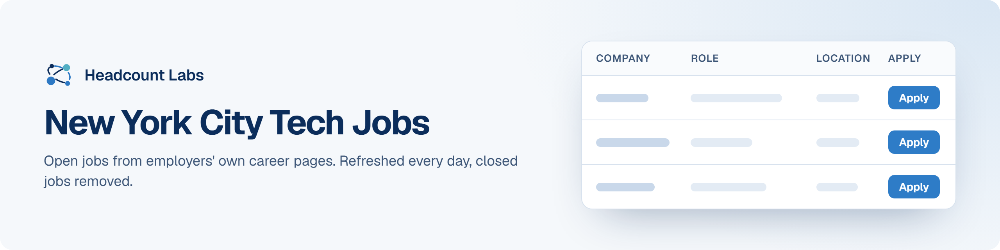

# New York City Tech Jobs

Software, data, AI, product and design jobs in the New York City area, sorted by field.

**400 open jobs** · first published October 18, 2026 at 6:52 PM EDT

This list is built and refreshed every day by [Headcount Labs](https://headcountlabs.com/?utm_source=github&utm_medium=job-list&utm_campaign=new-york-tech-jobs), which reads jobs straight from employers' own career pages and job boards. Every job here was still listed on its source board when we last read that board, within the past 3 days, and was posted in the past 30 days. Copies of the same job are merged into one row, and jobs that close are removed at the next update.

Want this data in your own app or agent? Use the [Headcount Labs jobs API](https://headcountlabs.com/docs/?utm_source=github&utm_medium=job-list&utm_campaign=new-york-tech-jobs) (free tier) or the [open dataset](https://huggingface.co/datasets/HeadcountLabs/job-postings) on Hugging Face.

**Jump to:** [Software engineering (138)](#software-engineering) · [Data, AI and machine learning (128)](#data-ai-and-machine-learning) · [Product and design (128)](#product-and-design) · [Hardware and engineering (6)](#hardware-and-engineering)

**Columns.** *Apply* opens the original posting on the employer's site. *Details* opens the job on Headcount Labs, with every posting we found for it. *Remote* shows what the employer states; a dash means the posting doesn't say. *Pay* is the range the employer published.

## Software engineering

| Company | Role | Location | Remote | Pay | Posted | Apply | Details |
| --- | --- | --- | --- | --- | --- | :---: | :---: |
| **True Talent Solutions Partners** | Senior Software Engineer | New York, NY | On-site | — | Oct 18 |  | <a href="https://headcountlabs.com/catalog/jobs/4a04f97f-907b-4e97-a223-ccf77a385944?utm_source=github&utm_medium=job-list&utm_campaign=new-york-tech-jobs">via Headcount Labs</a> |
| **Fitch Group** | Senior Software Engineer, AI (New York) | New York, NY | — | $140k–$150k/yr | Oct 18 |  | <a href="https://headcountlabs.com/catalog/jobs/b85b84ff-a69d-4781-8b5b-a0d5e4a33560?utm_source=github&utm_medium=job-list&utm_campaign=new-york-tech-jobs">via Headcount Labs</a> |
| **West Monroe** | Director, TechEx, Software Engineering | 

2 locations
New York, NY Chicago
 | — | $200k–$250k/yr | Oct 17 |  | <a href="https://headcountlabs.com/catalog/jobs/ec03cb44-5ce0-440e-aa2a-6b434c33472d?utm_source=github&utm_medium=job-list&utm_campaign=new-york-tech-jobs">via Headcount Labs</a> |
| **True Talent Solutions Partners** | Software Engineer, iOS | New York, NY | On-site | — | Oct 17 |  | <a href="https://headcountlabs.com/catalog/jobs/34c5e4e6-3a4f-444d-bf96-dd0a87d71bb3?utm_source=github&utm_medium=job-list&utm_campaign=new-york-tech-jobs">via Headcount Labs</a> |
| **Stash** | Senior Fullstack Engineer | New York, NY | Hybrid | $170k–$190k/yr | Oct 17 |  | <a href="https://headcountlabs.com/catalog/jobs/55fe1fb0-d247-4114-be1c-8773290ebd80?utm_source=github&utm_medium=job-list&utm_campaign=new-york-tech-jobs">via Headcount Labs</a> |
| **Sandbar** | Senior/Staff Security Engineer | New York City, NY | On-site | $190k–$270k/yr | Oct 17 |  | <a href="https://headcountlabs.com/catalog/jobs/d16db5f5-0b24-4398-b420-3af68e38666d?utm_source=github&utm_medium=job-list&utm_campaign=new-york-tech-jobs">via Headcount Labs</a> |
| **DoorDash** | Staff Software Engineer, Data - Experimentation | 

4 locations
California, CA San Francisco, CA Seattle, WA New York, NY
 | — | $194k–$285k/yr | Oct 17 |  | <a href="https://headcountlabs.com/catalog/jobs/add90fd9-d360-4a59-87cd-1b769aa29129?utm_source=github&utm_medium=job-list&utm_campaign=new-york-tech-jobs">via Headcount Labs</a> |
| **Yext** | Software Engineering Manager | New York, NY | — | $148k–$304k/yr | Oct 16 |  | <a href="https://headcountlabs.com/catalog/jobs/cbcd29ad-6977-4d1c-84eb-796301fbd02d?utm_source=github&utm_medium=job-list&utm_campaign=new-york-tech-jobs">via Headcount Labs</a> |
| **Warner Bros. Discovery** | Staff Product Manager, Developer Experience | 

2 locations
New York, NY United States
 | Hybrid | $133k–$247k/yr | Oct 16 |  | <a href="https://headcountlabs.com/catalog/jobs/ac62576f-4ff4-4328-b76d-566d4387383e?utm_source=github&utm_medium=job-list&utm_campaign=new-york-tech-jobs">via Headcount Labs</a> |
| **Warner Bros. Discovery** | Senior Software Engineer (Advertising Technology - AWS experience required) | 

2 locations
New York, NY United States
 | Hybrid | $132k–$244k/yr | Oct 16 |  | <a href="https://headcountlabs.com/catalog/jobs/0e84be6c-d30c-40cd-abc1-c24aa1ef81f9?utm_source=github&utm_medium=job-list&utm_campaign=new-york-tech-jobs">via Headcount Labs</a> |
| **Warner Bros. Discovery** | Staff Software Engineer | 

2 locations
Bellevue, WA New York, NY
 | Hybrid | $166k–$308k/yr | Oct 16 |  | <a href="https://headcountlabs.com/catalog/jobs/d0fb7aa6-4963-4bf0-b929-a96b6c326698?utm_source=github&utm_medium=job-list&utm_campaign=new-york-tech-jobs">via Headcount Labs</a> |
| **Walt Disney** | Senior Product Software Engineer - Golang | 

2 locations
Glendale, CA New York, NY
 | Hybrid | $144k–$193k/yr | Oct 16 |  | <a href="https://headcountlabs.com/catalog/jobs/cd8f6fc1-0af1-49be-8696-fe2a495b65a0?utm_source=github&utm_medium=job-list&utm_campaign=new-york-tech-jobs">via Headcount Labs</a> |
| **Virta Health** | Senior Software Engineer - Client Lifecycle | 

3 locations
Seattle, WA San Francisco, CA New York, NY
 | Remote | — | Oct 16 |  | <a href="https://headcountlabs.com/catalog/jobs/93755991-fb0f-4d08-9675-b01e91c748a5?utm_source=github&utm_medium=job-list&utm_campaign=new-york-tech-jobs">via Headcount Labs</a> |
| **True Talent Solutions Partners** | Software Engineer | New York, NY | On-site | — | Oct 16 |  | <a href="https://headcountlabs.com/catalog/jobs/b1545570-d2c0-4fd0-af3f-be81eeb81241?utm_source=github&utm_medium=job-list&utm_campaign=new-york-tech-jobs">via Headcount Labs</a> |
| **Syncreon Consulting** | AI Infrastructure Engineer — NVIDIA V100 or A100 | New York, NY | — | — | Oct 16 |  | <a href="https://headcountlabs.com/catalog/jobs/f1e40887-1dca-4895-ac84-dec9bc8e6192?utm_source=github&utm_medium=job-list&utm_campaign=new-york-tech-jobs">via Headcount Labs</a> |
| **SoundCloud** | Senior Enterprise Security Engineer | New York, NY | — | $140k–$170k/yr | Oct 16 |  | <a href="https://headcountlabs.com/catalog/jobs/a2a51581-ef11-4eeb-ba27-858f18699eab?utm_source=github&utm_medium=job-list&utm_campaign=new-york-tech-jobs">via Headcount Labs</a> |
| **Robinhood** | Senior iOS Engineer, Crypto Perpetuals | 

3 locations
Menlo Park, CA New York, NY Toronto
 | — | $196k–$230k/yr | Oct 16 |  | <a href="https://headcountlabs.com/catalog/jobs/14bd5cc8-1306-446f-af2f-458cf8025c69?utm_source=github&utm_medium=job-list&utm_campaign=new-york-tech-jobs">via Headcount Labs</a> |
| **Prove** | Senior Software Engineer - Knowledge Graph | New York, NY | — | $190k–$210k/yr | Oct 16 |  | <a href="https://headcountlabs.com/catalog/jobs/80187db9-af30-4200-b135-4ff14b438944?utm_source=github&utm_medium=job-list&utm_campaign=new-york-tech-jobs">via Headcount Labs</a> |
| **Polymarket** | Staff Backend Engineer | New York, NY | On-site | $250k–$400k/yr | Oct 16 |  | <a href="https://headcountlabs.com/catalog/jobs/c9e5fe9a-4ca3-4dea-a09e-4cafcd9ef4eb?utm_source=github&utm_medium=job-list&utm_campaign=new-york-tech-jobs">via Headcount Labs</a> |
| **Perplexity** | Member of Technical Staff (Software Engineer, Enterprise Trust &amp; Governance) | 

5 locations
San Francisco, CA London Seattle, WA New York City, NY Toronto
 | — | $220k–$405k/yr | Oct 16 |  | <a href="https://headcountlabs.com/catalog/jobs/9af51034-e19c-45a8-a3bc-b3181b033205?utm_source=github&utm_medium=job-list&utm_campaign=new-york-tech-jobs">via Headcount Labs</a> |
| **Perplexity** | Member of Technical Staff (Android Engineer, Computer Growth) | 

2 locations
San Francisco, CA New York City, NY
 | Hybrid | $220k–$405k/yr | Oct 16 |  | <a href="https://headcountlabs.com/catalog/jobs/c864333d-7f75-465b-bed3-aa5a2c6aa633?utm_source=github&utm_medium=job-list&utm_campaign=new-york-tech-jobs">via Headcount Labs</a> |
| **Perplexity** | Member of Technical Staff (iOS Engineer, Computer Growth) | 

2 locations
San Francisco, CA New York City, NY
 | — | $220k–$405k/yr | Oct 16 |  | <a href="https://headcountlabs.com/catalog/jobs/4e04b750-6752-481b-aa18-12a505727dc6?utm_source=github&utm_medium=job-list&utm_campaign=new-york-tech-jobs">via Headcount Labs</a> |
| **Nscale** | Staff Front-End Network Engineer | 

4 locations
New York, NY Houston San Francisco Seattle
 | — | — | Oct 16 |  | <a href="https://headcountlabs.com/catalog/jobs/8d68576e-7739-40a8-b8fd-e322eb30ddc2?utm_source=github&utm_medium=job-list&utm_campaign=new-york-tech-jobs">via Headcount Labs</a> |
| **NBCUniversal** | Sr Software Engineer | New York, NY | Hybrid | $120k–$170k/yr | Oct 16 |  | <a href="https://headcountlabs.com/catalog/jobs/12694c13-5fbe-485d-abf3-b870ae548046?utm_source=github&utm_medium=job-list&utm_campaign=new-york-tech-jobs">via Headcount Labs</a> |
| **MLabs** | Staff Frontend Engineer | New York, NY | On-site | — | Oct 16 |  | <a href="https://headcountlabs.com/catalog/jobs/f6d79171-9baa-44f5-ab30-36617f107c9c?utm_source=github&utm_medium=job-list&utm_campaign=new-york-tech-jobs">via Headcount Labs</a> |
| **MLabs** | Software Engineer | New York, NY | — | — | Oct 16 |  | <a href="https://headcountlabs.com/catalog/jobs/739681bb-58e3-44c4-a453-93d7da2c3426?utm_source=github&utm_medium=job-list&utm_campaign=new-york-tech-jobs">via Headcount Labs</a> |
| **LPL Financial** | AVP, Backend Software Engineer - Python/AWS | 

2 locations
New York, NY Fort Mill, SC
 | Hybrid | $127k–$212k/yr | Oct 16 |  | <a href="https://headcountlabs.com/catalog/jobs/c4928451-5f23-4721-bcda-babb409691e1?utm_source=github&utm_medium=job-list&utm_campaign=new-york-tech-jobs">via Headcount Labs</a> |
| **Latent Defense** | Staff Software Engineer | New York City, NY | Hybrid | — | Oct 16 |  | <a href="https://headcountlabs.com/catalog/jobs/6719e152-5625-46f0-800b-c7f8556c479c?utm_source=github&utm_medium=job-list&utm_campaign=new-york-tech-jobs">via Headcount Labs</a> |
| **Justworks** | Software Engineer, Solutions Engineering | New York, NY | Hybrid | $131k–$169k/yr | Oct 16 |  | <a href="https://headcountlabs.com/catalog/jobs/d125725f-178d-4fa3-b033-37d29a4200e9?utm_source=github&utm_medium=job-list&utm_campaign=new-york-tech-jobs">via Headcount Labs</a> |
| **Justworks** | Senior Software Engineer, Solutions Engineering | New York, NY | Hybrid | $188k–$242k/yr | Oct 16 |  | <a href="https://headcountlabs.com/catalog/jobs/09161374-7944-4ffe-b4ab-43fa34efa2e2?utm_source=github&utm_medium=job-list&utm_campaign=new-york-tech-jobs">via Headcount Labs</a> |
| **Etsy** | Senior Software Engineer I, Public API | Brooklyn, NY | — | $159k–$215k/yr | Oct 16 |  | <a href="https://headcountlabs.com/catalog/jobs/28b4f7f8-6321-46fe-b33e-f23ebf4a284e?utm_source=github&utm_medium=job-list&utm_campaign=new-york-tech-jobs">via Headcount Labs</a> |
| **EngFlow** | Site Reliability Engineer | 

2 locations
New York, NY Austin, TX
 | Remote | — | Oct 16 |  | <a href="https://headcountlabs.com/catalog/jobs/0607f0bb-f9f2-4ce7-be02-1de5a946f241?utm_source=github&utm_medium=job-list&utm_campaign=new-york-tech-jobs">via Headcount Labs</a> |
| **Datadog** | Senior Security Engineer - Platform Trust &amp; Safety | New York, NY | — | $192k–$240k/yr | Oct 16 |  | <a href="https://headcountlabs.com/catalog/jobs/26e944a5-6634-4109-a98a-2436a061047f?utm_source=github&utm_medium=job-list&utm_campaign=new-york-tech-jobs">via Headcount Labs</a> |
| **Datadog** | Senior Software Engineer - Husky Storage | 

2 locations
Boston, MA New York, NY
 | — | $192k–$240k/yr | Oct 16 |  | <a href="https://headcountlabs.com/catalog/jobs/25dc8eba-7486-46f2-a998-e4a5cae31dc0?utm_source=github&utm_medium=job-list&utm_campaign=new-york-tech-jobs">via Headcount Labs</a> |
| **Dashing Diva** | Web Designer | New York, NY | On-site | $80k–$100k/yr | Oct 16 |  | <a href="https://headcountlabs.com/catalog/jobs/caf39b51-322c-4673-9c65-82b54182b4ca?utm_source=github&utm_medium=job-list&utm_campaign=new-york-tech-jobs">via Headcount Labs</a> |
| **Carta** | Senior Software Engineer II, Investors | 

3 locations
Toronto Waterloo New York, NY
 | — | — | Oct 16 |  | <a href="https://headcountlabs.com/catalog/jobs/ea4cc607-b398-4aa6-a199-499b3fd7b0d2?utm_source=github&utm_medium=job-list&utm_campaign=new-york-tech-jobs">via Headcount Labs</a> |
| **Carta** | Staff Software Engineer, Investors | 

3 locations
New York, NY Toronto Waterloo
 | — | $240k–$300k/yr | Oct 16 |  | <a href="https://headcountlabs.com/catalog/jobs/283d73ac-9b0d-43ec-91d3-efd292a09e02?utm_source=github&utm_medium=job-list&utm_campaign=new-york-tech-jobs">via Headcount Labs</a> |
| **Capital One** | Full Stack Engineer 4 | 

6 locations
New York, NY McLean, VA Richmond, VA Chicago, IL Plano, TX San Jose, CA
 | — | $179k–$205k/yr | Oct 16 |  | <a href="https://headcountlabs.com/catalog/jobs/eaa23391-5805-4e8e-9a80-9e96b26efe8d?utm_source=github&utm_medium=job-list&utm_campaign=new-york-tech-jobs">via Headcount Labs</a> |
| **Capital One** | Manager, Cyber Security Product Owner (Cryptography) | 

6 locations
McLean, VA New York, NY Plano, TX Richmond, VA Riverwoods, IL San Jose, CA
 | — | $197k–$225k/yr | Oct 16 |  | <a href="https://headcountlabs.com/catalog/jobs/f9fe74f0-97ae-4078-8479-1c496f8e9f12?utm_source=github&utm_medium=job-list&utm_campaign=new-york-tech-jobs">via Headcount Labs</a> |
| **Capital One** | Senior Director, Product Management - Developer Telemetry | 

6 locations
McLean, VA Chicago, IL New York, NY Plano, TX Richmond, VA San Francisco, CA
 | — | $245k–$280k/yr | Oct 16 |  | <a href="https://headcountlabs.com/catalog/jobs/5e36f8c4-4b54-473f-aea9-15fa9d9b4a13?utm_source=github&utm_medium=job-list&utm_campaign=new-york-tech-jobs">via Headcount Labs</a> |
| **Berry Street** | Senior Software Engineer | New York, NY | On-site | — | Oct 16 |  | <a href="https://headcountlabs.com/catalog/jobs/9e6ceb18-65b3-4e8d-a460-fa21c6d35bc5?utm_source=github&utm_medium=job-list&utm_campaign=new-york-tech-jobs">via Headcount Labs</a> |
| **Bedrock Robotics Inc** | Cloud - Staff Site Reliability Engineer | 

2 locations
New York, NY San Francisco, CA
 | Hybrid | — | Oct 16 |  | <a href="https://headcountlabs.com/catalog/jobs/b3a980eb-d179-45ef-92e3-1ca730bae49f?utm_source=github&utm_medium=job-list&utm_campaign=new-york-tech-jobs">via Headcount Labs</a> |
| **Anthropic** | Staff+ Software Engineer, Enterprise (Full Stack) | San Francisco, CA &#124; New York City, NY | — | $405k–$485k/yr | Oct 16 |  | <a href="https://headcountlabs.com/catalog/jobs/31b85347-eea4-471f-9295-ab90e02515b4?utm_source=github&utm_medium=job-list&utm_campaign=new-york-tech-jobs">via Headcount Labs</a> |
| **We Are Rosie** | Interactive Designer / Creative Developer (Web Animation &amp; Data Viz) | New York, NY | Remote | $80–$95/hr | Oct 15 |  | <a href="https://headcountlabs.com/catalog/jobs/5a725c43-b950-483a-a31f-22c3e5a6e47c?utm_source=github&utm_medium=job-list&utm_campaign=new-york-tech-jobs">via Headcount Labs</a> |
| **Walt Disney** | Sr Product Software Engineer (News Front-End) | New York, NY | Hybrid | $149k–$199k/yr | Oct 15 |  | <a href="https://headcountlabs.com/catalog/jobs/af6ef88e-3ce1-4722-affb-42dff4690e50?utm_source=github&utm_medium=job-list&utm_campaign=new-york-tech-jobs">via Headcount Labs</a> |
| **Truelogic** | Senior DevOps Engineer / Cloud Infrastructure Engineer - Cybersecurity | New York, NY | Remote | — | Oct 15 |  | <a href="https://headcountlabs.com/catalog/jobs/d81a3353-5dce-469c-8060-cf7a16cbfcb0?utm_source=github&utm_medium=job-list&utm_campaign=new-york-tech-jobs">via Headcount Labs</a> |
| **Schonfeld** | Software Engineer | New York, NY | — | $175k–$215k/yr | Oct 15 |  | <a href="https://headcountlabs.com/catalog/jobs/82567309-3d12-42d7-a59b-e4aae533dc51?utm_source=github&utm_medium=job-list&utm_campaign=new-york-tech-jobs">via Headcount Labs</a> |
| **Paramount Field Services, LLC** | Senior Software Engineer | New York, NY | Remote | $124k–$200k/yr | Oct 15 |  | <a href="https://headcountlabs.com/catalog/jobs/577a5ae8-52a5-4f72-930f-5be74fda9892?utm_source=github&utm_medium=job-list&utm_campaign=new-york-tech-jobs">via Headcount Labs</a> |
| **Paramount Field Services, LLC** | Senior Software Engineer (Java) in Test | 

2 locations
Burbank, CA New York, NY
 | — | $110k–$166k/yr | Oct 15 |  | <a href="https://headcountlabs.com/catalog/jobs/f5e6fe76-c244-4d11-98ee-f2c2b4a8d551?utm_source=github&utm_medium=job-list&utm_campaign=new-york-tech-jobs">via Headcount Labs</a> |
| **Paramount Field Services, LLC** | Senior Agentic AI Software Engineer | New York, NY | — | $124k–$186k/yr | Oct 15 |  | <a href="https://headcountlabs.com/catalog/jobs/81077253-4b7e-434d-b475-1dee313451f9?utm_source=github&utm_medium=job-list&utm_campaign=new-york-tech-jobs">via Headcount Labs</a> |
| **Neko Health** | Lead Software Engineer - Medical OS | New York, NY | Hybrid | — | Oct 15 |  | <a href="https://headcountlabs.com/catalog/jobs/ec5aa425-8b4e-4b5a-803a-f39c28f1a208?utm_source=github&utm_medium=job-list&utm_campaign=new-york-tech-jobs">via Headcount Labs</a> |
| **Morgan Stanley** | Lead Software Engineer - Parametric | New York, NY | On-site | $115k–$225k/yr | Oct 15 |  | <a href="https://headcountlabs.com/catalog/jobs/fe8ab933-049a-4926-b69a-b9699aa63bcb?utm_source=github&utm_medium=job-list&utm_campaign=new-york-tech-jobs">via Headcount Labs</a> |
| **Justworks** | Senior Software Engineer, Front End - NY | New York, NY | Hybrid | $188k–$242k/yr | Oct 15 |  | <a href="https://headcountlabs.com/catalog/jobs/d114bdc7-a90e-49fa-8dc0-4cdd4a99b47e?utm_source=github&utm_medium=job-list&utm_campaign=new-york-tech-jobs">via Headcount Labs</a> |
| **Join Our Talent Community** | AfroTech 2026 Technical Program Manager, Software Deployments | 

2 locations
New York, NY Texas
 | Remote | $105k–$198k/yr | Oct 15 |  | <a href="https://headcountlabs.com/catalog/jobs/fc10e253-2235-44f8-ac8a-431126fd3a27?utm_source=github&utm_medium=job-list&utm_campaign=new-york-tech-jobs">via Headcount Labs</a> |
| **Intuit** | Software Engineer 1 | 

5 locations
Mountain View, CA San Diego, CA New York, NY Charlotte, NC Atlanta, GA
 | — | $55.50–$75/hr | Oct 15 |  | <a href="https://headcountlabs.com/catalog/jobs/a9aa2cb3-bc80-4950-b013-8b772e87dd69?utm_source=github&utm_medium=job-list&utm_campaign=new-york-tech-jobs">via Headcount Labs</a> |
| **Intuit** | Software Engineer 2 - Growth Team | New York, NY | — | $136k–$184k/yr | Oct 15 |  | <a href="https://headcountlabs.com/catalog/jobs/3e732f3c-6f54-41d2-b93a-a062fd61af07?utm_source=github&utm_medium=job-list&utm_campaign=new-york-tech-jobs">via Headcount Labs</a> |
| **Humana** | Director, Software Engineering - Platform &amp; Tool Development | New York, NY | Remote | $189k–$260k/yr | Oct 15 |  | <a href="https://headcountlabs.com/catalog/jobs/968523bb-cd5a-4205-a261-effe4403a70c?utm_source=github&utm_medium=job-list&utm_campaign=new-york-tech-jobs">via Headcount Labs</a> |
| **Healthpeak Properties** | Forward Deployed Software Engineer Internship | New York City, NY | On-site | $25/hr | Oct 15 |  | <a href="https://headcountlabs.com/catalog/jobs/dcf645ed-1817-466d-9702-d31db2341f63?utm_source=github&utm_medium=job-list&utm_campaign=new-york-tech-jobs">via Headcount Labs</a> |
| **Gusto, Inc.** | Staff Software Engineer, HR Experience | New York, NY | Hybrid | $197k–$247k/yr | Oct 15 |  | <a href="https://headcountlabs.com/catalog/jobs/513aaf22-421f-4fd1-b1d7-2369b9fe8850?utm_source=github&utm_medium=job-list&utm_campaign=new-york-tech-jobs">via Headcount Labs</a> |
| **Gusto, Inc.** | Senior Staff Software Engineer, Gusto Agent &amp; Partner Experiences (API) | 

3 locations
Denver, CO New York, NY San Francisco, CA
 | Hybrid | $213k–$236k/yr | Oct 15 |  | <a href="https://headcountlabs.com/catalog/jobs/625bc476-6609-45fd-88a9-b27e54967356?utm_source=github&utm_medium=job-list&utm_campaign=new-york-tech-jobs">via Headcount Labs</a> |
| **Gallatin** | Senior Frontend Engineer | 

6 locations
El Segundo, CA Washington, DC Palo Alto, CA San Francisco, CA Austin, TX New York City, NY
 | On-site | $80k–$120k/yr | Oct 15 |  | <a href="https://headcountlabs.com/catalog/jobs/51f9c8a8-3f71-464f-8dc0-4fc37063fcd0?utm_source=github&utm_medium=job-list&utm_campaign=new-york-tech-jobs">via Headcount Labs</a> |
| **Gallatin** | Fullstack Engineer | 

6 locations
El Segundo, CA Washington, DC Palo Alto, CA San Francisco, CA Austin, TX New York City, NY
 | On-site | $80k–$120k/yr | Oct 15 |  | <a href="https://headcountlabs.com/catalog/jobs/4740093a-9224-4c7c-b05f-923a9f6c5b7b?utm_source=github&utm_medium=job-list&utm_campaign=new-york-tech-jobs">via Headcount Labs</a> |
| **FalconX** | Senior Trading Systems DevOps Engineer | New York City, NY | — | $179k–$226k/yr | Oct 15 |  | <a href="https://headcountlabs.com/catalog/jobs/eeade808-042a-4f49-8ecb-ca38c26d01d5?utm_source=github&utm_medium=job-list&utm_campaign=new-york-tech-jobs">via Headcount Labs</a> |
| **ewminds consulting Services** | Senior Full Stack Developer with AI experience | New York, NY | — | — | Oct 15 |  | <a href="https://headcountlabs.com/catalog/jobs/7c8549fd-bca9-4a44-9e26-a175acde0286?utm_source=github&utm_medium=job-list&utm_campaign=new-york-tech-jobs">via Headcount Labs</a> |
| **DV Trading** | Quantitative Software Engineer (DV Commodities) | New York, NY | — | $160k–$190k/yr | Oct 15 |  | <a href="https://headcountlabs.com/catalog/jobs/2825393f-6a44-4f52-b92d-a077929cedd1?utm_source=github&utm_medium=job-list&utm_campaign=new-york-tech-jobs">via Headcount Labs</a> |
| **Datadog** | Senior Security Engineer, Security Incident Response Team | New York, NY | Hybrid | $192k–$240k/yr | Oct 15 |  | <a href="https://headcountlabs.com/catalog/jobs/16fbb19b-bbc7-4fcf-953f-1b05c9ffdca4?utm_source=github&utm_medium=job-list&utm_campaign=new-york-tech-jobs">via Headcount Labs</a> |
| **CrowdStrike** | Sr. Software Engineer II, AI on Sensor – Mac, Linux, or Windows (Hybrid) | 

5 locations
Sunnyvale, CA Toronto Austin, TX New York, NY Redmond, WA
 | Hybrid | $160k–$250k/yr | Oct 15 |  | <a href="https://headcountlabs.com/catalog/jobs/a2b60f07-e49b-440c-9701-2e40b609951a?utm_source=github&utm_medium=job-list&utm_campaign=new-york-tech-jobs">via Headcount Labs</a> |
| **Cohere** | Senior/Staff Software Engineer (Back-End), Inference | 

6 locations
San Francisco, CA United States New York, NY Ottawa Toronto Montreal
 | Remote | $225k–$315k/yr | Oct 15 |  | <a href="https://headcountlabs.com/catalog/jobs/62fa941d-b7ce-42c2-8130-8c95efe0b7f5?utm_source=github&utm_medium=job-list&utm_campaign=new-york-tech-jobs">via Headcount Labs</a> |
| **Bedrock Robotics** | Software Engineer, Fleet Platform | New York, NY | Hybrid | — | Oct 15 |  | <a href="https://headcountlabs.com/catalog/jobs/c9470547-aba1-43bb-a155-ff4cdc30124c?utm_source=github&utm_medium=job-list&utm_campaign=new-york-tech-jobs">via Headcount Labs</a> |
| **American Express** | Director-Software Engineering | New York, NY | Hybrid | $144k–$256k/yr | Oct 15 |  | <a href="https://headcountlabs.com/catalog/jobs/0f7a606d-0d1b-4bdd-80ce-cc1b7fc835be?utm_source=github&utm_medium=job-list&utm_campaign=new-york-tech-jobs">via Headcount Labs</a> |
| **AM Specialty** | Software Developer | New York, NY | On-site | $55–$74.50/hr | Oct 15 |  | <a href="https://headcountlabs.com/catalog/jobs/ca29af79-d1c7-4f07-abdb-f8936756abf3?utm_source=github&utm_medium=job-list&utm_campaign=new-york-tech-jobs">via Headcount Labs</a> |
| **S&amp;P Global** | Software Engineering Lead | 

2 locations
New York, NY Princeton, NJ
 | — | $104k–$174k/yr | Oct 14 |  | <a href="https://headcountlabs.com/catalog/jobs/58ecf6e9-4df5-476f-b14c-6c7bee42c77c?utm_source=github&utm_medium=job-list&utm_campaign=new-york-tech-jobs">via Headcount Labs</a> |
| **Robinhood** | Senior Software Engineer, International | 

3 locations
Menlo Park, CA New York, NY Toronto
 | — | $196k–$230k/yr | Oct 14 |  | <a href="https://headcountlabs.com/catalog/jobs/aa4170ef-f857-4fae-baf8-d257ada86a03?utm_source=github&utm_medium=job-list&utm_campaign=new-york-tech-jobs">via Headcount Labs</a> |
| **Rippling** | Staff Software Engineer - Agent Assist | 

2 locations
San Francisco, CA New York, NY
 | On-site | — | Oct 14 |  | <a href="https://headcountlabs.com/catalog/jobs/5887729d-1b43-4ca1-8db1-be2c72fc86a4?utm_source=github&utm_medium=job-list&utm_campaign=new-york-tech-jobs">via Headcount Labs</a> |
| **Point72** | 2027 Summer Internship – Software Engineer | New York, NY | — | $130k/yr | Oct 14 |  | <a href="https://headcountlabs.com/catalog/jobs/f5c62aef-c52a-411c-a7a0-8878d5602aab?utm_source=github&utm_medium=job-list&utm_campaign=new-york-tech-jobs">via Headcount Labs</a> |
| **Pathstone** | Azure Cloud Engineer | 

4 locations
Bellevue, WA Newtown Square, PA New York, NY San Francisco, CA
 | Hybrid | $105k–$130k/yr | Oct 14 |  | <a href="https://headcountlabs.com/catalog/jobs/dc0aaf2f-6fad-442f-875b-3e2bbb7fa059?utm_source=github&utm_medium=job-list&utm_campaign=new-york-tech-jobs">via Headcount Labs</a> |
| **American Express** | Sr Software Engineer II - GCP, Java/Python - The Personalization, Brand, and Communications Technology | 

2 locations
New York, NY Phoenix, AZ
 | Hybrid | $123k–$215k/yr | Oct 14 |  | <a href="https://headcountlabs.com/catalog/jobs/e71f8d34-0564-47f4-b80b-053e4f0f661b?utm_source=github&utm_medium=job-list&utm_campaign=new-york-tech-jobs">via Headcount Labs</a> |
| **LPL Financial** | VPII, Software Engineering Manager - Digital Experience (web/mobile) | 

2 locations
Fort Mill, SC New York, NY
 | — | $192k–$320k/yr | Oct 13 |  | <a href="https://headcountlabs.com/catalog/jobs/77e893ee-0f0b-4973-9bd5-eae31ab89289?utm_source=github&utm_medium=job-list&utm_campaign=new-york-tech-jobs">via Headcount Labs</a> |
| **LPL Financial** | AVP, Lead Software Engineer – .NET &amp; AWS | 

2 locations
Fort Mill, SC New York, NY
 | Hybrid | $140k–$234k/yr | Oct 13 |  | <a href="https://headcountlabs.com/catalog/jobs/25ae986f-89d3-4868-a754-9e17b9fc4122?utm_source=github&utm_medium=job-list&utm_campaign=new-york-tech-jobs">via Headcount Labs</a> |
| **Justworks** | Associate Software Engineer, Frontend | New York, NY | Hybrid | $109k–$136k/yr | Oct 13 |  | <a href="https://headcountlabs.com/catalog/jobs/0da7adcb-1bcf-4ec5-9117-cd3c922a9043?utm_source=github&utm_medium=job-list&utm_campaign=new-york-tech-jobs">via Headcount Labs</a> |
| **Attentive** | Director, AI Developer Experience | New York, NY | — | $285k–$385k/yr | Oct 13 |  | <a href="https://headcountlabs.com/catalog/jobs/d6115d6c-7bb9-478d-ad4b-fe19e16ecfed?utm_source=github&utm_medium=job-list&utm_campaign=new-york-tech-jobs">via Headcount Labs</a> |
| **02B Federal Reserve Bank of New York** | Software Developer: Java/Calypso/AWS | New York, NY | — | $160k–$210k/yr | Oct 13 |  | <a href="https://headcountlabs.com/catalog/jobs/b282f1c7-c8b3-4562-99f8-1fbeb726b071?utm_source=github&utm_medium=job-list&utm_campaign=new-york-tech-jobs">via Headcount Labs</a> |
| **Walt Disney** | Sr Product Software Engineer (iOS) | 

2 locations
New York, NY Glendale, CA
 | Hybrid | $151k–$202k/yr | Oct 12 |  | <a href="https://headcountlabs.com/catalog/jobs/e5d8fde6-f859-44b0-8a9b-2d03a5c0b2de?utm_source=github&utm_medium=job-list&utm_campaign=new-york-tech-jobs">via Headcount Labs</a> |
| **Walt Disney** | Product Software Engineer II (Roku Engineering) | 

2 locations
New York, NY Glendale, CA
 | Hybrid | $125k–$167k/yr | Oct 12 |  | <a href="https://headcountlabs.com/catalog/jobs/754e72ad-7773-4056-8826-8b97c6eee27d?utm_source=github&utm_medium=job-list&utm_campaign=new-york-tech-jobs">via Headcount Labs</a> |
| **Rippling** | Senior Software Engineer, Security | 

3 locations
New York, NY San Francisco, CA Seattle, WA
 | On-site | — | Oct 12 |  | <a href="https://headcountlabs.com/catalog/jobs/4d048787-53c1-4706-9a3e-e13b68e41b6d?utm_source=github&utm_medium=job-list&utm_campaign=new-york-tech-jobs">via Headcount Labs</a> |
| **LPL Financial** | VP, Software Engineering Lead (.NET/AWS) | 

2 locations
New York, NY Fort Mill, SC
 | — | $171k–$285k/yr | Oct 12 |  | <a href="https://headcountlabs.com/catalog/jobs/88c026ca-b0bf-4320-b4d0-c3e45c1d8265?utm_source=github&utm_medium=job-list&utm_campaign=new-york-tech-jobs">via Headcount Labs</a> |
| **ELITEBRAIN** | Junior Software Engineer – AI Code Evaluation (Remote) | New York, NY | Remote | $150–$200/hr | Oct 12 |  | <a href="https://headcountlabs.com/catalog/jobs/ab4892c3-d5a7-40c0-b489-40bdcabc84a7?utm_source=github&utm_medium=job-list&utm_campaign=new-york-tech-jobs">via Headcount Labs</a> |
| **Walt Disney** | Senior Manager, Software Development Engineer in Test | 

2 locations
Santa Monica, CA New York, NY
 | Hybrid | $174k–$234k/yr | Oct 11 |  | <a href="https://headcountlabs.com/catalog/jobs/5e2b305c-549e-4b7d-875a-704b99acd132?utm_source=github&utm_medium=job-list&utm_campaign=new-york-tech-jobs">via Headcount Labs</a> |
| **Walt Disney** | Senior Product Software Engineer (Swift) | 

3 locations
Glendale, CA New York, NY Seattle, WA
 | On-site | $144k–$193k/yr | Oct 11 |  | <a href="https://headcountlabs.com/catalog/jobs/31017439-68ce-4fd5-9dfd-2527a32df02e?utm_source=github&utm_medium=job-list&utm_campaign=new-york-tech-jobs">via Headcount Labs</a> |
| **Walt Disney** | Principal Software Development Engineer in Test | 

3 locations
New York, NY Glendale, CA Santa Monica, CA
 | Hybrid | $174k–$234k/yr | Oct 11 |  | <a href="https://headcountlabs.com/catalog/jobs/25917947-af98-446d-a31a-3dddebfd0944?utm_source=github&utm_medium=job-list&utm_campaign=new-york-tech-jobs">via Headcount Labs</a> |
| **Scope** | Software Engineer - NY | New York City, NY | Hybrid | $135k–$175k/yr | Oct 11 |  | <a href="https://headcountlabs.com/catalog/jobs/e48cdc77-cf69-400d-841e-789f8c625ecc?utm_source=github&utm_medium=job-list&utm_campaign=new-york-tech-jobs">via Headcount Labs</a> |
| **Robinhood** | Staff Software Engineer, Backend Platform | 

2 locations
New York, NY Toronto
 | — | $230k–$270k/yr | Oct 9 |  | <a href="https://headcountlabs.com/catalog/jobs/ef126dd5-d758-42c0-b5ca-0dd97c4179b6?utm_source=github&utm_medium=job-list&utm_campaign=new-york-tech-jobs">via Headcount Labs</a> |
| **NexHealth** | Senior Software Engineer | 

9 locations
Seattle, WA San Francisco, CA Austin, TX Boston, MA Denver, CO New York, NY Atlanta, GA Raleigh, NC Chicago, IL
 | Remote | $165k–$230k/yr | Oct 9 |  | <a href="https://headcountlabs.com/catalog/jobs/65ab7378-111b-4814-b97a-9957e63cbe47?utm_source=github&utm_medium=job-list&utm_campaign=new-york-tech-jobs">via Headcount Labs</a> |
| **Hearst** | Senior DevOps Engineer II | 

2 locations
New York, NY San Francisco, CA
 | Remote | $133k–$150k/yr | Oct 9 |  | <a href="https://headcountlabs.com/catalog/jobs/055db7a9-ea80-48c0-9261-c4226ab05858?utm_source=github&utm_medium=job-list&utm_campaign=new-york-tech-jobs">via Headcount Labs</a> |
| **Veho** | Senior Software Engineer, Facilties (Android Mobile Experience) | 

2 locations
Boston, MA New York City, NY
 | Hybrid | $170k–$200k/yr | Oct 8 |  | <a href="https://headcountlabs.com/catalog/jobs/f96320f7-af8d-49e3-a5f4-f43d18afcc0b?utm_source=github&utm_medium=job-list&utm_campaign=new-york-tech-jobs">via Headcount Labs</a> |
| **Luma** | Software Engineer, Inference | 

4 locations
Redwood City, CA United States New York, NY Seattle, WA
 | Hybrid | $195k–$345k/yr | Oct 8 |  | <a href="https://headcountlabs.com/catalog/jobs/bd9d0383-66c4-4598-90a6-db2d166f2218?utm_source=github&utm_medium=job-list&utm_campaign=new-york-tech-jobs">via Headcount Labs</a> |
| **LPL Financial** | AVP Tech, Edge Security Engineer | 

5 locations
Fort Mill, SC Austin, TX New York, NY San Diego, CA Tempe, AZ
 | — | $123k–$204k/yr | Oct 8 |  | <a href="https://headcountlabs.com/catalog/jobs/42e35b34-af1e-474c-8bfe-2563e4b747b1?utm_source=github&utm_medium=job-list&utm_campaign=new-york-tech-jobs">via Headcount Labs</a> |
| **S&amp;P Global** | Lead, Java Software Engineer | 

2 locations
New York, NY Princeton, NJ
 | — | $120k–$150k/yr | Oct 7 |  | <a href="https://headcountlabs.com/catalog/jobs/2c5a3340-bdd8-404a-90f7-9b647ffd4a19?utm_source=github&utm_medium=job-list&utm_campaign=new-york-tech-jobs">via Headcount Labs</a> |
| **Dow Jones** | Summer 2027 Internship Program – Software Engineering Intern | NEW YORK, NY | On-site | $28/hr | Oct 7 |  | <a href="https://headcountlabs.com/catalog/jobs/d9397617-6b4e-4cb6-bb1e-0364d568fa44?utm_source=github&utm_medium=job-list&utm_campaign=new-york-tech-jobs">via Headcount Labs</a> |
| **CrowdStrike** | Sr. Software Engineer - Cloud - Risk Analytics (Hybrid) | New York, NY | Hybrid | $140k–$215k/yr | Oct 7 |  | <a href="https://headcountlabs.com/catalog/jobs/8ecd9707-ec8a-4aea-bb85-062efd641ea9?utm_source=github&utm_medium=job-list&utm_campaign=new-york-tech-jobs">via Headcount Labs</a> |
| **CrowdStrike** | Sr. Software Engineer II - Cloud Detection Engine (Hybrid) | New York, NY | Hybrid | $160k–$250k/yr | Oct 7 |  | <a href="https://headcountlabs.com/catalog/jobs/fe58f37b-6b29-4f89-b7e2-6ed303b06d05?utm_source=github&utm_medium=job-list&utm_campaign=new-york-tech-jobs">via Headcount Labs</a> |
| **Continuum Resource Network** | Forward Deployed Engineer/Customer-Facing Software Engineer | 

2 locations
New York, NY San Francisco, CA
 | Hybrid | — | Oct 7 |  | <a href="https://headcountlabs.com/catalog/jobs/fb917e47-37b6-4b8f-badc-b183d86fbd7c?utm_source=github&utm_medium=job-list&utm_campaign=new-york-tech-jobs">via Headcount Labs</a> |
| **Blink Health** | Senior Software Engineer | New York, NY | — | — | Oct 7 |  | <a href="https://headcountlabs.com/catalog/jobs/0f15b30a-518d-432a-88d6-c21efbf35f51?utm_source=github&utm_medium=job-list&utm_campaign=new-york-tech-jobs">via Headcount Labs</a> |
| **ServiceNow** | Sr Staff Software Engineer | New York, NY | Remote | $191k–$298k/yr | Oct 6 |  | <a href="https://headcountlabs.com/catalog/jobs/fd03306f-46e4-45ee-b888-1124b32aeb5f?utm_source=github&utm_medium=job-list&utm_campaign=new-york-tech-jobs">via Headcount Labs</a> |
| **Scribd** | Staff Cloud Security Engineer | 

11 locations
San Francisco, CA Toronto Los Angeles, CA Denver, CO Chicago, IL New York City, NY Vancouver Seattle, WA Austin, TX Boston, MA Dallas, TX
 | — | — | Oct 6 |  | <a href="https://headcountlabs.com/catalog/jobs/f706c7f3-86ca-4993-b3d1-e0b22d8a5667?utm_source=github&utm_medium=job-list&utm_campaign=new-york-tech-jobs">via Headcount Labs</a> |
| **S&amp;P Global** | Head of Developer Experience | New York, NY | — | $220k–$350k/yr | Oct 6 |  | <a href="https://headcountlabs.com/catalog/jobs/1241eba3-1569-4b1c-acc8-6317696ad326?utm_source=github&utm_medium=job-list&utm_campaign=new-york-tech-jobs">via Headcount Labs</a> |
| **Principal Financial Group** | Equity Analyst, Software | 

4 locations
New York, NY Denver, CO Des Moines, IA Seattle, WA
 | — | $141k–$243k/yr | Oct 6 |  | <a href="https://headcountlabs.com/catalog/jobs/d9dbd2e2-6c60-4a4e-9d51-2ec5a99569ef?utm_source=github&utm_medium=job-list&utm_campaign=new-york-tech-jobs">via Headcount Labs</a> |
| **Join Our Talent Community** | 2026 AfroTech Software Product Manager | 

2 locations
New York, NY Seattle, WA
 | Hybrid | $162k–$259k/yr | Oct 6 |  | <a href="https://headcountlabs.com/catalog/jobs/8463f7a5-6f87-4977-9b9e-9878dbe63c0e?utm_source=github&utm_medium=job-list&utm_campaign=new-york-tech-jobs">via Headcount Labs</a> |
| **Intuit** | Staff Software Engineer - FE | New York, NY | — | $202k–$274k/yr | Oct 6 |  | <a href="https://headcountlabs.com/catalog/jobs/5994b55f-c98e-4f25-b9fd-bf88194917d4?utm_source=github&utm_medium=job-list&utm_campaign=new-york-tech-jobs">via Headcount Labs</a> |
| **Fastly** | Senior Security Engineer - Detection Engineering | 

3 locations
Denver, CO New York City, NY San Francisco, CA
 | — | $168k–$201k/yr | Oct 6 |  | <a href="https://headcountlabs.com/catalog/jobs/a3147768-2cf3-407f-96ff-fe66a9694a26?utm_source=github&utm_medium=job-list&utm_campaign=new-york-tech-jobs">via Headcount Labs</a> |
| **Fanatics Inc.** | Software Engineering Manager (REMOTE) | New York, NY | Remote | $144k–$235k/yr | Oct 6 |  | <a href="https://headcountlabs.com/catalog/jobs/5c02c5bd-a0f7-4a9c-bc0f-52272847fab0?utm_source=github&utm_medium=job-list&utm_campaign=new-york-tech-jobs">via Headcount Labs</a> |
| **Fanatics Betting &amp; Gaming** | Staff Engineer - Backend/Kotlin (REMOTE) | New York, NY | Remote | $144k–$235k/yr | Oct 6 |  | <a href="https://headcountlabs.com/catalog/jobs/48d1bc61-a428-4940-b5b9-4cd6e11c457f?utm_source=github&utm_medium=job-list&utm_campaign=new-york-tech-jobs">via Headcount Labs</a> |
| **Fanatics Betting &amp; Gaming** | Senior Software Engineer - Backend/Kotlin (REMOTE) | New York, NY | Remote | $121k–$200k/yr | Oct 6 |  | <a href="https://headcountlabs.com/catalog/jobs/1d67c278-d299-4d6f-8f00-7bb67fc32537?utm_source=github&utm_medium=job-list&utm_campaign=new-york-tech-jobs">via Headcount Labs</a> |
| **Fanatics Betting &amp; Gaming** | Software Engineering Manager (REMOTE) | New York, NY | Remote | $144k–$235k/yr | Oct 6 |  | <a href="https://headcountlabs.com/catalog/jobs/1fe9a7db-cad6-47b0-9b25-7b30536b30c3?utm_source=github&utm_medium=job-list&utm_campaign=new-york-tech-jobs">via Headcount Labs</a> |
| **Dow Jones** | Software Engineer - Data Architecture &amp; Platform Engineering | NEW YORK, NY | Hybrid | $95k–$125k/yr | Oct 6 |  | <a href="https://headcountlabs.com/catalog/jobs/09b94e05-b730-4ad6-97f5-24a2f31820c6?utm_source=github&utm_medium=job-list&utm_campaign=new-york-tech-jobs">via Headcount Labs</a> |
| **Distributed Spectrum** | Senior Software Engineer, Backend Systems | New York City, NY | On-site | $180k–$220k/yr | Oct 6 |  | <a href="https://headcountlabs.com/catalog/jobs/6f7d0065-3844-4173-9f3c-1bd57fb15e6e?utm_source=github&utm_medium=job-list&utm_campaign=new-york-tech-jobs">via Headcount Labs</a> |
| **Circle** | Staff Software Engineer | 

13 locations
United States San Francisco, CA Atlanta, GA Austin, TX Boston, MA Chicago, IL Los Angeles, CA Miami, FL New York, NY Phoenix, AZ Salt Lake City, UT Seattle, WA +1 more
 | Remote | $195k–$258k/yr | Oct 6 |  | <a href="https://headcountlabs.com/catalog/jobs/5e32ee1b-c2d9-4202-abfe-de019c88e512?utm_source=github&utm_medium=job-list&utm_campaign=new-york-tech-jobs">via Headcount Labs</a> |
| **AngelList** | Lead Infrastructure Security Engineer | 

2 locations
San Francisco, CA New York City, NY
 | Hybrid | $240k/yr | Oct 6 |  | <a href="https://headcountlabs.com/catalog/jobs/606937e8-4fdc-4362-b5e6-b418cbb625cf?utm_source=github&utm_medium=job-list&utm_campaign=new-york-tech-jobs">via Headcount Labs</a> |
| **Affirm** | Software Engineer, Early Career (NYC) | New York, NY | — | — | Oct 6 |  | <a href="https://headcountlabs.com/catalog/jobs/44a20715-e1f5-4a99-98e1-57ee27ef804c?utm_source=github&utm_medium=job-list&utm_campaign=new-york-tech-jobs">via Headcount Labs</a> |
| **Jefferies** | Senior Java Developer - Fixed Income ETrading | New York, NY | On-site | $175k–$225k/yr | Oct 5 |  | <a href="https://headcountlabs.com/catalog/jobs/187fbbed-ddb3-49c6-9098-123f70afd20b?utm_source=github&utm_medium=job-list&utm_campaign=new-york-tech-jobs">via Headcount Labs</a> |
| **Intuit** | Staff Software Engineer | New York, NY | — | $202k–$274k/yr | Oct 5 |  | <a href="https://headcountlabs.com/catalog/jobs/c5d18d9e-e261-42e2-93e9-16e0b3c18571?utm_source=github&utm_medium=job-list&utm_campaign=new-york-tech-jobs">via Headcount Labs</a> |
| **FEDERAL RESERVE BANK OF SAN FRANCISCO** | Lead Site Reliability Engineer | 

11 locations
San Francisco, CA Atlanta, GA Boston, MA Charlotte, NC Chicago, IL Cleveland, OH Dallas, TX Minneapolis, MN New York, NY Richmond, VA Saint Louis, MO
 | — | $147k–$234k/yr | Oct 5 |  | <a href="https://headcountlabs.com/catalog/jobs/283fd61b-f98a-4203-a680-54d622bb4699?utm_source=github&utm_medium=job-list&utm_campaign=new-york-tech-jobs">via Headcount Labs</a> |
| **CrowdStrike** | Sr. Site Reliability Engineer - Core Platform &amp; Embedded Reliability (Hybrid) | 

4 locations
New York, NY Austin, TX Redmond, WA Sunnyvale, CA
 | Hybrid | $140k–$215k/yr | Oct 5 |  | <a href="https://headcountlabs.com/catalog/jobs/3db9f5a8-d56d-44e1-9124-36a941ce5804?utm_source=github&utm_medium=job-list&utm_campaign=new-york-tech-jobs">via Headcount Labs</a> |
| **24-MAG** | Remote &#124; Senior Software Engineer – LLM Evaluation (US/Canada/WEU based) | New York, NY | Remote | — | Oct 5 |  | <a href="https://headcountlabs.com/catalog/jobs/e3695e6f-6bb1-4137-8dac-fc0782969b19?utm_source=github&utm_medium=job-list&utm_campaign=new-york-tech-jobs">via Headcount Labs</a> |
| **24-MAG** | Remote &#124; Senior Software Engineer – LLM Evaluation &amp; Repository Validation | New York, NY | Remote | — | Oct 5 |  | <a href="https://headcountlabs.com/catalog/jobs/d80538ac-018f-4e7b-9c9f-a5e73d8e3772?utm_source=github&utm_medium=job-list&utm_campaign=new-york-tech-jobs">via Headcount Labs</a> |
| **24-MAG** | Remote &#124; Senior Software Engineer – LLM Evaluation | New York, NY | Remote | — | Oct 5 |  | <a href="https://headcountlabs.com/catalog/jobs/7b3ae445-57a9-42f1-a1a6-daf402407734?utm_source=github&utm_medium=job-list&utm_campaign=new-york-tech-jobs">via Headcount Labs</a> |
| **24-MAG** | Remote &#124; Software Engineer — $30–$100/hour | New York, NY | Remote | $30–$100/hr | Oct 5 |  | <a href="https://headcountlabs.com/catalog/jobs/e283105e-9b6b-47c9-80bc-8f57fcb9ec3b?utm_source=github&utm_medium=job-list&utm_campaign=new-york-tech-jobs">via Headcount Labs</a> |
| **24-MAG** | Remote &#124; Senior Software Engineer — $100–$150/hour | New York, NY | Remote | $100–$150/hr | Oct 4 |  | <a href="https://headcountlabs.com/catalog/jobs/6dd42185-af90-4179-9252-f24631e4a7c0?utm_source=github&utm_medium=job-list&utm_campaign=new-york-tech-jobs">via Headcount Labs</a> |
| **Ro** | Staff Software Engineer/Tech Lead, Patient Experience | New York, NY | Hybrid | $223k–$311k/yr | Oct 2 |  | <a href="https://headcountlabs.com/catalog/jobs/8d47dabe-be15-4ef6-869b-87a978a62bca?utm_source=github&utm_medium=job-list&utm_campaign=new-york-tech-jobs">via Headcount Labs</a> |
| **LiveRamp** | Staff Site Reliability Engineer | 

3 locations
San Francisco, CA New York, NY Seattle, WA
 | Hybrid | — | Oct 2 |  | <a href="https://headcountlabs.com/catalog/jobs/76d06527-21ae-429f-b394-1d370956583d?utm_source=github&utm_medium=job-list&utm_campaign=new-york-tech-jobs">via Headcount Labs</a> |
| **LiveRamp** | Co-Op, DevOps Engineer | 

3 locations
San Francisco, CA New York, NY Seattle, WA
 | Hybrid | — | Oct 2 |  | <a href="https://headcountlabs.com/catalog/jobs/f7f59506-4cce-41bb-a54e-51a405cf6a6f?utm_source=github&utm_medium=job-list&utm_campaign=new-york-tech-jobs">via Headcount Labs</a> |
| **Justworks** | Senior Software Engineer, Frontend | New York, NY | Hybrid | $188k–$242k/yr | Oct 2 |  | <a href="https://headcountlabs.com/catalog/jobs/56160dcd-6acf-4c26-8cea-36671629cd58?utm_source=github&utm_medium=job-list&utm_campaign=new-york-tech-jobs">via Headcount Labs</a> |
| **Harvey** | Software Engineering Intern (Summer 2027) | New York, NY | Hybrid | $62–$72/hr | Oct 2 |  | <a href="https://headcountlabs.com/catalog/jobs/b8c3efec-03cc-4780-85fc-f4ec71dc66b3?utm_source=github&utm_medium=job-list&utm_campaign=new-york-tech-jobs">via Headcount Labs</a> |
| **10J Federal Reserve Bank of Kansas City** | CADRE Data/Software Engineer | 

15 locations
Kansas City, MO Atlanta, GA Boston, MA Chicago, IL Cleveland, OH Dallas, TX Denver, CO Minneapolis, MN New York, NY Oklahoma City, OK Omaha, NE Philadelphia, PA +3 more
 | — | $114k–$162k/yr | Oct 2 |  | <a href="https://headcountlabs.com/catalog/jobs/a6f0b386-b49b-4aa5-9c87-5431418a6d24?utm_source=github&utm_medium=job-list&utm_campaign=new-york-tech-jobs">via Headcount Labs</a> |
| **Polimorphic** | Full Stack Engineer | New York City, NY | On-site | $165k–$185k/yr | Oct 1 |  | <a href="https://headcountlabs.com/catalog/jobs/e17398b8-3a42-43ba-82b7-bab5d8d112ad?utm_source=github&utm_medium=job-list&utm_campaign=new-york-tech-jobs">via Headcount Labs</a> |
| **Notion** | Software Engineer, Mobile Platform (iOS) | 

2 locations
San Francisco, CA New York, NY
 | Hybrid | — | Oct 1 |  | <a href="https://headcountlabs.com/catalog/jobs/e6d89fff-4d29-4fc7-8038-0dee5b43cf56?utm_source=github&utm_medium=job-list&utm_campaign=new-york-tech-jobs">via Headcount Labs</a> |
| **LiveRamp** | Staff Backend Software Engineer - Activations | 

4 locations
San Francisco, CA Little Rock, AR New York, NY Seattle, WA
 | Hybrid | — | Oct 1 |  | <a href="https://headcountlabs.com/catalog/jobs/562da7f6-642d-4e03-95a2-48e63b039f76?utm_source=github&utm_medium=job-list&utm_campaign=new-york-tech-jobs">via Headcount Labs</a> |
| **Axon** | 2026 AfroTech Software Engineer | 

5 locations
Boston, MA New York, NY Scottsdale, AZ Seattle, WA Sterling, VA
 | Hybrid | $106k–$238k/yr | Oct 1 |  | <a href="https://headcountlabs.com/catalog/jobs/00824d7e-c965-41b7-a4b0-a8183f37968c?utm_source=github&utm_medium=job-list&utm_campaign=new-york-tech-jobs">via Headcount Labs</a> |

## Data, AI and machine learning

| Company | Role | Location | Remote | Pay | Posted | Apply | Details |
| --- | --- | --- | --- | --- | --- | :---: | :---: |
| **True Talent Solutions Partners** | Senior Product Manager, AI Education | New York, NY | On-site | — | Oct 17 |  | <a href="https://headcountlabs.com/catalog/jobs/8efa7d7f-0300-4409-979e-ff9db97094d1?utm_source=github&utm_medium=job-list&utm_campaign=new-york-tech-jobs">via Headcount Labs</a> |
| **Lyft** | Data Analyst | New York, NY | Hybrid | $140k–$190k/yr | Oct 17 |  | <a href="https://headcountlabs.com/catalog/jobs/6a8312b8-7b3f-4987-b0ea-7e67a876fa64?utm_source=github&utm_medium=job-list&utm_campaign=new-york-tech-jobs">via Headcount Labs</a> |
| **Lyft** | Data Scientist | New York, NY | Hybrid | $148k–$222k/yr | Oct 17 |  | <a href="https://headcountlabs.com/catalog/jobs/372570cd-15b1-4815-a0ee-1a285ca0f571?utm_source=github&utm_medium=job-list&utm_campaign=new-york-tech-jobs">via Headcount Labs</a> |
| **Eulerity** | AI Intern - Office of CEO &amp; Head of Product | New York, NY | On-site | $18–$20/hr | Oct 17 |  | <a href="https://headcountlabs.com/catalog/jobs/45253f01-e885-4692-8f28-2dbc7ab1de8d?utm_source=github&utm_medium=job-list&utm_campaign=new-york-tech-jobs">via Headcount Labs</a> |
| **Workana** | Clinical Data Scientist - Digital Twins &amp; AI/ML | 

5 locations
Indianapolis, IN New York, NY Indiana Ohio United States
 | Remote | — | Oct 16 |  | <a href="https://headcountlabs.com/catalog/jobs/268325a1-f52f-419e-bbaa-8feb28cfd307?utm_source=github&utm_medium=job-list&utm_campaign=new-york-tech-jobs">via Headcount Labs</a> |
| **Watershed** | Sustainability data advisor, fixed-term (US) | 

2 locations
San Francisco, CA New York City, NY
 | Hybrid | $118k/yr | Oct 16 |  | <a href="https://headcountlabs.com/catalog/jobs/8ba60756-1148-4178-b0a5-fdc5eb1b01f6?utm_source=github&utm_medium=job-list&utm_campaign=new-york-tech-jobs">via Headcount Labs</a> |
| **Twenty** | Staff Product Manager, Data &amp; Platform Infrastructure | New York, NY | On-site | $184k–$225k/yr | Oct 16 |  | <a href="https://headcountlabs.com/catalog/jobs/3f47085d-517a-40ad-9ab0-1d7a2be57bfd?utm_source=github&utm_medium=job-list&utm_campaign=new-york-tech-jobs">via Headcount Labs</a> |
| **SeatGeek** | Senior Data Analyst, Supply | New York, NY | — | $108k–$157k/yr | Oct 16 |  | <a href="https://headcountlabs.com/catalog/jobs/a426fb92-41a7-4639-b50a-c711a95fadd5?utm_source=github&utm_medium=job-list&utm_campaign=new-york-tech-jobs">via Headcount Labs</a> |
| **Scribd, Inc.** | Lead Analytics Engineer, AI Native Self Service Analytics | 

11 locations
San Francisco, CA Toronto Los Angeles, CA Denver, CO Chicago, IL New York City, NY Vancouver Seattle, WA Austin, TX Boston, MA Dallas, TX
 | — | — | Oct 16 |  | <a href="https://headcountlabs.com/catalog/jobs/7906482c-5cb7-419d-b354-db61cb0dbeb6?utm_source=github&utm_medium=job-list&utm_campaign=new-york-tech-jobs">via Headcount Labs</a> |
| **Scribd, Inc.** | Lead Analytics Engineer — Payments, Identity &amp; Trust and Safety | 

11 locations
San Francisco, CA Toronto Los Angeles, CA Denver, CO Chicago, IL New York City, NY Vancouver Seattle, WA Austin, TX Boston, MA Dallas, TX
 | — | — | Oct 16 |  | <a href="https://headcountlabs.com/catalog/jobs/535cc226-ff87-45da-94d7-085537f13291?utm_source=github&utm_medium=job-list&utm_campaign=new-york-tech-jobs">via Headcount Labs</a> |
| **RM Staffing B.V.** | Data Center Technician - United States of America | 

17 locations
Richmond, VA Ashburn, VA Charleston WV, WV Manassas, VA Reston, VA Sterling, VA Chantilly, VA Herndon, VA New York City, NY Newark, NJ Jersey City, NJ Piscataway, NJ +5 more
 | On-site | — | Oct 16 |  | <a href="https://headcountlabs.com/catalog/jobs/98af8eb5-703c-4327-95c6-cc2ebf53ce69?utm_source=github&utm_medium=job-list&utm_campaign=new-york-tech-jobs">via Headcount Labs</a> |
| **Reflection** | Human Data Strategist | 

2 locations
New York, NY San Francisco, CA
 | On-site | — | Oct 16 |  | <a href="https://headcountlabs.com/catalog/jobs/eec607fe-ef5f-40b6-a5a1-d2fa64a77de0?utm_source=github&utm_medium=job-list&utm_campaign=new-york-tech-jobs">via Headcount Labs</a> |
| **Publicis Groupe Holdings B.V** | EVP, Data &amp; Analytics | New York, NY | — | $260k–$340k/yr | Oct 16 |  | <a href="https://headcountlabs.com/catalog/jobs/462f7f61-9b32-4a6a-8a5d-4502c0f72c20?utm_source=github&utm_medium=job-list&utm_campaign=new-york-tech-jobs">via Headcount Labs</a> |
| **Publicis Groupe Holdings B.V** | Vice President, Data Science | New York, NY | — | $168k–$220k/yr | Oct 16 |  | <a href="https://headcountlabs.com/catalog/jobs/4f349144-84ed-49f0-962a-ce7487d87748?utm_source=github&utm_medium=job-list&utm_campaign=new-york-tech-jobs">via Headcount Labs</a> |
| **PDT Partners** | Data Strategist | New York, NY | Hybrid | $180k–$250k/yr | Oct 16 |  | <a href="https://headcountlabs.com/catalog/jobs/caf31c43-9e98-415a-a05e-e75cd1c8a26f?utm_source=github&utm_medium=job-list&utm_campaign=new-york-tech-jobs">via Headcount Labs</a> |
| **NBCUniversal** | Sr. Data Engineer | New York, NY | Hybrid | $115k–$145k/yr | Oct 16 |  | <a href="https://headcountlabs.com/catalog/jobs/66bc0fbc-a81e-4889-aadc-060515d099e6?utm_source=github&utm_medium=job-list&utm_campaign=new-york-tech-jobs">via Headcount Labs</a> |
| **Morgan Stanley** | Machine Learning, Vice President | 

2 locations
New York, NY New York
 | On-site | $115k–$190k/yr | Oct 16 |  | <a href="https://headcountlabs.com/catalog/jobs/7283b31c-f325-415f-8395-dc2a11bb7b02?utm_source=github&utm_medium=job-list&utm_campaign=new-york-tech-jobs">via Headcount Labs</a> |
| **Morgan Stanley** | Machine Learning, Assistant Vice President | 

2 locations
New York New York, NY
 | On-site | $85k–$140k/yr | Oct 16 |  | <a href="https://headcountlabs.com/catalog/jobs/0a510ded-fc7e-4b11-b6f7-542d81a46831?utm_source=github&utm_medium=job-list&utm_campaign=new-york-tech-jobs">via Headcount Labs</a> |
| **MLabs** | Senior ML Engineer | New York, NY | On-site | — | Oct 16 |  | <a href="https://headcountlabs.com/catalog/jobs/f8041235-c107-4a40-84ef-5b978e4c3bf7?utm_source=github&utm_medium=job-list&utm_campaign=new-york-tech-jobs">via Headcount Labs</a> |
| **MEDPACK LLC** | Data Entry Technician | Brooklyn, NY | On-site | — | Oct 16 |  | <a href="https://headcountlabs.com/catalog/jobs/b827773e-a3ed-4a63-8720-37e88dbf9041?utm_source=github&utm_medium=job-list&utm_campaign=new-york-tech-jobs">via Headcount Labs</a> |
| **KKR** | Associate, Data Engineer | New York, NY | — | $145k–$165k/yr | Oct 16 |  | <a href="https://headcountlabs.com/catalog/jobs/992dcd3e-0f80-4c15-b3fe-b9170af9be63?utm_source=github&utm_medium=job-list&utm_campaign=new-york-tech-jobs">via Headcount Labs</a> |
| **Headway** | Senior Data Scientist | 

3 locations
New York, NY San Francisco, CA Seattle, WA
 | Hybrid | $180k–$225k/yr | Oct 16 |  | <a href="https://headcountlabs.com/catalog/jobs/81c66743-29c8-4e9b-a9e9-277776b57603?utm_source=github&utm_medium=job-list&utm_campaign=new-york-tech-jobs">via Headcount Labs</a> |
| **Gen II Fund Services** | Head of AI, Data &amp; Process &amp; Transformation | New York, NY | — | $260k–$300k/yr | Oct 16 |  | <a href="https://headcountlabs.com/catalog/jobs/1be64e49-b145-44e5-be1a-629163e39b4c?utm_source=github&utm_medium=job-list&utm_campaign=new-york-tech-jobs">via Headcount Labs</a> |
| **Gen II** | Head of AI, Data &amp; Process &amp; Transformation | New York, NY | — | $260k–$300k/yr | Oct 16 |  | <a href="https://headcountlabs.com/catalog/jobs/9ab88791-22cb-47d6-8a91-e3d742ecf72e?utm_source=github&utm_medium=job-list&utm_campaign=new-york-tech-jobs">via Headcount Labs</a> |
| **Eulerity** | Product Marketing Intern - AI &amp; Automation | New York, NY | — | $18–$20/hr | Oct 16 |  | <a href="https://headcountlabs.com/catalog/jobs/b120dac2-8abc-4575-9133-7afe62274cc6?utm_source=github&utm_medium=job-list&utm_campaign=new-york-tech-jobs">via Headcount Labs</a> |
| **Crowe Advisory LLC** | Senior Data Architect - Associate Director | 

40 locations
Indianapolis United States Indianapolis, IN Atlanta, GA Austin, TX Boca Raton, FL Boston, MA Burlington, VT Charlotte, NC Chicago, IL Cleveland, OH Columbus, OH +28 more
 | On-site | $151k–$319k/yr | Oct 16 |  | <a href="https://headcountlabs.com/catalog/jobs/f17227ea-1add-4d8e-aa25-e598711e1c01?utm_source=github&utm_medium=job-list&utm_campaign=new-york-tech-jobs">via Headcount Labs</a> |
| **Cravath, Swaine &amp; Moore LLP** | Information Governance Data Analyst | New York, NY | — | $95k–$115k/yr | Oct 16 |  | <a href="https://headcountlabs.com/catalog/jobs/b45bdd88-97c2-4288-827c-0804f8b356c2?utm_source=github&utm_medium=job-list&utm_campaign=new-york-tech-jobs">via Headcount Labs</a> |
| **Comcast** | Lead Data Scientist - NYC - Hybrid - Freewheel | New York, NY | Hybrid | $165k–$247k/yr | Oct 16 |  | <a href="https://headcountlabs.com/catalog/jobs/92a2a960-98af-462c-b3f2-6e2903c2fd4e?utm_source=github&utm_medium=job-list&utm_campaign=new-york-tech-jobs">via Headcount Labs</a> |
| **Cloaked** | Analytics Engineer, Semantic Layer | New York, NY | Hybrid | $160k–$180k/yr | Oct 16 |  | <a href="https://headcountlabs.com/catalog/jobs/90d20fb0-ceb3-4fbe-84c5-73a715ab77d1?utm_source=github&utm_medium=job-list&utm_campaign=new-york-tech-jobs">via Headcount Labs</a> |
| **Citi** | MarTech Data Engineering &amp; Application Lead, Vice President | New York, NY | Remote | $142k–$213k/yr | Oct 16 |  | <a href="https://headcountlabs.com/catalog/jobs/bc9192ee-49ed-4e3b-8e4b-142c5c4a7551?utm_source=github&utm_medium=job-list&utm_campaign=new-york-tech-jobs">via Headcount Labs</a> |
| **Capital One** | AI Engineer 5 (Gen AI SDK: Agentic AI, Guardrails, Evaluation) | 

5 locations
New York, NY Cambridge, MA McLean, VA San Francisco, CA San Jose, CA
 | — | $230k–$262k/yr | Oct 16 |  | <a href="https://headcountlabs.com/catalog/jobs/ebae6700-ccb5-4bcc-aa58-3c505a999caa?utm_source=github&utm_medium=job-list&utm_campaign=new-york-tech-jobs">via Headcount Labs</a> |
| **Capital One** | AI Engineer 5 (MLX, Agentic AI, Gen AI platform Services) | 

5 locations
San Jose, CA Cambridge, MA McLean, VA New York, NY San Francisco, CA
 | — | $230k–$262k/yr | Oct 16 |  | <a href="https://headcountlabs.com/catalog/jobs/7ce35e7f-9c10-4a06-bbf7-31931f4baffa?utm_source=github&utm_medium=job-list&utm_campaign=new-york-tech-jobs">via Headcount Labs</a> |
| **Capital One** | Manager, Product Management - Data Infrastructure for Collections Platform | 

2 locations
McLean, VA New York, NY
 | Hybrid | $165k–$188k/yr | Oct 16 |  | <a href="https://headcountlabs.com/catalog/jobs/24862b00-fad7-423d-98a7-b0a73e9526f9?utm_source=github&utm_medium=job-list&utm_campaign=new-york-tech-jobs">via Headcount Labs</a> |
| **Capital One** | Manager, Product Management – Customer Resiliency Data Platform (US Card) | 

4 locations
McLean, VA Chicago, IL New York, NY Richmond, VA
 | Hybrid | $150k–$171k/yr | Oct 16 |  | <a href="https://headcountlabs.com/catalog/jobs/c729d081-ca0f-4d5a-b1e1-9456cdcbe5df?utm_source=github&utm_medium=job-list&utm_campaign=new-york-tech-jobs">via Headcount Labs</a> |
| **Berkshire Hathaway GUARD Insurance Companies** | Data Engineer | 

4 locations
Plano, TX Scottsdale, AZ New York, NY Wilkes Barre, PA
 | — | $100k–$140k/yr | Oct 16 |  | <a href="https://headcountlabs.com/catalog/jobs/969a2191-d888-4844-8705-a5b337bfc859?utm_source=github&utm_medium=job-list&utm_campaign=new-york-tech-jobs">via Headcount Labs</a> |
| **Amalgamated Financial Corp.** | Senior AI Engineer | New York, NY | — | $170k–$200k/yr | Oct 16 |  | <a href="https://headcountlabs.com/catalog/jobs/9af115a8-deb2-4600-857b-cb818e842a6b?utm_source=github&utm_medium=job-list&utm_campaign=new-york-tech-jobs">via Headcount Labs</a> |
| **Amalgamated Financial Corp.** | AI Engineer | New York, NY | — | $105k–$120k/yr | Oct 16 |  | <a href="https://headcountlabs.com/catalog/jobs/8827db95-933a-4c69-8db4-b2254841caac?utm_source=github&utm_medium=job-list&utm_campaign=new-york-tech-jobs">via Headcount Labs</a> |
| **Wonder Group, INC** | Associate Director, Inventory Data | 

2 locations
Parsippany, NJ New York, NY
 | — | $174k–$184k/yr | Oct 15 |  | <a href="https://headcountlabs.com/catalog/jobs/3267bffc-b3b5-4b21-bdad-847bbceee84b?utm_source=github&utm_medium=job-list&utm_campaign=new-york-tech-jobs">via Headcount Labs</a> |
| **Welo Data** | Italian Data Labeling Associate | New York, NY | On-site | $34/hr | Oct 15 |  | <a href="https://headcountlabs.com/catalog/jobs/cdfb00e7-00cb-4f20-b6e3-0bd08a658e91?utm_source=github&utm_medium=job-list&utm_campaign=new-york-tech-jobs">via Headcount Labs</a> |
| **UpToDate, Inc.** | Lead Technical Product Manager, Growth – UpToDate Expert AI | 

15 locations
Massachusetts Austin, TX United States Coppell, TX Greenwood Village, CO Kennesaw, GA New York City, NY Philadelphia, PA Princeton, NJ Riverwoods, IL Tampa, FL Torrance, CA +3 more
 | Remote | $108k–$188k/yr | Oct 15 |  | <a href="https://headcountlabs.com/catalog/jobs/8e69b6fe-4856-4227-8690-170aa464673e?utm_source=github&utm_medium=job-list&utm_campaign=new-york-tech-jobs">via Headcount Labs</a> |
| **S&amp;P Global** | Machine Learning Operations Engineer I | 

2 locations
Cambridge, MA New York, NY
 | — | — | Oct 15 |  | <a href="https://headcountlabs.com/catalog/jobs/ae8a72b3-fefc-4f75-8a26-15ced17f20e1?utm_source=github&utm_medium=job-list&utm_campaign=new-york-tech-jobs">via Headcount Labs</a> |
| **New York University** | Assistant Director, Data Management &amp; Strategy | New York, NY | Hybrid | — | Oct 15 |  | <a href="https://headcountlabs.com/catalog/jobs/ec720465-a3e2-4ccc-bbc5-5743dc8ef2d9?utm_source=github&utm_medium=job-list&utm_campaign=new-york-tech-jobs">via Headcount Labs</a> |
| **Mount Sinai Health Systems** | Data Analyst I-Geriatric and Palliative Care | New York, NY | — | — | Oct 15 |  | <a href="https://headcountlabs.com/catalog/jobs/14d80ef3-1b9a-4239-ae5d-2e2d9cd4fbe4?utm_source=github&utm_medium=job-list&utm_campaign=new-york-tech-jobs">via Headcount Labs</a> |
| **Morgan Stanley** | Capital &amp; Data Risk / IM Risk (Risk Management) : Job Level - Analyst | New York, NY | — | $70k–$90k/yr | Oct 15 |  | <a href="https://headcountlabs.com/catalog/jobs/59d50bb2-cd73-470f-b0b2-35f728a28c01?utm_source=github&utm_medium=job-list&utm_campaign=new-york-tech-jobs">via Headcount Labs</a> |
| **LPL Financial** | VP, Principal Data Engineer | 

2 locations
Fort Mill, SC New York, NY
 | — | $160k–$267k/yr | Oct 15 |  | <a href="https://headcountlabs.com/catalog/jobs/e085e7df-6e43-46ed-ac52-09c5cf98c851?utm_source=github&utm_medium=job-list&utm_campaign=new-york-tech-jobs">via Headcount Labs</a> |
| **LinkedIn Job Wrapping** | Jr, AI and Data Consulting | New York, NY | — | $85k–$105k/yr | Oct 15 |  | <a href="https://headcountlabs.com/catalog/jobs/675bfd08-233d-403b-a15a-52c80ae02361?utm_source=github&utm_medium=job-list&utm_campaign=new-york-tech-jobs">via Headcount Labs</a> |
| **Langan Engineering &amp; Environmental Services** | Senior Staff Environmental Engineer, Scientist or Geologist | New York, NY | — | $76k–$110k/yr | Oct 15 |  | <a href="https://headcountlabs.com/catalog/jobs/6eda4275-7d22-45f4-a785-5a1e344807d2?utm_source=github&utm_medium=job-list&utm_campaign=new-york-tech-jobs">via Headcount Labs</a> |
| **Garner Health** | Data Engineer II | New York City, NY | Hybrid | $138k–$160k/yr | Oct 15 |  | <a href="https://headcountlabs.com/catalog/jobs/080f737a-3798-4c4e-bff8-354173151de7?utm_source=github&utm_medium=job-list&utm_campaign=new-york-tech-jobs">via Headcount Labs</a> |
| **Duolingo University Recruitment** | Data Scientist, Intern | 

2 locations
Pittsburgh, PA New York, NY
 | — | $54–$56/hr | Oct 15 |  | <a href="https://headcountlabs.com/catalog/jobs/e3ee5e68-21e9-4e71-abaa-5096a96de4d7?utm_source=github&utm_medium=job-list&utm_campaign=new-york-tech-jobs">via Headcount Labs</a> |
| **Duolingo University Recruitment** | Data Scientist, Intern (PhD) | 

2 locations
Pittsburgh, PA New York, NY
 | — | $63–$65/hr | Oct 15 |  | <a href="https://headcountlabs.com/catalog/jobs/36fb2215-85c9-4ed1-bb2d-54c0548ce12e?utm_source=github&utm_medium=job-list&utm_campaign=new-york-tech-jobs">via Headcount Labs</a> |
| **Duolingo** | Data Scientist, Intern (PhD) | 

2 locations
New York, NY Pittsburgh, PA
 | — | $63–$65/hr | Oct 15 |  | <a href="https://headcountlabs.com/catalog/jobs/5f44e423-fb13-4b01-9e2b-70d9a85b8c52?utm_source=github&utm_medium=job-list&utm_campaign=new-york-tech-jobs">via Headcount Labs</a> |
| **Duolingo** | Data Scientist, Intern | 

2 locations
New York, NY Pittsburgh, PA
 | — | $54–$56/hr | Oct 15 |  | <a href="https://headcountlabs.com/catalog/jobs/26f0dd7a-1f56-412c-a76a-f4e4e94b72da?utm_source=github&utm_medium=job-list&utm_campaign=new-york-tech-jobs">via Headcount Labs</a> |
| **Cloudflare** | Data Center Strategy - Edge | 

3 locations
Austin, TX New York, NY San Francisco, CA
 | Hybrid | $166k–$271k/yr | Oct 15 |  | <a href="https://headcountlabs.com/catalog/jobs/56cc693f-4f86-424c-ad09-77fcc2cb4918?utm_source=github&utm_medium=job-list&utm_campaign=new-york-tech-jobs">via Headcount Labs</a> |
| **Anthropic** | Applied AI Engineer, Startups (Life Sciences) | San Francisco, CA &#124; New York City, NY | — | $280k–$320k/yr | Oct 15 |  | <a href="https://headcountlabs.com/catalog/jobs/6f194a11-23a9-4a03-ac57-c9d725beb30a?utm_source=github&utm_medium=job-list&utm_campaign=new-york-tech-jobs">via Headcount Labs</a> |
| **American Express** | Director-Digital Product Mgmt - Enterprise AI Platforms | 

4 locations
Sunnyvale, CA Sunrise, FL Phoenix, AZ New York, NY
 | Hybrid | $144k–$256k/yr | Oct 15 |  | <a href="https://headcountlabs.com/catalog/jobs/92b9a37b-4acf-4e47-8278-16673f781c5c?utm_source=github&utm_medium=job-list&utm_campaign=new-york-tech-jobs">via Headcount Labs</a> |
| **American Express** | Senior Analyst Data Governance &amp; Management | 

2 locations
Sunrise, FL New York, NY
 | Hybrid | $89k–$150k/yr | Oct 15 |  | <a href="https://headcountlabs.com/catalog/jobs/054304e2-8572-4605-81a4-fc91713e0fec?utm_source=github&utm_medium=job-list&utm_campaign=new-york-tech-jobs">via Headcount Labs</a> |
| **United Talent Agency** | Coordinator, People Data Operations | New York, NY | Hybrid | — | Oct 14 |  | <a href="https://headcountlabs.com/catalog/jobs/c3113831-8ebf-43e4-a956-5861f4cb0ccc?utm_source=github&utm_medium=job-list&utm_campaign=new-york-tech-jobs">via Headcount Labs</a> |
| **Spotify** | Senior Machine Learning Engineer, Personalization | New York, NY | Remote | $184k–$263k/yr | Oct 14 |  | <a href="https://headcountlabs.com/catalog/jobs/41e8fd82-6261-4feb-8507-e57b2763919e?utm_source=github&utm_medium=job-list&utm_campaign=new-york-tech-jobs">via Headcount Labs</a> |
| **Ridgeline** | Senior Engineer, Custodian Data | New York, NY | — | $168k–$210k/yr | Oct 14 |  | <a href="https://headcountlabs.com/catalog/jobs/09c12bea-9284-4f43-bb84-2a5956f1a22a?utm_source=github&utm_medium=job-list&utm_campaign=new-york-tech-jobs">via Headcount Labs</a> |
| **Publicis Groupe Holdings B.V** | Director, Data &amp; Platform Solutions | New York, NY | — | $135k–$181k/yr | Oct 14 |  | <a href="https://headcountlabs.com/catalog/jobs/e7f3983d-7170-4b02-9b8c-7668faed5e69?utm_source=github&utm_medium=job-list&utm_campaign=new-york-tech-jobs">via Headcount Labs</a> |
| **Point72** | 2027 Summer Internship - MS/PhD Data Scientist, Proprietary Research | New York, NY | — | $130k–$175k/yr | Oct 14 |  | <a href="https://headcountlabs.com/catalog/jobs/ab54e641-8854-46c2-b3bb-c39dfdc8e1d6?utm_source=github&utm_medium=job-list&utm_campaign=new-york-tech-jobs">via Headcount Labs</a> |
| **Mesh** | Senior Data Engineer | San Francisco, CA, New York, NY | — | $180k–$200k/yr | Oct 14 |  | <a href="https://headcountlabs.com/catalog/jobs/cdac1f45-a1c0-4e3f-9778-ecd5f0d974ec?utm_source=github&utm_medium=job-list&utm_campaign=new-york-tech-jobs">via Headcount Labs</a> |
| **Major League Baseball** | Product Manager, Fan Data | New York, NY | — | $110k–$135k/yr | Oct 14 |  | <a href="https://headcountlabs.com/catalog/jobs/1ed96065-4418-47fb-9b94-a7f1ea11fba6?utm_source=github&utm_medium=job-list&utm_campaign=new-york-tech-jobs">via Headcount Labs</a> |
| **Citi** | AI and Data Client Solutions Lead- VP | 

3 locations
New York, NY Boston, MA United States
 | Hybrid | $157k–$236k/yr | Oct 14 |  | <a href="https://headcountlabs.com/catalog/jobs/9b0b93b4-b3a4-4da9-abee-6e47060a065c?utm_source=github&utm_medium=job-list&utm_campaign=new-york-tech-jobs">via Headcount Labs</a> |
| **Avalere Health** | Senior Analyst, Data Strategy | 

2 locations
United States New York, NY
 | Remote | $102k–$120k/yr | Oct 14 |  | <a href="https://headcountlabs.com/catalog/jobs/7a69d960-3dcb-4b46-8765-08e2eba4436f?utm_source=github&utm_medium=job-list&utm_campaign=new-york-tech-jobs">via Headcount Labs</a> |
| **Publicis Groupe Holdings B.V** | Manager, Data Science, Audience Solutions Group | 

3 locations
New York, NY Chicago, IL Atlanta, GA
 | — | $89k–$142k/yr | Oct 13 |  | <a href="https://headcountlabs.com/catalog/jobs/72f8c030-41bf-4a9b-9585-fc7733757641?utm_source=github&utm_medium=job-list&utm_campaign=new-york-tech-jobs">via Headcount Labs</a> |
| **TRC Companies, Inc.** | Environmental Engineer/Scientist/Geologist (entry level) | New York, NY | — | $72k–$81k/yr | Oct 12 |  | <a href="https://headcountlabs.com/catalog/jobs/6b8722b0-5249-468f-81e6-2bf6cc371284?utm_source=github&utm_medium=job-list&utm_campaign=new-york-tech-jobs">via Headcount Labs</a> |
| **ServiceNow** | Senior Staff Outbound Product Manager - Data &amp; Analytics | New York, NY | Remote | $191k–$334k/yr | Oct 12 |  | <a href="https://headcountlabs.com/catalog/jobs/40e4c35b-e5ad-4acd-8112-2f077f7af423?utm_source=github&utm_medium=job-list&utm_campaign=new-york-tech-jobs">via Headcount Labs</a> |
| **Scale AI** | Field Marketing &amp; Events Manager, Frontier Data | 

2 locations
San Francisco, CA New York, NY
 | — | $128k–$160k/yr | Oct 12 |  | <a href="https://headcountlabs.com/catalog/jobs/16da99d7-f7b7-4e40-a0a0-2402d271640a?utm_source=github&utm_medium=job-list&utm_campaign=new-york-tech-jobs">via Headcount Labs</a> |
| **Publicis Groupe Holdings B.V** | Manager, Data Science and Analytics (Paid Media Analytics) | New York, NY | — | $89k–$142k/yr | Oct 12 |  | <a href="https://headcountlabs.com/catalog/jobs/9b7dbdc8-cede-43f0-a597-e95d7b52091d?utm_source=github&utm_medium=job-list&utm_campaign=new-york-tech-jobs">via Headcount Labs</a> |
| **Publicis Groupe Holdings B.V** | Manager, Data Operations | 

3 locations
New York, NY Boston, MA Chicago, IL
 | — | $89k–$136k/yr | Oct 12 |  | <a href="https://headcountlabs.com/catalog/jobs/a1305e20-fcd6-40e0-895d-0c890af294a9?utm_source=github&utm_medium=job-list&utm_campaign=new-york-tech-jobs">via Headcount Labs</a> |
| **Nectar** | Founding Data Scientist | 

2 locations
Palo Alto, CA New York City, NY
 | Hybrid | $200k–$250k/yr | Oct 12 |  | <a href="https://headcountlabs.com/catalog/jobs/39f40d05-7d52-47bd-95cb-54980f127307?utm_source=github&utm_medium=job-list&utm_campaign=new-york-tech-jobs">via Headcount Labs</a> |
| **Moody's** | Assc Dir Mgr-Data Analytics | New York, NY | — | $142k–$207k/yr | Oct 12 |  | <a href="https://headcountlabs.com/catalog/jobs/47b88d15-8d2d-4347-9cd5-1ecca70cefa5?utm_source=github&utm_medium=job-list&utm_campaign=new-york-tech-jobs">via Headcount Labs</a> |
| **Humana** | Lead AI Technical Product Manager | 

7 locations
New York, NY Boston, MA Chicago, IL Plano, TX Louisville, KY Washington, DC Liberty Mutual
 | Hybrid | $152k–$208k/yr | Oct 12 |  | <a href="https://headcountlabs.com/catalog/jobs/a6211c23-62b8-4b66-a865-955e422e45ff?utm_source=github&utm_medium=job-list&utm_campaign=new-york-tech-jobs">via Headcount Labs</a> |
| **Financial Times** | US Data Journalist | 

2 locations
New York, NY Washington, DC
 | Hybrid | $85k–$115k/yr | Oct 12 |  | <a href="https://headcountlabs.com/catalog/jobs/26a129dd-05a9-4152-b859-596e36be1818?utm_source=github&utm_medium=job-list&utm_campaign=new-york-tech-jobs">via Headcount Labs</a> |
| **AHEAD** | Associate Technical Consultant - Data Storage | 

3 locations
Chicago, IL Atlanta, GA New York, NY
 | Hybrid | $52k–$82k/yr | Oct 12 |  | <a href="https://headcountlabs.com/catalog/jobs/cebe66bc-7bfe-4359-bfe4-5d20ba074733?utm_source=github&utm_medium=job-list&utm_campaign=new-york-tech-jobs">via Headcount Labs</a> |
| **Scope** | AI Engineer - NY | New York City, NY | On-site | $150k–$200k/yr | Oct 11 |  | <a href="https://headcountlabs.com/catalog/jobs/55be0e00-3f27-4218-970e-9807b10c82dc?utm_source=github&utm_medium=job-list&utm_campaign=new-york-tech-jobs">via Headcount Labs</a> |
| **The Cadmus Group, Inc.** | Data Analyst - Water Quality | 

4 locations
Arlington, VA Boston, MA Waltham, MA New York, NY
 | — | $70k–$85k/yr | Oct 9 |  | <a href="https://headcountlabs.com/catalog/jobs/49d81213-0d14-493a-9712-8c175beb4d04?utm_source=github&utm_medium=job-list&utm_campaign=new-york-tech-jobs">via Headcount Labs</a> |
| **New York University** | Senior Procure to Pay Data Analyst | New York, NY | — | — | Oct 9 |  | <a href="https://headcountlabs.com/catalog/jobs/c783cbf1-fdbb-4921-97a3-c98ff259e5b5?utm_source=github&utm_medium=job-list&utm_campaign=new-york-tech-jobs">via Headcount Labs</a> |
| **Morgan Stanley** | Global Financial Crimes Data Testing Lead, Vice President | New York, NY | — | — | Oct 9 |  | <a href="https://headcountlabs.com/catalog/jobs/a71f1048-8a0d-439a-904b-4495e3f79d76?utm_source=github&utm_medium=job-list&utm_campaign=new-york-tech-jobs">via Headcount Labs</a> |
| **LPL Financial** | VP, Data Intelligence Transformation | 

3 locations
Fort Mill, SC Charlotte, NC New York, NY
 | — | $164k–$273k/yr | Oct 9 |  | <a href="https://headcountlabs.com/catalog/jobs/98adedb7-82c4-4193-981d-dbe85aae89f2?utm_source=github&utm_medium=job-list&utm_campaign=new-york-tech-jobs">via Headcount Labs</a> |
| **Citi** | Senior Generative AI Engineer | 

2 locations
United States New York, NY
 | Hybrid | $142k–$213k/yr | Oct 9 |  | <a href="https://headcountlabs.com/catalog/jobs/aefeb6dc-a95f-401c-8466-c02557559ae6?utm_source=github&utm_medium=job-list&utm_campaign=new-york-tech-jobs">via Headcount Labs</a> |
| **TGH Senior Center Powered by Greenbrook Medical** | Director of Data Engineering and Analytics | New York City, NY | Hybrid | $160k–$190k/yr | Oct 8 |  | <a href="https://headcountlabs.com/catalog/jobs/1ee5a9ef-cc54-426d-904d-0d89b794de44?utm_source=github&utm_medium=job-list&utm_campaign=new-york-tech-jobs">via Headcount Labs</a> |
| **Prologis** | Senior Semantic Data Engineer | 

10 locations
San Francisco, CA Atlanta, GA Chicago, IL Columbus, OH Dallas, TX Denver, CO Nashville, TN New York, NY Phoenix, AZ Seattle, WA
 | — | $104k–$144k/yr | Oct 8 |  | <a href="https://headcountlabs.com/catalog/jobs/9d3d5749-24db-4dd6-af06-8ac585bb14ee?utm_source=github&utm_medium=job-list&utm_campaign=new-york-tech-jobs">via Headcount Labs</a> |
| **Okta** | Senior Product Manager, Okta for AI Agents | 

5 locations
Bellevue, WA Chicago, IL New York, NY San Francisco, CA Washington, DC
 | — | $189k–$260k/yr | Oct 8 |  | <a href="https://headcountlabs.com/catalog/jobs/4e6b6467-06f4-4103-9f6d-be67e8d67274?utm_source=github&utm_medium=job-list&utm_campaign=new-york-tech-jobs">via Headcount Labs</a> |
| **Moody's** | Asst Dir-Data Scientist | 

2 locations
New York, NY United States
 | — | $116k–$169k/yr | Oct 8 |  | <a href="https://headcountlabs.com/catalog/jobs/d36d6c94-d324-4886-a95f-fd48ccf7d01b?utm_source=github&utm_medium=job-list&utm_campaign=new-york-tech-jobs">via Headcount Labs</a> |
| **Luma** | Research Scientist / Engineer – Performance Optimization | 

6 locations
Redwood City, CA United States EU New York, NY Seattle, WA London
 | Hybrid | $195k–$395k/yr | Oct 8 |  | <a href="https://headcountlabs.com/catalog/jobs/14385e39-4946-4f11-91da-ad93b88a4c5b?utm_source=github&utm_medium=job-list&utm_campaign=new-york-tech-jobs">via Headcount Labs</a> |
| **Launch Potato** | Lead Data Analyst, Marketing | 

29 locations
Arlington, VA Baltimore, MD Buffalo, NY Jersey City, NJ Manchester, NH New York, NY Philadelphia, PA Stamford, CT Denver, CO Las Vegas, NV Phoenix, AZ Salt Lake City, UT +17 more
 | Remote | $120k–$150k/yr | Oct 8 |  | <a href="https://headcountlabs.com/catalog/jobs/c87a91b2-eedf-4277-b47a-7e87f5cea927?utm_source=github&utm_medium=job-list&utm_campaign=new-york-tech-jobs">via Headcount Labs</a> |
| **Greenbrook Medical** | Director of Data Engineering and Analytics | New York City, NY | Hybrid | $160k–$190k/yr | Oct 8 |  | <a href="https://headcountlabs.com/catalog/jobs/ed2af29a-ecd8-4c29-b55b-7390d4321b2c?utm_source=github&utm_medium=job-list&utm_campaign=new-york-tech-jobs">via Headcount Labs</a> |
| **CrowdStrike** | Engineering, Manager - Data Ingestion, NG-SIEM (Hybrid) | 

2 locations
USA - New York, NY New York, NY
 | Hybrid | $140k–$215k/yr | Oct 8 |  | <a href="https://headcountlabs.com/catalog/jobs/f267644d-6b6b-43c4-bf77-8b700f26374a?utm_source=github&utm_medium=job-list&utm_campaign=new-york-tech-jobs">via Headcount Labs</a> |
| **Brains Workgroup, Inc.** | Markets Data Steward | New York, NY | — | — | Oct 8 |  | <a href="https://headcountlabs.com/catalog/jobs/25b0d071-1102-46f8-ae26-ad66c7c963ec?utm_source=github&utm_medium=job-list&utm_campaign=new-york-tech-jobs">via Headcount Labs</a> |
| **WONDER RESTORATION AND CARPET CLEANING** | Manager of Data &amp; Reporting (Procurement Org) | 

2 locations
New York, NY Chicago
 | Hybrid | $128k–$136k/yr | Oct 7 |  | <a href="https://headcountlabs.com/catalog/jobs/07ace115-f38f-4d8e-bc0d-5a557b9b0a05?utm_source=github&utm_medium=job-list&utm_campaign=new-york-tech-jobs">via Headcount Labs</a> |
| **Palantir** | Data Engineer - Talent Acquisition Operations | New York, NY | Hybrid | $100k–$145k/yr | Oct 7 |  | <a href="https://headcountlabs.com/catalog/jobs/1e83519b-7103-42d5-b964-429f100ba62d?utm_source=github&utm_medium=job-list&utm_campaign=new-york-tech-jobs">via Headcount Labs</a> |
| **Okta** | Product Architect, AI (Auth0) | 

4 locations
Bellevue, WA Chicago, IL New York, NY Washington, DC
 | — | $226k–$311k/yr | Oct 7 |  | <a href="https://headcountlabs.com/catalog/jobs/68730cce-a549-4988-b24b-14aa1d9e669e?utm_source=github&utm_medium=job-list&utm_campaign=new-york-tech-jobs">via Headcount Labs</a> |
| **Intuit** | Senior Analyst - Risk Data Intelligence, Fintech | New York, NY | — | $140k–$190k/yr | Oct 7 |  | <a href="https://headcountlabs.com/catalog/jobs/8a0c6af1-9bee-4008-8681-771e2907d237?utm_source=github&utm_medium=job-list&utm_campaign=new-york-tech-jobs">via Headcount Labs</a> |
| **Foot Locker** | Sr. Data Analyst | New York, NY | Hybrid | $100k–$115k/yr | Oct 7 |  | <a href="https://headcountlabs.com/catalog/jobs/58446f81-b357-491b-b0ca-60b33bf91c48?utm_source=github&utm_medium=job-list&utm_campaign=new-york-tech-jobs">via Headcount Labs</a> |
| **Exponent** | Electrical Engineer or Computer Scientist (Ph.D.) | New York, NY | — | $140k/yr | Oct 7 |  | <a href="https://headcountlabs.com/catalog/jobs/6aefcf4d-4ccf-4606-8da9-8a5f547f0604?utm_source=github&utm_medium=job-list&utm_campaign=new-york-tech-jobs">via Headcount Labs</a> |
| **Dow Jones** | Summer 2027 Internship Program - Marketing Data Science Intern | NEW YORK, NY | Hybrid | — | Oct 7 |  | <a href="https://headcountlabs.com/catalog/jobs/f893f642-196d-4c90-9f28-2dd981927ee3?utm_source=github&utm_medium=job-list&utm_campaign=new-york-tech-jobs">via Headcount Labs</a> |
| **Dow Jones** | Summer 2027 Internship Program – Data Analyst Intern | NEW YORK, NY | Hybrid | $28/hr | Oct 7 |  | <a href="https://headcountlabs.com/catalog/jobs/2d7c21f6-dd75-4081-abda-b457c1f8f02d?utm_source=github&utm_medium=job-list&utm_campaign=new-york-tech-jobs">via Headcount Labs</a> |
| **Citi** | AI Product Management Senior Lead | 

2 locations
New York, NY United States
 | Hybrid | $192k–$288k/yr | Oct 7 |  | <a href="https://headcountlabs.com/catalog/jobs/b8da0a5f-7267-4fe0-a2c5-8b0d670578d7?utm_source=github&utm_medium=job-list&utm_campaign=new-york-tech-jobs">via Headcount Labs</a> |
| **Bank of China Limited, New York Branch** | Enterprise Risk Management Department - Risk Data Aggregation and Risk Reporting (RDA) Associate/AVP | New York, NY | — | $42k–$150k/yr | Oct 7 |  | <a href="https://headcountlabs.com/catalog/jobs/383ff56d-9264-4af9-8e05-9a227c1f0343?utm_source=github&utm_medium=job-list&utm_campaign=new-york-tech-jobs">via Headcount Labs</a> |
| **American Express Travel Related Services Company** | Managers, Data Analytics | New York, NY | On-site | $130k–$175k/yr | Oct 7 |  | <a href="https://headcountlabs.com/catalog/jobs/f4d1bbf0-8455-4cb6-a8bf-dae0ae5d5053?utm_source=github&utm_medium=job-list&utm_campaign=new-york-tech-jobs">via Headcount Labs</a> |
| **Watershed** | Customer data specialist, US (fixed-term) | 

2 locations
New York City, NY San Francisco, CA
 | Hybrid | $58k–$70k/yr | Oct 6 |  | <a href="https://headcountlabs.com/catalog/jobs/ddc69638-a4ec-4ef7-9410-555c6c0705bc?utm_source=github&utm_medium=job-list&utm_campaign=new-york-tech-jobs">via Headcount Labs</a> |
| **Snap Inc.** | Machine Learning Engineer, Revenue+, Level 5 | New York, NY | — | $209k–$313k/yr | Oct 6 |  | <a href="https://headcountlabs.com/catalog/jobs/af917f13-19a5-4b3f-a130-4745a6ad2733?utm_source=github&utm_medium=job-list&utm_campaign=new-york-tech-jobs">via Headcount Labs</a> |
| **Planet Reimagined** | Machine Learning Engineer / Data Scientist - Climate and Energy Policy | New York, NY | Remote | $120k–$150k/yr | Oct 6 |  | <a href="https://headcountlabs.com/catalog/jobs/7c469a51-0ecb-4573-8d6d-9a9f395c1ba2?utm_source=github&utm_medium=job-list&utm_campaign=new-york-tech-jobs">via Headcount Labs</a> |
| **NBCUniversal** | Lead Data Scientist | New York, NY | Hybrid | $145k–$175k/yr | Oct 6 |  | <a href="https://headcountlabs.com/catalog/jobs/aa488a22-d4ae-470d-9e68-09f309696507?utm_source=github&utm_medium=job-list&utm_campaign=new-york-tech-jobs">via Headcount Labs</a> |
| **Lazard** | Data Engineer | 

2 locations
New York New York, NY
 | Hybrid | $170k–$200k/yr | Oct 6 |  | <a href="https://headcountlabs.com/catalog/jobs/e2bb325a-5ede-4f14-863a-e1eb9a1a8cd8?utm_source=github&utm_medium=job-list&utm_campaign=new-york-tech-jobs">via Headcount Labs</a> |
| **Lavendo** | Forward Deployed Engineer, Enterprise AI Automation (SF/NYC) | 

2 locations
San Francisco, CA New York, NY
 | On-site | $160k–$225k/yr | Oct 6 |  | <a href="https://headcountlabs.com/catalog/jobs/f2d35aa5-203b-494e-b0cf-5ec6a28b020e?utm_source=github&utm_medium=job-list&utm_campaign=new-york-tech-jobs">via Headcount Labs</a> |
| **Intuit** | Assistant General Counsel, Privacy and Data Governance | 

4 locations
Mountain View, CA Oakland, CA New York, NY Atlanta, GA
 | — | $266k–$360k/yr | Oct 6 |  | <a href="https://headcountlabs.com/catalog/jobs/5d66db66-a1bd-4574-906a-c1dabcba8a63?utm_source=github&utm_medium=job-list&utm_campaign=new-york-tech-jobs">via Headcount Labs</a> |
| **Canon Business Process Services, Inc.** | Warehouse Data Entry Clerk | Brooklyn, NY | — | $49,920–$24/hr | Oct 6 |  | <a href="https://headcountlabs.com/catalog/jobs/3a69d38c-4bd3-469e-812b-418287576619?utm_source=github&utm_medium=job-list&utm_campaign=new-york-tech-jobs">via Headcount Labs</a> |
| **Blackstone** | Real Estate – Innovation, Applied AI Engineer | New York, NY | — | $130k–$200k/yr | Oct 6 |  | <a href="https://headcountlabs.com/catalog/jobs/b5094e34-25c1-4158-8c60-72cb3e615b4b?utm_source=github&utm_medium=job-list&utm_campaign=new-york-tech-jobs">via Headcount Labs</a> |
| **Baton Corporation Ltd** | Machine Learning Engineer ($400k - $600k salary) | New York, NY | On-site | $400k–$600k/yr | Oct 6 |  | <a href="https://headcountlabs.com/catalog/jobs/0a9e11b9-28ca-4635-9cc4-95ffd92dee13?utm_source=github&utm_medium=job-list&utm_campaign=new-york-tech-jobs">via Headcount Labs</a> |
| **Success Academy Charter Schools** | AI Product Manager | New York, NY | Hybrid | $150k–$175k/yr | Oct 5 |  | <a href="https://headcountlabs.com/catalog/jobs/f1a891a1-dd4f-4993-9fe0-0615bcaced31?utm_source=github&utm_medium=job-list&utm_campaign=new-york-tech-jobs">via Headcount Labs</a> |
| **Moody's** | Assistant Director - Data Scientist | 

2 locations
New York, NY King of Prussia, PA
 | — | $133k–$192k/yr | Oct 5 |  | <a href="https://headcountlabs.com/catalog/jobs/63453091-b78a-4e1a-b75c-b7eae3747bfb?utm_source=github&utm_medium=job-list&utm_campaign=new-york-tech-jobs">via Headcount Labs</a> |
| **L'Oreal** | Platform Services Lead, Data &amp; AI | New York, NY | — | $147k–$213k/yr | Oct 5 |  | <a href="https://headcountlabs.com/catalog/jobs/0177e08b-ae86-4538-b6c2-bf6a3605e80f?utm_source=github&utm_medium=job-list&utm_campaign=new-york-tech-jobs">via Headcount Labs</a> |
| **Intuit** | Senior Assistant General Counsel - Privacy, Data Innovation &amp; Protection | 

4 locations
Mountain View, CA San Diego, CA New York, NY Atlanta, GA
 | — | $272k–$368k/yr | Oct 5 |  | <a href="https://headcountlabs.com/catalog/jobs/bb223ed7-59f6-4150-8568-e78946b88b68?utm_source=github&utm_medium=job-list&utm_campaign=new-york-tech-jobs">via Headcount Labs</a> |
| **AXIS** | Principal Security AI Engineer | 

11 locations
Alpharetta, GA Chicago, IL Kansas City, MO Los Angeles, CA New York, NY Princeton, NJ Red Bank, NJ San Francisco, CA Scottsdale, AZ Short Hills, NJ Stamford, CT
 | — | $90k–$110k/yr | Oct 5 |  | <a href="https://headcountlabs.com/catalog/jobs/d0490dc0-b4f6-4694-8511-89d30b4df0f8?utm_source=github&utm_medium=job-list&utm_campaign=new-york-tech-jobs">via Headcount Labs</a> |
| **Adelaide** | Lead Data Engineer | New York, NY | — | $89k/yr | Oct 5 |  | <a href="https://headcountlabs.com/catalog/jobs/1ca5488e-3e43-4170-921a-cc8c47b5472d?utm_source=github&utm_medium=job-list&utm_campaign=new-york-tech-jobs">via Headcount Labs</a> |
| **SiriusXM** | Senior Vice President, Data &amp; AI Enablement | New York, NY | — | $342k–$416k/yr | Oct 2 |  | <a href="https://headcountlabs.com/catalog/jobs/aa54adc3-8ca1-4303-8518-54612fd546a9?utm_source=github&utm_medium=job-list&utm_campaign=new-york-tech-jobs">via Headcount Labs</a> |
| **Moody's** | Data Operations Specialist II | New York, NY | — | $51k–$74k/yr | Oct 2 |  | <a href="https://headcountlabs.com/catalog/jobs/c74b8f7a-9ea0-46d4-a892-257c66de30c6?utm_source=github&utm_medium=job-list&utm_campaign=new-york-tech-jobs">via Headcount Labs</a> |
| **Womble Bond Dickinson** | AI Engineer | 

32 locations
Atlanta, GA Charleston, SC Columbia, SC Greenville, SC Greensboro, NC Winston-Salem, NC Raleigh, NC Charlotte, NC Durham, NC Nashville, TN Huntsville, AL Houston, TX +20 more
 | — | $90k–$122k/yr | Oct 1 |  | <a href="https://headcountlabs.com/catalog/jobs/d213144b-ea6e-409a-8b74-c59ff7f17cc6?utm_source=github&utm_medium=job-list&utm_campaign=new-york-tech-jobs">via Headcount Labs</a> |
| **TALKSPACE LLC** | Data Analyst | New York, NY | Remote | $110k–$130k/yr | Oct 1 |  | <a href="https://headcountlabs.com/catalog/jobs/5cc634f6-0e84-41db-a48c-888bafb6fecf?utm_source=github&utm_medium=job-list&utm_campaign=new-york-tech-jobs">via Headcount Labs</a> |
| **Snap Inc.** | Machine Learning Engineer, Level 5 | 

5 locations
Palo Alto, CA Bellevue, WA Los Angeles, CA New York, NY San Francisco, CA
 | — | $209k–$313k/yr | Oct 1 |  | <a href="https://headcountlabs.com/catalog/jobs/1fdeefd5-a7d8-4d19-9309-50b892cb64a8?utm_source=github&utm_medium=job-list&utm_campaign=new-york-tech-jobs">via Headcount Labs</a> |
| **Simpson Thacher &amp; Bartlett LLP** | Data Scientist | New York, NY | Hybrid | $150k–$175k/yr | Oct 1 |  | <a href="https://headcountlabs.com/catalog/jobs/f86b20bf-e7e9-468e-931c-1448e3789da3?utm_source=github&utm_medium=job-list&utm_campaign=new-york-tech-jobs">via Headcount Labs</a> |
| **OneStream, Inc.** | AI Engineer | 

4 locations
New York, NY Birmingham Chicago Fort Lauderdale
 | Remote | $114k–$148k/yr | Oct 1 |  | <a href="https://headcountlabs.com/catalog/jobs/3d9ac084-b7b2-4bc2-8fa8-589a185aab16?utm_source=github&utm_medium=job-list&utm_campaign=new-york-tech-jobs">via Headcount Labs</a> |
| **Imprint** | Senior Data Journalist | 

2 locations
New York City, NY San Francisco, CA
 | Hybrid | $150k–$200k/yr | Oct 1 |  | <a href="https://headcountlabs.com/catalog/jobs/a8c6df1e-bf0f-46ff-aacd-1e750c1f8fb9?utm_source=github&utm_medium=job-list&utm_campaign=new-york-tech-jobs">via Headcount Labs</a> |
| **GenLogs Corporation** | Computer Vision Engineer | 

5 locations
Chicago, IL United States Atlanta, GA New York, NY Washington, DC
 | Remote | — | Oct 1 |  | <a href="https://headcountlabs.com/catalog/jobs/d6194efa-242c-468a-afb2-3f4e11445791?utm_source=github&utm_medium=job-list&utm_campaign=new-york-tech-jobs">via Headcount Labs</a> |
| **02B Federal Reserve Bank of New York** | Risk Data Analytics Product Owner &amp; Reporting Lead | New York, NY | — | $200k–$230k/yr | Oct 1 |  | <a href="https://headcountlabs.com/catalog/jobs/c1d1ad49-da18-4fbf-ac37-084774c80bd8?utm_source=github&utm_medium=job-list&utm_campaign=new-york-tech-jobs">via Headcount Labs</a> |

## Product and design

| Company | Role | Location | Remote | Pay | Posted | Apply | Details |
| --- | --- | --- | --- | --- | --- | :---: | :---: |
| **True Talent Solutions Partners** | Forward Deployed Product Manager | New York, NY | On-site | — | Oct 18 |  | <a href="https://headcountlabs.com/catalog/jobs/d7fbaddd-7c93-4eba-aa14-4681b2429408?utm_source=github&utm_medium=job-list&utm_campaign=new-york-tech-jobs">via Headcount Labs</a> |
| **True Talent Solutions Partners** | Founding Product Designer | New York, NY | On-site | — | Oct 18 |  | <a href="https://headcountlabs.com/catalog/jobs/cd6c2aee-ee05-4d97-95ec-f4efa3ef4f6f?utm_source=github&utm_medium=job-list&utm_campaign=new-york-tech-jobs">via Headcount Labs</a> |
| **Paramount Field Services, LLC** | Technical Product Manager, Content Systems Automation | 

2 locations
Burbank, CA New York, NY
 | — | $98k–$115k/yr | Oct 18 |  | <a href="https://headcountlabs.com/catalog/jobs/0c87d38d-a4dc-4edc-9f6e-b038d46c0bf5?utm_source=github&utm_medium=job-list&utm_campaign=new-york-tech-jobs">via Headcount Labs</a> |
| **True Talent Solutions Partners** | Staff Product Manager | New York, NY | On-site | — | Oct 17 |  | <a href="https://headcountlabs.com/catalog/jobs/8b0e2a71-fa31-4ecc-9bd3-8cdff637dfda?utm_source=github&utm_medium=job-list&utm_campaign=new-york-tech-jobs">via Headcount Labs</a> |
| **Henderson Companies** | Electrical Designer / Electrical Engineer - Level II &amp; III (Multiple Openings) | 

14 locations
Los Angeles, CA Chantilly, VA Las Vegas, NV Nashville, TN Phoenix, AZ Plano, TX Lenexa, KS Houston, TX St. Louis, MO Philadelphia, PA Denver, CO New York, NY +2 more
 | On-site | — | Oct 17 |  | <a href="https://headcountlabs.com/catalog/jobs/5de629b9-11ce-475f-a299-ea26469a2257?utm_source=github&utm_medium=job-list&utm_campaign=new-york-tech-jobs">via Headcount Labs</a> |
| **Fitch Group** | Director, Product Management, Ratings Platform &amp; APIs (New York) | New York, NY | — | $130k–$180k/yr | Oct 17 |  | <a href="https://headcountlabs.com/catalog/jobs/e0f26098-4021-491f-95bc-1621a5f7d83b?utm_source=github&utm_medium=job-list&utm_campaign=new-york-tech-jobs">via Headcount Labs</a> |
| **Warner Bros. Discovery** | Staff Product Manager, Newsource | 

5 locations
United States Nebraska New York, NY Atlanta, GA Washington, DC
 | Hybrid | $130k–$240k/yr | Oct 16 |  | <a href="https://headcountlabs.com/catalog/jobs/f5a3e8e7-b4e3-47bb-9982-1293163981d9?utm_source=github&utm_medium=job-list&utm_campaign=new-york-tech-jobs">via Headcount Labs</a> |
| **Warner Bros. Discovery** | Senior Product Manager | 

4 locations
San Francisco, CA Bellevue, WA New York, NY Culver City, CA
 | Hybrid | $126k–$234k/yr | Oct 16 |  | <a href="https://headcountlabs.com/catalog/jobs/d794c14c-afd6-4bfc-816a-1ceb1868dcc4?utm_source=github&utm_medium=job-list&utm_campaign=new-york-tech-jobs">via Headcount Labs</a> |
| **Warner Bros. Discovery** | Product Designer II, New Business | 

5 locations
New York, NY Atlanta, GA Washington, DC United States Nebraska
 | Hybrid | $84k–$156k/yr | Oct 16 |  | <a href="https://headcountlabs.com/catalog/jobs/5172f5f5-893f-4739-b963-df3fe6c33304?utm_source=github&utm_medium=job-list&utm_campaign=new-york-tech-jobs">via Headcount Labs</a> |
| **Warner Bros. Discovery** | Digital Designer, CNN | 

4 locations
Atlanta, GA New York, NY Burbank, CA United States
 | Hybrid | $63k–$117k/yr | Oct 16 |  | <a href="https://headcountlabs.com/catalog/jobs/bc1bb649-a4fa-4e03-9b2a-21fd2374c733?utm_source=github&utm_medium=job-list&utm_campaign=new-york-tech-jobs">via Headcount Labs</a> |
| **Warner Bros. Discovery** | Staff Product Manager, Experimentation | 

2 locations
New York, NY Bellevue, WA
 | Hybrid | $147k–$273k/yr | Oct 16 |  | <a href="https://headcountlabs.com/catalog/jobs/96cf2d78-4bbd-42f8-90be-c0a3913b98e2?utm_source=github&utm_medium=job-list&utm_campaign=new-york-tech-jobs">via Headcount Labs</a> |
| **Vibe** | Senior Product Manager - Measurement &amp; Reporting | 

2 locations
Paris New York, NY
 | Hybrid | — | Oct 16 |  | <a href="https://headcountlabs.com/catalog/jobs/e2ff313a-fa44-41f3-bbee-dec6c5e2cf03?utm_source=github&utm_medium=job-list&utm_campaign=new-york-tech-jobs">via Headcount Labs</a> |
| **UiPath** | Principal Product Manager | 

2 locations
New York, NY Bellevue, WA
 | Hybrid | $192k–$265k/yr | Oct 16 |  | <a href="https://headcountlabs.com/catalog/jobs/9f36721a-6aaf-483b-ae99-b946d9d5851d?utm_source=github&utm_medium=job-list&utm_campaign=new-york-tech-jobs">via Headcount Labs</a> |
| **True Talent Solutions Partners** | Senior Technical Product Manager | New York, NY | On-site | — | Oct 16 |  | <a href="https://headcountlabs.com/catalog/jobs/a7e49a9a-36da-4954-b3d6-b51a05167bb0?utm_source=github&utm_medium=job-list&utm_campaign=new-york-tech-jobs">via Headcount Labs</a> |
| **The Trade Desk** | Product Manager II | 

2 locations
New York, NY Bellevue
 | — | $151k–$189k/yr | Oct 16 |  | <a href="https://headcountlabs.com/catalog/jobs/49e84bb8-ffd9-4659-a0f1-ebc09f66e03c?utm_source=github&utm_medium=job-list&utm_campaign=new-york-tech-jobs">via Headcount Labs</a> |
| **The New York Public Library** | Exhibition Lighting Designer - Stephen A. Schwarzman Building (Part-Time) | New York, NY | On-site | $45/hr | Oct 16 |  | <a href="https://headcountlabs.com/catalog/jobs/beac0ad2-dd8b-4586-bc25-7e2d04e6ef40?utm_source=github&utm_medium=job-list&utm_campaign=new-york-tech-jobs">via Headcount Labs</a> |
| **ServiceNow** | Senior Staff Product Manager | New York City, NY | Hybrid | $191k–$334k/yr | Oct 16 |  | <a href="https://headcountlabs.com/catalog/jobs/ebf5e112-002e-47bc-b224-2b32555f4e88?utm_source=github&utm_medium=job-list&utm_campaign=new-york-tech-jobs">via Headcount Labs</a> |
| **Scribd** | Lead Product Manager, User Acquisition (scribd.com) | 

11 locations
San Francisco, CA Toronto Los Angeles, CA Denver, CO Chicago, IL New York City, NY Vancouver Seattle, WA Austin, TX Boston, MA Dallas, TX
 | Hybrid | — | Oct 16 |  | <a href="https://headcountlabs.com/catalog/jobs/8688f56e-57fd-4afb-90c5-1b4a07285e11?utm_source=github&utm_medium=job-list&utm_campaign=new-york-tech-jobs">via Headcount Labs</a> |
| **Pinterest** | Staff Product Manager, Ads Measurement | New York, NY | Hybrid | $165k–$339k/yr | Oct 16 |  | <a href="https://headcountlabs.com/catalog/jobs/d4970560-f03f-4c60-9609-82e9ee0a424a?utm_source=github&utm_medium=job-list&utm_campaign=new-york-tech-jobs">via Headcount Labs</a> |
| **Paramount Field Services, LLC** | Director, Product Management | 

2 locations
New York, NY Nashville, TN
 | — | $159k–$265k/yr | Oct 16 |  | <a href="https://headcountlabs.com/catalog/jobs/9f835a37-ec21-4c1f-a675-648c49c2df4d?utm_source=github&utm_medium=job-list&utm_campaign=new-york-tech-jobs">via Headcount Labs</a> |
| **Paramount Field Services, LLC** | Designer, Global Softlines | New York, NY | On-site | $65k–$85k/yr | Oct 16 |  | <a href="https://headcountlabs.com/catalog/jobs/e85d58e0-5fd2-4a53-acdf-6d9b6aff30e0?utm_source=github&utm_medium=job-list&utm_campaign=new-york-tech-jobs">via Headcount Labs</a> |
| **Paramount** | Director, Product Management | 

2 locations
New York, NY Nashville, TN
 | — | $159k–$265k/yr | Oct 16 |  | <a href="https://headcountlabs.com/catalog/jobs/c1937636-0030-4b6e-b95d-33cf65fbc12c?utm_source=github&utm_medium=job-list&utm_campaign=new-york-tech-jobs">via Headcount Labs</a> |
| **Paramount** | Designer, Global Softlines | New York, NY | On-site | $65k–$85k/yr | Oct 16 |  | <a href="https://headcountlabs.com/catalog/jobs/531bed3e-47e5-4514-ad38-1a096e9a85fc?utm_source=github&utm_medium=job-list&utm_campaign=new-york-tech-jobs">via Headcount Labs</a> |
| **Palo Alto Networks** | Motion Graphics Designer - Creative Services Marketing | 

4 locations
United States New York Santa Clara, CA New York, NY
 | On-site | $122k–$198k/yr | Oct 16 |  | <a href="https://headcountlabs.com/catalog/jobs/e3a7c048-046a-408c-8008-a805f1c52bfb?utm_source=github&utm_medium=job-list&utm_campaign=new-york-tech-jobs">via Headcount Labs</a> |
| **Mastercard** | Airport Services Product Manager, Cardholder Services - North America | 

4 locations
Purchase, NY New York City, NY Purchase New York
 | — | — | Oct 16 |  | <a href="https://headcountlabs.com/catalog/jobs/8609d713-a9c3-4138-b4a6-5254c4c37a98?utm_source=github&utm_medium=job-list&utm_campaign=new-york-tech-jobs">via Headcount Labs</a> |
| **Kith Retail LLC** | Associate Graphic Designer | Brooklyn, NY | — | $65k–$75k/yr | Oct 16 |  | <a href="https://headcountlabs.com/catalog/jobs/5dd4aa8a-f903-4028-a4bd-bbb091afe38b?utm_source=github&utm_medium=job-list&utm_campaign=new-york-tech-jobs">via Headcount Labs</a> |
| **Kalepa** | Lead Product Designer (NYC Hybrid) | New York, NY | Remote | $190k–$245k/yr | Oct 16 |  | <a href="https://headcountlabs.com/catalog/jobs/0e6e4b56-9f98-49c4-923e-c4fafd30af68?utm_source=github&utm_medium=job-list&utm_campaign=new-york-tech-jobs">via Headcount Labs</a> |
| **J.Crew** | Senior Designer - Jewelry and Accessories | New York, NY | — | $98k–$126k/yr | Oct 16 |  | <a href="https://headcountlabs.com/catalog/jobs/888dba91-e3ba-4254-9aed-4312dfdee27f?utm_source=github&utm_medium=job-list&utm_campaign=new-york-tech-jobs">via Headcount Labs</a> |
| **InvestCloud** | Product Manager, Network Rules &amp; Governance | 

2 locations
New York, NY Warren Twp, NJ
 | — | $165k–$195k/yr | Oct 16 |  | <a href="https://headcountlabs.com/catalog/jobs/2335cd9f-15e0-4fd2-ac7d-76b95c67b879?utm_source=github&utm_medium=job-list&utm_campaign=new-york-tech-jobs">via Headcount Labs</a> |
| **Haddad Brands** | Graphic Designer - China | New York, NY | — | $75k–$125k/yr | Oct 16 |  | <a href="https://headcountlabs.com/catalog/jobs/f233a8ae-117f-4d59-8885-78627f192b4a?utm_source=github&utm_medium=job-list&utm_campaign=new-york-tech-jobs">via Headcount Labs</a> |
| **Fanatics Betting &amp; Gaming** | Motion Designer | New York, NY | — | $88k–$106k/yr | Oct 16 |  | <a href="https://headcountlabs.com/catalog/jobs/01855110-606d-48c6-9e0a-8e742a0ebf11?utm_source=github&utm_medium=job-list&utm_campaign=new-york-tech-jobs">via Headcount Labs</a> |
| **Digital Realty** | Sr. UX Designer | 

7 locations
Dallas, TX Austin, TX San Francisco, CA Denver, CO New York, NY Ashburn, VA Chicago
 | Remote | $125k–$145k/yr | Oct 16 |  | <a href="https://headcountlabs.com/catalog/jobs/762d2558-a238-4378-bfd3-62fa404ef66d?utm_source=github&utm_medium=job-list&utm_campaign=new-york-tech-jobs">via Headcount Labs</a> |
| **David Yurman Enterprises LLC** | UX Designer | New York, NY | Hybrid | $110k–$120k/yr | Oct 16 |  | <a href="https://headcountlabs.com/catalog/jobs/781df0ad-34fd-4003-a043-29b9630bf1d5?utm_source=github&utm_medium=job-list&utm_campaign=new-york-tech-jobs">via Headcount Labs</a> |
| **Capital One** | Senior Director, Product Management (Infra) | 

5 locations
McLean, VA New York, NY Plano, TX San Francisco, CA San Jose, CA
 | Remote | $245k–$280k/yr | Oct 16 |  | <a href="https://headcountlabs.com/catalog/jobs/2c7f7c4a-2f9e-4678-bb90-7da6094b00cc?utm_source=github&utm_medium=job-list&utm_campaign=new-york-tech-jobs">via Headcount Labs</a> |
| **CAA Sports** | Designer, Sports - Brand Consulting | 

2 locations
New York, NY Los Angeles, CA
 | — | $71k–$90k/yr | Oct 16 |  | <a href="https://headcountlabs.com/catalog/jobs/aec40e94-9be6-47a1-ac97-69b0474e6af1?utm_source=github&utm_medium=job-list&utm_campaign=new-york-tech-jobs">via Headcount Labs</a> |
| **American Express** | Senior Associate - Digital Product Management (Banking COE) | 

4 locations
New York, NY Sandy, UT Phoenix, AZ Sunrise, FL
 | Hybrid | $89k–$150k/yr | Oct 16 |  | <a href="https://headcountlabs.com/catalog/jobs/f097077c-3f4e-47ed-b036-bc6468c549bc?utm_source=github&utm_medium=job-list&utm_campaign=new-york-tech-jobs">via Headcount Labs</a> |
| **American Express** | Senior Technical Product Manager - Agentic Identity | 

2 locations
New York, NY Phoenix, AZ
 | Hybrid | $123k–$215k/yr | Oct 16 |  | <a href="https://headcountlabs.com/catalog/jobs/b516e594-6efc-4239-9e8d-3868c3f5e03b?utm_source=github&utm_medium=job-list&utm_campaign=new-york-tech-jobs">via Headcount Labs</a> |
| **American Express** | Senior Product Designer | New York, NY | Hybrid | $123k–$215k/yr | Oct 16 |  | <a href="https://headcountlabs.com/catalog/jobs/429c4ff0-b1f6-490f-a717-d90b771996ca?utm_source=github&utm_medium=job-list&utm_campaign=new-york-tech-jobs">via Headcount Labs</a> |
| **Wpromote** | Senior Graphic Designer | New York City, NY | Hybrid | $95k–$110k/yr | Oct 15 |  | <a href="https://headcountlabs.com/catalog/jobs/6d8b3a8e-c125-4fe4-89b0-f80e88aeaaf9?utm_source=github&utm_medium=job-list&utm_campaign=new-york-tech-jobs">via Headcount Labs</a> |
| **Wonder Group, INC** | Senior Designer, Consumer Product | New York, NY | — | $138k–$146k/yr | Oct 15 |  | <a href="https://headcountlabs.com/catalog/jobs/28fd0294-47b7-4cbc-b7a1-32a0c5f58247?utm_source=github&utm_medium=job-list&utm_campaign=new-york-tech-jobs">via Headcount Labs</a> |
| **Reinsurance Group of America** | Executive Director, Business Product Management | 

4 locations
Chesterfield, MO Louisville, KY Minneapolis, MN New York, NY
 | — | — | Oct 15 |  | <a href="https://headcountlabs.com/catalog/jobs/75026815-65e4-4215-a824-bb58e46b5939?utm_source=github&utm_medium=job-list&utm_campaign=new-york-tech-jobs">via Headcount Labs</a> |
| **Publicis Groupe Holdings B.V** | Senior Designer | New York, NY | — | $81k–$130k/yr | Oct 15 |  | <a href="https://headcountlabs.com/catalog/jobs/b01ae81a-3103-4acd-a310-9e63add09f90?utm_source=github&utm_medium=job-list&utm_campaign=new-york-tech-jobs">via Headcount Labs</a> |
| **Paramount Field Services, LLC** | Sr. Product Designer | New York, NY | — | $130k–$150k/yr | Oct 15 |  | <a href="https://headcountlabs.com/catalog/jobs/7e8e8e5a-a010-4934-a58f-d9110fde82f5?utm_source=github&utm_medium=job-list&utm_campaign=new-york-tech-jobs">via Headcount Labs</a> |
| **Paperless Post** | Senior Product Manager I/II, Revenue Growth | New York, NY | — | $164k–$175k/yr | Oct 15 |  | <a href="https://headcountlabs.com/catalog/jobs/9a31b8f5-c4bc-47f4-920c-cba2fe34b74b?utm_source=github&utm_medium=job-list&utm_campaign=new-york-tech-jobs">via Headcount Labs</a> |
| **Okta** | Motion Designer | 

2 locations
Bellevue, WA New York, NY
 | — | $84k–$115k/yr | Oct 15 |  | <a href="https://headcountlabs.com/catalog/jobs/51ebe37c-56e1-41ae-925e-558a26171db7?utm_source=github&utm_medium=job-list&utm_campaign=new-york-tech-jobs">via Headcount Labs</a> |
| **Okta** | Event &amp; Experiences Designer | 

2 locations
Bellevue, WA New York, NY
 | — | $84k–$115k/yr | Oct 15 |  | <a href="https://headcountlabs.com/catalog/jobs/ebb45617-cd32-445f-9d3b-ef7f43e39fee?utm_source=github&utm_medium=job-list&utm_campaign=new-york-tech-jobs">via Headcount Labs</a> |
| **Nuveen Services LLC** | VP, Wealth Alternatives Product Manager | 

2 locations
Charlotte, NC New York, NY
 | Hybrid | $136k–$217k/yr | Oct 15 |  | <a href="https://headcountlabs.com/catalog/jobs/71b15a4e-e1f8-46f9-a1a8-13c756526fb7?utm_source=github&utm_medium=job-list&utm_campaign=new-york-tech-jobs">via Headcount Labs</a> |
| **Neko Health** | Medical Learning Designer | New York, NY | Hybrid | — | Oct 15 |  | <a href="https://headcountlabs.com/catalog/jobs/d698f417-97a2-4ada-8265-0c2c06ae15f3?utm_source=github&utm_medium=job-list&utm_campaign=new-york-tech-jobs">via Headcount Labs</a> |
| **NBCUniversal** | Senior Product Manager, Content Experience | New York, NY | Hybrid | $150k–$190k/yr | Oct 15 |  | <a href="https://headcountlabs.com/catalog/jobs/ba2facbc-39c1-4b51-83eb-d8331f344f03?utm_source=github&utm_medium=job-list&utm_campaign=new-york-tech-jobs">via Headcount Labs</a> |
| **NBCUniversal** | Product Manager | New York, NY | Hybrid | $110k–$145k/yr | Oct 15 |  | <a href="https://headcountlabs.com/catalog/jobs/42d9306a-41ff-4cba-9799-b2393ffc296d?utm_source=github&utm_medium=job-list&utm_campaign=new-york-tech-jobs">via Headcount Labs</a> |
| **N23 Premium Brands Opco LLC** | Designer, Sweaters/Tops - LOFT Outlet | Times Square Tower-ANN-New York, NY | — | $85k–$95k/yr | Oct 15 |  | <a href="https://headcountlabs.com/catalog/jobs/d5353f46-88ae-494c-aaec-77e9813668ba?utm_source=github&utm_medium=job-list&utm_campaign=new-york-tech-jobs">via Headcount Labs</a> |
| **Morgan Stanley** | Product Manager Strategic Deposit Initiatives Vice President | 

3 locations
New York, NY Harrison, NY New York
 | Hybrid | $110k–$190k/yr | Oct 15 |  | <a href="https://headcountlabs.com/catalog/jobs/327cabe7-c3a6-43d3-a4fb-e0b14dfd8bec?utm_source=github&utm_medium=job-list&utm_campaign=new-york-tech-jobs">via Headcount Labs</a> |
| **Match Group** | Staff Product Manager, Trust &amp; Safety | 

2 locations
Los Angeles, CA New York, NY
 | Hybrid | $215k–$225k/yr | Oct 15 |  | <a href="https://headcountlabs.com/catalog/jobs/3a48791d-a94b-4281-8ae2-4865b5fab46f?utm_source=github&utm_medium=job-list&utm_campaign=new-york-tech-jobs">via Headcount Labs</a> |
| **LOFT** | Designer, Sweaters/Tops - LOFT Outlet | New York, NY | — | $85k–$95k/yr | Oct 15 |  | <a href="https://headcountlabs.com/catalog/jobs/5027b994-a21c-450d-902d-00dfe864b9ef?utm_source=github&utm_medium=job-list&utm_campaign=new-york-tech-jobs">via Headcount Labs</a> |
| **LE140 Unity Technologies Canada Company** | Senior Graphic and Motion Designer/Concepteur(trice) graphique et Motion Graphics principal(e) | 

3 locations
Montreal New York, NY United States
 | Remote | — | Oct 15 |  | <a href="https://headcountlabs.com/catalog/jobs/c8b2368d-bbc7-435b-b3b3-a8c149bfb3ff?utm_source=github&utm_medium=job-list&utm_campaign=new-york-tech-jobs">via Headcount Labs</a> |
| **Konrad** | Senior UI/UX Designer | New York, NY | Hybrid | $100k–$125k/yr | Oct 15 |  | <a href="https://headcountlabs.com/catalog/jobs/ef11bd6d-1882-4e0e-8662-8a750004aea5?utm_source=github&utm_medium=job-list&utm_campaign=new-york-tech-jobs">via Headcount Labs</a> |
| **Konrad** | Associate UI/UX Designer | New York, NY | Hybrid | $70k–$80k/yr | Oct 15 |  | <a href="https://headcountlabs.com/catalog/jobs/77678524-303d-480a-b31d-8f75b75f6b84?utm_source=github&utm_medium=job-list&utm_campaign=new-york-tech-jobs">via Headcount Labs</a> |
| **Konrad** | UI/UX Designer | New York, NY | Hybrid | $80k–$100k/yr | Oct 15 |  | <a href="https://headcountlabs.com/catalog/jobs/384de588-366d-4f49-901f-cce5c9a5b1f0?utm_source=github&utm_medium=job-list&utm_campaign=new-york-tech-jobs">via Headcount Labs</a> |
| **Interior Marketing Group** | Graphic Designer | New York, NY | On-site | $72k–$80k/yr | Oct 15 |  | <a href="https://headcountlabs.com/catalog/jobs/ad5db068-e6ac-4608-9069-d0df0db42e42?utm_source=github&utm_medium=job-list&utm_campaign=new-york-tech-jobs">via Headcount Labs</a> |
| **Hospital for Special Surgery** | Product Manager | New York, NY | Hybrid | $102k–$155k/yr | Oct 15 |  | <a href="https://headcountlabs.com/catalog/jobs/ae348543-ee8f-47d9-a551-18ec9f1a2e19?utm_source=github&utm_medium=job-list&utm_campaign=new-york-tech-jobs">via Headcount Labs</a> |
| **Haddad Brands** | Digital Content Designer | New York, NY | — | $60k–$65k/yr | Oct 15 |  | <a href="https://headcountlabs.com/catalog/jobs/76d02c08-f99d-4471-957c-c07ecc83345c?utm_source=github&utm_medium=job-list&utm_campaign=new-york-tech-jobs">via Headcount Labs</a> |
| **Gusto, Inc.** | Staff Product Designer | 

3 locations
Denver, CO New York, NY San Francisco, CA
 | Hybrid | $146k–$183k/yr | Oct 15 |  | <a href="https://headcountlabs.com/catalog/jobs/96486225-fa55-4b6f-8d0c-139f83333c70?utm_source=github&utm_medium=job-list&utm_campaign=new-york-tech-jobs">via Headcount Labs</a> |
| **Golden Touch Group** | Associate Designer, Kid's Apparel (4-20) | New York, NY | — | $53k–$65k/yr | Oct 15 |  | <a href="https://headcountlabs.com/catalog/jobs/1e95c45c-5d4e-440d-9ea2-e979bde7c89e?utm_source=github&utm_medium=job-list&utm_campaign=new-york-tech-jobs">via Headcount Labs</a> |
| **ELEMIS** | Creative Designer | New York, NY | Hybrid | $75k–$81k/yr | Oct 15 |  | <a href="https://headcountlabs.com/catalog/jobs/88ab95c6-7f7b-4789-9079-1d9c2673c8f7?utm_source=github&utm_medium=job-list&utm_campaign=new-york-tech-jobs">via Headcount Labs</a> |
| **Datadog** | Product Manager II - RUM | New York, NY | Hybrid | $156k–$195k/yr | Oct 15 |  | <a href="https://headcountlabs.com/catalog/jobs/a0578c00-4312-4cc4-a48c-794946890fce?utm_source=github&utm_medium=job-list&utm_campaign=new-york-tech-jobs">via Headcount Labs</a> |
| **Clera** | Senior Product Manager, SMB Platform | New York, NY | Remote | — | Oct 15 |  | <a href="https://headcountlabs.com/catalog/jobs/e5d6a204-f44f-4939-a0f5-4291317cfd8d?utm_source=github&utm_medium=job-list&utm_campaign=new-york-tech-jobs">via Headcount Labs</a> |
| **Clera** | Senior Product Manager, Banking | New York City, NY | On-site | — | Oct 15 |  | <a href="https://headcountlabs.com/catalog/jobs/41d87e98-913d-41c5-b9ea-7981b549ff5e?utm_source=github&utm_medium=job-list&utm_campaign=new-york-tech-jobs">via Headcount Labs</a> |
| **Circle** | Principal Product Manager, Arc Consumer | 

26 locations
United States San Francisco, CA Atlanta, GA Austin, TX Boise, ID Boston, MA Charlotte, NC Chicago, IL Columbus, OH Dallas, TX Houston, TX Kansas City, MO +14 more
 | Remote | $225k–$277k/yr | Oct 15 |  | <a href="https://headcountlabs.com/catalog/jobs/31aac78e-4fe7-4147-a20e-000f388051ef?utm_source=github&utm_medium=job-list&utm_campaign=new-york-tech-jobs">via Headcount Labs</a> |
| **Center for Justice Innovation** | Graphic Designer | New York, NY | On-site | $62k–$74k/yr | Oct 15 |  | <a href="https://headcountlabs.com/catalog/jobs/071b9898-0563-4273-a7bd-bfdcb62da1e7?utm_source=github&utm_medium=job-list&utm_campaign=new-york-tech-jobs">via Headcount Labs</a> |
| **BlackRock** | Technical Product Manager, Aladdin Product Management - Vice President | 

2 locations
New York, NY New York
 | Hybrid | $162k–$215k/yr | Oct 15 |  | <a href="https://headcountlabs.com/catalog/jobs/c91b8ca3-ecf7-4473-aef5-1090222b0846?utm_source=github&utm_medium=job-list&utm_campaign=new-york-tech-jobs">via Headcount Labs</a> |
| **Big Spaceship** | Designer | New York, NY | Hybrid | — | Oct 15 |  | <a href="https://headcountlabs.com/catalog/jobs/698bac5e-e4f0-4659-8e70-04881be49ced?utm_source=github&utm_medium=job-list&utm_campaign=new-york-tech-jobs">via Headcount Labs</a> |
| **American Express** | Senior Product Manager - Agentic Commerce | New York, NY | Hybrid | $123k–$215k/yr | Oct 15 |  | <a href="https://headcountlabs.com/catalog/jobs/dc743d50-d44b-47bb-b2fe-d5491a595d1c?utm_source=github&utm_medium=job-list&utm_campaign=new-york-tech-jobs">via Headcount Labs</a> |
| **voize** | Founding Product Manager - US | New York, NY | Hybrid | $170k–$200k/yr | Oct 14 |  | <a href="https://headcountlabs.com/catalog/jobs/b1104887-abbc-401b-a1ea-86cd53b8b893?utm_source=github&utm_medium=job-list&utm_campaign=new-york-tech-jobs">via Headcount Labs</a> |
| **Talbots** | Assistant Designer, Accessories | 

2 locations
United States New York, NY
 | — | $53k–$54k/yr | Oct 14 |  | <a href="https://headcountlabs.com/catalog/jobs/9f632128-8d3c-42b8-b937-e6b446b0c9c4?utm_source=github&utm_medium=job-list&utm_campaign=new-york-tech-jobs">via Headcount Labs</a> |
| **Publicis Groupe Holdings B.V** | Vice President, Product Management - Onsite Commerce Media | New York, NY | On-site | $164k–$306k/yr | Oct 14 |  | <a href="https://headcountlabs.com/catalog/jobs/da67cde1-6c2b-47c1-8e4f-5ebc23ef55fa?utm_source=github&utm_medium=job-list&utm_campaign=new-york-tech-jobs">via Headcount Labs</a> |
| **MSG Entertainment Holdings, LLC** | Senior Designer | New York City, NY | — | $100k–$115k/yr | Oct 14 |  | <a href="https://headcountlabs.com/catalog/jobs/615b4c58-9513-456a-888c-507a8df61e87?utm_source=github&utm_medium=job-list&utm_campaign=new-york-tech-jobs">via Headcount Labs</a> |
| **Mastercard** | Director - Regional Product Management - Marketing Solutions Sales Enablement | 

5 locations
New York City, NY Purchase, NY New York, NY New York Purchase
 | — | $187k–$318k/yr | Oct 14 |  | <a href="https://headcountlabs.com/catalog/jobs/4bdb9beb-27b2-412c-8c2b-7d7842ed07b9?utm_source=github&utm_medium=job-list&utm_campaign=new-york-tech-jobs">via Headcount Labs</a> |
| **Harvey** | Staff Product Manager, Agents | New York, NY | Hybrid | $214k–$300k/yr | Oct 14 |  | <a href="https://headcountlabs.com/catalog/jobs/bbe307b5-781e-43ee-960a-e1b4f29c6848?utm_source=github&utm_medium=job-list&utm_campaign=new-york-tech-jobs">via Headcount Labs</a> |
| **Tech Holding** | Senior Product Manager &#124; Contract &#124; Hybrid, NYC | New York, NY | Hybrid | — | Oct 13 |  | <a href="https://headcountlabs.com/catalog/jobs/a0ef8a13-b6a7-4f3d-8d07-2165715e714c?utm_source=github&utm_medium=job-list&utm_campaign=new-york-tech-jobs">via Headcount Labs</a> |
| **Mastercard** | Director Product Management - Technical | 

3 locations
New York City, NY New York, NY New York
 | — | $187k–$318k/yr | Oct 13 |  | <a href="https://headcountlabs.com/catalog/jobs/43b1dd35-5020-4d1f-8da4-64de608e1b0d?utm_source=github&utm_medium=job-list&utm_campaign=new-york-tech-jobs">via Headcount Labs</a> |
| **LPL Financial** | AVP, Product Management | 

6 locations
Fort Mill, SC Austin, TX Boston, MA New York, NY San Diego, CA Tempe, AZ
 | — | $109k–$182k/yr | Oct 13 |  | <a href="https://headcountlabs.com/catalog/jobs/cb216592-4b09-49e1-9027-5c59ae6d0bc5?utm_source=github&utm_medium=job-list&utm_campaign=new-york-tech-jobs">via Headcount Labs</a> |
| **Imprint** | Staff Product Designer | New York City, NY | Hybrid | $190k–$250k/yr | Oct 13 |  | <a href="https://headcountlabs.com/catalog/jobs/853bafbc-7d3a-4af1-a0e2-624676a0d5c4?utm_source=github&utm_medium=job-list&utm_campaign=new-york-tech-jobs">via Headcount Labs</a> |
| **Apollo Management Holdings, L.P.** | Private Equity Product Management Director | New York, NY | — | $200k–$250k/yr | Oct 13 |  | <a href="https://headcountlabs.com/catalog/jobs/7750ed43-2e79-4821-803c-83fb32dfe243?utm_source=github&utm_medium=job-list&utm_campaign=new-york-tech-jobs">via Headcount Labs</a> |
| **AJAIA** | Product Designer (UI/UX) | New York, NY | Remote | — | Oct 13 |  | <a href="https://headcountlabs.com/catalog/jobs/ea1321a0-b621-4fd3-b653-6b981f1319fa?utm_source=github&utm_medium=job-list&utm_campaign=new-york-tech-jobs">via Headcount Labs</a> |
| **AJAIA** | Digital Product Designer | New York, NY | Remote | — | Oct 13 |  | <a href="https://headcountlabs.com/catalog/jobs/e7090950-57f9-4635-996c-d3c9f8a7256a?utm_source=github&utm_medium=job-list&utm_campaign=new-york-tech-jobs">via Headcount Labs</a> |
| **AJAIA** | UX/UI Designer | New York, NY | Remote | — | Oct 13 |  | <a href="https://headcountlabs.com/catalog/jobs/e2616aa3-13fd-4e10-99c6-3edba2abc9ac?utm_source=github&utm_medium=job-list&utm_campaign=new-york-tech-jobs">via Headcount Labs</a> |
| **Spotify** | Senior Product Manager, Consumer - Audiobooks | New York, NY | Hybrid | $169k–$211k/yr | Oct 12 |  | <a href="https://headcountlabs.com/catalog/jobs/d866ad6d-11ad-42af-af1b-0b0056392107?utm_source=github&utm_medium=job-list&utm_campaign=new-york-tech-jobs">via Headcount Labs</a> |
| **LOFT** | Associate Designer, Sweaters | New York, NY | — | $65k–$68k/yr | Oct 12 |  | <a href="https://headcountlabs.com/catalog/jobs/6db675f7-9cbe-401b-ba5e-1a3f63222f18?utm_source=github&utm_medium=job-list&utm_campaign=new-york-tech-jobs">via Headcount Labs</a> |
| **Justworks** | Product Manager, Fulfillment | New York, NY | — | $131k–$169k/yr | Oct 12 |  | <a href="https://headcountlabs.com/catalog/jobs/30d4a558-b4b1-4a2d-bb4f-cc8f296095b0?utm_source=github&utm_medium=job-list&utm_campaign=new-york-tech-jobs">via Headcount Labs</a> |
| **Augustus** | Product Manager | 

2 locations
New York City, NY Berlin
 | On-site | $180k–$230k/yr | Oct 12 |  | <a href="https://headcountlabs.com/catalog/jobs/883bded1-6f9e-4a80-b6af-dcc319e14418?utm_source=github&utm_medium=job-list&utm_campaign=new-york-tech-jobs">via Headcount Labs</a> |
| **Walt Disney** | Product Manager II – Audience Targeting &amp; Measurement | 

4 locations
Glendale, CA New York, NY San Francisco, CA Santa Monica, CA
 | Hybrid | $119k–$160k/yr | Oct 11 |  | <a href="https://headcountlabs.com/catalog/jobs/d4717a33-73f7-4c4b-a481-c510cca3bbaa?utm_source=github&utm_medium=job-list&utm_campaign=new-york-tech-jobs">via Headcount Labs</a> |
| **AKQA** | Senior Designer - Freelance | New York, NY | — | $3k–$3k | Oct 11 |  | <a href="https://headcountlabs.com/catalog/jobs/9ec78302-a820-43d9-a83d-4c98d4da7fbe?utm_source=github&utm_medium=job-list&utm_campaign=new-york-tech-jobs">via Headcount Labs</a> |
| **Wounded Warrior Project, Inc** | Digital Experience Designer | 

14 locations
Jacksonville, FL Chicago, IL Colorado Springs, CO Fayetteville, NC Houston, TX Nashville, TN New York, NY Phoenix, AZ Pittsburgh, PA San Antonio, TX San Diego, CA Tacoma, WA +2 more
 | Hybrid | $90k–$113k/yr | Oct 9 |  | <a href="https://headcountlabs.com/catalog/jobs/245432f6-eac1-4663-9e39-8d74c59d9290?utm_source=github&utm_medium=job-list&utm_campaign=new-york-tech-jobs">via Headcount Labs</a> |
| **JCPenney** | Associate Designer, Denim | New York, NY | — | $63k–$79k/yr | Oct 9 |  | <a href="https://headcountlabs.com/catalog/jobs/54c602c7-83d6-479e-b906-776860a97695?utm_source=github&utm_medium=job-list&utm_campaign=new-york-tech-jobs">via Headcount Labs</a> |
| **Eyeline** | Product Manager, Ads Signal Modeling and Targeting | 

6 locations
Los Gatos Los Angeles New York Los Gatos, CA New York, NY Los Angeles, CA
 | On-site | $440k–$725k/yr | Oct 9 |  | <a href="https://headcountlabs.com/catalog/jobs/ffb00be3-99e7-466a-8396-5af1fa62524c?utm_source=github&utm_medium=job-list&utm_campaign=new-york-tech-jobs">via Headcount Labs</a> |
| **ConEd** | Jr Designer L1-2 | New York, NY | On-site | $35.51–$48.80/hr | Oct 9 |  | <a href="https://headcountlabs.com/catalog/jobs/3e0ee793-de29-4800-b7f1-db0abc150d01?utm_source=github&utm_medium=job-list&utm_campaign=new-york-tech-jobs">via Headcount Labs</a> |
| **Zinnia** | Senior Product Manager (Technical) | 

3 locations
Greenwich, CT New York City, NY Short Hills, NJ
 | Hybrid | $115k–$155k/yr | Oct 8 |  | <a href="https://headcountlabs.com/catalog/jobs/5bb190da-3f29-47e1-8c57-2dd3ad1d3ff0?utm_source=github&utm_medium=job-list&utm_campaign=new-york-tech-jobs">via Headcount Labs</a> |
| **Robinhood** | Senior Product Manager, Trading Tools | 

2 locations
Menlo Park, CA New York, NY
 | — | $166k–$195k/yr | Oct 8 |  | <a href="https://headcountlabs.com/catalog/jobs/5977d40f-d270-41c9-8179-26913c887fab?utm_source=github&utm_medium=job-list&utm_campaign=new-york-tech-jobs">via Headcount Labs</a> |
| **Ro** | Principal Product Designer | New York, NY | Remote | $242k–$285k/yr | Oct 8 |  | <a href="https://headcountlabs.com/catalog/jobs/6afef54b-7901-42c4-8160-3b9b585286c0?utm_source=github&utm_medium=job-list&utm_campaign=new-york-tech-jobs">via Headcount Labs</a> |
| **Perkins&amp;Will** | Senior Interior Designer | New York, NY | Hybrid | $115k–$150k/yr | Oct 8 |  | <a href="https://headcountlabs.com/catalog/jobs/dff96cc6-143b-4400-aba1-e645b6f72881?utm_source=github&utm_medium=job-list&utm_campaign=new-york-tech-jobs">via Headcount Labs</a> |
| **Control Risks** | Senior Consultant - Physical Security Designer | 

6 locations
Chicago, IL Houston, TX Los Angeles, CA New York, NY San Francisco, CA Washington, DC
 | Hybrid | — | Oct 8 |  | <a href="https://headcountlabs.com/catalog/jobs/d0dc1e33-c635-4e06-979a-c73ce36af0d6?utm_source=github&utm_medium=job-list&utm_campaign=new-york-tech-jobs">via Headcount Labs</a> |
| **CCC Intelligent Solutions** | Principal Product Manager, Subrogation | 

2 locations
Chicago, IL New York, NY
 | Hybrid | $147k–$200k/yr | Oct 8 |  | <a href="https://headcountlabs.com/catalog/jobs/56e78557-887f-4b3f-8287-dde13062a10c?utm_source=github&utm_medium=job-list&utm_campaign=new-york-tech-jobs">via Headcount Labs</a> |
| **HarperCollins Publishers** | Senior Designer—Art Department (NYC Hybrid) | New York, NY | Hybrid | $65k/yr | Oct 7 |  | <a href="https://headcountlabs.com/catalog/jobs/0467de4a-2e35-4ca0-8d0d-0be27ecaffc5?utm_source=github&utm_medium=job-list&utm_campaign=new-york-tech-jobs">via Headcount Labs</a> |
| **Peloton** | Sr. Product Manager | New York, NY | — | $174k–$213k/yr | Oct 6 |  | <a href="https://headcountlabs.com/catalog/jobs/797bb87c-12c4-41f6-a8b7-5f34719ba9d5?utm_source=github&utm_medium=job-list&utm_campaign=new-york-tech-jobs">via Headcount Labs</a> |
| **Pavarini** | Senior Graphic Designer | New York, NY | On-site | $110k–$135k/yr | Oct 6 |  | <a href="https://headcountlabs.com/catalog/jobs/28ff116f-3c55-4af2-9a61-e4a746a10f99?utm_source=github&utm_medium=job-list&utm_campaign=new-york-tech-jobs">via Headcount Labs</a> |
| **NBCUniversal** | Sr. Director, Product &amp; UX | New York, NY | — | $210k–$260k/yr | Oct 6 |  | <a href="https://headcountlabs.com/catalog/jobs/358766f8-8ec5-4daf-b090-cb92c2993a9c?utm_source=github&utm_medium=job-list&utm_campaign=new-york-tech-jobs">via Headcount Labs</a> |
| **McKinney** | Senior Product Manager - Contractor | New York, NY | — | — | Oct 6 |  | <a href="https://headcountlabs.com/catalog/jobs/3e29ab8d-0ff7-4d01-a77d-6599650c8c7a?utm_source=github&utm_medium=job-list&utm_campaign=new-york-tech-jobs">via Headcount Labs</a> |
| **Jerry.ai** | Product Manager-in-Training (YC cofounder/CEO-led) | 

5 locations
Palo Alto, CA Chicago, IL Boston, MA New York, NY San Francisco Bay Area, CA
 | Remote | $130k–$160k/yr | Oct 6 |  | <a href="https://headcountlabs.com/catalog/jobs/eed2cb0e-8538-4cfb-950c-afaf90ab0244?utm_source=github&utm_medium=job-list&utm_campaign=new-york-tech-jobs">via Headcount Labs</a> |
| **Jerry.ai** | Product Manager (2x YC founder mentorship) | 

6 locations
Palo Alto, CA Chicago, IL Boston, MA Austin, TX New York, NY San Francisco Bay Area, CA
 | Remote | $130k–$160k/yr | Oct 6 |  | <a href="https://headcountlabs.com/catalog/jobs/83025b41-f600-4eae-a14c-2c00cf1b34e1?utm_source=github&utm_medium=job-list&utm_campaign=new-york-tech-jobs">via Headcount Labs</a> |
| **Hex** | Brand Designer | 

3 locations
United States San Francisco, CA New York, NY
 | Remote | $142k–$190k/yr | Oct 6 |  | <a href="https://headcountlabs.com/catalog/jobs/765a6c1a-9cff-40c4-8178-c79a244e6b55?utm_source=github&utm_medium=job-list&utm_campaign=new-york-tech-jobs">via Headcount Labs</a> |
| **BlackRock** | Technical Product Manager, Aladdin Product Management - Analyst | 

2 locations
New York, NY New York
 | Hybrid | $112k–$132k/yr | Oct 6 |  | <a href="https://headcountlabs.com/catalog/jobs/405b83ad-9aa4-406f-b9d8-d5f8b0e5e281?utm_source=github&utm_medium=job-list&utm_campaign=new-york-tech-jobs">via Headcount Labs</a> |
| **BCI Brands** | Assistant Designer, Sportswear | New York, NY | On-site | — | Oct 6 |  | <a href="https://headcountlabs.com/catalog/jobs/23314e9b-016b-4dbd-a191-f73cf173f4dc?utm_source=github&utm_medium=job-list&utm_campaign=new-york-tech-jobs">via Headcount Labs</a> |
| **Scope** | Product Designer - NY | New York City, NY | Hybrid | $95k–$135k/yr | Oct 5 |  | <a href="https://headcountlabs.com/catalog/jobs/ffa3c22d-2f87-45d6-a720-09ad88661394?utm_source=github&utm_medium=job-list&utm_campaign=new-york-tech-jobs">via Headcount Labs</a> |
| **DANA Inc** | Associate Technical Designer - Sleepwear | New York, NY | On-site | $65k–$75k/yr | Oct 5 |  | <a href="https://headcountlabs.com/catalog/jobs/9ea10c14-cb16-4fbf-966c-00706689007a?utm_source=github&utm_medium=job-list&utm_campaign=new-york-tech-jobs">via Headcount Labs</a> |
| **CUNY** | Assistant Graphic Designer (Television Media Design Specialist, Level 1) - Part-Time | New York, NY | — | $31.93/hr | Oct 3 |  | <a href="https://headcountlabs.com/catalog/jobs/860fbc1f-b03f-496b-8409-7f363a56164a?utm_source=github&utm_medium=job-list&utm_campaign=new-york-tech-jobs">via Headcount Labs</a> |
| **WONDER RESTORATION AND CARPET CLEANING** | Product Manager (Associate Director) - Forecasting | New York, NY | Hybrid | $194k–$203k/yr | Oct 2 |  | <a href="https://headcountlabs.com/catalog/jobs/b2dfaaf3-c1cd-4be3-a23e-ef022f44a57b?utm_source=github&utm_medium=job-list&utm_campaign=new-york-tech-jobs">via Headcount Labs</a> |
| **LiveRamp** | Lead Privacy Product Manager | 

4 locations
New York, NY Little Rock, AR Seattle, WA San Francisco, CA
 | Hybrid | — | Oct 2 |  | <a href="https://headcountlabs.com/catalog/jobs/37742c00-f58b-427c-9b0b-b60923c395e2?utm_source=github&utm_medium=job-list&utm_campaign=new-york-tech-jobs">via Headcount Labs</a> |
| **Fiserv** | Senior Product Manager | New York, NY | On-site | $120k–$198k/yr | Oct 2 |  | <a href="https://headcountlabs.com/catalog/jobs/afe82d9c-53e7-472e-bd57-f92d76b12b07?utm_source=github&utm_medium=job-list&utm_campaign=new-york-tech-jobs">via Headcount Labs</a> |
| **Arq, Inc.** | Product Manager | 

6 locations
New York, NY Mexico City Buenos Aires Bogota São Paulo London
 | Hybrid | — | Oct 2 |  | <a href="https://headcountlabs.com/catalog/jobs/89095590-08b6-441f-a0db-98b629efe214?utm_source=github&utm_medium=job-list&utm_campaign=new-york-tech-jobs">via Headcount Labs</a> |
| **Polimorphic** | Product Designer | New York City, NY | On-site | $120k–$150k/yr | Oct 1 |  | <a href="https://headcountlabs.com/catalog/jobs/ec26a816-dc80-4d26-806d-5cf1486b811c?utm_source=github&utm_medium=job-list&utm_campaign=new-york-tech-jobs">via Headcount Labs</a> |
| **LangChain** | Product Manager, LangSmith | New York, NY | On-site | — | Oct 1 |  | <a href="https://headcountlabs.com/catalog/jobs/7d72b01e-0d08-42f5-bc58-d5462b479098?utm_source=github&utm_medium=job-list&utm_campaign=new-york-tech-jobs">via Headcount Labs</a> |
| **JCPenney** | Senior Technical Designer | New York, NY | — | $76k–$110k/yr | Oct 1 |  | <a href="https://headcountlabs.com/catalog/jobs/d7f20121-0963-4beb-a952-1e00b3c82ec2?utm_source=github&utm_medium=job-list&utm_campaign=new-york-tech-jobs">via Headcount Labs</a> |
| **JCPenney** | Technical Designer | New York, NY | — | $63k–$90k/yr | Oct 1 |  | <a href="https://headcountlabs.com/catalog/jobs/ba9ae812-bd2a-4955-a2dd-db41aa7b95b5?utm_source=github&utm_medium=job-list&utm_campaign=new-york-tech-jobs">via Headcount Labs</a> |
| **JCPenney** | Assistant Technical Designer | New York, NY | — | $57k–$67k/yr | Oct 1 |  | <a href="https://headcountlabs.com/catalog/jobs/86b77793-9ede-4676-af48-57c0bac31e05?utm_source=github&utm_medium=job-list&utm_campaign=new-york-tech-jobs">via Headcount Labs</a> |
| **Catalyst Brands** | Senior Technical Designer | New York, NY | — | $76k–$200k/yr | Oct 1 |  | <a href="https://headcountlabs.com/catalog/jobs/4a3acaf0-e2d4-4597-a8ce-aff97431fc8f?utm_source=github&utm_medium=job-list&utm_campaign=new-york-tech-jobs">via Headcount Labs</a> |
| **Aeropostale** | Technical Designer | New York, NY | — | $63k–$165k/yr | Oct 1 |  | <a href="https://headcountlabs.com/catalog/jobs/42c0256c-beca-44e9-b621-040fa0798483?utm_source=github&utm_medium=job-list&utm_campaign=new-york-tech-jobs">via Headcount Labs</a> |
| **Adyen** | Senior Designer, Digital | 

2 locations
New York, NY San Francisco
 | — | $165k–$195k/yr | Oct 1 |  | <a href="https://headcountlabs.com/catalog/jobs/eb9d5524-6f99-4848-96c5-c833b47ec921?utm_source=github&utm_medium=job-list&utm_campaign=new-york-tech-jobs">via Headcount Labs</a> |
| **WONDER RESTORATION AND CARPET CLEANING** | Senior Principal Product Manager (Wonder Create) | New York, NY | Hybrid | $232k–$242k/yr | Sep 30 |  | <a href="https://headcountlabs.com/catalog/jobs/e449a7c1-f9a1-435f-ac32-51e1cc5ef5dc?utm_source=github&utm_medium=job-list&utm_campaign=new-york-tech-jobs">via Headcount Labs</a> |

## Hardware and engineering

| Company | Role | Location | Remote | Pay | Posted | Apply | Details |
| --- | --- | --- | --- | --- | --- | :---: | :---: |
| **Morrison &amp; Foerster, LLP** | Senior Cloud Systems Engineer | 

8 locations
San Francisco, CA Los Angeles, CA Austin, TX New York, NY Palo Alto, CA Boston, MA Washington, DC San Diego, CA
 | — | $140k–$185k/yr | Oct 14 |  | <a href="https://headcountlabs.com/catalog/jobs/e82e6147-4b6b-4a4e-8db5-c2aecf9c4fc1?utm_source=github&utm_medium=job-list&utm_campaign=new-york-tech-jobs">via Headcount Labs</a> |
| **Datadog** | Senior Network Engineer, Office Technology | New York, NY | — | $145k–$195k/yr | Oct 9 |  | <a href="https://headcountlabs.com/catalog/jobs/8ce1fbdc-3ff1-43fc-851d-6af081dfc233?utm_source=github&utm_medium=job-list&utm_campaign=new-york-tech-jobs">via Headcount Labs</a> |
| **Legora** | Workplace Network Engineer | New York City, NY | On-site | $173k–$233k/yr | Oct 7 |  | <a href="https://headcountlabs.com/catalog/jobs/9d37b917-d34f-40da-98fa-2c60710d137a?utm_source=github&utm_medium=job-list&utm_campaign=new-york-tech-jobs">via Headcount Labs</a> |
| **Eyeline** | Distributed Systems Engineer 6 - Ads Member Experience | 

8 locations
Los Gatos, CA Seattle, WA New York, NY Los Angeles, CA Los Gatos Los Angeles New York Seattle
 | On-site | $499k–$900k/yr | Oct 7 |  | <a href="https://headcountlabs.com/catalog/jobs/69a6fc5f-ed70-4327-9077-07c7dc5bb459?utm_source=github&utm_medium=job-list&utm_campaign=new-york-tech-jobs">via Headcount Labs</a> |
| **Pendo** | Workday Systems Engineer | Raleigh, NC or New York, NY | Hybrid | $102k–$140k/yr | Oct 1 |  | <a href="https://headcountlabs.com/catalog/jobs/a03cd9aa-4606-41ec-b454-b679f699e5d7?utm_source=github&utm_medium=job-list&utm_campaign=new-york-tech-jobs">via Headcount Labs</a> |
| **Lewis Brisbois** | Systems Engineer - DMS and Legal Applications | New York, NY | — | $120k/yr | Oct 1 |  | <a href="https://headcountlabs.com/catalog/jobs/1b4d35be-5063-4abc-b1dd-aba125913b7c?utm_source=github&utm_medium=job-list&utm_campaign=new-york-tech-jobs">via Headcount Labs</a> |

## More lists from Headcount Labs

[Software Engineering Internships](https://github.com/HeadcountLabs/software-engineering-internships) · [Data Science, AI and Machine Learning Internships](https://github.com/HeadcountLabs/data-science-ai-internships) · [Engineering Internships](https://github.com/HeadcountLabs/engineering-internships) · [Business, Finance and Marketing Internships](https://github.com/HeadcountLabs/business-finance-internships) · [Internships in the US](https://github.com/HeadcountLabs/internships) · [New Grad Software Engineer Jobs](https://github.com/HeadcountLabs/new-grad-software-engineer-jobs) · [Entry-Level and New Grad Jobs](https://github.com/HeadcountLabs/entry-level-jobs) · [Entry-Level Data Analyst Jobs](https://github.com/HeadcountLabs/entry-level-data-analyst-jobs) · [Remote Software Engineer Jobs](https://github.com/HeadcountLabs/remote-software-engineer-jobs) · [Remote Data, AI and Machine Learning Jobs](https://github.com/HeadcountLabs/remote-data-jobs) · [Remote Product Manager Jobs](https://github.com/HeadcountLabs/remote-product-manager-jobs) · [Remote Marketing Jobs](https://github.com/HeadcountLabs/remote-marketing-jobs) · [Remote Sales Jobs](https://github.com/HeadcountLabs/remote-sales-jobs) · [Remote Customer Support and Success Jobs](https://github.com/HeadcountLabs/remote-customer-support-jobs) · [Remote Healthcare Jobs](https://github.com/HeadcountLabs/remote-healthcare-jobs) · [Remote Finance and Accounting Jobs](https://github.com/HeadcountLabs/remote-finance-accounting-jobs) · [Remote Jobs in the US](https://github.com/HeadcountLabs/remote-jobs) · [AI and Machine Learning Engineer Jobs](https://github.com/HeadcountLabs/ai-ml-engineer-jobs) · [Data Engineer Jobs](https://github.com/HeadcountLabs/data-engineer-jobs) · [Cybersecurity Jobs](https://github.com/HeadcountLabs/cybersecurity-jobs) · [Product Manager Jobs](https://github.com/HeadcountLabs/product-manager-jobs) · [Registered Nurse Jobs](https://github.com/HeadcountLabs/registered-nurse-jobs) · [Software Jobs Paying $200k+](https://github.com/HeadcountLabs/high-paying-software-jobs) · [San Francisco Bay Area Tech Jobs](https://github.com/HeadcountLabs/bay-area-tech-jobs) · [Seattle Tech Jobs](https://github.com/HeadcountLabs/seattle-tech-jobs) · [Austin Tech Jobs](https://github.com/HeadcountLabs/austin-tech-jobs) · [Boston Tech Jobs](https://github.com/HeadcountLabs/boston-tech-jobs) · [Los Angeles Tech Jobs](https://github.com/HeadcountLabs/los-angeles-tech-jobs) · [Washington, DC Tech Jobs](https://github.com/HeadcountLabs/washington-dc-tech-jobs)

## Contributing

This README is generated, so edits to it are overwritten at the next update. If a job is closed, a link is broken or a detail is wrong, [open an issue](../../issues/new) with the link and we'll fix it in the data, which fixes it everywhere. Requests for new lists are welcome too.

## License

The list data is licensed under [CC BY 4.0](LICENSE). Credit "Headcount Labs (https://headcountlabs.com)" when you reuse it. Job postings belong to the employers that published them. The same rows are in [`data/jobs.csv`](data/jobs.csv).

Generated by Headcount Labs from the jobs API on October 18, 2026 at 6:52 PM EDT. At most 8 jobs per employer are shown in each list.
