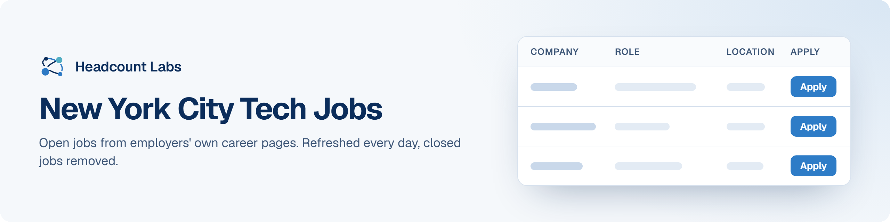

# New York City Tech Jobs

Software, data, AI, product and design jobs in the New York City area, sorted by field.

**397 open jobs** · 278 new since the last update · 46 removed because they closed or left the employer's board · updated November 19, 2026 at 5:17 AM EST

This list is built and refreshed every day by [Headcount Labs](https://headcountlabs.com/?utm_source=github&utm_medium=job-list&utm_campaign=new-york-tech-jobs), which reads jobs straight from employers' own career pages and job boards. Every job here was still listed on its source board when we last read that board, within the past 3 days, and was posted in the past 30 days. Copies of the same job are merged into one row, and jobs that close are removed at the next update.

Want this data in your own app or agent? Use the [Headcount Labs jobs API](https://headcountlabs.com/docs/?utm_source=github&utm_medium=job-list&utm_campaign=new-york-tech-jobs) (free tier), the [MCP server](https://headcountlabs.com/mcp/?utm_source=github&utm_medium=job-list&utm_campaign=new-york-tech-jobs) for Claude, ChatGPT and other AI assistants, or the [public dataset subsets](https://huggingface.co/HeadcountLabs) on Hugging Face (the full dataset is coming soon).

**Full dataset.** A bigger, one-off snapshot dated 2026-10-19 (all matching jobs, not only the open jobs below) is on Hugging Face: [Tech and software jobs](https://huggingface.co/datasets/HeadcountLabs/tech-jobs). It loads with `datasets.load_dataset` and is under the Open Database License (ODbL) 1.0.

**Jump to:** [Software engineering (137)](#software-engineering) · [Data, AI and machine learning (145)](#data-ai-and-machine-learning) · [Product and design (101)](#product-and-design) · [Hardware and engineering (14)](#hardware-and-engineering)

**Columns.** *Apply* opens the original posting on the employer's site. *Details* opens the job on Headcount Labs, with every posting we found for it. *Remote* shows what the employer states; a dash means the posting doesn't say. *Pay* is the range the employer published.

## Software engineering

| Company | Role | Location | Remote | Pay | Posted | Apply | Details |
| --- | --- | --- | --- | --- | --- | :---: | :---: |
| **Uber** | Staff Software Engineer: iOS (Core Build) | 

4 locations
San Francisco, CA Sunnyvale, CA Seattle, WA New York City, NY
 | Remote | $232k/yr | Nov 18 |  | <a href="https://headcountlabs.com/catalog/jobs/edd7739b-301d-48c5-a597-369291dde2f2?utm_source=github&utm_medium=job-list&utm_campaign=new-york-tech-jobs">via Headcount Labs</a> |
| **S&amp;P Global** | Senior Application Developer | 

2 locations
Boulder, CO New York, NY
 | Hybrid | $92k–$155k/yr | Nov 18 |  | <a href="https://headcountlabs.com/catalog/jobs/d2f88e09-a4cf-41d4-b272-ff03194deeb1?utm_source=github&utm_medium=job-list&utm_campaign=new-york-tech-jobs">via Headcount Labs</a> |
| **Peraton** | Senior Software Engineering (Open VMS) | New York, NY | Remote | $104k–$166k/yr | Nov 18 |  | <a href="https://headcountlabs.com/catalog/jobs/d778e89e-1ffb-4f71-b787-aafe973e1f2b?utm_source=github&utm_medium=job-list&utm_campaign=new-york-tech-jobs">via Headcount Labs</a> |
| **Mistral Ai** | Software Engineer, Backend | New York, NY | Hybrid | — | Nov 18 |  | <a href="https://headcountlabs.com/catalog/jobs/4baf2ecf-2ed2-461a-b788-8093bd3a08f5?utm_source=github&utm_medium=job-list&utm_campaign=new-york-tech-jobs">via Headcount Labs</a> |
| **Mistral Ai** | Site Reliability Engineer | New York, NY | — | — | Nov 18 |  | <a href="https://headcountlabs.com/catalog/jobs/c4ad9442-9214-4fa6-b1ae-9f34648b1a2c?utm_source=github&utm_medium=job-list&utm_campaign=new-york-tech-jobs">via Headcount Labs</a> |
| **LiveRamp** | Senior Fullstack Software Engineer | New York, NY | Hybrid | $130k–$196k/yr | Nov 18 |  | <a href="https://headcountlabs.com/catalog/jobs/8d32b028-b009-440a-987c-8080d9f7de05?utm_source=github&utm_medium=job-list&utm_campaign=new-york-tech-jobs">via Headcount Labs</a> |
| **Uber** | Sr Software Engineer - Developer Platform | 

4 locations
New York City, NY Seattle, WA Sunnyvale, CA San Francisco, CA
 | Remote | $202k/yr | Nov 17 |  | <a href="https://headcountlabs.com/catalog/jobs/b76499f3-5f94-4b99-8d8d-03ba5c6f5dd2?utm_source=github&utm_medium=job-list&utm_campaign=new-york-tech-jobs">via Headcount Labs</a> |
| **Uber** | Sr Software Engineer | 

3 locations
San Francisco, CA Sunnyvale, CA New York City, NY
 | Remote | $202k/yr | Nov 17 |  | <a href="https://headcountlabs.com/catalog/jobs/b25d2729-c608-4816-b3f2-c83be121d5cf?utm_source=github&utm_medium=job-list&utm_campaign=new-york-tech-jobs">via Headcount Labs</a> |
| **The National Football League** | Application Developer | New York, NY | — | $135k–$155k/yr | Nov 17 |  | <a href="https://headcountlabs.com/catalog/jobs/681c8776-b54a-4042-a9e5-ee97309e8175?utm_source=github&utm_medium=job-list&utm_campaign=new-york-tech-jobs">via Headcount Labs</a> |
| **StubHub** | Senior Software Engineer - Core Compute Platform | 

2 locations
New York, NY Los Angeles, CA
 | — | $200k–$250k/yr | Nov 17 |  | <a href="https://headcountlabs.com/catalog/jobs/7b47ea70-094b-4aec-83f4-cd49e5df7c71?utm_source=github&utm_medium=job-list&utm_campaign=new-york-tech-jobs">via Headcount Labs</a> |
| **River** | Staff Security Engineer | 

3 locations
United States New York, NY Columbus, OH
 | Remote | — | Nov 17 |  | <a href="https://headcountlabs.com/catalog/jobs/5ee492c1-1242-47ed-bd32-adc3d3481279?utm_source=github&utm_medium=job-list&utm_campaign=new-york-tech-jobs">via Headcount Labs</a> |
| **Metropolitan Transportation Authority** | Advanced Software Engineer - Product Architect (Legal, Safety, and Risk) | New York, NY | — | $141k–$166k/yr | Nov 17 |  | <a href="https://headcountlabs.com/catalog/jobs/85dc43a0-a720-4682-907e-7c22e1ef1e1e?utm_source=github&utm_medium=job-list&utm_campaign=new-york-tech-jobs">via Headcount Labs</a> |
| **Metropolitan Transportation Authority** | Computer Specialist (SW) 1-4 TWU Rep - Cloud Specialist and SW/Database Developer | New York, NY | — | $109k–$118k/yr | Nov 17 |  | <a href="https://headcountlabs.com/catalog/jobs/cd9200d2-993e-48a7-842c-26654ca79b55?utm_source=github&utm_medium=job-list&utm_campaign=new-york-tech-jobs">via Headcount Labs</a> |
| **Metropolitan Transportation Authority** | Computer Specialist (SW) 1-4 TWU Rep - Splunk Developer | New York, NY | — | $109k–$118k/yr | Nov 17 |  | <a href="https://headcountlabs.com/catalog/jobs/b4a2156d-06b2-453a-893e-28761c462338?utm_source=github&utm_medium=job-list&utm_campaign=new-york-tech-jobs">via Headcount Labs</a> |
| **JPMorgan Asset Management Technology** | Lead Software Engineer - AI &amp; Quantitative Development | 

2 locations
Jersey City, NJ New York, NY
 | On-site | $157k–$215k/yr | Nov 17 |  | <a href="https://headcountlabs.com/catalog/jobs/bbaab239-1726-4bed-85b3-b9c12e02fb42?utm_source=github&utm_medium=job-list&utm_campaign=new-york-tech-jobs">via Headcount Labs</a> |
| **JPMC** | Sr Lead Software Engineer- Commodities- Python | 

2 locations
United States New York, NY
 | On-site | $176k–$260k/yr | Nov 17 |  | <a href="https://headcountlabs.com/catalog/jobs/65812873-4b18-4fdb-90b2-346f89bb60fb?utm_source=github&utm_medium=job-list&utm_campaign=new-york-tech-jobs">via Headcount Labs</a> |
| **Japan Society** | Web Developer | New York City, NY | — | $80k–$85k/yr | Nov 17 |  | <a href="https://headcountlabs.com/catalog/jobs/3bbcc26c-8fc8-4221-bfa0-defa9131093a?utm_source=github&utm_medium=job-list&utm_campaign=new-york-tech-jobs">via Headcount Labs</a> |
| **Fitch Group** | Senior Software Engineer - Backend | New York, NY | — | $165k–$180k/yr | Nov 17 |  | <a href="https://headcountlabs.com/catalog/jobs/49c2c1ee-187e-47c1-b0e7-5f8163d4deb0?utm_source=github&utm_medium=job-list&utm_campaign=new-york-tech-jobs">via Headcount Labs</a> |
| **Clera** | Full-Stack Software Engineering Intern | New York, NY | Remote | — | Nov 17 |  | <a href="https://headcountlabs.com/catalog/jobs/7dcda9b6-4eda-4f2c-89b6-02ef06cb71da?utm_source=github&utm_medium=job-list&utm_campaign=new-york-tech-jobs">via Headcount Labs</a> |
| **Clera** | Founding Full-Stack Engineer | New York, NY | Remote | $120k–$150k/yr | Nov 17 |  | <a href="https://headcountlabs.com/catalog/jobs/c45c657c-4497-4849-8fc4-d0bb78b687b5?utm_source=github&utm_medium=job-list&utm_campaign=new-york-tech-jobs">via Headcount Labs</a> |
| **City of New York** | Senior DevOps Engineer | Brooklyn, NY | — | $68k–$145k/yr | Nov 17 |  | <a href="https://headcountlabs.com/catalog/jobs/3a5bbd29-fc45-44c7-b6df-d0bea24fdbbb?utm_source=github&utm_medium=job-list&utm_campaign=new-york-tech-jobs">via Headcount Labs</a> |
| **BNY** | SVP, Java Full-Stack Principal Engineer | New York, NY | On-site | $120k–$200k/yr | Nov 17 |  | <a href="https://headcountlabs.com/catalog/jobs/3db5c002-e969-4592-8126-363f8dc3ce0e?utm_source=github&utm_medium=job-list&utm_campaign=new-york-tech-jobs">via Headcount Labs</a> |
| **BlackRock** | Applied AI Engineer, Software Engineering – Associate | New York, NY | — | — | Nov 17 |  | <a href="https://headcountlabs.com/catalog/jobs/b91ae236-4188-49fb-a908-8f35804496f6?utm_source=github&utm_medium=job-list&utm_campaign=new-york-tech-jobs">via Headcount Labs</a> |
| **Ambrook** | Software Engineer, Product | 

3 locations
New York, NY Denver, CO San Francisco, CA
 | Hybrid | $115k–$260k/yr | Nov 17 |  | <a href="https://headcountlabs.com/catalog/jobs/53717405-9c76-48c0-8222-141842e1973e?utm_source=github&utm_medium=job-list&utm_campaign=new-york-tech-jobs">via Headcount Labs</a> |
| **AgileEngine** | Staff Software Engineer ID99041 | New York, NY | — | — | Nov 17 |  | <a href="https://headcountlabs.com/catalog/jobs/c98f7123-bea3-4bca-9c17-b8e5ba0b426e?utm_source=github&utm_medium=job-list&utm_campaign=new-york-tech-jobs">via Headcount Labs</a> |
| **003 Humana Inc.** | Senior Full-Stack Engineer | 

5 locations
New York, NY Dallas, TX Louisville, KY Nashville, TN Washington, DC
 | Remote | $128k–$176k/yr | Nov 17 |  | <a href="https://headcountlabs.com/catalog/jobs/69d35393-80bb-49eb-80e9-2993ed4efcd3?utm_source=github&utm_medium=job-list&utm_campaign=new-york-tech-jobs">via Headcount Labs</a> |
| **003 Humana Inc.** | Senior Software Engineer - Appian Platform | 

11 locations
Louisville, KY Arlington, VA Atlanta Boston, MA Charlotte, NC Chicago, IL Dallas, TX Fort Lauderdale, FL Nashville, TN New York, NY Tampa, FL
 | Remote | $107k–$147k/yr | Nov 17 |  | <a href="https://headcountlabs.com/catalog/jobs/50e096b0-8c43-49ba-aef5-f5a10406b34d?utm_source=github&utm_medium=job-list&utm_campaign=new-york-tech-jobs">via Headcount Labs</a> |
| **Uber** | Staff Software Engineer - Code Hosting &amp; Merge | 

4 locations
San Francisco, CA Seattle, WA Sunnyvale, CA New York City, NY
 | Remote | $232k/yr | Nov 16 |  | <a href="https://headcountlabs.com/catalog/jobs/1fb2e66a-8f89-4389-8e3c-bd8d46a68d26?utm_source=github&utm_medium=job-list&utm_campaign=new-york-tech-jobs">via Headcount Labs</a> |
| **Temporal (member)** | Staff Software Engineer, AI Foundations (Agent Optimization) | 

2 locations
San Francisco, CA New York, NY
 | Remote | $212k–$278k/yr | Nov 16 |  | <a href="https://headcountlabs.com/catalog/jobs/15b3a62e-8404-4c95-b1f2-047fa72ab200?utm_source=github&utm_medium=job-list&utm_campaign=new-york-tech-jobs">via Headcount Labs</a> |
| **Spotnana** | Software Engineer II, Frontend | New York, NY | — | $125k–$170k/yr | Nov 16 |  | <a href="https://headcountlabs.com/catalog/jobs/e0b251d2-810a-4ede-88b2-b75b5301393c?utm_source=github&utm_medium=job-list&utm_campaign=new-york-tech-jobs">via Headcount Labs</a> |
| **S&amp;P Global** | Sr. Director, Software Engineering – Data Platform &amp; MDM Integration | New York, NY | — | $185k–$265k/yr | Nov 16 |  | <a href="https://headcountlabs.com/catalog/jobs/d2abd8e8-db9d-40d3-8081-234c90c28d5a?utm_source=github&utm_medium=job-list&utm_campaign=new-york-tech-jobs">via Headcount Labs</a> |
| **PwC US** | Tax Innovation - Software Engineering - Senior Associate | NY-New York, NY | — | $77k–$214k/yr | Nov 16 |  | <a href="https://headcountlabs.com/catalog/jobs/d42fd205-57f8-484c-8be7-27b72b0e1173?utm_source=github&utm_medium=job-list&utm_campaign=new-york-tech-jobs">via Headcount Labs</a> |
| **PwC US** | Tax Innovation - Software Engineering - Manager | 

4 locations
NY-New York, NY DC-Washington TX-Dallas IL-Chicago
 | — | $99k–$266k/yr | Nov 16 |  | <a href="https://headcountlabs.com/catalog/jobs/945dc02b-94a1-4833-b138-8bff54223bc0?utm_source=github&utm_medium=job-list&utm_campaign=new-york-tech-jobs">via Headcount Labs</a> |
| **PwC US** | Tax Innovation - Software Engineering - Experienced Associate | 

4 locations
NY-New York, NY DC-Washington TX-Dallas IL-Chicago
 | — | $63k–$153k/yr | Nov 16 |  | <a href="https://headcountlabs.com/catalog/jobs/91730f1c-d9c7-4f6d-adda-ab19a04e1a89?utm_source=github&utm_medium=job-list&utm_campaign=new-york-tech-jobs">via Headcount Labs</a> |
| **PwC US** | Tax Innovation - Software Engineering - Senior Manager | 

4 locations
NY-New York, NY DC-Washington TX-Dallas IL-Chicago
 | — | $124k–$335k/yr | Nov 16 |  | <a href="https://headcountlabs.com/catalog/jobs/700b2710-ab26-4dd6-93f5-91e60b09448b?utm_source=github&utm_medium=job-list&utm_campaign=new-york-tech-jobs">via Headcount Labs</a> |
| **PwC US** | Tax Innovation - Software Engineering - Director | 

4 locations
NY-New York, NY DC-Washington TX-Dallas IL-Chicago
 | — | $150k–$438k/yr | Nov 16 |  | <a href="https://headcountlabs.com/catalog/jobs/54f4cd3f-e209-4dd8-bfcb-66176f5c7415?utm_source=github&utm_medium=job-list&utm_campaign=new-york-tech-jobs">via Headcount Labs</a> |
| **Perplexity** | Member of Technical Staff (Enterprise Security Engineer) | 

6 locations
San Francisco, CA United States London Belgrade New York City, NY Dublin
 | Hybrid | $250k–$350k/yr | Nov 16 |  | <a href="https://headcountlabs.com/catalog/jobs/62453c1d-7688-4ffb-baf0-94fb459237ed?utm_source=github&utm_medium=job-list&utm_campaign=new-york-tech-jobs">via Headcount Labs</a> |
| **Joyful Health** | Software Engineer | New York City, NY | Hybrid | — | Nov 16 |  | <a href="https://headcountlabs.com/catalog/jobs/3490ad45-2958-4138-82bf-5a0e28be4ffd?utm_source=github&utm_medium=job-list&utm_campaign=new-york-tech-jobs">via Headcount Labs</a> |
| **Fitch Group** | Senior Software Engineer, AI (New York) | New York, NY | — | $140k–$150k/yr | Nov 16 |  | <a href="https://headcountlabs.com/catalog/jobs/b85b84ff-a69d-4781-8b5b-a0d5e4a33560?utm_source=github&utm_medium=job-list&utm_campaign=new-york-tech-jobs">via Headcount Labs</a> |
| **Fanatics Collectibles** | Senior Security Engineer | New York, NY | — | $170k–$210k/yr | Nov 16 |  | <a href="https://headcountlabs.com/catalog/jobs/c9713aeb-3719-40b3-987f-977bdecd9b7d?utm_source=github&utm_medium=job-list&utm_campaign=new-york-tech-jobs">via Headcount Labs</a> |
| **Cohere** | Staff Software Engineer, Data Infrastructure | New York, NY | — | $275k–$335k/yr | Nov 16 |  | <a href="https://headcountlabs.com/catalog/jobs/332485c4-a799-47b1-84de-2a3a99cbfa4c?utm_source=github&utm_medium=job-list&utm_campaign=new-york-tech-jobs">via Headcount Labs</a> |
| **COGNIZANT TECH SOLUTIONS A** | Lead Java Full Stack Developer | New York, NY | On-site | $75k–$124k/yr | Nov 16 |  | <a href="https://headcountlabs.com/catalog/jobs/50f5b036-ca08-491a-be9e-ed1c84be1e8f?utm_source=github&utm_medium=job-list&utm_campaign=new-york-tech-jobs">via Headcount Labs</a> |
| **Adidev Technologies Inc** | Android Developer | New York, NY | On-site | $60k–$85k/yr | Nov 16 |  | <a href="https://headcountlabs.com/catalog/jobs/eeab8248-1f0c-4dbb-a907-83c3c876237b?utm_source=github&utm_medium=job-list&utm_campaign=new-york-tech-jobs">via Headcount Labs</a> |
| **Intuit** | Staff Software Engineer | New York, NY | — | — | Nov 15 |  | <a href="https://headcountlabs.com/catalog/jobs/05bf206f-1cfb-47ee-a628-fb62d9969714?utm_source=github&utm_medium=job-list&utm_campaign=new-york-tech-jobs">via Headcount Labs</a> |
| **Intuit** | Senior Software Engineer, Agentic Workflows | New York, NY | — | — | Nov 15 |  | <a href="https://headcountlabs.com/catalog/jobs/e8631c1a-6581-42e6-a39e-8e7fa7967473?utm_source=github&utm_medium=job-list&utm_campaign=new-york-tech-jobs">via Headcount Labs</a> |
| **Baseten** | Software Engineer, Cloud Platform | 

5 locations
San Francisco, CA Toronto New York, NY Montreal Seattle, WA
 | Hybrid | $165k–$330k/yr | Nov 14 |  | <a href="https://headcountlabs.com/catalog/jobs/c2e39340-af69-4341-913a-0a30fa5e675d?utm_source=github&utm_medium=job-list&utm_campaign=new-york-tech-jobs">via Headcount Labs</a> |
| **Pfizer** | Senior Cloud Engineer | New York City, NY | — | $99k–$165k/yr | Nov 13 |  | <a href="https://headcountlabs.com/catalog/jobs/9ba348aa-5615-4cae-8886-9995d4eb1cb9?utm_source=github&utm_medium=job-list&utm_campaign=new-york-tech-jobs">via Headcount Labs</a> |
| **Perplexity** | Member of Technical Staff (Software Engineer, Cybersecurity Products) | 

6 locations
San Francisco, CA United States London Belgrade New York City, NY Dublin
 | Remote | $220k–$405k/yr | Nov 13 |  | <a href="https://headcountlabs.com/catalog/jobs/eb1efca1-0068-449c-8cba-4406683bfb6e?utm_source=github&utm_medium=job-list&utm_campaign=new-york-tech-jobs">via Headcount Labs</a> |
| **Outtake** | Software Engineer, Platform | New York City, NY | On-site | $160k–$300k/yr | Nov 13 |  | <a href="https://headcountlabs.com/catalog/jobs/3c4682a8-fb15-480a-9460-24fff432ac63?utm_source=github&utm_medium=job-list&utm_campaign=new-york-tech-jobs">via Headcount Labs</a> |
| **Metropolitan Transportation Authority** | Application Developer Levels 1 - 5 - Revenue Applications (TCU) | New York, NY | — | $57k–$82k/yr | Nov 13 |  | <a href="https://headcountlabs.com/catalog/jobs/9e8ce3a5-c440-4c26-9490-84297a8f192b?utm_source=github&utm_medium=job-list&utm_campaign=new-york-tech-jobs">via Headcount Labs</a> |
| **GovDash** | Software Engineer | New York, NY | On-site | $160k–$200k/yr | Nov 13 |  | <a href="https://headcountlabs.com/catalog/jobs/b7b814c2-26cf-4f6c-b0bc-93fd3b841b42?utm_source=github&utm_medium=job-list&utm_campaign=new-york-tech-jobs">via Headcount Labs</a> |
| **Stripe** | Software Engineer, Full Stack | New York, NY | — | $193k–$286k/yr | Nov 12 |  | <a href="https://headcountlabs.com/catalog/jobs/8f59b6d1-1b61-4d2f-a6cc-026271a0ad53?utm_source=github&utm_medium=job-list&utm_campaign=new-york-tech-jobs">via Headcount Labs</a> |
| **Navan** | Sr. Software Engineer, Core AI | 

2 locations
Palo Alto, CA New York, NY
 | — | $113k–$252k/yr | Nov 12 |  | <a href="https://headcountlabs.com/catalog/jobs/f95d8de0-a738-41d7-808a-93b9b26930cd?utm_source=github&utm_medium=job-list&utm_campaign=new-york-tech-jobs">via Headcount Labs</a> |
| **Brex** | Software Engineer II, Frontend (Banking) | 

3 locations
San Francisco, CA Seattle, WA New York, NY
 | — | $152k–$190k/yr | Nov 12 |  | <a href="https://headcountlabs.com/catalog/jobs/452774cb-6881-429b-b99d-89d4e5bcdedc?utm_source=github&utm_medium=job-list&utm_campaign=new-york-tech-jobs">via Headcount Labs</a> |
| **NORY** | NORY Maker Education Curriculum Developer (Full Time) | New York, NY | On-site | $70k–$90k/yr | Nov 11 |  | <a href="https://headcountlabs.com/catalog/jobs/3463afc6-14e1-41bb-ac44-347dbb86e5ce?utm_source=github&utm_medium=job-list&utm_campaign=new-york-tech-jobs">via Headcount Labs</a> |
| **NORY** | Maker Ed Curriculum Developer (Part-Time) | New York, NY | On-site | $20–$35/hr | Nov 11 |  | <a href="https://headcountlabs.com/catalog/jobs/acb6d2eb-94eb-4570-8f8d-1b36b7c99bc9?utm_source=github&utm_medium=job-list&utm_campaign=new-york-tech-jobs">via Headcount Labs</a> |
| **Commure** | Senior Software Engineer, Data Platform | 

4 locations
Mountain View, CA Los Angeles, CA New York City, NY San Francisco, CA
 | Hybrid | $180k–$230k/yr | Nov 11 |  | <a href="https://headcountlabs.com/catalog/jobs/d75b8cff-c839-422d-a4c2-d53370099304?utm_source=github&utm_medium=job-list&utm_campaign=new-york-tech-jobs">via Headcount Labs</a> |
| **Temporal (member)** | Senior Developer Success Engineer | 

6 locations
United States Austin, TX Dallas, TX Boston, MA Raleigh, NC New York, NY
 | Remote | $144k–$189k/yr | Nov 10 |  | <a href="https://headcountlabs.com/catalog/jobs/3e1b54bb-e51a-4aeb-baa0-fe20bfb13e0e?utm_source=github&utm_medium=job-list&utm_campaign=new-york-tech-jobs">via Headcount Labs</a> |
| **StubHub** | Senior Software Engineer - Buyer Pricing | New York, NY | — | $200k–$250k/yr | Nov 10 |  | <a href="https://headcountlabs.com/catalog/jobs/5402e92f-f98c-4564-b35d-7cf76ccd9f62?utm_source=github&utm_medium=job-list&utm_campaign=new-york-tech-jobs">via Headcount Labs</a> |
| **Snap Inc.** | Staff Software Engineer, Android, Content | 

5 locations
Bellevue, WA Palo Alto, CA Los Angeles, CA San Francisco, CA New York, NY
 | — | $229k–$343k/yr | Nov 10 |  | <a href="https://headcountlabs.com/catalog/jobs/e11ac657-8e8a-4493-a6f7-02418a44f865?utm_source=github&utm_medium=job-list&utm_campaign=new-york-tech-jobs">via Headcount Labs</a> |
| **Penguin Random House** | Senior Infrastructure Engineer, AI &amp; ML, Penguin Random House (Open to Remote) | New York, NY | Remote | $185k–$210k/yr | Nov 10 |  | <a href="https://headcountlabs.com/catalog/jobs/944d4e3a-9f2c-4edd-a185-c66497e8533f?utm_source=github&utm_medium=job-list&utm_campaign=new-york-tech-jobs">via Headcount Labs</a> |
| **EPAM Systems** | Senior SAP CAP Developer | New York, NY | Remote | — | Nov 10 |  | <a href="https://headcountlabs.com/catalog/jobs/40a5ef16-af03-49e7-97ee-55a44804d9ee?utm_source=github&utm_medium=job-list&utm_campaign=new-york-tech-jobs">via Headcount Labs</a> |
| **Computer Task Group, Inc** | Senior Platform Engineer – Cloud, DevOps &amp; AKS | New York, NY | — | — | Nov 10 |  | <a href="https://headcountlabs.com/catalog/jobs/8028ba40-b462-44cd-90ac-43a09b121806?utm_source=github&utm_medium=job-list&utm_campaign=new-york-tech-jobs">via Headcount Labs</a> |
| **BNY** | Senior Associate, Full-Stack Engineer | 

2 locations
New York, NY Jersey City, NJ
 | On-site | $83k–$180k/yr | Nov 10 |  | <a href="https://headcountlabs.com/catalog/jobs/f373ed3e-fa7d-4df3-91fd-44ade35a10d3?utm_source=github&utm_medium=job-list&utm_campaign=new-york-tech-jobs">via Headcount Labs</a> |
| **BNY** | Vice President, AI / Machine Learning Software Engineer | New York, NY | On-site | $83k–$209k/yr | Nov 10 |  | <a href="https://headcountlabs.com/catalog/jobs/a0bed7c5-e4d8-4d51-a180-4b088c60d749?utm_source=github&utm_medium=job-list&utm_campaign=new-york-tech-jobs">via Headcount Labs</a> |
| **Ziff Davis** | Site Reliability Engineer | 

4 locations
Seattle, WA New York, NY Denver, CO Memphis, TN
 | — | $90k–$100k/yr | Nov 9 |  | <a href="https://headcountlabs.com/catalog/jobs/47e70c71-f39e-4cbf-abb0-16a79cb606ab?utm_source=github&utm_medium=job-list&utm_campaign=new-york-tech-jobs">via Headcount Labs</a> |
| **Pinterest** | Staff Software Engineer | 

4 locations
San Francisco, CA Los Angeles, CA Seattle, WA New York, NY
 | — | $208k–$365k/yr | Nov 9 |  | <a href="https://headcountlabs.com/catalog/jobs/740915ae-605b-4e53-95b1-13e3c7c621eb?utm_source=github&utm_medium=job-list&utm_campaign=new-york-tech-jobs">via Headcount Labs</a> |
| **Ookla** | Site Reliability Engineer | 

4 locations
Seattle, WA New York, NY Denver, CO Memphis, TN
 | — | $90k–$100k/yr | Nov 9 |  | <a href="https://headcountlabs.com/catalog/jobs/c00f9b91-40a3-464e-94b2-84930849de39?utm_source=github&utm_medium=job-list&utm_campaign=new-york-tech-jobs">via Headcount Labs</a> |
| **Nscale** | Senior Staff Cloud Native Software Engineer | 

2 locations
New York, NY San Francisco
 | — | $230k–$320k/yr | Nov 9 |  | <a href="https://headcountlabs.com/catalog/jobs/135fc2bf-a4c3-42ee-b3b7-544c3bd919f7?utm_source=github&utm_medium=job-list&utm_campaign=new-york-tech-jobs">via Headcount Labs</a> |
| **Nscale** | Staff Cloud Native Software Engineer | 

2 locations
New York, NY San Francisco
 | — | $220k–$290k/yr | Nov 9 |  | <a href="https://headcountlabs.com/catalog/jobs/ccbd34f2-9222-438a-b514-4718e8a6dd6f?utm_source=github&utm_medium=job-list&utm_campaign=new-york-tech-jobs">via Headcount Labs</a> |
| **Nexxen** | Staff Site Reliability Engineer | New York, NY | — | — | Nov 9 |  | <a href="https://headcountlabs.com/catalog/jobs/41103337-8936-4cfb-85bc-0a4a9a99af6d?utm_source=github&utm_medium=job-list&utm_campaign=new-york-tech-jobs">via Headcount Labs</a> |
| **Metropolitan Transportation Authority** | Application Developer Levels 1-5 - iOS | New York, NY | — | $57k–$82k/yr | Nov 9 |  | <a href="https://headcountlabs.com/catalog/jobs/0296da71-ceb2-45c8-8bb0-536f2feb6ff7?utm_source=github&utm_medium=job-list&utm_campaign=new-york-tech-jobs">via Headcount Labs</a> |
| **Metropolitan Transportation Authority** | Cybersecurity Engineer Levels 4 - 7 | New York, NY | — | $106k–$144k/yr | Nov 9 |  | <a href="https://headcountlabs.com/catalog/jobs/2b2c74db-ac7c-4611-b220-e28f59b66a0c?utm_source=github&utm_medium=job-list&utm_campaign=new-york-tech-jobs">via Headcount Labs</a> |
| **Metropolitan Transportation Authority** | Advanced Software Engineer - iOS | New York, NY | — | $141k–$166k/yr | Nov 9 |  | <a href="https://headcountlabs.com/catalog/jobs/af6dad10-1a9d-4366-b121-ee74305f7a3d?utm_source=github&utm_medium=job-list&utm_campaign=new-york-tech-jobs">via Headcount Labs</a> |
| **LPL Financial** | AVP, Backend Software Engineer - AWS / Cloud Native | 

2 locations
New York, NY Fort Mill, SC
 | Hybrid | $127k–$212k/yr | Nov 9 |  | <a href="https://headcountlabs.com/catalog/jobs/ffb7ef47-0505-4619-9fe5-db4da0edce5d?utm_source=github&utm_medium=job-list&utm_campaign=new-york-tech-jobs">via Headcount Labs</a> |
| **Council on Foreign Relations** | DevOps Engineer / Site Reliability Engineer | New York, NY | — | $150k–$175k/yr | Nov 9 |  | <a href="https://headcountlabs.com/catalog/jobs/bdef7835-67b9-4029-add2-23b82fba6fba?utm_source=github&utm_medium=job-list&utm_campaign=new-york-tech-jobs">via Headcount Labs</a> |
| **Munich Re** | Software Engineer, US Life (2027 Permanent) | New York, NY | — | $125k–$145k/yr | Nov 8 |  | <a href="https://headcountlabs.com/catalog/jobs/f4cdcb00-531a-492e-8699-6235ffc13a0b?utm_source=github&utm_medium=job-list&utm_campaign=new-york-tech-jobs">via Headcount Labs</a> |
| **S&amp;P Global** | Senior Lead, Java Application Developer | New York, NY | — | $120k–$155k/yr | Nov 6 |  | <a href="https://headcountlabs.com/catalog/jobs/e1f187be-716a-417d-a79b-98aeb5a139cc?utm_source=github&utm_medium=job-list&utm_campaign=new-york-tech-jobs">via Headcount Labs</a> |
| **StubHub** | Software Engineer I (New Grad) - Consumer Experience | New York, NY | — | $120k–$150k/yr | Nov 5 |  | <a href="https://headcountlabs.com/catalog/jobs/f21b47c9-9329-4c84-b60e-3be9d0c0a627?utm_source=github&utm_medium=job-list&utm_campaign=new-york-tech-jobs">via Headcount Labs</a> |
| **StubHub** | Software Engineer II - Seller Experience | 

2 locations
Aliso Viejo, CA New York, NY
 | — | $165k–$200k/yr | Nov 5 |  | <a href="https://headcountlabs.com/catalog/jobs/bb8d290d-7cc4-44b2-ab84-a93abc5b5cc7?utm_source=github&utm_medium=job-list&utm_campaign=new-york-tech-jobs">via Headcount Labs</a> |
| **SeatGeek** | Senior Fullstack Engineer, FanX AI | New York, NY | — | $144k–$209k/yr | Nov 5 |  | <a href="https://headcountlabs.com/catalog/jobs/d40129e3-bf32-4c28-a0c8-6a82a8bed5cc?utm_source=github&utm_medium=job-list&utm_campaign=new-york-tech-jobs">via Headcount Labs</a> |
| **Nscale** | Senior Security Engineer, Red Team | 

3 locations
New York, NY San Francisco Seattle
 | — | $160k–$190k/yr | Nov 5 |  | <a href="https://headcountlabs.com/catalog/jobs/25ac6da1-8a89-48b9-bcd1-f73086286d02?utm_source=github&utm_medium=job-list&utm_campaign=new-york-tech-jobs">via Headcount Labs</a> |
| **EPAM Systems** | Senior Software Engineer | New York, NY | Remote | — | Nov 5 |  | <a href="https://headcountlabs.com/catalog/jobs/1f555db0-5cae-4745-b7ed-e7a14df9f94d?utm_source=github&utm_medium=job-list&utm_campaign=new-york-tech-jobs">via Headcount Labs</a> |
| **CUNY** | Web Designer | New York, NY | Hybrid | $80k–$94k/yr | Nov 5 |  | <a href="https://headcountlabs.com/catalog/jobs/932fd7b8-65f8-49b7-bb81-374c7b243a7d?utm_source=github&utm_medium=job-list&utm_campaign=new-york-tech-jobs">via Headcount Labs</a> |
| **C1** | Software Engineer | New York City, NY | Hybrid | $180k–$250k/yr | Nov 5 |  | <a href="https://headcountlabs.com/catalog/jobs/d1b22c51-d55c-4080-aa08-85182dfe22b0?utm_source=github&utm_medium=job-list&utm_campaign=new-york-tech-jobs">via Headcount Labs</a> |
| **PermitFlow** | Principal Software Engineer, Platform | New York City, NY | Hybrid | $250k–$300k/yr | Nov 4 |  | <a href="https://headcountlabs.com/catalog/jobs/25ea0688-20ae-4778-a73a-c17ad1e30f9a?utm_source=github&utm_medium=job-list&utm_campaign=new-york-tech-jobs">via Headcount Labs</a> |
| **Paramount** | Senior Software Engineer, Privacy | New York, NY | — | $124k–$186k/yr | Nov 3 |  | <a href="https://headcountlabs.com/catalog/jobs/f32a9fa0-a752-4683-913b-5f1948e1dbb9?utm_source=github&utm_medium=job-list&utm_campaign=new-york-tech-jobs">via Headcount Labs</a> |
| **Paramount** | Lead Software Engineer | 

2 locations
Burbank, CA New York, NY
 | On-site | $157k–$235k/yr | Nov 3 |  | <a href="https://headcountlabs.com/catalog/jobs/78cb8458-339a-45c6-91ef-2dd4540166c3?utm_source=github&utm_medium=job-list&utm_campaign=new-york-tech-jobs">via Headcount Labs</a> |
| **Nscale** | Developer Experience Engineer-AI Infrastructure Operations | 

4 locations
New York, NY Houston San Francisco Seattle
 | — | $100k–$170k/yr | Nov 3 |  | <a href="https://headcountlabs.com/catalog/jobs/77b80f8c-2b46-4664-b0b4-6efc0a296949?utm_source=github&utm_medium=job-list&utm_campaign=new-york-tech-jobs">via Headcount Labs</a> |
| **Nscale** | Senior Developer Experience Engineer-AI Infrastructure Operations | 

4 locations
New York, NY Houston San Francisco Seattle
 | — | $170k–$265k/yr | Nov 3 |  | <a href="https://headcountlabs.com/catalog/jobs/772cacdd-4f8f-4791-b6c3-91d34eabfbd9?utm_source=github&utm_medium=job-list&utm_campaign=new-york-tech-jobs">via Headcount Labs</a> |
| **Nebius** | Senior Full Stack Engineer (Agentic Search) - Platform | New York City, NY | — | $147k–$224k/yr | Nov 3 |  | <a href="https://headcountlabs.com/catalog/jobs/0099e93c-6ec5-4a9b-8d26-31820363ad4e?utm_source=github&utm_medium=job-list&utm_campaign=new-york-tech-jobs">via Headcount Labs</a> |
| **Spring Health** | Staff Software Engineer I, AI Transformation | New York, NY | Hybrid | $208k–$280k/yr | Nov 2 |  | <a href="https://headcountlabs.com/catalog/jobs/39501670-1af1-460d-bc14-47a16d1519d8?utm_source=github&utm_medium=job-list&utm_campaign=new-york-tech-jobs">via Headcount Labs</a> |
| **Peloton** | Sr. AI Engineer (Full Stack) | New York, NY | Hybrid | $161k–$225k/yr | Nov 2 |  | <a href="https://headcountlabs.com/catalog/jobs/aa93b8c9-fc76-4bbb-bffd-851f3dbe85e7?utm_source=github&utm_medium=job-list&utm_campaign=new-york-tech-jobs">via Headcount Labs</a> |
| **IEX Group** | Software Engineer for Test | New York, NY | — | $150k–$200k/yr | Nov 2 |  | <a href="https://headcountlabs.com/catalog/jobs/c4a81664-9ff8-4858-8aee-1f874cf6855c?utm_source=github&utm_medium=job-list&utm_campaign=new-york-tech-jobs">via Headcount Labs</a> |
| **Cleary Gottlieb Steen &amp; Hamilton LLP** | Applications Manager - Software Development | New York, NY | — | $200k–$220k/yr | Nov 2 |  | <a href="https://headcountlabs.com/catalog/jobs/75327580-7294-44f1-911f-a4066acc44e7?utm_source=github&utm_medium=job-list&utm_campaign=new-york-tech-jobs">via Headcount Labs</a> |
| **Charlie Health** | Senior Corporate Security Engineer | 

2 locations
Nashville, TN New York, NY
 | Hybrid | $180k–$240k/yr | Nov 2 |  | <a href="https://headcountlabs.com/catalog/jobs/fc6ec184-a3bb-4136-9e4f-c39a084a104b?utm_source=github&utm_medium=job-list&utm_campaign=new-york-tech-jobs">via Headcount Labs</a> |
| **Brains Workgroup, Inc.** | Deployment Engineer Developer L3 | New York, NY | — | $50–$56/hr | Nov 2 |  | <a href="https://headcountlabs.com/catalog/jobs/9b1a7ce9-4ba0-4c83-8bb2-77d930d4b758?utm_source=github&utm_medium=job-list&utm_campaign=new-york-tech-jobs">via Headcount Labs</a> |
| **Paramount** | Senior Software Engineer | 

2 locations
New York, NY Burbank, CA
 | — | $124k–$186k/yr | Oct 30 |  | <a href="https://headcountlabs.com/catalog/jobs/6dd5ae05-1405-4c22-8aad-55a9b3bbfc99?utm_source=github&utm_medium=job-list&utm_campaign=new-york-tech-jobs">via Headcount Labs</a> |
| **Nscale** | Security Engineer II, Cloud &amp; Platform Security | 

3 locations
New York, NY San Francisco Seattle
 | — | $130k–$160k/yr | Oct 30 |  | <a href="https://headcountlabs.com/catalog/jobs/f482b806-bc7f-4a3d-81ba-d2262018913c?utm_source=github&utm_medium=job-list&utm_campaign=new-york-tech-jobs">via Headcount Labs</a> |
| **LPL Financial** | AVP, Full Stack Engineer – AI/GenAI. | 

2 locations
Fort Mill, SC New York, NY
 | Hybrid | $140k–$234k/yr | Oct 30 |  | <a href="https://headcountlabs.com/catalog/jobs/25ae986f-89d3-4868-a754-9e17b9fc4122?utm_source=github&utm_medium=job-list&utm_campaign=new-york-tech-jobs">via Headcount Labs</a> |
| **Jefferies** | VP, C++ Developer - OMS Technology | New York, NY | On-site | $200k–$250k/yr | Oct 30 |  | <a href="https://headcountlabs.com/catalog/jobs/7cb69f23-7add-4609-87f6-87164b124731?utm_source=github&utm_medium=job-list&utm_campaign=new-york-tech-jobs">via Headcount Labs</a> |
| **CUNY** | Backend Developer | New York, NY | Hybrid | $90k–$102k/yr | Oct 30 |  | <a href="https://headcountlabs.com/catalog/jobs/7a3064a1-5fd4-4d96-a687-fd44881e7f91?utm_source=github&utm_medium=job-list&utm_campaign=new-york-tech-jobs">via Headcount Labs</a> |
| **Tono Health** | Senior Software Engineer, AI | Brooklyn, NY | Remote | $180k–$275k/yr | Oct 29 |  | <a href="https://headcountlabs.com/catalog/jobs/9aec1804-4312-4771-910e-4017c594860b?utm_source=github&utm_medium=job-list&utm_campaign=new-york-tech-jobs">via Headcount Labs</a> |
| **Tono Health** | Senior Software Engineer, Dermatology Inference | Brooklyn, NY | — | $180k–$325k/yr | Oct 29 |  | <a href="https://headcountlabs.com/catalog/jobs/59d25967-8afb-4b39-ada3-c69f8890e8a1?utm_source=github&utm_medium=job-list&utm_campaign=new-york-tech-jobs">via Headcount Labs</a> |
| **Santander US** | Senior Java Developer (ION) | New York, NY | — | $175k–$220k/yr | Oct 29 |  | <a href="https://headcountlabs.com/catalog/jobs/412777d2-b755-4de9-aed6-132b8bfb72a2?utm_source=github&utm_medium=job-list&utm_campaign=new-york-tech-jobs">via Headcount Labs</a> |
| **Nscale** | Senior Manager, Developer Platforms | 

3 locations
New York, NY San Francisco Seattle
 | — | $180k–$280k/yr | Oct 29 |  | <a href="https://headcountlabs.com/catalog/jobs/df307aa8-09a5-4f2c-9c32-407a053b7de0?utm_source=github&utm_medium=job-list&utm_campaign=new-york-tech-jobs">via Headcount Labs</a> |
| **Major League Baseball** | Software Engineer, Fan Identity | New York, NY | — | $120k–$155k/yr | Oct 29 |  | <a href="https://headcountlabs.com/catalog/jobs/00fc9c4b-3c0c-485f-b389-cd914890944d?utm_source=github&utm_medium=job-list&utm_campaign=new-york-tech-jobs">via Headcount Labs</a> |
| **Lyft** | Engineering Manager, Developer Environments | New York, NY | Hybrid | $176k–$220k/yr | Oct 29 |  | <a href="https://headcountlabs.com/catalog/jobs/8de1fa8c-a36d-43a3-b978-a74aff7c3ab9?utm_source=github&utm_medium=job-list&utm_campaign=new-york-tech-jobs">via Headcount Labs</a> |
| **Snap Inc.** | Staff Software Engineer, Backend, Level 6 | 

5 locations
New York, NY San Francisco, CA Bellevue, WA Los Angeles, CA Palo Alto, CA
 | — | $229k–$343k/yr | Oct 28 |  | <a href="https://headcountlabs.com/catalog/jobs/0f6e2225-7fcc-412d-b9d4-dbd363a039ae?utm_source=github&utm_medium=job-list&utm_campaign=new-york-tech-jobs">via Headcount Labs</a> |
| **SeatGeek** | Senior Software Engineer | New York, NY | — | $144k–$209k/yr | Oct 28 |  | <a href="https://headcountlabs.com/catalog/jobs/b5772abf-808b-4ea3-9dd9-bd828316335b?utm_source=github&utm_medium=job-list&utm_campaign=new-york-tech-jobs">via Headcount Labs</a> |
| **Mural Group** | Senior Software Engineer, Fintech Products | New York, NY | On-site | — | Oct 28 |  | <a href="https://headcountlabs.com/catalog/jobs/b9dd99ca-afe8-4150-9c0d-f050940754c6?utm_source=github&utm_medium=job-list&utm_campaign=new-york-tech-jobs">via Headcount Labs</a> |
| **Harvey** | Staff Product Security Engineer | 

2 locations
San Francisco, CA New York, NY
 | Hybrid | $220k–$330k/yr | Oct 28 |  | <a href="https://headcountlabs.com/catalog/jobs/4ae98377-103e-4dad-ae46-787df4aeefca?utm_source=github&utm_medium=job-list&utm_campaign=new-york-tech-jobs">via Headcount Labs</a> |
| **Commure** | Senior Fullstack Engineer, Air AI | 

4 locations
Mountain View, CA Los Angeles, CA New York City, NY San Francisco, CA
 | — | $170k–$230k/yr | Oct 28 |  | <a href="https://headcountlabs.com/catalog/jobs/37ca1771-dd22-470a-90f9-5ff7a7db6043?utm_source=github&utm_medium=job-list&utm_campaign=new-york-tech-jobs">via Headcount Labs</a> |
| **Brex** | Staff Software Engineer - Identity &amp; Access Management | 

4 locations
Vancouver San Francisco, CA Seattle, WA New York, NY
 | — | — | Oct 28 |  | <a href="https://headcountlabs.com/catalog/jobs/70f251b2-db52-4758-b1b8-f231ba3f5cfe?utm_source=github&utm_medium=job-list&utm_campaign=new-york-tech-jobs">via Headcount Labs</a> |
| **Atto Trading** | Software Engineer C++ - Trading Platform | New York, NY | — | $175k–$250k/yr | Oct 28 |  | <a href="https://headcountlabs.com/catalog/jobs/9f3d7603-d0f3-4102-b774-daaee886e198?utm_source=github&utm_medium=job-list&utm_campaign=new-york-tech-jobs">via Headcount Labs</a> |
| **Tono Health** | Staff Software Engineer, Product | Brooklyn, NY | Remote | $180k–$275k/yr | Oct 27 |  | <a href="https://headcountlabs.com/catalog/jobs/377cef4d-8e8a-420e-af38-14348f4ee7ae?utm_source=github&utm_medium=job-list&utm_campaign=new-york-tech-jobs">via Headcount Labs</a> |
| **Jefferies** | VP, Site Reliable Engineer (SRE) for Equity Trading Platform | New York, NY | On-site | $150k–$225k/yr | Oct 27 |  | <a href="https://headcountlabs.com/catalog/jobs/bf45955c-f5d6-4e59-a44d-c7e51af248bf?utm_source=github&utm_medium=job-list&utm_campaign=new-york-tech-jobs">via Headcount Labs</a> |
| **Baseten** | Software Engineer - Storage Systems (Agent Infra) | 

2 locations
San Francisco, CA New York, NY
 | Hybrid | $160k–$330k/yr | Oct 27 |  | <a href="https://headcountlabs.com/catalog/jobs/efc8b072-9266-4e20-a0fd-bef29027c500?utm_source=github&utm_medium=job-list&utm_campaign=new-york-tech-jobs">via Headcount Labs</a> |
| **Stripe** | Android Engineer, Identity | 

3 locations
Seattle, WA San Francisco, CA New York City, NY
 | — | — | Oct 26 |  | <a href="https://headcountlabs.com/catalog/jobs/5ee58424-27e3-49ff-8973-bcb29036dfe7?utm_source=github&utm_medium=job-list&utm_campaign=new-york-tech-jobs">via Headcount Labs</a> |
| **Stripe** | iOS Engineer, Identity | 

3 locations
Seattle, WA San Francisco, CA New York City, NY
 | — | — | Oct 26 |  | <a href="https://headcountlabs.com/catalog/jobs/2116a020-e6f0-4640-ba4d-2922383e2eed?utm_source=github&utm_medium=job-list&utm_campaign=new-york-tech-jobs">via Headcount Labs</a> |
| **Polymarket** | Senior Web Engineer | New York, NY | On-site | $230k–$330k/yr | Oct 26 |  | <a href="https://headcountlabs.com/catalog/jobs/9ba0893f-6181-4efd-bfe7-56481bf20ed1?utm_source=github&utm_medium=job-list&utm_campaign=new-york-tech-jobs">via Headcount Labs</a> |
| **Brillio** | Senior Cloud Security Engineer - R01573020 | New York, NY | On-site | $120k–$130k/yr | Oct 26 |  | <a href="https://headcountlabs.com/catalog/jobs/6a32e1d1-cc48-4aa2-95e7-145179a3c07f?utm_source=github&utm_medium=job-list&utm_campaign=new-york-tech-jobs">via Headcount Labs</a> |
| **Brillio** | Enterprise Security Engineer - R01573019 | New York, NY | On-site | $120k–$130k/yr | Oct 26 |  | <a href="https://headcountlabs.com/catalog/jobs/05443329-6f09-42c7-9685-3733fa6cc4e5?utm_source=github&utm_medium=job-list&utm_campaign=new-york-tech-jobs">via Headcount Labs</a> |
| **Baseten** | Software Engineer - Compute &amp; Isolation (Agent Infra) | 

2 locations
San Francisco, CA New York, NY
 | Hybrid | $165k–$330k/yr | Oct 26 |  | <a href="https://headcountlabs.com/catalog/jobs/5d42cbf9-d418-4c45-8c45-e9e08346941b?utm_source=github&utm_medium=job-list&utm_campaign=new-york-tech-jobs">via Headcount Labs</a> |
| **LiveRamp** | Senior Site Reliability Engineer | New York, NY | Hybrid | $127k–$196k/yr | Oct 23 |  | <a href="https://headcountlabs.com/catalog/jobs/4f78fe81-561d-41cf-b599-b48c630af35a?utm_source=github&utm_medium=job-list&utm_campaign=new-york-tech-jobs">via Headcount Labs</a> |
| **Intercontinental Exchange Holdings, Inc.** | Summer Internship Program 2027 - Software Engineering Intern | New York, NY | — | $30/hr | Oct 23 |  | <a href="https://headcountlabs.com/catalog/jobs/5456e488-62b7-4df2-97f4-17e2136c03a8?utm_source=github&utm_medium=job-list&utm_campaign=new-york-tech-jobs">via Headcount Labs</a> |
| **Artemis** | Lead Security Engineer, Internal and IT | New York City, NY | On-site | — | Oct 23 |  | <a href="https://headcountlabs.com/catalog/jobs/a49f9f97-cf40-47fb-b5d8-9696b47a9d37?utm_source=github&utm_medium=job-list&utm_campaign=new-york-tech-jobs">via Headcount Labs</a> |
| **Phipps Neighborhoods** | Job Developer Workforce Development | New York, NY | On-site | $55k–$58k/yr | Oct 22 |  | <a href="https://headcountlabs.com/catalog/jobs/d1944fb9-1488-4c64-9db0-a32bcaeacd4b?utm_source=github&utm_medium=job-list&utm_campaign=new-york-tech-jobs">via Headcount Labs</a> |
| **Paramount** | Lead Software Engineer (Java) in Test | 

2 locations
New York, NY Burbank, CA
 | — | $124k–$186k/yr | Oct 22 |  | <a href="https://headcountlabs.com/catalog/jobs/3b0d272a-965b-4ac9-87f1-136930d0a755?utm_source=github&utm_medium=job-list&utm_campaign=new-york-tech-jobs">via Headcount Labs</a> |
| **Munich Re** | Senior Software Engineer | New York, NY | — | $147k–$170k/yr | Oct 22 |  | <a href="https://headcountlabs.com/catalog/jobs/f3a7e158-1c12-4e66-9848-2e2f7ec899ab?utm_source=github&utm_medium=job-list&utm_campaign=new-york-tech-jobs">via Headcount Labs</a> |
| **iCapital** | Senior Cloud Platform Engineer - Vice President | New York, NY | — | $150k–$190k/yr | Oct 22 |  | <a href="https://headcountlabs.com/catalog/jobs/4774240c-2c4d-4bb1-9c12-e5a29049bdd4?utm_source=github&utm_medium=job-list&utm_campaign=new-york-tech-jobs">via Headcount Labs</a> |
| **Brains Workgroup, Inc.** | Python Full Stack Developer | New York, NY | — | $60–$64/hr | Oct 22 |  | <a href="https://headcountlabs.com/catalog/jobs/664ee68d-0cad-4ae7-95d9-31b784693ada?utm_source=github&utm_medium=job-list&utm_campaign=new-york-tech-jobs">via Headcount Labs</a> |
| **Intercontinental Exchange Holdings, Inc.** | Lead Developer | New York, NY | — | $168k–$220k/yr | Oct 21 |  | <a href="https://headcountlabs.com/catalog/jobs/1cdd44fe-b91c-4d5e-b52a-2de930d30645?utm_source=github&utm_medium=job-list&utm_campaign=new-york-tech-jobs">via Headcount Labs</a> |
| **DoorDash USA** | Software Engineer, Reliability Platform | 

4 locations
San Francisco, CA Sunnyvale, CA Seattle, WA New York City, NY
 | — | $131k–$192k/yr | Oct 21 |  | <a href="https://headcountlabs.com/catalog/jobs/672f21fe-a74f-44c9-b688-9a359bab395b?utm_source=github&utm_medium=job-list&utm_campaign=new-york-tech-jobs">via Headcount Labs</a> |
| **LiveRamp** | Staff Backend Software Engineer - Activations | New York, NY | Hybrid | $156k–$235k/yr | Oct 20 |  | <a href="https://headcountlabs.com/catalog/jobs/d4b60c39-c1da-44af-a912-9f5f6ef9d538?utm_source=github&utm_medium=job-list&utm_campaign=new-york-tech-jobs">via Headcount Labs</a> |
| **CRM Force** | Salesforce Marketing Cloud &amp; Data Cloud Implementor/Developer | New York, NY | Hybrid | — | Oct 20 |  | <a href="https://headcountlabs.com/catalog/jobs/cc141570-48be-48a6-9210-933bf8ad6a69?utm_source=github&utm_medium=job-list&utm_campaign=new-york-tech-jobs">via Headcount Labs</a> |
| **Brains Workgroup, Inc.** | Snowflake and BI Developer Treasury Finance | New York, NY | — | — | Oct 20 |  | <a href="https://headcountlabs.com/catalog/jobs/d9f3ce06-9fe8-46fd-b9f3-5fbe8d9072bf?utm_source=github&utm_medium=job-list&utm_campaign=new-york-tech-jobs">via Headcount Labs</a> |

## Data, AI and machine learning

| Company | Role | Location | Remote | Pay | Posted | Apply | Details |
| --- | --- | --- | --- | --- | --- | :---: | :---: |
| **ZS** | Strategic Alliances Senior Associate - Data partners | 

4 locations
Chicago, IL New York, NY Bellevue, WA South San Francisco, CA
 | — | — | Nov 18 |  | <a href="https://headcountlabs.com/catalog/jobs/36478d98-ecd2-40fe-9474-fe0c4e509799?utm_source=github&utm_medium=job-list&utm_campaign=new-york-tech-jobs">via Headcount Labs</a> |
| **Uber** | Manager, Data Analyst, Delivery Reporting &amp; Tooling | 

2 locations
New York City, NY San Francisco, CA
 | Remote | $167k/yr | Nov 18 |  | <a href="https://headcountlabs.com/catalog/jobs/61c5be30-d32e-44e1-9b52-0298d4431f19?utm_source=github&utm_medium=job-list&utm_campaign=new-york-tech-jobs">via Headcount Labs</a> |
| **S&amp;P Global** | Lead Data Scientist | New York, NY | — | $231k–$259k/yr | Nov 18 |  | <a href="https://headcountlabs.com/catalog/jobs/be4f0bd4-78f0-4673-87b4-2bcf454be8f7?utm_source=github&utm_medium=job-list&utm_campaign=new-york-tech-jobs">via Headcount Labs</a> |
| **S&amp;P Global** | Machine Learning Engineer II | 

2 locations
Cambridge, MA New York, NY
 | — | $140k–$180k/yr | Nov 18 |  | <a href="https://headcountlabs.com/catalog/jobs/75c82290-0c97-4fac-a4af-5848ffe441c4?utm_source=github&utm_medium=job-list&utm_campaign=new-york-tech-jobs">via Headcount Labs</a> |
| **Photon** | Senior QA Automation Engineer (MCP &amp; AI Infrastructure) &#124; Onsite (Dallas, Chicago, New York) | 

2 locations
United States New York, NY
 | On-site | — | Nov 18 |  | <a href="https://headcountlabs.com/catalog/jobs/d7e4c103-2c0e-4e72-9126-0027395bfaa3?utm_source=github&utm_medium=job-list&utm_campaign=new-york-tech-jobs">via Headcount Labs</a> |
| **Paramount** | Senior Machine Learning Engineer, Content Engineering | New York, NY | — | $139k–$219k/yr | Nov 18 |  | <a href="https://headcountlabs.com/catalog/jobs/7070f968-e0d6-4a0a-aee9-49ecc28061e0?utm_source=github&utm_medium=job-list&utm_campaign=new-york-tech-jobs">via Headcount Labs</a> |
| **LiveRamp** | Principal Product Manager, Data Platform &amp; Data Catalog | 

2 locations
New York, NY San Francisco, NY
 | Hybrid | $181k–$234k/yr | Nov 18 |  | <a href="https://headcountlabs.com/catalog/jobs/354b8d60-d0c4-42f8-8c0e-97ca3230a313?utm_source=github&utm_medium=job-list&utm_campaign=new-york-tech-jobs">via Headcount Labs</a> |
| **Langan** | Project Environmental Permitting &amp; Compliance Engineer, Scientist or Manager | New York, NY | — | $90k–$133k/yr | Nov 18 |  | <a href="https://headcountlabs.com/catalog/jobs/98109bc9-f67d-4a7b-889b-a2fd7c9a69ce?utm_source=github&utm_medium=job-list&utm_campaign=new-york-tech-jobs">via Headcount Labs</a> |
| **Fitch Group** | Data Strategy Partner, Director (Fitch Solutions) | New York, NY | — | — | Nov 18 |  | <a href="https://headcountlabs.com/catalog/jobs/6a9a3a84-a8d1-4094-9eb3-558753b54fc2?utm_source=github&utm_medium=job-list&utm_campaign=new-york-tech-jobs">via Headcount Labs</a> |
| **Digital Realty** | Senior AI Engineer | 

10 locations
Dallas, TX Austin, TX Charlotte, NC San Francisco, CA Ashburn, VA Denver, CO Seattle, WA Portland Los Angeles, CA New York, NY
 | Remote | $160k–$190k/yr | Nov 18 |  | <a href="https://headcountlabs.com/catalog/jobs/5257149d-3f89-4813-846f-4084ec2c1b8b?utm_source=github&utm_medium=job-list&utm_campaign=new-york-tech-jobs">via Headcount Labs</a> |
| **American Express** | Senior Technology Auditor – Data Governance | 

4 locations
New York, NY Phoenix, AZ Charlotte, NC Sandy, UT
 | Hybrid | $78k–$125k/yr | Nov 18 |  | <a href="https://headcountlabs.com/catalog/jobs/f44d94dc-3ec7-4e21-beb5-06d0431eefa8?utm_source=github&utm_medium=job-list&utm_campaign=new-york-tech-jobs">via Headcount Labs</a> |
| **AECOM** | AI Advisory Director, Data and AI Engineering Solutions | New York, NY | Hybrid | — | Nov 18 |  | <a href="https://headcountlabs.com/catalog/jobs/3e049a09-52b5-4f78-bada-2e9241c48212?utm_source=github&utm_medium=job-list&utm_campaign=new-york-tech-jobs">via Headcount Labs</a> |
| **AECOM** | Advisory Associate Director, Data &amp; AI Architect Solutions | New York, NY | Hybrid | — | Nov 18 |  | <a href="https://headcountlabs.com/catalog/jobs/19f839a2-8a2c-418c-94ff-062f039f9966?utm_source=github&utm_medium=job-list&utm_campaign=new-york-tech-jobs">via Headcount Labs</a> |
| **ŌURA** | Senior Data Analyst, Hardware | 

4 locations
Los Angeles, CA San Francisco, CA Boston, MA New York, NY
 | Remote | $174k–$205k/yr | Nov 17 |  | <a href="https://headcountlabs.com/catalog/jobs/508c0d21-ad0d-4369-9d2e-9e3552a03817?utm_source=github&utm_medium=job-list&utm_campaign=new-york-tech-jobs">via Headcount Labs</a> |
| **Prove** | Lead Data Engineer | New York, NY | Hybrid | $175k–$200k/yr | Nov 17 |  | <a href="https://headcountlabs.com/catalog/jobs/0054664b-82b0-4ae4-8e13-68c6250c05b2?utm_source=github&utm_medium=job-list&utm_campaign=new-york-tech-jobs">via Headcount Labs</a> |
| **Obin Ai** | Agentic AI Engineer | New York, NY | Hybrid | $150k–$180k/yr | Nov 17 |  | <a href="https://headcountlabs.com/catalog/jobs/ac5b9059-3673-4905-a802-7902f8d2081f?utm_source=github&utm_medium=job-list&utm_campaign=new-york-tech-jobs">via Headcount Labs</a> |
| **JPMorganChase** | Technology, Data and Product - United States - 2027 ReEntry Program | 

12 locations
Plano, TX Houston, TX Atlanta, GA Tampa, FL Chicago, IL Columbus, OH Jersey City, NJ New York, NY Newark, DE Palo Alto, CA Seattle, WA Charlotte, NC
 | On-site | — | Nov 17 |  | <a href="https://headcountlabs.com/catalog/jobs/3df3060e-18a4-4439-971e-3cd22c7e35e9?utm_source=github&utm_medium=job-list&utm_campaign=new-york-tech-jobs">via Headcount Labs</a> |
| **JPMC** | Global Research – Agentic AI &amp; Data Science Lead – Associate | New York, NY | On-site | $200k–$285k/yr | Nov 17 |  | <a href="https://headcountlabs.com/catalog/jobs/89a2c6ff-bc63-4898-8f62-ca8d30c9b7c2?utm_source=github&utm_medium=job-list&utm_campaign=new-york-tech-jobs">via Headcount Labs</a> |
| **JPMC** | Senior Product Associate, Agentic AI | New York, NY | On-site | $100k–$155k/yr | Nov 17 |  | <a href="https://headcountlabs.com/catalog/jobs/4b6e49b6-1a41-43ee-9a93-06a862611c5e?utm_source=github&utm_medium=job-list&utm_campaign=new-york-tech-jobs">via Headcount Labs</a> |
| **JPMC** | Vice President, AI Product Manager | New York, NY | On-site | $133k–$215k/yr | Nov 17 |  | <a href="https://headcountlabs.com/catalog/jobs/1eda44ba-2929-4c23-9d24-281c4767a5b7?utm_source=github&utm_medium=job-list&utm_campaign=new-york-tech-jobs">via Headcount Labs</a> |
| **JPMC** | Data &amp; AI Product Manager Vice President | 

3 locations
New York, NY Columbus, OH Wilmington, DE
 | On-site | — | Nov 17 |  | <a href="https://headcountlabs.com/catalog/jobs/fe2df038-b628-4c3c-bbe2-a569fc10733a?utm_source=github&utm_medium=job-list&utm_campaign=new-york-tech-jobs">via Headcount Labs</a> |
| **InvestCloud** | Compensation &amp; Data Analytics Manager | 

3 locations
Warren Twp, NJ New York, NY United States
 | — | $155k–$175k/yr | Nov 17 |  | <a href="https://headcountlabs.com/catalog/jobs/883f8a36-3c2d-46da-a3ca-47b95ce0584e?utm_source=github&utm_medium=job-list&utm_campaign=new-york-tech-jobs">via Headcount Labs</a> |
| **Franklin Templeton** | Senior Digital Product Manager – AI, Sales &amp; Distribution | New York, NY | Hybrid | $165k–$190k/yr | Nov 17 |  | <a href="https://headcountlabs.com/catalog/jobs/dc2e16e1-42d9-4011-9ae6-56cc4dd94de2?utm_source=github&utm_medium=job-list&utm_campaign=new-york-tech-jobs">via Headcount Labs</a> |
| **Fitch Group** | Enterprise AI and Productivity Engineer | New York, NY | — | $140k–$150k/yr | Nov 17 |  | <a href="https://headcountlabs.com/catalog/jobs/a6d1ea3c-c7fc-45e3-a49f-8335113b5dce?utm_source=github&utm_medium=job-list&utm_campaign=new-york-tech-jobs">via Headcount Labs</a> |
| **Fi** | Lead Data Scientist | New York, NY | On-site | $140k–$225k/yr | Nov 17 |  | <a href="https://headcountlabs.com/catalog/jobs/65b92c37-2c62-4622-bf02-b29924538b5b?utm_source=github&utm_medium=job-list&utm_campaign=new-york-tech-jobs">via Headcount Labs</a> |
| **City of New York** | Community Engagement, Capacity Building Program and Data Manager | New York City, NY | — | $88k–$101k/yr | Nov 17 |  | <a href="https://headcountlabs.com/catalog/jobs/9208add3-047c-4205-a1fe-c2e9dbe90be2?utm_source=github&utm_medium=job-list&utm_campaign=new-york-tech-jobs">via Headcount Labs</a> |
| **City of New York** | Director of Food Safety Data Analytics, Bureau of Environmental Surveillance and Policy | New York City, NY | — | $110k–$135k/yr | Nov 17 |  | <a href="https://headcountlabs.com/catalog/jobs/bd507bbd-1eb8-4fcf-a096-a420fb3df0c7?utm_source=github&utm_medium=job-list&utm_campaign=new-york-tech-jobs">via Headcount Labs</a> |
| **City of New York** | Technical Lead, Data Strategy | Brooklyn, NY | — | $68k–$140k/yr | Nov 17 |  | <a href="https://headcountlabs.com/catalog/jobs/031fa2e1-0c95-43d3-9c59-773e5f98527c?utm_source=github&utm_medium=job-list&utm_campaign=new-york-tech-jobs">via Headcount Labs</a> |
| **ASPCA** | Senior Enterprise Data Engineer - (on site NYC) | 

2 locations
New York, NY New York metropolitan area, NY
 | On-site | $138k–$143k/yr | Nov 17 |  | <a href="https://headcountlabs.com/catalog/jobs/5a5caad1-6cb3-482d-b963-faddc14c923c?utm_source=github&utm_medium=job-list&utm_campaign=new-york-tech-jobs">via Headcount Labs</a> |
| **American Express** | Sr AI Engineer II - Agentic AI | 

2 locations
Phoenix, AZ New York, NY
 | Hybrid | $123k–$215k/yr | Nov 17 |  | <a href="https://headcountlabs.com/catalog/jobs/e3f69406-7730-4b8d-90d0-1e97bce4482d?utm_source=github&utm_medium=job-list&utm_campaign=new-york-tech-jobs">via Headcount Labs</a> |
| **American Express** | Senior Agentic AI Engineer - Core Platforms | 

3 locations
New York, NY Sunrise, FL Phoenix, AZ
 | Hybrid | $123k–$215k/yr | Nov 17 |  | <a href="https://headcountlabs.com/catalog/jobs/9824af69-4858-409e-a46d-6bb8d82bc31d?utm_source=github&utm_medium=job-list&utm_campaign=new-york-tech-jobs">via Headcount Labs</a> |
| **003 Humana Inc.** | Data Engineer | 

11 locations
Louisville, KY Atlanta Boston, MA Charlotte, NC Chicago, IL Fort Lauderdale, FL Frisco, TX Nashville, TN New York, NY Tampa, FL Washington, DC
 | Remote | $98k–$134k/yr | Nov 17 |  | <a href="https://headcountlabs.com/catalog/jobs/d6a82068-5549-4031-8ffa-4f882a633031?utm_source=github&utm_medium=job-list&utm_campaign=new-york-tech-jobs">via Headcount Labs</a> |
| **STO Building Group** | Data Analyst | New York, NY | On-site | $85k–$95k/yr | Nov 16 |  | <a href="https://headcountlabs.com/catalog/jobs/748fd93e-7197-43ad-84e3-e920fad00cd1?utm_source=github&utm_medium=job-list&utm_campaign=new-york-tech-jobs">via Headcount Labs</a> |
| **Roku** | Senior AI Transformation Engineer | 

3 locations
Santa Monica, CA New York, NY Boston, MA
 | — | $242k–$486k/yr | Nov 16 |  | <a href="https://headcountlabs.com/catalog/jobs/379bb6cb-92fa-4f61-81f6-e31662f0bc6f?utm_source=github&utm_medium=job-list&utm_campaign=new-york-tech-jobs">via Headcount Labs</a> |
| **PWC US** | Data Engineer - Experienced Associate | NY-New York, NY | — | $63k–$140k/yr | Nov 16 |  | <a href="https://headcountlabs.com/catalog/jobs/1d883c5e-00f5-4648-8d1e-07a391ff3905?utm_source=github&utm_medium=job-list&utm_campaign=new-york-tech-jobs">via Headcount Labs</a> |
| **PwC US** | AI Data Governance Engineer- Manager | 

63 locations
NY-New York, NY NC-Raleigh NC-Charlotte IL-Chicago OH-Cincinnati OH-Cleveland SC-Columbia OH-Columbus TX-Dallas VA-Richmond MD-Baltimore NY-Rochester +51 more
 | Hybrid | $99k–$232k/yr | Nov 16 |  | <a href="https://headcountlabs.com/catalog/jobs/ffdd1a5e-8670-4b5e-be80-3b2a31723c0b?utm_source=github&utm_medium=job-list&utm_campaign=new-york-tech-jobs">via Headcount Labs</a> |
| **Pfizer** | Sr. Manager, Solution Engineer, Visualization, Analytics &amp; Collaboration | 

5 locations
Cambridge, MA New York City, NY Collegeville, PA Tampa, FL Groton, CT
 | — | $124k–$207k/yr | Nov 16 |  | <a href="https://headcountlabs.com/catalog/jobs/f9d0ce96-9234-49b9-a5af-f455ad84156a?utm_source=github&utm_medium=job-list&utm_campaign=new-york-tech-jobs">via Headcount Labs</a> |
| **Pfizer** | Senior Director, Marketing AI Content &amp; MLR Product Owner | 

3 locations
Bothell, WA New York City, NY Collegeville, PA
 | Hybrid | $215k–$358k/yr | Nov 16 |  | <a href="https://headcountlabs.com/catalog/jobs/e6141ad2-3716-401b-ab5f-fe7fda820074?utm_source=github&utm_medium=job-list&utm_campaign=new-york-tech-jobs">via Headcount Labs</a> |
| **Pfizer** | Director, Solution Engineer, Data Storage and Registration | 

5 locations
Cambridge, MA Tampa, FL Collegeville, PA Groton, CT New York City, NY
 | — | $163k–$272k/yr | Nov 16 |  | <a href="https://headcountlabs.com/catalog/jobs/c5da0259-69f0-4182-9d58-7e5368748e41?utm_source=github&utm_medium=job-list&utm_campaign=new-york-tech-jobs">via Headcount Labs</a> |
| **Ness Digital Engineering** | Technical Product Manager – Enterprise Data Platform (NYC) | New York, NY | — | — | Nov 16 |  | <a href="https://headcountlabs.com/catalog/jobs/c2fd1829-0d0c-4517-802e-b277fb1aadcb?utm_source=github&utm_medium=job-list&utm_campaign=new-york-tech-jobs">via Headcount Labs</a> |
| **Macy's** | Data Quality Specialist | New York, NY | On-site | $101k–$169k/yr | Nov 16 |  | <a href="https://headcountlabs.com/catalog/jobs/f17feb90-3c4a-4806-b46b-1d4646a8feb6?utm_source=github&utm_medium=job-list&utm_campaign=new-york-tech-jobs">via Headcount Labs</a> |
| **Insurance Fund, State** | Data Analyst 1 (Sales) | New York, NY | — | $74k–$93k/yr | Nov 16 |  | <a href="https://headcountlabs.com/catalog/jobs/c0c02642-f4ad-4006-b045-fbab178ad6cf?utm_source=github&utm_medium=job-list&utm_campaign=new-york-tech-jobs">via Headcount Labs</a> |
| **iCapital** | AI Engineer- Assistant Vice President | New York, NY | — | $120k–$170k/yr | Nov 16 |  | <a href="https://headcountlabs.com/catalog/jobs/f57d198c-4741-4d03-86d1-0db18f5886f5?utm_source=github&utm_medium=job-list&utm_campaign=new-york-tech-jobs">via Headcount Labs</a> |
| **Harvey** | Senior AI Enablement Engineer, GTM | New York, NY | Hybrid | $153k–$210k/yr | Nov 16 |  | <a href="https://headcountlabs.com/catalog/jobs/2b538a8c-f729-40e1-b51a-053e24c2c55e?utm_source=github&utm_medium=job-list&utm_campaign=new-york-tech-jobs">via Headcount Labs</a> |
| **EPAM Systems** | Data &amp; AI Consultant, Revenue Growth Management (RGM), Consumer Industries | 

5 locations
Jersey City, NJ Branford, CT Atlanta, GA Chicago, IL New York, NY
 | Remote | — | Nov 16 |  | <a href="https://headcountlabs.com/catalog/jobs/4c73eb60-6bd3-45dd-b4f1-b3abbcbd66ff?utm_source=github&utm_medium=job-list&utm_campaign=new-york-tech-jobs">via Headcount Labs</a> |
| **Crédit Agricole CIB** | Compliance Data Analytics and Reporting Associate | New York, NY | — | $125k–$150k/yr | Nov 16 |  | <a href="https://headcountlabs.com/catalog/jobs/65172f47-7f12-47c8-83b5-54b441ca63a3?utm_source=github&utm_medium=job-list&utm_campaign=new-york-tech-jobs">via Headcount Labs</a> |
| **Comcast** | Machine Learning Engineer 2 - Freewheel | 

2 locations
Sunnyvale, CA New York, NY
 | — | $136k–$181k/yr | Nov 16 |  | <a href="https://headcountlabs.com/catalog/jobs/8cc7ce60-5e02-4959-8d93-4f024873daf6?utm_source=github&utm_medium=job-list&utm_campaign=new-york-tech-jobs">via Headcount Labs</a> |
| **American Express** | Senior Analyst - USCS Data Risk Management | 

2 locations
Charlotte, NC New York, NY
 | Hybrid | $89k–$150k/yr | Nov 16 |  | <a href="https://headcountlabs.com/catalog/jobs/ff8c9998-4663-4d1c-9702-624e13e7c518?utm_source=github&utm_medium=job-list&utm_campaign=new-york-tech-jobs">via Headcount Labs</a> |
| **American Express** | Senior Agentic AI Engineer II - Global Infrastructure | 

3 locations
New York, NY Sunrise, FL Phoenix, AZ
 | Hybrid | $123k–$215k/yr | Nov 16 |  | <a href="https://headcountlabs.com/catalog/jobs/c0d7f7d2-148e-4775-97e4-bea08cd4d721?utm_source=github&utm_medium=job-list&utm_campaign=new-york-tech-jobs">via Headcount Labs</a> |
| **003 Humana Inc.** | Lead AI Technical Product Manager | 

6 locations
New York, NY Chicago, IL Dallas, TX Fort Lauderdale, FL Louisville, KY Tampa, FL
 | Hybrid | $152k–$208k/yr | Nov 16 |  | <a href="https://headcountlabs.com/catalog/jobs/37b81de3-9e51-46e5-98d9-10f68cfa18ff?utm_source=github&utm_medium=job-list&utm_campaign=new-york-tech-jobs">via Headcount Labs</a> |
| **003 Humana Inc.** | Principal Product Manager, AI | 

6 locations
New York, NY Chicago, IL Dallas, TX Fort Lauderdale, FL Louisville, KY Tampa, FL
 | Hybrid | $202k–$277k/yr | Nov 16 |  | <a href="https://headcountlabs.com/catalog/jobs/a318602f-eb5a-4d90-a575-66fbe8275514?utm_source=github&utm_medium=job-list&utm_campaign=new-york-tech-jobs">via Headcount Labs</a> |
| **003 Humana Inc.** | Senior AI Technical Product Manager | 

3 locations
New York, NY Fort Lauderdale, FL Tampa, FL
 | Hybrid | $125k–$172k/yr | Nov 16 |  | <a href="https://headcountlabs.com/catalog/jobs/1ff5da90-09c9-462b-9edb-972d68e98b3b?utm_source=github&utm_medium=job-list&utm_campaign=new-york-tech-jobs">via Headcount Labs</a> |
| **S&amp;P Global** | Head of AI &amp; Data Sales | 

3 locations
New York, NY Houston, TX London
 | — | $150k–$276k/yr | Nov 15 |  | <a href="https://headcountlabs.com/catalog/jobs/b0837340-0210-4872-904a-8517c74d6070?utm_source=github&utm_medium=job-list&utm_campaign=new-york-tech-jobs">via Headcount Labs</a> |
| **Chubb** | Senior Analyst, Strategic Intelligence (Global Data &amp; Analytics) | 

4 locations
New York, NY Jersey City, NJ Philadelphia, PA Whitehouse Station, NJ
 | On-site | $117k–$169k/yr | Nov 15 |  | <a href="https://headcountlabs.com/catalog/jobs/4571febc-8b35-447c-8555-c149282089e8?utm_source=github&utm_medium=job-list&utm_campaign=new-york-tech-jobs">via Headcount Labs</a> |
| **WTW** | Early Careers: Data Analyst Internship | New York, NY | — | $18–$20/hr | Nov 14 |  | <a href="https://headcountlabs.com/catalog/jobs/af299e1f-df77-4c53-9f81-06d4dd146a66?utm_source=github&utm_medium=job-list&utm_campaign=new-york-tech-jobs">via Headcount Labs</a> |
| **Weill Cornell Medical College** | Research Data Specialist II | New York, NY | — | $78k–$90k/yr | Nov 14 |  | <a href="https://headcountlabs.com/catalog/jobs/39df89ba-0718-4ab1-93a5-876e57d1cd11?utm_source=github&utm_medium=job-list&utm_campaign=new-york-tech-jobs">via Headcount Labs</a> |
| **Pfizer** | Senior Manager, Marketing AI Product Operations, CoCo | New York City, NY | Hybrid | $124k–$207k/yr | Nov 13 |  | <a href="https://headcountlabs.com/catalog/jobs/cfc1c8fe-fbd8-4493-8fe5-48658a30bbfc?utm_source=github&utm_medium=job-list&utm_campaign=new-york-tech-jobs">via Headcount Labs</a> |
| **Mount Sinai Kravis Children's Hospital** | Data Analyst I - Population Health Science &amp; Policy Research (On Site) | 

2 locations
United States New York, NY
 | Remote | — | Nov 13 |  | <a href="https://headcountlabs.com/catalog/jobs/ca4fda48-d4f2-44a0-a84d-0a5c68d9ba1e?utm_source=github&utm_medium=job-list&utm_campaign=new-york-tech-jobs">via Headcount Labs</a> |
| **Mount Sinai Kravis Children's Hospital** | Data Coordinator I - Cardiology | 

2 locations
United States New York, NY
 | On-site | — | Nov 13 |  | <a href="https://headcountlabs.com/catalog/jobs/4a6b0f20-27ec-494a-b49e-1a2a221888f5?utm_source=github&utm_medium=job-list&utm_campaign=new-york-tech-jobs">via Headcount Labs</a> |
| **LPL Financial** | Senior Vice President, Head of Core Data Technology | 

3 locations
New York, NY Austin, TX Fort Mill, SC
 | — | $208k–$346k/yr | Nov 13 |  | <a href="https://headcountlabs.com/catalog/jobs/05249924-96b0-4aa3-905a-06199e6a27b0?utm_source=github&utm_medium=job-list&utm_campaign=new-york-tech-jobs">via Headcount Labs</a> |
| **Joyful Health** | AI Engineer | New York City, NY | On-site | — | Nov 13 |  | <a href="https://headcountlabs.com/catalog/jobs/a51dd073-ef34-4d67-8763-983645f09eff?utm_source=github&utm_medium=job-list&utm_campaign=new-york-tech-jobs">via Headcount Labs</a> |
| **Reddit** | Staff Machine Learning Engineer, Ads Foundational Representations | New York City, NY | — | $230k–$322k/yr | Nov 12 |  | <a href="https://headcountlabs.com/catalog/jobs/9f2e4206-061a-4246-8476-ce1a43dade82?utm_source=github&utm_medium=job-list&utm_campaign=new-york-tech-jobs">via Headcount Labs</a> |
| **BNY** | Vice President, Data Management Engineer | New York, NY | On-site | $69k–$185k/yr | Nov 12 |  | <a href="https://headcountlabs.com/catalog/jobs/9c549bcd-2dd0-4a3f-b169-1dcaa5b69fb8?utm_source=github&utm_medium=job-list&utm_campaign=new-york-tech-jobs">via Headcount Labs</a> |
| **Lazard** | Data Engineer | 

2 locations
United States New York, NY
 | Hybrid | $170k–$200k/yr | Nov 11 |  | <a href="https://headcountlabs.com/catalog/jobs/e2bb325a-5ede-4f14-863a-e1eb9a1a8cd8?utm_source=github&utm_medium=job-list&utm_campaign=new-york-tech-jobs">via Headcount Labs</a> |
| **Hearst** | Senior Product Data Analyst - Digital Analytics | 

3 locations
New York, NY Orlando, FL Washington, DC
 | — | $100k–$135k/yr | Nov 11 |  | <a href="https://headcountlabs.com/catalog/jobs/9fb9c7c6-e160-44ae-a783-fe8c0ab9e619?utm_source=github&utm_medium=job-list&utm_campaign=new-york-tech-jobs">via Headcount Labs</a> |
| **Hearst** | Sr FinOps Data Analyst | 

2 locations
Charlotte, NC New York, NY
 | — | $102k–$125k/yr | Nov 11 |  | <a href="https://headcountlabs.com/catalog/jobs/33d61b81-6310-43a9-b7be-08898eef356f?utm_source=github&utm_medium=job-list&utm_campaign=new-york-tech-jobs">via Headcount Labs</a> |
| **Flowcode** | Applied AI Engineer: Solutions &amp; Infrastructure | New York, NY | — | $120k–$170k/yr | Nov 11 |  | <a href="https://headcountlabs.com/catalog/jobs/ec9066f6-3bbf-4dfd-a33f-e2398c0a6005?utm_source=github&utm_medium=job-list&utm_campaign=new-york-tech-jobs">via Headcount Labs</a> |
| **Flowcode** | Applied AI Engineer: Product &amp; Experience | New York, NY | — | $120k–$170k/yr | Nov 11 |  | <a href="https://headcountlabs.com/catalog/jobs/96f11ebf-7a72-4488-a3c2-32169b696c78?utm_source=github&utm_medium=job-list&utm_campaign=new-york-tech-jobs">via Headcount Labs</a> |
| **Fitch Group** | Staff Data Scientist (New York) | New York, NY | — | — | Nov 11 |  | <a href="https://headcountlabs.com/catalog/jobs/cca126c3-feaa-4c1c-936b-8653fbd2f6b7?utm_source=github&utm_medium=job-list&utm_campaign=new-york-tech-jobs">via Headcount Labs</a> |
| **Fi** | Lead Analytics Engineer | New York, NY | Remote | $140k–$210k/yr | Nov 11 |  | <a href="https://headcountlabs.com/catalog/jobs/0ec58f17-c930-48fa-98d4-86f86e780d58?utm_source=github&utm_medium=job-list&utm_campaign=new-york-tech-jobs">via Headcount Labs</a> |
| **ServiceNow, Inc.** | Sr Solution Sales Executive Data &amp; Analytics - Financial Markets | New York, NY | — | $139k–$230k/yr | Nov 10 |  | <a href="https://headcountlabs.com/catalog/jobs/867533f4-f517-46af-ba95-40114ac8c24a?utm_source=github&utm_medium=job-list&utm_campaign=new-york-tech-jobs">via Headcount Labs</a> |
| **Dow Jones** | Audience Data Analyst, Opinion | NEW YORK, NY | Hybrid | $80k–$100k/yr | Nov 10 |  | <a href="https://headcountlabs.com/catalog/jobs/17c14b5a-977d-4093-b198-30ac2a0793f6?utm_source=github&utm_medium=job-list&utm_campaign=new-york-tech-jobs">via Headcount Labs</a> |
| **Nexxen** | Senior Data Scientist | New York, NY | Hybrid | — | Nov 9 |  | <a href="https://headcountlabs.com/catalog/jobs/e1acb714-efc7-49f8-815b-54bab62bc9f1?utm_source=github&utm_medium=job-list&utm_campaign=new-york-tech-jobs">via Headcount Labs</a> |
| **Hines** | AI Embedded Business Automation Engineer | 

3 locations
Houston, TX New York, NY London
 | — | — | Nov 9 |  | <a href="https://headcountlabs.com/catalog/jobs/bce0408d-755f-4a53-be4f-28964bab06ec?utm_source=github&utm_medium=job-list&utm_campaign=new-york-tech-jobs">via Headcount Labs</a> |
| **Pfizer** | Senior Principal Machine Learning Scientist | 

5 locations
New York City, NY Pearl River, NY Bothell, WA Cambridge, MA Groton, CT
 | — | $139k–$232k/yr | Nov 8 |  | <a href="https://headcountlabs.com/catalog/jobs/6b0ffad4-7b30-47dc-be98-ad59cc985cd8?utm_source=github&utm_medium=job-list&utm_campaign=new-york-tech-jobs">via Headcount Labs</a> |
| **Pfizer** | Senior Machine Learning Research Scientist | 

5 locations
Bothell, WA New York City, NY Cambridge, MA Groton, CT Pearl River, NY
 | — | $106k–$177k/yr | Nov 8 |  | <a href="https://headcountlabs.com/catalog/jobs/5563bc8f-7abc-48ab-943c-365b195c9f9f?utm_source=github&utm_medium=job-list&utm_campaign=new-york-tech-jobs">via Headcount Labs</a> |
| **Pfizer** | Senior Principal AI Research Engineer | 

5 locations
Bothell, WA Cambridge, MA New York City, NY Groton, CT Pearl River, NY
 | Hybrid | $139k–$232k/yr | Nov 8 |  | <a href="https://headcountlabs.com/catalog/jobs/5102c07f-fb9d-403c-afec-a6ad344ee586?utm_source=github&utm_medium=job-list&utm_campaign=new-york-tech-jobs">via Headcount Labs</a> |
| **iCapital** | Global Head of Distribution, Data Solutions - Managing Director | 

2 locations
Greenwich, CT New York, NY
 | — | $275k–$300k/yr | Nov 6 |  | <a href="https://headcountlabs.com/catalog/jobs/726d47a5-d95b-4e44-a22e-92c28592905b?utm_source=github&utm_medium=job-list&utm_campaign=new-york-tech-jobs">via Headcount Labs</a> |
| **Future Works** | Senior AI Product Manager (CRE) | 

2 locations
United States New York, NY
 | Remote | — | Nov 6 |  | <a href="https://headcountlabs.com/catalog/jobs/573f5df6-8761-4ac4-9bb6-47c07de1f699?utm_source=github&utm_medium=job-list&utm_campaign=new-york-tech-jobs">via Headcount Labs</a> |
| **Compas** | Director, Data Privacy Operations &amp; Governance | 

6 locations
Philadelphia, PA King of Prussia, PA Cherry Hill, NJ New York, NY Parsippany, NJ Chesterbrook, PA
 | — | $90k–$180k/yr | Nov 6 |  | <a href="https://headcountlabs.com/catalog/jobs/a371a461-9f0f-4d46-9cac-c6bdaf1fb2ca?utm_source=github&utm_medium=job-list&utm_campaign=new-york-tech-jobs">via Headcount Labs</a> |
| **Coast** | AI Operations Engineer | New York, NY | — | $150k–$180k/yr | Nov 6 |  | <a href="https://headcountlabs.com/catalog/jobs/6b31da53-c741-4c99-bafd-9a55b9623da7?utm_source=github&utm_medium=job-list&utm_campaign=new-york-tech-jobs">via Headcount Labs</a> |
| **CMI Media Group** | Director, Data Privacy Operations &amp; Governance | 

6 locations
Philadelphia, PA King of Prussia, PA Cherry Hill, NJ New York, NY Parsippany, NJ Chesterbrook, PA
 | — | $90k–$180k/yr | Nov 6 |  | <a href="https://headcountlabs.com/catalog/jobs/9c43950f-dac0-47da-9132-58bd28d4d3fa?utm_source=github&utm_medium=job-list&utm_campaign=new-york-tech-jobs">via Headcount Labs</a> |
| **Waymo** | Staff Machine Learning Engineer, AI Infrastructure | 

3 locations
Mountain View, CA San Francisco, CA New York, NY
 | — | $251k–$310k/yr | Nov 5 |  | <a href="https://headcountlabs.com/catalog/jobs/5774a729-a652-4a61-9eaf-ceacc7066eeb?utm_source=github&utm_medium=job-list&utm_campaign=new-york-tech-jobs">via Headcount Labs</a> |
| **Susquehanna International Group, LLP** | Machine Learning Discovery Summit (On-site) | New York, NY | On-site | — | Nov 5 |  | <a href="https://headcountlabs.com/catalog/jobs/0fe040e2-25e4-4d2d-baf6-52f8c53b5e89?utm_source=github&utm_medium=job-list&utm_campaign=new-york-tech-jobs">via Headcount Labs</a> |
| **StubHub** | Senior Data Scientist | 

2 locations
New York, NY Los Angeles, CA
 | — | $200k–$250k/yr | Nov 5 |  | <a href="https://headcountlabs.com/catalog/jobs/f8d4a328-70f7-41e2-afa3-0f0ee307d026?utm_source=github&utm_medium=job-list&utm_campaign=new-york-tech-jobs">via Headcount Labs</a> |
| **S&amp;P Global** | Lead AI Product Manager, Private Markets | 

4 locations
New York, NY Raleigh, NC Dallas, TX Charlottesville, VA
 | — | $101k–$175k/yr | Nov 5 |  | <a href="https://headcountlabs.com/catalog/jobs/0304970d-9d03-4a48-a365-780470d8c43d?utm_source=github&utm_medium=job-list&utm_campaign=new-york-tech-jobs">via Headcount Labs</a> |
| **Mount Sinai Health Systems** | Data Scientist I - Windreich Department for AI &amp; Human Health Research | New York, NY | — | $109k–$164k/yr | Nov 5 |  | <a href="https://headcountlabs.com/catalog/jobs/6da1d439-dfb9-4e01-acd0-4c5422b0e58e?utm_source=github&utm_medium=job-list&utm_campaign=new-york-tech-jobs">via Headcount Labs</a> |
| **L'Occitane En Provence** | Customer Data Analyst | New York, NY | On-site | $75k–$85k/yr | Nov 5 |  | <a href="https://headcountlabs.com/catalog/jobs/f81524df-57b4-49d6-afbe-b9ee85879ebf?utm_source=github&utm_medium=job-list&utm_campaign=new-york-tech-jobs">via Headcount Labs</a> |
| **EPAM Systems** | Senior Data Technology Consultant, Databricks Data &amp; AI Practice | New York, NY | Remote | — | Nov 5 |  | <a href="https://headcountlabs.com/catalog/jobs/eeabf775-c497-423e-ba6b-658679f7ebf8?utm_source=github&utm_medium=job-list&utm_campaign=new-york-tech-jobs">via Headcount Labs</a> |
| **EPAM Systems** | Python AI Engineer | New York, NY | Remote | — | Nov 5 |  | <a href="https://headcountlabs.com/catalog/jobs/b0134c84-c7c7-410d-9198-910805134bcc?utm_source=github&utm_medium=job-list&utm_campaign=new-york-tech-jobs">via Headcount Labs</a> |
| **S&amp;P Global** | Head of Engineering - Inbound Data | 

2 locations
New York, NY Washington, DC
 | — | $185k–$265k/yr | Nov 4 |  | <a href="https://headcountlabs.com/catalog/jobs/6b8c0e48-a066-4e2e-b316-9964f904a97f?utm_source=github&utm_medium=job-list&utm_campaign=new-york-tech-jobs">via Headcount Labs</a> |
| **Mount Sinai Kravis Children's Hospital** | Manager, Data Informatics-Medical Staff Affairs/Services-Mount Sinai Health System-Remote-Full Time-Days | 

2 locations
United States New York, NY
 | Remote | — | Nov 4 |  | <a href="https://headcountlabs.com/catalog/jobs/2f71bab7-d902-4a06-aad1-9869c8762ac1?utm_source=github&utm_medium=job-list&utm_campaign=new-york-tech-jobs">via Headcount Labs</a> |
| **LPL Financial** | VP Product Management, Intelligent Data Layer | 

3 locations
Fort Mill, SC Austin, TX New York, NY
 | — | $136k–$227k/yr | Nov 4 |  | <a href="https://headcountlabs.com/catalog/jobs/70422ffd-7dfa-44d3-a0c8-38cdfacc6a70?utm_source=github&utm_medium=job-list&utm_campaign=new-york-tech-jobs">via Headcount Labs</a> |
| **LPL Financial** | SVP, Head of Development Practices &amp; AI Product Development Lifecycle | 

3 locations
Austin, TX Fort Mill, SC New York, NY
 | — | $240k–$290k/yr | Nov 4 |  | <a href="https://headcountlabs.com/catalog/jobs/461a0bdc-99f3-44d6-bd3e-190ca9d4dd58?utm_source=github&utm_medium=job-list&utm_campaign=new-york-tech-jobs">via Headcount Labs</a> |
| **LiveRamp** | Data Client Partner | New York, NY | Hybrid | $147k–$182k/yr | Nov 4 |  | <a href="https://headcountlabs.com/catalog/jobs/ccf80dfe-230f-4f87-852b-e852e242485e?utm_source=github&utm_medium=job-list&utm_campaign=new-york-tech-jobs">via Headcount Labs</a> |
| **FSA Federal** | Legal Assistant / Data Analyst Supporting the US Attorney's Office | New York, NY | — | — | Nov 4 |  | <a href="https://headcountlabs.com/catalog/jobs/71afb182-ce33-4641-9114-7b5b057ff91e?utm_source=github&utm_medium=job-list&utm_campaign=new-york-tech-jobs">via Headcount Labs</a> |
| **Fanatics Collectibles** | Senior Forward Deployed AI Engineer— Strategic Finance | New York, NY | — | $145k–$181k/yr | Nov 4 |  | <a href="https://headcountlabs.com/catalog/jobs/3701f65c-53e4-4657-aaab-1ad4f1d8483b?utm_source=github&utm_medium=job-list&utm_campaign=new-york-tech-jobs">via Headcount Labs</a> |
| **EPAM Systems** | Forward Deployed AI Engineer - Agentic Systems Lead | New York, NY | Remote | — | Nov 4 |  | <a href="https://headcountlabs.com/catalog/jobs/ed342cfd-f230-44b6-959a-c05c0ab5b911?utm_source=github&utm_medium=job-list&utm_campaign=new-york-tech-jobs">via Headcount Labs</a> |
| **SAP** | Forward Deployed Senior AI Engineer | New York, NY | Hybrid | $131k–$272k/yr | Nov 3 |  | <a href="https://headcountlabs.com/catalog/jobs/72fe39f8-b3c9-4d87-9cae-6e30fe2e9c9c?utm_source=github&utm_medium=job-list&utm_campaign=new-york-tech-jobs">via Headcount Labs</a> |
| **Provectus** | Senior AI Engineer | 

5 locations
New York City Metropolitan Area Brooklyn, NY Manhattan, NY New York, NY San Francisco Bay Area, CA
 | Hybrid | $180k–$200k/yr | Nov 3 |  | <a href="https://headcountlabs.com/catalog/jobs/5ececa4f-e0b5-489e-bd9b-1eb5edf6d402?utm_source=github&utm_medium=job-list&utm_campaign=new-york-tech-jobs">via Headcount Labs</a> |
| **LPL Financial** | VPII, Data Engineering Manager | 

4 locations
Fort Mill, SC Austin, TX New York, NY San Diego, CA
 | — | $169k–$282k/yr | Nov 3 |  | <a href="https://headcountlabs.com/catalog/jobs/6b1541df-309a-4c73-921b-e8ed988babd2?utm_source=github&utm_medium=job-list&utm_campaign=new-york-tech-jobs">via Headcount Labs</a> |
| **CUNY** | Business Data and Reporting Analyst 1 (Hourly) | New York, NY | — | $24.48/hr | Nov 3 |  | <a href="https://headcountlabs.com/catalog/jobs/cec522c6-597c-43b5-8126-d25d2c706a5a?utm_source=github&utm_medium=job-list&utm_campaign=new-york-tech-jobs">via Headcount Labs</a> |
| **Crowell &amp; Moring** | Director of eDiscovery and Data Solutions | 

7 locations
Boston, MA Chicago, IL Denver, CO Irvine, CA Los Angeles, CA New York, NY Washington, DC
 | Remote | $195k–$290k/yr | Nov 3 |  | <a href="https://headcountlabs.com/catalog/jobs/2abee024-4cb7-4238-a6e7-dc84f8e8c8dd?utm_source=github&utm_medium=job-list&utm_campaign=new-york-tech-jobs">via Headcount Labs</a> |
| **ZS** | Data Architect – Knowledge Graph &amp; AI | 

9 locations
Philadelphia, PA New York, NY Boston, MA Princeton, NJ Bethesda, MD Durham, NC Atlanta, GA Chicago, IL Evanston, IL
 | — | — | Nov 2 |  | <a href="https://headcountlabs.com/catalog/jobs/88a703dc-55c7-4f1b-812d-749cd6fb216b?utm_source=github&utm_medium=job-list&utm_campaign=new-york-tech-jobs">via Headcount Labs</a> |
| **Robots and Pencils** | Staff Engineer / AI Builder - NYC | New York, NY | — | $166k–$228k/yr | Nov 2 |  | <a href="https://headcountlabs.com/catalog/jobs/11112403-ed25-4f90-8083-d81f8c44eea8?utm_source=github&utm_medium=job-list&utm_campaign=new-york-tech-jobs">via Headcount Labs</a> |
| **Paramount** | Sr Data Engineer | New York, NY | — | $110k–$165k/yr | Nov 2 |  | <a href="https://headcountlabs.com/catalog/jobs/b5e4cf27-05ac-4f09-9d90-967762d9f97a?utm_source=github&utm_medium=job-list&utm_campaign=new-york-tech-jobs">via Headcount Labs</a> |
| **Paramount** | Senior Data Engineer | 

3 locations
Los Angeles, CA New York, NY Fort Lauderdale, FL
 | — | $110k–$166k/yr | Nov 2 |  | <a href="https://headcountlabs.com/catalog/jobs/9b54b96e-94b3-4304-a0b8-577c4f3e7f6c?utm_source=github&utm_medium=job-list&utm_campaign=new-york-tech-jobs">via Headcount Labs</a> |
| **Harvey** | Research Engineer / Scientist, Reinforcement Learning | New York, NY | Hybrid | $230k–$450k/yr | Nov 2 |  | <a href="https://headcountlabs.com/catalog/jobs/9ae68129-3f6f-4368-88b8-371c89a5ec81?utm_source=github&utm_medium=job-list&utm_campaign=new-york-tech-jobs">via Headcount Labs</a> |
| **Harvey** | Research Engineer / Scientist, Data &amp; Evals | New York, NY | Hybrid | $230k–$450k/yr | Nov 2 |  | <a href="https://headcountlabs.com/catalog/jobs/45fd5c05-8340-48c6-9e34-41e4ef3ce360?utm_source=github&utm_medium=job-list&utm_campaign=new-york-tech-jobs">via Headcount Labs</a> |
| **Twin Health** | Lead Health Economics Analytics Engineer | New York, NY | Remote | $185k–$195k/yr | Oct 30 |  | <a href="https://headcountlabs.com/catalog/jobs/12e380db-4ea4-4f2b-94d7-fa5cc0754051?utm_source=github&utm_medium=job-list&utm_campaign=new-york-tech-jobs">via Headcount Labs</a> |
| **Tono Health** | Data Engineer | Brooklyn, NY | Remote | $140k–$190k/yr | Oct 29 |  | <a href="https://headcountlabs.com/catalog/jobs/83e82fc8-0432-4203-8a6e-3971c34abbce?utm_source=github&utm_medium=job-list&utm_campaign=new-york-tech-jobs">via Headcount Labs</a> |
| **Tessera Labs** | AI Engineer | 

2 locations
San Jose Office (HQ) New York City, NY
 | Hybrid | $200k–$250k/yr | Oct 29 |  | <a href="https://headcountlabs.com/catalog/jobs/1b3a53d0-3568-4cbf-95e4-f74f0cf81289?utm_source=github&utm_medium=job-list&utm_campaign=new-york-tech-jobs">via Headcount Labs</a> |
| **Nourish** | Staff Data Scientist, Actuarial | New York, NY | — | — | Oct 29 |  | <a href="https://headcountlabs.com/catalog/jobs/5c12307f-2508-4ed5-9f41-f84f5305ed5f?utm_source=github&utm_medium=job-list&utm_campaign=new-york-tech-jobs">via Headcount Labs</a> |
| **Distyl AI** | AI Engineer (French Speaking) | New York, NY | — | — | Oct 29 |  | <a href="https://headcountlabs.com/catalog/jobs/fbf01fb8-2825-46fa-8bd9-d581e726b6fc?utm_source=github&utm_medium=job-list&utm_campaign=new-york-tech-jobs">via Headcount Labs</a> |
| **Proofpoint** | Senior Sales Engineer - AI Security Solutions | New York City, NY | — | — | Oct 28 |  | <a href="https://headcountlabs.com/catalog/jobs/e7ec1b27-90f8-4501-a939-47efdda8240a?utm_source=github&utm_medium=job-list&utm_campaign=new-york-tech-jobs">via Headcount Labs</a> |
| **Lazard** | Sales Data Operations Specialist | 

2 locations
United States New York, NY
 | Hybrid | $135k–$155k/yr | Oct 28 |  | <a href="https://headcountlabs.com/catalog/jobs/60c76695-a339-4376-826f-f3ba8dd317a2?utm_source=github&utm_medium=job-list&utm_campaign=new-york-tech-jobs">via Headcount Labs</a> |
| **Intercontinental Exchange Holdings, Inc.** | Data Engineer | New York, NY | — | $80k–$120k/yr | Oct 28 |  | <a href="https://headcountlabs.com/catalog/jobs/3bcf890e-a7de-402e-82a0-63014754bc5d?utm_source=github&utm_medium=job-list&utm_campaign=new-york-tech-jobs">via Headcount Labs</a> |
| **Fanatics Collectibles** | Senior Analytics Engineer, Topps Digital | 

2 locations
Los Angeles, CA New York, NY
 | — | $140k–$175k/yr | Oct 28 |  | <a href="https://headcountlabs.com/catalog/jobs/e82d74a7-ecc3-4c4d-9934-749baa70cb81?utm_source=github&utm_medium=job-list&utm_campaign=new-york-tech-jobs">via Headcount Labs</a> |
| **Rag &amp; Bone** | Manager of Customer Data Analytics &amp; Insights | New York, NY | On-site | $110k–$120k/yr | Oct 27 |  | <a href="https://headcountlabs.com/catalog/jobs/a8f6664a-45ce-4dbb-a569-e4803acd8329?utm_source=github&utm_medium=job-list&utm_campaign=new-york-tech-jobs">via Headcount Labs</a> |
| **Ultra** | Product Engineer, AI Enablement | New York, NY | — | — | Oct 26 |  | <a href="https://headcountlabs.com/catalog/jobs/76c41691-74c5-4f7a-9304-de913f3740e8?utm_source=github&utm_medium=job-list&utm_campaign=new-york-tech-jobs">via Headcount Labs</a> |
| **Tradeweb Markets LLC** | Summer 2027 Human Resources Data &amp; Analytics Internship | New York, NY | On-site | $22–$25/hr | Oct 26 |  | <a href="https://headcountlabs.com/catalog/jobs/b853704b-d964-4d22-a11e-108c6b8acab8?utm_source=github&utm_medium=job-list&utm_campaign=new-york-tech-jobs">via Headcount Labs</a> |
| **Protege** | Technical Project Lead, Data Privacy | New York City, NY | — | — | Oct 26 |  | <a href="https://headcountlabs.com/catalog/jobs/049fb50f-8644-4d79-9a4b-9924985516e9?utm_source=github&utm_medium=job-list&utm_campaign=new-york-tech-jobs">via Headcount Labs</a> |
| **Kargo** | Machine Learning Engineer | New York, NY | — | $173k–$193k/yr | Oct 26 |  | <a href="https://headcountlabs.com/catalog/jobs/9119a39a-6287-4f66-bd1f-a9578012a347?utm_source=github&utm_medium=job-list&utm_campaign=new-york-tech-jobs">via Headcount Labs</a> |
| **Kargo** | Senior Analytics Engineer | New York, NY | — | $173k–$193k/yr | Oct 26 |  | <a href="https://headcountlabs.com/catalog/jobs/85b60147-6152-4a87-b0e0-2138e2b20463?utm_source=github&utm_medium=job-list&utm_campaign=new-york-tech-jobs">via Headcount Labs</a> |
| **Harvey** | Corporate Business Development Manager, Legal Data | New York, NY | Hybrid | $240k–$260k/yr | Oct 26 |  | <a href="https://headcountlabs.com/catalog/jobs/ca4b04ec-094b-4c13-9a03-3fe10eb71e27?utm_source=github&utm_medium=job-list&utm_campaign=new-york-tech-jobs">via Headcount Labs</a> |
| **EPAM Systems** | Senior Applied AI Product Manager | New York, NY | Remote | — | Oct 26 |  | <a href="https://headcountlabs.com/catalog/jobs/8c046617-8e38-4bdd-875e-349e4689de54?utm_source=github&utm_medium=job-list&utm_campaign=new-york-tech-jobs">via Headcount Labs</a> |
| **COGNIZANT TECH SOLUTIONS A** | Forward Deployed AI Engineer – Enterprise AI Architecture &amp; Responsible AI | 

2 locations
New York, NY New York
 | Remote | — | Oct 26 |  | <a href="https://headcountlabs.com/catalog/jobs/cebaaddf-98ca-4a48-9268-e2a6565048c6?utm_source=github&utm_medium=job-list&utm_campaign=new-york-tech-jobs">via Headcount Labs</a> |
| **Protege** | Human Data Project Lead | New York City, NY | — | — | Oct 25 |  | <a href="https://headcountlabs.com/catalog/jobs/8801a0e2-a45d-466f-a092-edcb96dac365?utm_source=github&utm_medium=job-list&utm_campaign=new-york-tech-jobs">via Headcount Labs</a> |
| **Valon Tech** | Senior Analytics Engineer | 

2 locations
New York, NY San Francisco, CA
 | On-site | $176k–$207k/yr | Oct 23 |  | <a href="https://headcountlabs.com/catalog/jobs/a48611c5-c69a-48d1-be73-cf3db7d8473a?utm_source=github&utm_medium=job-list&utm_campaign=new-york-tech-jobs">via Headcount Labs</a> |
| **SMBC** | HR Data Governance and Privacy Lead (12-24 Month Project) | New York, NY | — | $169k–$210k/yr | Oct 23 |  | <a href="https://headcountlabs.com/catalog/jobs/881a01bb-822f-4d3d-a385-24f506f8f653?utm_source=github&utm_medium=job-list&utm_campaign=new-york-tech-jobs">via Headcount Labs</a> |
| **Intercontinental Exchange Holdings, Inc.** | Summer Internship Program 2027 - Data Science Intern | New York, NY | — | $35/hr | Oct 23 |  | <a href="https://headcountlabs.com/catalog/jobs/b78a485f-8c50-47da-93c7-d5e3375b3180?utm_source=github&utm_medium=job-list&utm_campaign=new-york-tech-jobs">via Headcount Labs</a> |
| **Hook Music** | Data Intern | New York City, NY | Hybrid | — | Oct 23 |  | <a href="https://headcountlabs.com/catalog/jobs/0a2668c0-61fa-453a-b211-f25d745a128e?utm_source=github&utm_medium=job-list&utm_campaign=new-york-tech-jobs">via Headcount Labs</a> |
| **CUNY** | Associate Director for Slate CRM &amp; Data Analytics (HEA) | New York, NY | — | $106k–$114k/yr | Oct 23 |  | <a href="https://headcountlabs.com/catalog/jobs/8d831f51-d57c-43f6-a407-2d13ae2b3879?utm_source=github&utm_medium=job-list&utm_campaign=new-york-tech-jobs">via Headcount Labs</a> |
| **Twenty** | Staff Product Manager - AI Evals | 

2 locations
Arlington, VA New York, NY
 | On-site | $161k–$225k/yr | Oct 22 |  | <a href="https://headcountlabs.com/catalog/jobs/db182c1c-8460-45fc-ac08-bc358cde6b6a?utm_source=github&utm_medium=job-list&utm_campaign=new-york-tech-jobs">via Headcount Labs</a> |
| **STO Building Group** | Enterprise AI Assistant Product Manager | New York, NY | On-site | $120k–$140k/yr | Oct 22 |  | <a href="https://headcountlabs.com/catalog/jobs/0735790f-b7b3-42fe-9115-65bff6bdb2e0?utm_source=github&utm_medium=job-list&utm_campaign=new-york-tech-jobs">via Headcount Labs</a> |
| **ServiceNow, Inc.** | Senior Staff Outbound Product Manager - GTM / Data &amp; Analytics | 

3 locations
New York, NY Santa Clara, CA Washington, DC
 | — | $191k–$334k/yr | Oct 22 |  | <a href="https://headcountlabs.com/catalog/jobs/93638a68-490d-492f-8611-8decb325469d?utm_source=github&utm_medium=job-list&utm_campaign=new-york-tech-jobs">via Headcount Labs</a> |
| **Flow Traders** | Core Data Engineer | New York, NY | — | $165k–$210k/yr | Oct 22 |  | <a href="https://headcountlabs.com/catalog/jobs/aca5fc1e-d10b-4f73-b3bc-e26fe4380d33?utm_source=github&utm_medium=job-list&utm_campaign=new-york-tech-jobs">via Headcount Labs</a> |
| **Nexxen** | Data Product Consultant | 

3 locations
Chicago, IL New York, NY Los Angeles, CA
 | — | — | Oct 21 |  | <a href="https://headcountlabs.com/catalog/jobs/e2b8914a-b3ee-4a08-83e3-8df78a4b037a?utm_source=github&utm_medium=job-list&utm_campaign=new-york-tech-jobs">via Headcount Labs</a> |
| **Mount Sinai Health Systems** | Senior Scientist (Computational Genomics &amp; Large-Scale Molecular Data Analysis)(Dr Sealfon's Lab) - Neurology | New York, NY | — | $59k–$132k/yr | Oct 21 |  | <a href="https://headcountlabs.com/catalog/jobs/80dac108-b87c-437e-a2ea-8821d5c7b9b4?utm_source=github&utm_medium=job-list&utm_campaign=new-york-tech-jobs">via Headcount Labs</a> |
| **Formation Bio** | Data Scientist, Medical Imaging (Open Level) | 

2 locations
Boston, MA New York, NY
 | Hybrid | $178k–$232k/yr | Oct 21 |  | <a href="https://headcountlabs.com/catalog/jobs/d5ab4fd1-f559-4c41-b744-0d16bdbe28ac?utm_source=github&utm_medium=job-list&utm_campaign=new-york-tech-jobs">via Headcount Labs</a> |
| **Formation Bio** | Data Scientist (Open Level) | 

2 locations
Boston, MA New York, NY
 | Hybrid | $162k–$267k/yr | Oct 21 |  | <a href="https://headcountlabs.com/catalog/jobs/4bf7e12c-4233-49f2-808b-010a67e68e2d?utm_source=github&utm_medium=job-list&utm_campaign=new-york-tech-jobs">via Headcount Labs</a> |
| **Mount Sinai Health Systems** | Data Coordinator I- Environmental Medicine | New York, NY | — | $66k–$73k/yr | Oct 20 |  | <a href="https://headcountlabs.com/catalog/jobs/a10d5f17-f2fb-4800-b36b-111e71ad9306?utm_source=github&utm_medium=job-list&utm_campaign=new-york-tech-jobs">via Headcount Labs</a> |
| **Mount Sinai Health Systems** | Data Analyst II - Maternal Health Policy and Equity | New York, NY | — | $70k–$105k/yr | Oct 20 |  | <a href="https://headcountlabs.com/catalog/jobs/74b72716-d9b2-4c2e-904c-e3c4380a25fa?utm_source=github&utm_medium=job-list&utm_campaign=new-york-tech-jobs">via Headcount Labs</a> |
| **LiveRamp** | Principal Data Scientist, Analytics | New York, NY | Hybrid | $194k–$228k/yr | Oct 20 |  | <a href="https://headcountlabs.com/catalog/jobs/87b607ca-77e2-4633-85a8-10a6bab33ad8?utm_source=github&utm_medium=job-list&utm_campaign=new-york-tech-jobs">via Headcount Labs</a> |
| **Brains Workgroup, Inc.** | Head of Data Strategy and Governance | New York, NY | — | — | Oct 20 |  | <a href="https://headcountlabs.com/catalog/jobs/143d6f7f-99fa-4783-8664-55aa16aac1b0?utm_source=github&utm_medium=job-list&utm_campaign=new-york-tech-jobs">via Headcount Labs</a> |

## Product and design

| Company | Role | Location | Remote | Pay | Posted | Apply | Details |
| --- | --- | --- | --- | --- | --- | :---: | :---: |
| **Uber** | Lead Product Manager - Mobility Ads | 

3 locations
San Francisco, CA Sunnyvale, CA New York City, NY
 | — | $216k/yr | Nov 18 |  | <a href="https://headcountlabs.com/catalog/jobs/4624b649-aac4-43cc-b55f-ec84ab8b0363?utm_source=github&utm_medium=job-list&utm_campaign=new-york-tech-jobs">via Headcount Labs</a> |
| **The RealReal** | Motion Graphics Designer | New York, NY | Hybrid | $85k–$95k/yr | Nov 18 |  | <a href="https://headcountlabs.com/catalog/jobs/0b581844-2f18-42de-be8b-438ccd5bb2e8?utm_source=github&utm_medium=job-list&utm_campaign=new-york-tech-jobs">via Headcount Labs</a> |
| **The Farmer's Dog** | Senior Product Manager 2 | New York, NY | On-site | $170k–$190k/yr | Nov 18 |  | <a href="https://headcountlabs.com/catalog/jobs/ff51a1a8-54bd-4981-914b-1a097f448df8?utm_source=github&utm_medium=job-list&utm_campaign=new-york-tech-jobs">via Headcount Labs</a> |
| **PepsiCo** | Senior Brand Designer (Pepsi) | New York, NY | — | $88k–$148k/yr | Nov 18 |  | <a href="https://headcountlabs.com/catalog/jobs/d920a6f5-3f3e-4728-8d78-beb69148db3e?utm_source=github&utm_medium=job-list&utm_campaign=new-york-tech-jobs">via Headcount Labs</a> |
| **Macy's** | Associate Designer- Men's | New York, NY | On-site | $82k–$136k/yr | Nov 18 |  | <a href="https://headcountlabs.com/catalog/jobs/83381015-8aa9-4282-80c6-6379d7a33390?utm_source=github&utm_medium=job-list&utm_campaign=new-york-tech-jobs">via Headcount Labs</a> |
| **Autodesk** | Principal Product Manager, Flow Studio (GenAI Products) | 

19 locations
New York, NY Montreal Ontario Michigan, MI Alabama, AL Massachusetts, MA Washington, WA Illinois, IL Virginia, VA Florida, FL Connecticut, CT South Carolina, SC +7 more
 | Remote | — | Nov 18 |  | <a href="https://headcountlabs.com/catalog/jobs/fe0ca197-e51b-413c-a922-b648a98d99f8?utm_source=github&utm_medium=job-list&utm_campaign=new-york-tech-jobs">via Headcount Labs</a> |
| **Vida Shoes International** | Graphic Designer | New York, NY | — | $65k–$80k/yr | Nov 17 |  | <a href="https://headcountlabs.com/catalog/jobs/e66c15cb-2d2a-4376-b8c8-6d7edc8158cf?utm_source=github&utm_medium=job-list&utm_campaign=new-york-tech-jobs">via Headcount Labs</a> |
| **Uber** | Product Manager II - Product | New York City, NY | Remote | $161k/yr | Nov 17 |  | <a href="https://headcountlabs.com/catalog/jobs/20237694-0eae-4f65-8cad-564004076b80?utm_source=github&utm_medium=job-list&utm_campaign=new-york-tech-jobs">via Headcount Labs</a> |
| **Talbots** | Associate Designer, Footwear | New York, NY | — | $65k–$70k/yr | Nov 17 |  | <a href="https://headcountlabs.com/catalog/jobs/eacde612-fd72-45ba-bdaf-59c44aecedaf?utm_source=github&utm_medium=job-list&utm_campaign=new-york-tech-jobs">via Headcount Labs</a> |
| **StubHub** | Senior Product Manager - Core Seller Experience (POS) | New York, NY | Hybrid | $175k–$270k/yr | Nov 17 |  | <a href="https://headcountlabs.com/catalog/jobs/4746aed1-fe86-4ca0-96cf-425a723ab7c6?utm_source=github&utm_medium=job-list&utm_campaign=new-york-tech-jobs">via Headcount Labs</a> |
| **JPMC** | Check Product Management Lead - Deluxe | 

3 locations
Wilmington, DE Columbus, OH New York, NY
 | On-site | $124k–$195k/yr | Nov 17 |  | <a href="https://headcountlabs.com/catalog/jobs/c039ce87-46f6-49c2-8746-243a75ed4f04?utm_source=github&utm_medium=job-list&utm_campaign=new-york-tech-jobs">via Headcount Labs</a> |
| **JPMC** | Product Manager - Investor Access - Analyst | New York, NY | On-site | $110k–$125k/yr | Nov 17 |  | <a href="https://headcountlabs.com/catalog/jobs/13ed1213-4076-4e9e-99ef-573825e3825f?utm_source=github&utm_medium=job-list&utm_campaign=new-york-tech-jobs">via Headcount Labs</a> |
| **JPMC** | Wealth Management Global Products &amp; Solutions Donor Advised Funds Product Manager - Vice President | New York, NY | On-site | $133k–$215k/yr | Nov 17 |  | <a href="https://headcountlabs.com/catalog/jobs/2374085c-e4d9-49b5-9c00-06e93066cfbb?utm_source=github&utm_medium=job-list&utm_campaign=new-york-tech-jobs">via Headcount Labs</a> |
| **Invisible Technologies** | Senior Product Manager | New York, NY | Hybrid | $164k–$212k/yr | Nov 17 |  | <a href="https://headcountlabs.com/catalog/jobs/d11c0f05-f5b7-4f54-a022-18b4fdae2c0b?utm_source=github&utm_medium=job-list&utm_campaign=new-york-tech-jobs">via Headcount Labs</a> |
| **Intuit** | Principal Product Manager, Intuit For Franchise | 

3 locations
Mountain View, CA San Diego, CA New York, NY
 | — | $243k–$328k/yr | Nov 17 |  | <a href="https://headcountlabs.com/catalog/jobs/de10f206-c4b3-4b23-841d-326c3701bc5d?utm_source=github&utm_medium=job-list&utm_campaign=new-york-tech-jobs">via Headcount Labs</a> |
| **iCapital** | Product Manager - Assistant Vice President | New York, NY | — | $130k–$160k/yr | Nov 17 |  | <a href="https://headcountlabs.com/catalog/jobs/7455bc26-9672-45d5-9e0c-7c3f655d3a64?utm_source=github&utm_medium=job-list&utm_campaign=new-york-tech-jobs">via Headcount Labs</a> |
| **Golden Touch Group** | Designer – Sleepwear, Kohls | New York, NY | — | $67k–$90k/yr | Nov 17 |  | <a href="https://headcountlabs.com/catalog/jobs/f3adde15-6601-42b3-8815-80446da6558f?utm_source=github&utm_medium=job-list&utm_campaign=new-york-tech-jobs">via Headcount Labs</a> |
| **EwingCole, Inc.** | Interior Designer 3 - Healthcare Practice | New York, NY | — | $100k–$150k/yr | Nov 17 |  | <a href="https://headcountlabs.com/catalog/jobs/ab59483c-2f1b-4f8d-82a5-68a02eb49324?utm_source=github&utm_medium=job-list&utm_campaign=new-york-tech-jobs">via Headcount Labs</a> |
| **Beyer Blinder Belle Architects and Planners LLP** | Junior Architectural Designer (Recent Graduate) | New York, NY | — | $63k–$72k/yr | Nov 17 |  | <a href="https://headcountlabs.com/catalog/jobs/45fcc69a-1dfc-488f-9a78-5fec195b8024?utm_source=github&utm_medium=job-list&utm_campaign=new-york-tech-jobs">via Headcount Labs</a> |
| **Artisan Talent** | Digital Designer (performance content) | New York, NY | — | $80k–$85k/yr | Nov 17 |  | <a href="https://headcountlabs.com/catalog/jobs/33ba2fda-09ea-405b-b581-ff66efce2e1e?utm_source=github&utm_medium=job-list&utm_campaign=new-york-tech-jobs">via Headcount Labs</a> |
| **American Express** | Senior Product Manager - Agentic Commerce | New York, NY | Hybrid | $123k–$215k/yr | Nov 17 |  | <a href="https://headcountlabs.com/catalog/jobs/dc743d50-d44b-47bb-b2fe-d5491a595d1c?utm_source=github&utm_medium=job-list&utm_campaign=new-york-tech-jobs">via Headcount Labs</a> |
| **American Express** | Director-Treasury Product Management | 

3 locations
Gurugram New York, NY Gurgaon
 | Hybrid | — | Nov 17 |  | <a href="https://headcountlabs.com/catalog/jobs/bd4b7d31-f21b-4029-987e-b9a737642aa1?utm_source=github&utm_medium=job-list&utm_campaign=new-york-tech-jobs">via Headcount Labs</a> |
| **PWC US** | CTIO - Product Management - Senior Associate | 

62 locations
NY-New York, NY NC-Raleigh NC-Charlotte IL-Chicago OH-Cincinnati OH-Cleveland SC-Columbia OH-Columbus TX-Dallas VA-Richmond MD-Baltimore NY-Rochester +50 more
 | — | $55k–$151k/yr | Nov 16 |  | <a href="https://headcountlabs.com/catalog/jobs/182640bc-3a5c-4a3a-b3f7-b64e77e95c70?utm_source=github&utm_medium=job-list&utm_campaign=new-york-tech-jobs">via Headcount Labs</a> |
| **Paypal** | Director, Product Management - Merchant Experiences | 

4 locations
San Jose, CA Chicago, IL New York, NY Austin, TX
 | On-site | $218k–$324k/yr | Nov 16 |  | <a href="https://headcountlabs.com/catalog/jobs/8378ee86-3ee6-47a1-a6d3-616c5f96f5ea?utm_source=github&utm_medium=job-list&utm_campaign=new-york-tech-jobs">via Headcount Labs</a> |
| **Paramount** | Technical Product Manager, Content Systems Automation | 

2 locations
Burbank, CA New York, NY
 | — | $98k–$115k/yr | Nov 16 |  | <a href="https://headcountlabs.com/catalog/jobs/0c87d38d-a4dc-4edc-9f6e-b038d46c0bf5?utm_source=github&utm_medium=job-list&utm_campaign=new-york-tech-jobs">via Headcount Labs</a> |
| **NFP Corp** | VP, Technical Product Manager | 

2 locations
New York, NY Austin, TX
 | — | $165k–$190k/yr | Nov 16 |  | <a href="https://headcountlabs.com/catalog/jobs/e617b54b-40b4-4562-b339-ea47a9d9bfef?utm_source=github&utm_medium=job-list&utm_campaign=new-york-tech-jobs">via Headcount Labs</a> |
| **Newmark** | Senior Product Designer | 

3 locations
New York, NY Chicago, IL Dallas, TX
 | — | $125k–$200k/yr | Nov 16 |  | <a href="https://headcountlabs.com/catalog/jobs/66139d4d-d35f-4459-8e13-adf454684327?utm_source=github&utm_medium=job-list&utm_campaign=new-york-tech-jobs">via Headcount Labs</a> |
| **Mini-Circuits** | Senior CAD Designer | Brooklyn, NY | — | $100k–$115k/yr | Nov 16 |  | <a href="https://headcountlabs.com/catalog/jobs/c3f51595-42a4-4292-8077-964ad5636541?utm_source=github&utm_medium=job-list&utm_campaign=new-york-tech-jobs">via Headcount Labs</a> |
| **HDR** | Site Civil EIT/Designer | 

3 locations
New York, NY Woodcliff Lake, NJ Pennington, NJ
 | — | — | Nov 16 |  | <a href="https://headcountlabs.com/catalog/jobs/1a4baf25-3d4f-433b-9e75-f38c23159aff?utm_source=github&utm_medium=job-list&utm_campaign=new-york-tech-jobs">via Headcount Labs</a> |
| **Gen II** | Managing Director, Product Management | New York, NY | Hybrid | $250k–$275k/yr | Nov 16 |  | <a href="https://headcountlabs.com/catalog/jobs/bf139eaf-3d6a-4bac-952a-7dcf5ff26b68?utm_source=github&utm_medium=job-list&utm_campaign=new-york-tech-jobs">via Headcount Labs</a> |
| **Flex** | Principal Product Manager, Payments | New York, NY | Hybrid | $248k–$310k/yr | Nov 16 |  | <a href="https://headcountlabs.com/catalog/jobs/59f7a37f-03cd-44fe-a872-1d919d767151?utm_source=github&utm_medium=job-list&utm_campaign=new-york-tech-jobs">via Headcount Labs</a> |
| **Equinox** | Product Manager, Membership Systems | New York, NY | Hybrid | $125k–$140k/yr | Nov 16 |  | <a href="https://headcountlabs.com/catalog/jobs/4ceb5ec8-1bb3-4d1f-adb5-935ea8346654?utm_source=github&utm_medium=job-list&utm_campaign=new-york-tech-jobs">via Headcount Labs</a> |
| **Bloomingdale's** | Sales Associate - Designer 3 Contemporary, Part Time - 59th Street | New York, NY | On-site | $17–$34.05/hr | Nov 16 |  | <a href="https://headcountlabs.com/catalog/jobs/7be477dc-d3d6-4065-84b1-125f140b82bf?utm_source=github&utm_medium=job-list&utm_campaign=new-york-tech-jobs">via Headcount Labs</a> |
| **Artisan Talent** | Production Designer | New York, NY | — | — | Nov 16 |  | <a href="https://headcountlabs.com/catalog/jobs/8d6a7df1-8f7d-499c-885f-9d8f7213497d?utm_source=github&utm_medium=job-list&utm_campaign=new-york-tech-jobs">via Headcount Labs</a> |
| **Clera** | Senior Product Manager, Banking | New York City, NY | On-site | $160k–$200k/yr | Nov 14 |  | <a href="https://headcountlabs.com/catalog/jobs/3871cd43-f3d3-4835-967b-ba234c2c5462?utm_source=github&utm_medium=job-list&utm_campaign=new-york-tech-jobs">via Headcount Labs</a> |
| **Clera** | Senior Product Manager, SMB Platform | New York, NY | Remote | $160k–$200k/yr | Nov 14 |  | <a href="https://headcountlabs.com/catalog/jobs/692982ab-bf9e-4af3-8f4b-19229dabdbf9?utm_source=github&utm_medium=job-list&utm_campaign=new-york-tech-jobs">via Headcount Labs</a> |
| **Williams-Sonoma** | Assistant Designer, Bedding, Bath &amp; Window - West Elm | Brooklyn, NY | On-site | $60k–$65k/yr | Nov 13 |  | <a href="https://headcountlabs.com/catalog/jobs/c628d0b5-db66-4456-a930-54c8d549820c?utm_source=github&utm_medium=job-list&utm_campaign=new-york-tech-jobs">via Headcount Labs</a> |
| **Stoney Clover Lane** | Technical Designer | New York, NY | On-site | $28.84–$33.65/hr | Nov 13 |  | <a href="https://headcountlabs.com/catalog/jobs/45e1c71e-6d8a-4235-9f52-8b435aab5287?utm_source=github&utm_medium=job-list&utm_campaign=new-york-tech-jobs">via Headcount Labs</a> |
| **Peloton** | Group Product Manager | New York, NY | Hybrid | $215k–$265k/yr | Nov 13 |  | <a href="https://headcountlabs.com/catalog/jobs/38cf691f-7f68-4f3e-8751-583b2e19e260?utm_source=github&utm_medium=job-list&utm_campaign=new-york-tech-jobs">via Headcount Labs</a> |
| **HowGood** | Senior Product Manager - Core Products | Brooklyn, NY | Remote | $150k–$175k/yr | Nov 13 |  | <a href="https://headcountlabs.com/catalog/jobs/b7717657-f4e3-4c17-a1cc-1f69437636aa?utm_source=github&utm_medium=job-list&utm_campaign=new-york-tech-jobs">via Headcount Labs</a> |
| **HDR** | Civil/Highway Designer/EIT | New York, NY | — | — | Nov 13 |  | <a href="https://headcountlabs.com/catalog/jobs/eca29e8f-fba0-406d-ba73-05fd3ed07ddc?utm_source=github&utm_medium=job-list&utm_campaign=new-york-tech-jobs">via Headcount Labs</a> |
| **Perplexity** | Product Manager, Legal | 

2 locations
San Francisco, CA New York City, NY
 | — | $250k–$340k/yr | Nov 12 |  | <a href="https://headcountlabs.com/catalog/jobs/9ca19eaf-0d9b-45cd-b14f-60ab4d2ba414?utm_source=github&utm_medium=job-list&utm_campaign=new-york-tech-jobs">via Headcount Labs</a> |
| **NBBJ** | Senior Visual Designer | New York, NY | — | $125k–$150k/yr | Nov 12 |  | <a href="https://headcountlabs.com/catalog/jobs/00550bdc-8250-4cf4-bee5-2522eaba0730?utm_source=github&utm_medium=job-list&utm_campaign=new-york-tech-jobs">via Headcount Labs</a> |
| **BMO Financial Group** | Director, Digital Product Management, Wealth Management | 

4 locations
San Francisco, CA New York, NY Chicago, IL Charlotte, NC
 | — | $130k–$270k/yr | Nov 11 |  | <a href="https://headcountlabs.com/catalog/jobs/7fda4d87-f096-4b8c-a573-080b9aa1754a?utm_source=github&utm_medium=job-list&utm_campaign=new-york-tech-jobs">via Headcount Labs</a> |
| **Blank Street** | Brand Designer, US | Brooklyn, NY | — | $90k–$110k/yr | Nov 11 |  | <a href="https://headcountlabs.com/catalog/jobs/dc243855-392b-4361-8e48-477211397e45?utm_source=github&utm_medium=job-list&utm_campaign=new-york-tech-jobs">via Headcount Labs</a> |
| **Baseten** | Product Manager, Inference Experience | 

2 locations
San Francisco, CA New York, NY
 | Hybrid | $200k–$400k/yr | Nov 11 |  | <a href="https://headcountlabs.com/catalog/jobs/575c39d7-a513-4945-9dc9-f77daf585f0c?utm_source=github&utm_medium=job-list&utm_campaign=new-york-tech-jobs">via Headcount Labs</a> |
| **Baseten** | Product Manager, Training Platform | 

2 locations
San Francisco, CA New York, NY
 | Hybrid | $200k–$400k/yr | Nov 11 |  | <a href="https://headcountlabs.com/catalog/jobs/122c9680-345b-4332-b89d-e0cec9c06aa2?utm_source=github&utm_medium=job-list&utm_campaign=new-york-tech-jobs">via Headcount Labs</a> |
| **Baseten** | Product Manager, Grid | 

2 locations
San Francisco, CA New York, NY
 | Hybrid | $200k–$400k/yr | Nov 11 |  | <a href="https://headcountlabs.com/catalog/jobs/b0c06d6b-0d12-417b-8728-3cc30be7b18b?utm_source=github&utm_medium=job-list&utm_campaign=new-york-tech-jobs">via Headcount Labs</a> |
| **Baseten** | Product Manager, Pricing and Monetization | 

2 locations
San Francisco, CA New York, NY
 | Hybrid | $200k–$400k/yr | Nov 11 |  | <a href="https://headcountlabs.com/catalog/jobs/ad6fdae5-e3ba-479f-ab39-9449c27316d5?utm_source=github&utm_medium=job-list&utm_campaign=new-york-tech-jobs">via Headcount Labs</a> |
| **Baseten** | Product Manager, Inference Platform | 

2 locations
San Francisco, CA New York, NY
 | Hybrid | $200k–$400k/yr | Nov 11 |  | <a href="https://headcountlabs.com/catalog/jobs/cefc2335-2bcd-4e4e-8718-fc401e0a2621?utm_source=github&utm_medium=job-list&utm_campaign=new-york-tech-jobs">via Headcount Labs</a> |
| **AngelList** | Product Manager, Identity and Subscriptions | 

2 locations
San Francisco, CA New York City, NY
 | Hybrid | $240k/yr | Nov 11 |  | <a href="https://headcountlabs.com/catalog/jobs/9351a1cb-edf9-4d73-ae02-b8846085d389?utm_source=github&utm_medium=job-list&utm_campaign=new-york-tech-jobs">via Headcount Labs</a> |
| **AngelList** | Product Manager, Banking Foundations | 

2 locations
San Francisco, CA New York City, NY
 | Hybrid | — | Nov 11 |  | <a href="https://headcountlabs.com/catalog/jobs/86fb532a-45d3-4398-ae84-168952635fb9?utm_source=github&utm_medium=job-list&utm_campaign=new-york-tech-jobs">via Headcount Labs</a> |
| **Agentio** | Product Manager, Core | New York, NY | On-site | $225k–$350k/yr | Nov 11 |  | <a href="https://headcountlabs.com/catalog/jobs/2e4012b1-c47f-4b7f-ba00-dda1f4aba542?utm_source=github&utm_medium=job-list&utm_campaign=new-york-tech-jobs">via Headcount Labs</a> |
| **OpenTable** | Principal Product Designer - Diner Platform | 

3 locations
London Toronto New York, NY
 | Hybrid | — | Nov 10 |  | <a href="https://headcountlabs.com/catalog/jobs/e571ea66-e946-47f0-a3f0-0569a14ae253?utm_source=github&utm_medium=job-list&utm_campaign=new-york-tech-jobs">via Headcount Labs</a> |
| **Medsien** | Senior Product Manager | New York, NY | Remote | — | Nov 10 |  | <a href="https://headcountlabs.com/catalog/jobs/e83c7cae-9769-4050-bbd2-20f2566c57f3?utm_source=github&utm_medium=job-list&utm_campaign=new-york-tech-jobs">via Headcount Labs</a> |
| **LPL Financial** | AVP, Product Management - ClientWorks Platform | 

4 locations
Fort Mill, SC Austin, TX New York, NY San Diego, CA
 | — | $109k–$182k/yr | Nov 10 |  | <a href="https://headcountlabs.com/catalog/jobs/d9b971f2-9e7c-4001-8841-aadf0c64d114?utm_source=github&utm_medium=job-list&utm_campaign=new-york-tech-jobs">via Headcount Labs</a> |
| **DoorDash USA** | Staff Product Designer, DashPass — Affordability &amp; New Benefits | New York, NY | — | $124k–$183k/yr | Nov 10 |  | <a href="https://headcountlabs.com/catalog/jobs/26b2bb5b-0324-401f-b27f-01ffa8a5640a?utm_source=github&utm_medium=job-list&utm_campaign=new-york-tech-jobs">via Headcount Labs</a> |
| **BNY** | Director, Product Management Manager - Government Solutions | 

2 locations
Washington, DC New York, NY
 | On-site | $130k–$270k/yr | Nov 10 |  | <a href="https://headcountlabs.com/catalog/jobs/25293b3b-6f38-4aac-8be9-f86ff96e0345?utm_source=github&utm_medium=job-list&utm_campaign=new-york-tech-jobs">via Headcount Labs</a> |
| **BNY** | Senior Vice President, POM Product Management - Government Solutions | New York, NY | Hybrid | $104k–$218k/yr | Nov 10 |  | <a href="https://headcountlabs.com/catalog/jobs/ecfd075b-2272-4ab7-bb61-90b13acd5ab1?utm_source=github&utm_medium=job-list&utm_campaign=new-york-tech-jobs">via Headcount Labs</a> |
| **Lightning AI** | Senior Product Designer | 

3 locations
New York, NY San Francisco, CA Seattle, WA
 | Hybrid | $160k–$200k/yr | Nov 9 |  | <a href="https://headcountlabs.com/catalog/jobs/c5ca9c65-2424-429c-80a7-27e15303f39c?utm_source=github&utm_medium=job-list&utm_campaign=new-york-tech-jobs">via Headcount Labs</a> |
| **Brex** | Senior Product Designer, T&amp;E | 

2 locations
New York, NY San Francisco, CA
 | — | $192k–$240k/yr | Nov 9 |  | <a href="https://headcountlabs.com/catalog/jobs/b38ce062-a1fd-4fd4-9c4b-8728be44a23e?utm_source=github&utm_medium=job-list&utm_campaign=new-york-tech-jobs">via Headcount Labs</a> |
| **BNY** | Senior Vice President, POM Product Management Manager | New York, NY | On-site | $104k–$185k/yr | Nov 9 |  | <a href="https://headcountlabs.com/catalog/jobs/c8fd642b-04fc-4aa5-93b1-586cd3a3a55c?utm_source=github&utm_medium=job-list&utm_campaign=new-york-tech-jobs">via Headcount Labs</a> |
| **BNY** | Senior Director, Technology Product Management Manager | New York, NY | On-site | $136k–$350k/yr | Nov 9 |  | <a href="https://headcountlabs.com/catalog/jobs/181154a1-f18c-4d81-936c-80ee93a6b61e?utm_source=github&utm_medium=job-list&utm_campaign=new-york-tech-jobs">via Headcount Labs</a> |
| **Valon Tech** | Senior Product Manager, Product Infrastructure | 

2 locations
New York, NY San Francisco, CA
 | Hybrid | $200k–$235k/yr | Nov 7 |  | <a href="https://headcountlabs.com/catalog/jobs/64eaf514-0adb-4cb7-a555-7e9c1ef7c642?utm_source=github&utm_medium=job-list&utm_campaign=new-york-tech-jobs">via Headcount Labs</a> |
| **Snap Inc.** | Product Manager, Ad Tech | 

6 locations
Los Angeles, CA Chicago, IL New York, NY San Francisco, CA Bellevue, WA Palo Alto, CA
 | — | $209k–$313k/yr | Nov 7 |  | <a href="https://headcountlabs.com/catalog/jobs/d2ce6fa2-1467-485e-89da-9fa4965aab9c?utm_source=github&utm_medium=job-list&utm_campaign=new-york-tech-jobs">via Headcount Labs</a> |
| **Trilon Group** | Associate Designer | New York, NY | On-site | $58k–$71k/yr | Nov 6 |  | <a href="https://headcountlabs.com/catalog/jobs/dfeeb35e-c6f9-4baf-bed6-61d6d624d0fb?utm_source=github&utm_medium=job-list&utm_campaign=new-york-tech-jobs">via Headcount Labs</a> |
| **Macy's** | Associate Designer - INC | New York, NY | On-site | $82k–$136k/yr | Nov 6 |  | <a href="https://headcountlabs.com/catalog/jobs/26688808-8b96-46ed-9196-e232e0404e31?utm_source=github&utm_medium=job-list&utm_campaign=new-york-tech-jobs">via Headcount Labs</a> |
| **DoorDash USA** | Staff Visual Designer- Studio Central | 

3 locations
San Francisco, CA Seattle, WA New York, NY
 | — | $177k–$260k/yr | Nov 6 |  | <a href="https://headcountlabs.com/catalog/jobs/9c9b9d04-6382-41b1-812e-a496bc524f8c?utm_source=github&utm_medium=job-list&utm_campaign=new-york-tech-jobs">via Headcount Labs</a> |
| **DoorDash USA** | Principal Visual Designer - Studio Central | 

3 locations
New York City, NY San Francisco, CA Seattle, WA
 | — | $209k–$307k/yr | Nov 6 |  | <a href="https://headcountlabs.com/catalog/jobs/213b9e9b-2dc5-4e12-b260-10a141b88710?utm_source=github&utm_medium=job-list&utm_campaign=new-york-tech-jobs">via Headcount Labs</a> |
| **Charlie Health** | Senior/Staff Product Manager, Client | New York, NY | Hybrid | $125k–$225k/yr | Nov 6 |  | <a href="https://headcountlabs.com/catalog/jobs/7fb42dfb-c890-470c-92c1-39ab57a32318?utm_source=github&utm_medium=job-list&utm_campaign=new-york-tech-jobs">via Headcount Labs</a> |
| **StubHub** | Senior Product Manager- Consumer Experience | New York, NY | — | $194k–$270k/yr | Nov 5 |  | <a href="https://headcountlabs.com/catalog/jobs/1726a4b4-f87a-4e1a-ab44-736301f805f5?utm_source=github&utm_medium=job-list&utm_campaign=new-york-tech-jobs">via Headcount Labs</a> |
| **Metropolitan Transportation Authority** | Learning Experience Designer | New York, NY | — | $102k–$118k/yr | Nov 5 |  | <a href="https://headcountlabs.com/catalog/jobs/60c6b0d2-a3c2-4d9f-8d6b-f26d22c37137?utm_source=github&utm_medium=job-list&utm_campaign=new-york-tech-jobs">via Headcount Labs</a> |
| **F. Schumacher &amp; Co.** | Junior Graphic Designer | New York, NY | — | $55k–$60k/yr | Nov 5 |  | <a href="https://headcountlabs.com/catalog/jobs/28c3e7d4-54fa-4bd2-b084-3666156012af?utm_source=github&utm_medium=job-list&utm_campaign=new-york-tech-jobs">via Headcount Labs</a> |
| **Temporal (member)** | Staff Product Manager, Nexus | 

4 locations
San Francisco, CA Seattle, WA United States New York, NY
 | Hybrid | $200k–$262k/yr | Nov 4 |  | <a href="https://headcountlabs.com/catalog/jobs/f92fda28-14f5-47fd-8616-701e7df9cc2d?utm_source=github&utm_medium=job-list&utm_campaign=new-york-tech-jobs">via Headcount Labs</a> |
| **Lands' End** | Designer - Accessories (Hybrid from WI or NY) | 

2 locations
New York, NY Dodgeville, WI
 | Hybrid | $76k–$103k/yr | Nov 3 |  | <a href="https://headcountlabs.com/catalog/jobs/ce5d98bc-512b-4083-8a35-77e899e326f7?utm_source=github&utm_medium=job-list&utm_campaign=new-york-tech-jobs">via Headcount Labs</a> |
| **Harvey** | Staff Content Designer | New York, NY | Hybrid | $196k–$264k/yr | Nov 3 |  | <a href="https://headcountlabs.com/catalog/jobs/195974da-ed51-4eb6-b8ae-2f85d724bdeb?utm_source=github&utm_medium=job-list&utm_campaign=new-york-tech-jobs">via Headcount Labs</a> |
| **AngelList** | Product Manager, Institutional | 

2 locations
San Francisco, CA New York City, NY
 | Hybrid | $240k/yr | Nov 3 |  | <a href="https://headcountlabs.com/catalog/jobs/01cc0954-3018-4179-9f18-2fc14d1334c6?utm_source=github&utm_medium=job-list&utm_campaign=new-york-tech-jobs">via Headcount Labs</a> |
| **Rag &amp; Bone** | Designer, Women’s White Label | New York, NY | On-site | $75k–$90k/yr | Nov 2 |  | <a href="https://headcountlabs.com/catalog/jobs/e8cd5a4c-69fa-4e27-9146-7d988310eb5d?utm_source=github&utm_medium=job-list&utm_campaign=new-york-tech-jobs">via Headcount Labs</a> |
| **LPL Financial** | VPII Product Management, Agentic Product Development Lifecycle | 

3 locations
Fort Mill, SC Austin, TX New York, NY
 | — | $156k–$261k/yr | Nov 2 |  | <a href="https://headcountlabs.com/catalog/jobs/0ef18d45-a2b4-4d7a-9d72-66d14e79429c?utm_source=github&utm_medium=job-list&utm_campaign=new-york-tech-jobs">via Headcount Labs</a> |
| **Jefferies** | AVP, Product Manager - Investment Banking Technology | New York, NY | On-site | $150k–$185k/yr | Nov 2 |  | <a href="https://headcountlabs.com/catalog/jobs/b787ea06-2d06-4657-a3da-5bb1a4d17b7e?utm_source=github&utm_medium=job-list&utm_campaign=new-york-tech-jobs">via Headcount Labs</a> |
| **Gerber Childrenswear LLC** | Associate Technical Designer | New York City, NY | Hybrid | $65k–$85k/yr | Nov 2 |  | <a href="https://headcountlabs.com/catalog/jobs/ec5656a5-8edc-4fbe-a881-dab116f5b55f?utm_source=github&utm_medium=job-list&utm_campaign=new-york-tech-jobs">via Headcount Labs</a> |
| **Harvey** | Senior Product Designer | New York, NY | Hybrid | $168k–$251k/yr | Oct 29 |  | <a href="https://headcountlabs.com/catalog/jobs/c1ff975c-07b6-4cd1-838f-73e7cb8ba5af?utm_source=github&utm_medium=job-list&utm_campaign=new-york-tech-jobs">via Headcount Labs</a> |
| **Harvey** | Staff Brand Designer | New York, NY | — | $181k–$249k/yr | Oct 29 |  | <a href="https://headcountlabs.com/catalog/jobs/505e0c6e-7a41-4727-a07a-d65b0fe508a6?utm_source=github&utm_medium=job-list&utm_campaign=new-york-tech-jobs">via Headcount Labs</a> |
| **Mural Group** | Founding Product Designer | New York, NY | On-site | — | Oct 28 |  | <a href="https://headcountlabs.com/catalog/jobs/39e16aa7-a749-461c-8bd5-eccdbf9bd626?utm_source=github&utm_medium=job-list&utm_campaign=new-york-tech-jobs">via Headcount Labs</a> |
| **Snap Inc.** | Staff Product Manager, Ads Measurement | 

6 locations
Bellevue, WA Chicago, IL Palo Alto, CA Los Angeles, CA New York, NY San Francisco, CA
 | — | $229k–$343k/yr | Oct 27 |  | <a href="https://headcountlabs.com/catalog/jobs/cc40afb4-6575-415d-8669-fc841c33d8c1?utm_source=github&utm_medium=job-list&utm_campaign=new-york-tech-jobs">via Headcount Labs</a> |
| **Hearst** | Temporary Designer, Delish | New York, NY | Remote | $40–$50/hr | Oct 27 |  | <a href="https://headcountlabs.com/catalog/jobs/a41051e4-35af-4fe1-b258-5864c148b9ef?utm_source=github&utm_medium=job-list&utm_campaign=new-york-tech-jobs">via Headcount Labs</a> |
| **Fabrichealth** | Product Manager | New York, NY | — | $100k–$130k/yr | Oct 27 |  | <a href="https://headcountlabs.com/catalog/jobs/adf7a85c-4d39-49d0-93ad-31fd27181bc6?utm_source=github&utm_medium=job-list&utm_campaign=new-york-tech-jobs">via Headcount Labs</a> |
| **G-III Apparel Group** | Senior Designer, Marc by Marc Jacobs Sportswear | New York, NY | On-site | $120k/yr | Oct 26 |  | <a href="https://headcountlabs.com/catalog/jobs/ea7a4dca-9ad7-4ebb-9b00-f792bc198051?utm_source=github&utm_medium=job-list&utm_campaign=new-york-tech-jobs">via Headcount Labs</a> |
| **G-III Apparel Group** | Senior Designer, Karl Lagerfeld Paris | New York, NY | On-site | $75/hr | Oct 26 |  | <a href="https://headcountlabs.com/catalog/jobs/c440d9b2-a728-4cd4-95c0-26ea425dfba5?utm_source=github&utm_medium=job-list&utm_campaign=new-york-tech-jobs">via Headcount Labs</a> |
| **G-III Apparel Group** | Designer, Sports | New York, NY | On-site | $90k/yr | Oct 26 |  | <a href="https://headcountlabs.com/catalog/jobs/49ced9d5-bff3-4505-b132-7870145b9cf4?utm_source=github&utm_medium=job-list&utm_campaign=new-york-tech-jobs">via Headcount Labs</a> |
| **SMBC** | GTBD Product Manager, Associate | New York, NY | — | $85k–$115k/yr | Oct 24 |  | <a href="https://headcountlabs.com/catalog/jobs/ba7c4484-3d83-4464-84c3-e6125111ae28?utm_source=github&utm_medium=job-list&utm_campaign=new-york-tech-jobs">via Headcount Labs</a> |
| **StubHub** | Product Manager - Paid Search / Acquisition | New York, NY | — | $140k–$175k/yr | Oct 23 |  | <a href="https://headcountlabs.com/catalog/jobs/4b8743d6-e8da-47ee-a458-03cf98390ddd?utm_source=github&utm_medium=job-list&utm_campaign=new-york-tech-jobs">via Headcount Labs</a> |
| **Intercontinental Exchange Holdings, Inc.** | Summer Internship Program 2027 - User Experience (UX) Designer Intern | New York, NY | — | $30/hr | Oct 23 |  | <a href="https://headcountlabs.com/catalog/jobs/6fc2dcdd-25c9-4786-a2dd-27a5158ce8d7?utm_source=github&utm_medium=job-list&utm_campaign=new-york-tech-jobs">via Headcount Labs</a> |
| **ServiceNow, Inc.** | Director, Regional Product Management | 

3 locations
New York City, NY Addison, TX Santa Clara, CA
 | — | $221k–$387k/yr | Oct 22 |  | <a href="https://headcountlabs.com/catalog/jobs/5173772f-61fb-4388-ba50-0c93cd4f3f3f?utm_source=github&utm_medium=job-list&utm_campaign=new-york-tech-jobs">via Headcount Labs</a> |
| **Mount Sinai Health Systems** | Oracle HCM Cloud Technical Architect(Product Owner III) - Digital and Technology Partners - Remote | New York, NY | Remote | $103k–$198k/yr | Oct 22 |  | <a href="https://headcountlabs.com/catalog/jobs/bae7d37b-99c9-4503-8871-f3a39c65ea30?utm_source=github&utm_medium=job-list&utm_campaign=new-york-tech-jobs">via Headcount Labs</a> |
| **iHeartMedia** | Graphic Designer | New York, NY | Hybrid | $52k–$65k/yr | Oct 21 |  | <a href="https://headcountlabs.com/catalog/jobs/b233f0a6-8820-4461-b16b-f1b4dee73408?utm_source=github&utm_medium=job-list&utm_campaign=new-york-tech-jobs">via Headcount Labs</a> |
| **Veronica Beard** | Assistant Designer, Cut &amp; Sew Knitwear | New York, NY | — | $24/hr | Oct 20 |  | <a href="https://headcountlabs.com/catalog/jobs/99c2abb6-1648-4e09-8b32-0e393f450b3e?utm_source=github&utm_medium=job-list&utm_campaign=new-york-tech-jobs">via Headcount Labs</a> |
| **Valon Tech** | Senior Product Manager | 

2 locations
New York, NY San Francisco, CA
 | Hybrid | $200k–$235k/yr | Oct 20 |  | <a href="https://headcountlabs.com/catalog/jobs/109234ba-0e31-4765-a538-9120393bc49b?utm_source=github&utm_medium=job-list&utm_campaign=new-york-tech-jobs">via Headcount Labs</a> |
| **Titan** | Brand Designer | New York, NY | — | $100k–$150k/yr | Oct 20 |  | <a href="https://headcountlabs.com/catalog/jobs/04803211-62b5-41df-8566-781bc5fac657?utm_source=github&utm_medium=job-list&utm_campaign=new-york-tech-jobs">via Headcount Labs</a> |
| **Foot Locker** | Vice President, Product Management, Research &amp; Experience Design | New York, NY | — | $330k–$400k/yr | Oct 20 |  | <a href="https://headcountlabs.com/catalog/jobs/e5f3ac70-50f7-4004-a3fa-b6de6a16cca1?utm_source=github&utm_medium=job-list&utm_campaign=new-york-tech-jobs">via Headcount Labs</a> |
| **Applecart** | Senior Product Manager | New York, NY | Hybrid | $160k–$190k/yr | Oct 20 |  | <a href="https://headcountlabs.com/catalog/jobs/9469db77-f681-4d26-ade9-d023bec62a1f?utm_source=github&utm_medium=job-list&utm_campaign=new-york-tech-jobs">via Headcount Labs</a> |

## Hardware and engineering

| Company | Role | Location | Remote | Pay | Posted | Apply | Details |
| --- | --- | --- | --- | --- | --- | :---: | :---: |
| **iSoftStone** | Salesforce Commerce Cloud Dev Ops/Release Engineer | New York, NY | — | $75–$83/hr | Nov 18 |  | <a href="https://headcountlabs.com/catalog/jobs/15f50d2c-806f-415d-8f78-142441264e80?utm_source=github&utm_medium=job-list&utm_campaign=new-york-tech-jobs">via Headcount Labs</a> |
| **River** | Senior IT Systems Engineer | 

3 locations
United States New York, NY Columbus, OH
 | Remote | — | Nov 17 |  | <a href="https://headcountlabs.com/catalog/jobs/e85ce888-367c-46ec-9456-72187d84c8b9?utm_source=github&utm_medium=job-list&utm_campaign=new-york-tech-jobs">via Headcount Labs</a> |
| **Options Technology** | Systems Engineer | New York, NY | On-site | — | Nov 17 |  | <a href="https://headcountlabs.com/catalog/jobs/c77c8ba2-0c4a-473d-8839-d8ea101dce29?utm_source=github&utm_medium=job-list&utm_campaign=new-york-tech-jobs">via Headcount Labs</a> |
| **NORTHROP GRUMMAN SYSTEMS CORPORATION** | Systems Engineer - Level 6 Mission Modeling Simulation | 

2 locations
Chandler, AZ New York, NY
 | Hybrid | $166k–$250k/yr | Nov 17 |  | <a href="https://headcountlabs.com/catalog/jobs/df8a63ea-0817-4d93-9662-3969383fc756?utm_source=github&utm_medium=job-list&utm_campaign=new-york-tech-jobs">via Headcount Labs</a> |
| **City of New York** | Public Safety Systems Engineer | Brooklyn, NY | — | $68k–$130k/yr | Nov 17 |  | <a href="https://headcountlabs.com/catalog/jobs/00e7004a-22e5-4359-9379-e1c2bf131a3a?utm_source=github&utm_medium=job-list&utm_campaign=new-york-tech-jobs">via Headcount Labs</a> |
| **The Fedcap Group - US** | Sr. Network Engineer | 

2 locations
United States New York, NY
 | On-site | — | Nov 16 |  | <a href="https://headcountlabs.com/catalog/jobs/0eab1560-0cae-41e0-9bf3-9f68598cb7de?utm_source=github&utm_medium=job-list&utm_campaign=new-york-tech-jobs">via Headcount Labs</a> |
| **Court Administration, Office of** | Network Systems Engineer | New York, NY | — | $116k/yr | Nov 16 |  | <a href="https://headcountlabs.com/catalog/jobs/402f7e6e-e35c-49a8-9144-d80602299aa4?utm_source=github&utm_medium=job-list&utm_campaign=new-york-tech-jobs">via Headcount Labs</a> |
| **RailWorks** | Signal Systems Engineer | New York City, NY | — | $125k–$200k/yr | Nov 11 |  | <a href="https://headcountlabs.com/catalog/jobs/f2e43c96-df26-47ca-9b81-00b538d2f5e7?utm_source=github&utm_medium=job-list&utm_campaign=new-york-tech-jobs">via Headcount Labs</a> |
| **Qube Research &amp; Technologies** | Trading Systems Engineer | New York, NY | — | $180k–$300k/yr | Nov 11 |  | <a href="https://headcountlabs.com/catalog/jobs/b4844168-8034-4188-a666-20cd2fc15496?utm_source=github&utm_medium=job-list&utm_campaign=new-york-tech-jobs">via Headcount Labs</a> |
| **EPAM Systems** | Lead HPC Systems Engineer | 

2 locations
New York, NY United States
 | Remote | — | Nov 10 |  | <a href="https://headcountlabs.com/catalog/jobs/8abc5385-4a3d-4418-8d46-c6270462477a?utm_source=github&utm_medium=job-list&utm_campaign=new-york-tech-jobs">via Headcount Labs</a> |
| **Lightning AI** | IT Systems Engineer | New York, NY | — | $90k–$115k/yr | Nov 9 |  | <a href="https://headcountlabs.com/catalog/jobs/55bec587-347c-4b5e-b206-dde1a08d5b6f?utm_source=github&utm_medium=job-list&utm_campaign=new-york-tech-jobs">via Headcount Labs</a> |
| **Options Technology** | Network Engineer | New York, NY | On-site | $60k–$90k/yr | Nov 4 |  | <a href="https://headcountlabs.com/catalog/jobs/c1cb5cad-7148-45c6-a819-a058a13f655c?utm_source=github&utm_medium=job-list&utm_campaign=new-york-tech-jobs">via Headcount Labs</a> |
| **Nexxen** | Senior IT Systems Engineer | New York, NY | Hybrid | — | Oct 22 |  | <a href="https://headcountlabs.com/catalog/jobs/3c6932b4-a407-44d7-9b27-e0d50255f69f?utm_source=github&utm_medium=job-list&utm_campaign=new-york-tech-jobs">via Headcount Labs</a> |
| **Adaptive Financial Consulting** | Senior Java Systems Engineer - Exchange Accelerator / Matching Engine - NYC - Fintech | New York, NY | — | $240k–$260k/yr | Oct 20 |  | <a href="https://headcountlabs.com/catalog/jobs/2db801b5-d23e-47ef-bb84-726b79db4fd3?utm_source=github&utm_medium=job-list&utm_campaign=new-york-tech-jobs">via Headcount Labs</a> |

## Related data on Headcount Labs

- [Job postings data for New York](https://headcountlabs.com/data/job-postings-new-york-us/)
- [Software engineer salary data from posted pay](https://headcountlabs.com/salary-data/software-engineer/)
- [US job market report: open jobs by state, top employers, pay and remote share](https://headcountlabs.com/reports/us-job-market/)

## More lists from Headcount Labs

[Software Engineering Internships](https://github.com/HeadcountLabs/software-engineering-internships) · [Data Science, AI and Machine Learning Internships](https://github.com/HeadcountLabs/data-science-ai-internships) · [Engineering Internships](https://github.com/HeadcountLabs/engineering-internships) · [Business, Finance and Marketing Internships](https://github.com/HeadcountLabs/business-finance-internships) · [Internships in the US](https://github.com/HeadcountLabs/internships) · [New Grad Software Engineer Jobs](https://github.com/HeadcountLabs/new-grad-software-engineer-jobs) · [Entry-Level and New Grad Jobs](https://github.com/HeadcountLabs/entry-level-jobs) · [Entry-Level Data Analyst Jobs](https://github.com/HeadcountLabs/entry-level-data-analyst-jobs) · [Remote Software Engineer Jobs](https://github.com/HeadcountLabs/remote-software-engineer-jobs) · [Remote Data, AI and Machine Learning Jobs](https://github.com/HeadcountLabs/remote-data-jobs) · [Remote Product Manager Jobs](https://github.com/HeadcountLabs/remote-product-manager-jobs) · [Remote Marketing Jobs](https://github.com/HeadcountLabs/remote-marketing-jobs) · [Remote Sales Jobs](https://github.com/HeadcountLabs/remote-sales-jobs) · [Remote Customer Support and Success Jobs](https://github.com/HeadcountLabs/remote-customer-support-jobs) · [Remote Healthcare Jobs](https://github.com/HeadcountLabs/remote-healthcare-jobs) · [Remote Finance and Accounting Jobs](https://github.com/HeadcountLabs/remote-finance-accounting-jobs) · [Remote Jobs in the US](https://github.com/HeadcountLabs/remote-jobs) · [AI and Machine Learning Engineer Jobs](https://github.com/HeadcountLabs/ai-ml-engineer-jobs) · [Data Engineer Jobs](https://github.com/HeadcountLabs/data-engineer-jobs) · [Cybersecurity Jobs](https://github.com/HeadcountLabs/cybersecurity-jobs) · [Product Manager Jobs](https://github.com/HeadcountLabs/product-manager-jobs) · [Registered Nurse Jobs](https://github.com/HeadcountLabs/registered-nurse-jobs) · [Software Jobs Paying $200k+](https://github.com/HeadcountLabs/high-paying-software-jobs) · [Tech and Software Jobs in the US](https://github.com/HeadcountLabs/tech-jobs) · [Jobs with Salary Listed in the US](https://github.com/HeadcountLabs/pay-transparency-jobs) · [San Francisco Bay Area Tech Jobs](https://github.com/HeadcountLabs/bay-area-tech-jobs) · [Seattle Tech Jobs](https://github.com/HeadcountLabs/seattle-tech-jobs) · [Austin Tech Jobs](https://github.com/HeadcountLabs/austin-tech-jobs) · [Boston Tech Jobs](https://github.com/HeadcountLabs/boston-tech-jobs) · [Los Angeles Tech Jobs](https://github.com/HeadcountLabs/los-angeles-tech-jobs) · [Washington, DC Tech Jobs](https://github.com/HeadcountLabs/washington-dc-tech-jobs)

## Contributing

This README is generated, so edits to it are overwritten at the next update. If a job is closed, a link is broken or a detail is wrong, [open an issue](../../issues/new) with the link and we'll fix it in the data, which fixes it everywhere. Requests for new lists are welcome too.

## License

The list data is under the [Open Database License (ODbL) 1.0](LICENSE). Our own values in it are under the [Database Contents License (DbCL) 1.0](https://opendatacommons.org/licenses/dbcl/1-0/). Credit "Headcount Labs (https://headcountlabs.com)" when you reuse it. Job description text is the employer's own text and is not licensed by us. Takedown requests: [https://headcountlabs.com/remove/](https://headcountlabs.com/remove/). Location data includes data from OpenStreetMap contributors (ODbL) and Overture Maps. The same rows are in [`data/jobs.csv`](data/jobs.csv).

Generated by Headcount Labs from the jobs API on November 19, 2026 at 5:17 AM EST. At most 8 jobs per employer are shown in each list.
