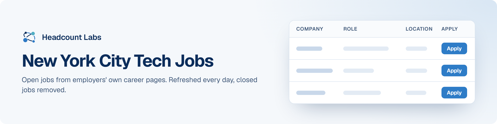

# New York City Tech Jobs

Software, data, AI, product and design jobs in the New York City area, sorted by field.

**327 open jobs** · 312 new since the last update · 185 removed because they closed or left the employer's board · updated November 11, 2026 at 5:12 AM EST

This list is built and refreshed every day by [Headcount Labs](https://headcountlabs.com/?utm_source=github&utm_medium=job-list&utm_campaign=new-york-tech-jobs), which reads jobs straight from employers' own career pages and job boards. Every job here was still listed on its source board when we last read that board, within the past 3 days, and was posted in the past 30 days. Copies of the same job are merged into one row, and jobs that close are removed at the next update.

Want this data in your own app or agent? Use the [Headcount Labs jobs API](https://headcountlabs.com/docs/?utm_source=github&utm_medium=job-list&utm_campaign=new-york-tech-jobs) (free tier), the [MCP server](https://headcountlabs.com/mcp/?utm_source=github&utm_medium=job-list&utm_campaign=new-york-tech-jobs) for Claude, ChatGPT and other AI assistants, or the [public dataset subsets](https://huggingface.co/HeadcountLabs) on Hugging Face (the full dataset is coming soon).

**Full dataset.** A bigger, one-off snapshot dated 2026-10-19 (all matching jobs, not only the open jobs below) is on Hugging Face: [Tech and software jobs](https://huggingface.co/datasets/HeadcountLabs/tech-jobs). It loads with `datasets.load_dataset` and is under the Open Database License (ODbL) 1.0.

**Jump to:** [Software engineering (114)](#software-engineering) · [Data, AI and machine learning (118)](#data-ai-and-machine-learning) · [Product and design (88)](#product-and-design) · [Hardware and engineering (7)](#hardware-and-engineering)

**Columns.** *Apply* opens the original posting on the employer's site. *Details* opens the job on Headcount Labs, with every posting we found for it. *Remote* shows what the employer states; a dash means the posting doesn't say. *Pay* is the range the employer published.

## Software engineering

| Company | Role | Location | Remote | Pay | Posted | Apply | Details |
| --- | --- | --- | --- | --- | --- | :---: | :---: |
| **Recruiting From Scratch** | Head of Software Engineering | Brooklyn, NY | On-site | $237k/yr | Nov 10 |  | <a href="https://headcountlabs.com/catalog/jobs/f0a3875d-bf83-47ad-9391-9154e6d7fb02?utm_source=github&utm_medium=job-list&utm_campaign=new-york-tech-jobs">via Headcount Labs</a> |
| **Pivotal Solutions, Inc.** | Senior Front End Engineer | New York, NY | — | — | Nov 10 |  | <a href="https://headcountlabs.com/catalog/jobs/babb3635-0a2d-40fd-8d00-260f0b55d493?utm_source=github&utm_medium=job-list&utm_campaign=new-york-tech-jobs">via Headcount Labs</a> |
| **Pivotal Solutions, Inc.** | Full Stack Engineer (React/Node) | New York, NY | — | — | Nov 10 |  | <a href="https://headcountlabs.com/catalog/jobs/17c7eb29-9268-4bf9-a1ec-6b696e21372e?utm_source=github&utm_medium=job-list&utm_campaign=new-york-tech-jobs">via Headcount Labs</a> |
| **Pivotal Solutions, Inc.** | Full Stack Engineer | New York, NY | — | — | Nov 10 |  | <a href="https://headcountlabs.com/catalog/jobs/05337074-d7b3-4802-b83f-c58d6d3eea97?utm_source=github&utm_medium=job-list&utm_campaign=new-york-tech-jobs">via Headcount Labs</a> |
| **Pivotal Solutions, Inc.** | Senior FullStack Engineer | New York, NY | — | — | Nov 10 |  | <a href="https://headcountlabs.com/catalog/jobs/03024c53-219f-4330-a152-ec887215d4a8?utm_source=github&utm_medium=job-list&utm_campaign=new-york-tech-jobs">via Headcount Labs</a> |
| **MaxIT Consulting - Max Corporate Group** | Software Engineer, Data Platform – Financial Data Lakehouse | New York, NY | — | — | Nov 10 |  | <a href="https://headcountlabs.com/catalog/jobs/69a9e480-0dec-4947-9331-1c8968f22d69?utm_source=github&utm_medium=job-list&utm_campaign=new-york-tech-jobs">via Headcount Labs</a> |
| **JPMorganChase** | Director of Software Engineering- Trader Voice Engineering | 

2 locations
Jersey City, NJ New York, NY
 | On-site | — | Nov 10 |  | <a href="https://headcountlabs.com/catalog/jobs/ac195da7-0626-40c3-bc87-c324cfcb0d7c?utm_source=github&utm_medium=job-list&utm_campaign=new-york-tech-jobs">via Headcount Labs</a> |
| **Google** | Senior Software Engineer, GenAI Evaluation | New York, NY | — | $174k–$252k/yr | Nov 10 |  | <a href="https://headcountlabs.com/catalog/jobs/adc67d73-c646-455b-b21b-7d87be2686b5?utm_source=github&utm_medium=job-list&utm_campaign=new-york-tech-jobs">via Headcount Labs</a> |
| **Google** | Senior Staff Software Engineer, Search Privacy and Trust Engineering | 

2 locations
Cambridge, MA New York, NY
 | — | $262k–$364k/yr | Nov 10 |  | <a href="https://headcountlabs.com/catalog/jobs/c0e6dfb2-3c57-4548-b98b-51d35cf23f9b?utm_source=github&utm_medium=job-list&utm_campaign=new-york-tech-jobs">via Headcount Labs</a> |
| **Google** | Staff Software Engineer, DeepMind | 

2 locations
Mountain View, CA New York, NY
 | — | $207k–$300k/yr | Nov 10 |  | <a href="https://headcountlabs.com/catalog/jobs/4a7f07cd-bf72-4695-bd35-452c8f963909?utm_source=github&utm_medium=job-list&utm_campaign=new-york-tech-jobs">via Headcount Labs</a> |
| **BNY** | Senior Associate, Full-Stack Engineer | 

2 locations
Jersey City, NJ New York, NY
 | On-site | $83k–$180k/yr | Nov 10 |  | <a href="https://headcountlabs.com/catalog/jobs/5f1334e7-dc09-49e4-b1b3-0d4348164bd0?utm_source=github&utm_medium=job-list&utm_campaign=new-york-tech-jobs">via Headcount Labs</a> |
| **BNY** | Vice President, AI / Machine Learning Software Engineer | New York, NY | On-site | — | Nov 10 |  | <a href="https://headcountlabs.com/catalog/jobs/a0bed7c5-e4d8-4d51-a180-4b088c60d749?utm_source=github&utm_medium=job-list&utm_campaign=new-york-tech-jobs">via Headcount Labs</a> |
| **Addepar** | Software Engineering Intern - Summer 2027 | New York, NY | — | $48/hr | Nov 10 |  | <a href="https://headcountlabs.com/catalog/jobs/d5fbb1d7-8f19-4e3f-ae47-ed263463b0b7?utm_source=github&utm_medium=job-list&utm_campaign=new-york-tech-jobs">via Headcount Labs</a> |
| **Ziff Davis** | Site Reliability Engineer | 

4 locations
Seattle, WA New York, NY Denver, CO Memphis, TN
 | — | $90k–$100k/yr | Nov 9 |  | <a href="https://headcountlabs.com/catalog/jobs/47e70c71-f39e-4cbf-abb0-16a79cb606ab?utm_source=github&utm_medium=job-list&utm_campaign=new-york-tech-jobs">via Headcount Labs</a> |
| **Versant** | Senior Software Engineer - Platforms | New York, NY | Hybrid | $110k–$160k/yr | Nov 9 |  | <a href="https://headcountlabs.com/catalog/jobs/2223763c-13dc-4c42-bcc0-baa19dd9992e?utm_source=github&utm_medium=job-list&utm_campaign=new-york-tech-jobs">via Headcount Labs</a> |
| **Spring Health** | Software Engineer II, Client Experience, Cost Journey | New York, NY | Hybrid | $120k–$153k/yr | Nov 9 |  | <a href="https://headcountlabs.com/catalog/jobs/5bdf1c38-bb64-4162-94e7-3d34f716e895?utm_source=github&utm_medium=job-list&utm_campaign=new-york-tech-jobs">via Headcount Labs</a> |
| **Pinterest** | Staff Software Engineer | 

4 locations
San Francisco, CA Los Angeles, CA Seattle, WA New York, NY
 | — | $208k–$365k/yr | Nov 9 |  | <a href="https://headcountlabs.com/catalog/jobs/740915ae-605b-4e53-95b1-13e3c7c621eb?utm_source=github&utm_medium=job-list&utm_campaign=new-york-tech-jobs">via Headcount Labs</a> |
| **Nscale** | Staff Cloud Native Software Engineer | 

2 locations
New York, NY San Francisco
 | — | $220k–$290k/yr | Nov 9 |  | <a href="https://headcountlabs.com/catalog/jobs/ccbd34f2-9222-438a-b514-4718e8a6dd6f?utm_source=github&utm_medium=job-list&utm_campaign=new-york-tech-jobs">via Headcount Labs</a> |
| **Nscale** | Senior Staff Cloud Native Software Engineer | 

2 locations
New York, NY San Francisco
 | — | $230k–$320k/yr | Nov 9 |  | <a href="https://headcountlabs.com/catalog/jobs/135fc2bf-a4c3-42ee-b3b7-544c3bd919f7?utm_source=github&utm_medium=job-list&utm_campaign=new-york-tech-jobs">via Headcount Labs</a> |
| **Notion** | Software Engineer, Web Infrastructure | 

2 locations
San Francisco, CA New York, NY
 | Hybrid | — | Nov 9 |  | <a href="https://headcountlabs.com/catalog/jobs/fba88e6d-0d0e-48ba-9ffe-033c046644c5?utm_source=github&utm_medium=job-list&utm_campaign=new-york-tech-jobs">via Headcount Labs</a> |
| **Gusto, Inc.** | Software Engineer, Financial Data &amp; Payments | 

4 locations
Denver, CO New York, NY San Francisco, CA Seattle, WA
 | Remote | $183k–$200k/yr | Nov 9 |  | <a href="https://headcountlabs.com/catalog/jobs/f40d86de-e41d-4411-8a90-669dc300aa4e?utm_source=github&utm_medium=job-list&utm_campaign=new-york-tech-jobs">via Headcount Labs</a> |
| **Fanatics Betting &amp; Gaming** | Staff Engineer - Backend/Java (REMOTE) | New York, NY | Remote | $144k–$235k/yr | Nov 9 |  | <a href="https://headcountlabs.com/catalog/jobs/575e9ec9-9495-43f4-8c77-820f78c8cbb7?utm_source=github&utm_medium=job-list&utm_campaign=new-york-tech-jobs">via Headcount Labs</a> |
| **Everyday Health - Division** | Site Reliability Engineer | 

4 locations
Seattle, WA New York, NY Denver, CO Memphis, TN
 | — | $90k–$100k/yr | Nov 9 |  | <a href="https://headcountlabs.com/catalog/jobs/df8596fa-734e-47e9-8c16-7c75f3fac053?utm_source=github&utm_medium=job-list&utm_campaign=new-york-tech-jobs">via Headcount Labs</a> |
| **Cohere** | Staff Software Engineer, Agentic Analytics | 

6 locations
United States San Francisco, CA New York, NY Ottawa Toronto Montreal
 | Hybrid | $270k–$325k/yr | Nov 9 |  | <a href="https://headcountlabs.com/catalog/jobs/48d17573-d993-4d53-945c-cdcc265df479?utm_source=github&utm_medium=job-list&utm_campaign=new-york-tech-jobs">via Headcount Labs</a> |
| **Chase-** | Lead Software Engineer - iOS Developer | New York, NY | Remote | $157k–$215k/yr | Nov 9 |  | <a href="https://headcountlabs.com/catalog/jobs/854ab165-de81-454f-9dca-8d464e84b4b6?utm_source=github&utm_medium=job-list&utm_campaign=new-york-tech-jobs">via Headcount Labs</a> |
| **Chase-** | Software Engineer III (Full Stack Java) | New York, NY | On-site | $138k–$185k/yr | Nov 9 |  | <a href="https://headcountlabs.com/catalog/jobs/793449e6-88f9-4c92-b5a7-90f4c87e48b5?utm_source=github&utm_medium=job-list&utm_campaign=new-york-tech-jobs">via Headcount Labs</a> |
| **Chase-** | Lead Software Engineer - Senior Android Engineer | New York, NY | Remote | $157k–$215k/yr | Nov 9 |  | <a href="https://headcountlabs.com/catalog/jobs/42eef730-b673-4571-8362-392cf9b672c5?utm_source=github&utm_medium=job-list&utm_campaign=new-york-tech-jobs">via Headcount Labs</a> |
| **BlackRock** | AI Platform &amp; Application Engineer - Vice President | New York, NY | — | — | Nov 9 |  | <a href="https://headcountlabs.com/catalog/jobs/9ac2347a-e087-4bbf-8f0e-e6d237ed5591?utm_source=github&utm_medium=job-list&utm_campaign=new-york-tech-jobs">via Headcount Labs</a> |
| **AgileEngine** | Software Architect ID92707 | New York, NY | — | — | Nov 9 |  | <a href="https://headcountlabs.com/catalog/jobs/253e6ba3-0c7c-4698-ad5a-5a092e3c6f9e?utm_source=github&utm_medium=job-list&utm_campaign=new-york-tech-jobs">via Headcount Labs</a> |
| **Raydar** | Senior Frontend Software Engineer | New York, NY | Hybrid | — | Nov 8 |  | <a href="https://headcountlabs.com/catalog/jobs/422d27a4-7f82-4c46-9270-c32d07d1e2bd?utm_source=github&utm_medium=job-list&utm_campaign=new-york-tech-jobs">via Headcount Labs</a> |
| **Win Career Openings** | Job Developer/Employment Specialist | Brooklyn, NY | — | $27.81/hr | Nov 7 |  | <a href="https://headcountlabs.com/catalog/jobs/874b836d-77ff-463b-97cc-3f6afd356c25?utm_source=github&utm_medium=job-list&utm_campaign=new-york-tech-jobs">via Headcount Labs</a> |
| **Raydar** | Senior Software Engineer | 

2 locations
New York, NY San Francisco, CA
 | On-site | — | Nov 7 |  | <a href="https://headcountlabs.com/catalog/jobs/6c6e8d5c-b156-44a5-b561-4432489e70d6?utm_source=github&utm_medium=job-list&utm_campaign=new-york-tech-jobs">via Headcount Labs</a> |
| **Raydar** | Senior Full Stack Software Engineer | New York, NY | Hybrid | — | Nov 7 |  | <a href="https://headcountlabs.com/catalog/jobs/a5063457-d6f6-4ba0-868e-89ab2ef674de?utm_source=github&utm_medium=job-list&utm_campaign=new-york-tech-jobs">via Headcount Labs</a> |
| **Raydar** | Backend Software Engineer | New York, NY | On-site | — | Nov 7 |  | <a href="https://headcountlabs.com/catalog/jobs/a9a54a96-836c-4902-bc3e-af723a8434b8?utm_source=github&utm_medium=job-list&utm_campaign=new-york-tech-jobs">via Headcount Labs</a> |
| **Twelve NYC** | Packaging Developer | Brooklyn, NY | Hybrid | $75k–$85k/yr | Nov 6 |  | <a href="https://headcountlabs.com/catalog/jobs/8cb0a030-4ba3-43d6-b0e7-1fe9d7d500d4?utm_source=github&utm_medium=job-list&utm_campaign=new-york-tech-jobs">via Headcount Labs</a> |
| **SemiAnalysis** | Cybersecurity Engineer | 

3 locations
New York City, NY San Francisco, CA Chicago, IL
 | Remote | — | Nov 6 |  | <a href="https://headcountlabs.com/catalog/jobs/8a9589b7-3559-47bc-add5-e073598bc094?utm_source=github&utm_medium=job-list&utm_campaign=new-york-tech-jobs">via Headcount Labs</a> |
| **S&amp;P OPCO LLC** | Senior Lead, Java Application Developer | New York, NY | — | $120k–$155k/yr | Nov 6 |  | <a href="https://headcountlabs.com/catalog/jobs/88297ac0-3313-45f3-9da5-6565397f3a84?utm_source=github&utm_medium=job-list&utm_campaign=new-york-tech-jobs">via Headcount Labs</a> |
| **S&amp;P Global** | Senior Lead, Java Application Developer | New York, NY | — | $120k–$155k/yr | Nov 6 |  | <a href="https://headcountlabs.com/catalog/jobs/e1f187be-716a-417d-a79b-98aeb5a139cc?utm_source=github&utm_medium=job-list&utm_campaign=new-york-tech-jobs">via Headcount Labs</a> |
| **Rockstar** | Senior / Staff Software Engineer | New York, NY | On-site | — | Nov 6 |  | <a href="https://headcountlabs.com/catalog/jobs/74ba19c4-cd2e-4364-b2f7-f8babc2d3af8?utm_source=github&utm_medium=job-list&utm_campaign=new-york-tech-jobs">via Headcount Labs</a> |
| **Raydar** | Full-Stack Product Engineer | New York, NY | On-site | — | Nov 6 |  | <a href="https://headcountlabs.com/catalog/jobs/1865be25-ca3b-4133-81eb-61568de72ea7?utm_source=github&utm_medium=job-list&utm_campaign=new-york-tech-jobs">via Headcount Labs</a> |
| **Notion** | Software Engineering Intern, Frontend (Summer 2027) | New York, NY | Hybrid | — | Nov 6 |  | <a href="https://headcountlabs.com/catalog/jobs/8a90be15-fbc5-4a7e-b779-943be2470a76?utm_source=github&utm_medium=job-list&utm_campaign=new-york-tech-jobs">via Headcount Labs</a> |
| **Notion** | Software Engineering Intern, iOS (Summer 2027) | New York, NY | — | — | Nov 6 |  | <a href="https://headcountlabs.com/catalog/jobs/50c7e42e-b5d7-4821-bd8f-e75cbcf6d861?utm_source=github&utm_medium=job-list&utm_campaign=new-york-tech-jobs">via Headcount Labs</a> |
| **JPMorganChase** | Senior Lead Software Engineer - Security Platforms | 

5 locations
Jersey City, NJ Columbus, OH Plano, TX Tampa, FL Brooklyn, NY
 | On-site | — | Nov 6 |  | <a href="https://headcountlabs.com/catalog/jobs/f04b3b4f-bf7e-4b95-98fe-610d9f3887c8?utm_source=github&utm_medium=job-list&utm_campaign=new-york-tech-jobs">via Headcount Labs</a> |
| **Cohere** | Software Engineer, GPU Infrastructure | 

2 locations
Seattle, WA New York, NY
 | Remote | $200k–$325k/yr | Nov 6 |  | <a href="https://headcountlabs.com/catalog/jobs/260899ba-74b7-497e-8e6c-34a33aabc55f?utm_source=github&utm_medium=job-list&utm_campaign=new-york-tech-jobs">via Headcount Labs</a> |
| **Raydar** | Senior Backend Software Engineer | New York, NY | Hybrid | — | Nov 4 |  | <a href="https://headcountlabs.com/catalog/jobs/e3821060-8210-4042-ae03-8559d1f276ef?utm_source=github&utm_medium=job-list&utm_campaign=new-york-tech-jobs">via Headcount Labs</a> |
| **Raydar** | Security Engineer | New York, NY | On-site | — | Nov 4 |  | <a href="https://headcountlabs.com/catalog/jobs/a91d80ad-22a6-4c8a-a2d6-cece238ceca3?utm_source=github&utm_medium=job-list&utm_campaign=new-york-tech-jobs">via Headcount Labs</a> |
| **LE038 Second Sight Solutions, LLC** | Software Engineering Manager | 

2 locations
Washington, DC New York, NY
 | — | $160k–$220k/yr | Nov 4 |  | <a href="https://headcountlabs.com/catalog/jobs/0a3d0a19-2de8-4e0f-82c7-967cd95ac47a?utm_source=github&utm_medium=job-list&utm_campaign=new-york-tech-jobs">via Headcount Labs</a> |
| **American Express** | Sr Software Engineer I | 

3 locations
Atlanta, GA New York, NY Phoenix, AZ
 | Hybrid | $123k–$215k/yr | Nov 4 |  | <a href="https://headcountlabs.com/catalog/jobs/64db955a-d7aa-4503-b55c-c26db1eac85b?utm_source=github&utm_medium=job-list&utm_campaign=new-york-tech-jobs">via Headcount Labs</a> |
| **INFOTRON** | Senior Dotnet Developer | New York, NY | — | $135k/yr | Nov 3 |  | <a href="https://headcountlabs.com/catalog/jobs/aacc030b-f286-4526-bc2c-2a4edb53e8b3?utm_source=github&utm_medium=job-list&utm_campaign=new-york-tech-jobs">via Headcount Labs</a> |
| **FactSet Research Systems Inc.** | OMS Principal Software Engineer (Full Stack, Design and Develop Financial Trading Applications) | 

2 locations
New York, NY Norwalk, CT
 | — | $210k–$270k/yr | Nov 3 |  | <a href="https://headcountlabs.com/catalog/jobs/2d060cc1-c72e-4293-aaa7-2900712c951e?utm_source=github&utm_medium=job-list&utm_campaign=new-york-tech-jobs">via Headcount Labs</a> |
| **Fanatics Betting &amp; Gaming** | Senior Software Engineer, Accounts - Core | New York, NY | Remote | $144k–$180k/yr | Nov 2 |  | <a href="https://headcountlabs.com/catalog/jobs/7099932c-6577-4a3c-9221-eabb94a02924?utm_source=github&utm_medium=job-list&utm_campaign=new-york-tech-jobs">via Headcount Labs</a> |
| **en banque, finance, assurance - Société Générale recrutement** | Bernstein Senior Research Associate - US SMID-Cap Software | New York, NY | — | $150k/yr | Nov 2 |  | <a href="https://headcountlabs.com/catalog/jobs/5f4e8b43-3767-45fb-ab8a-46262c1297b8?utm_source=github&utm_medium=job-list&utm_campaign=new-york-tech-jobs">via Headcount Labs</a> |
| **Charlie Health** | Senior Corporate Security Engineer | 

2 locations
Nashville, TN New York, NY
 | Hybrid | $180k–$240k/yr | Nov 2 |  | <a href="https://headcountlabs.com/catalog/jobs/decdffd1-f5a4-4fd6-a1a5-d64333d84b13?utm_source=github&utm_medium=job-list&utm_campaign=new-york-tech-jobs">via Headcount Labs</a> |
| **Axon** | Senior Software Engineer, Axon 911 (Relocation Assistance Available) | New York, NY | Hybrid | $141k–$217k/yr | Nov 2 |  | <a href="https://headcountlabs.com/catalog/jobs/c584f43b-5982-48fa-82c4-66dc387ad79e?utm_source=github&utm_medium=job-list&utm_campaign=new-york-tech-jobs">via Headcount Labs</a> |
| **Nomura Holdings, inc.** | eTrading Strategist/Developer - Associate/Vice President | New York, NY | — | $175k–$210k/yr | Nov 1 |  | <a href="https://headcountlabs.com/catalog/jobs/70e7e36d-47a4-4f4b-abc7-2722fd520c95?utm_source=github&utm_medium=job-list&utm_campaign=new-york-tech-jobs">via Headcount Labs</a> |
| **Nomura Holdings, inc.** | Principal Software Engineer/Tech Lead | New York, NY | — | $160k–$190k/yr | Oct 31 |  | <a href="https://headcountlabs.com/catalog/jobs/06872119-4b6c-40c0-a556-6fb8d13d55a1?utm_source=github&utm_medium=job-list&utm_campaign=new-york-tech-jobs">via Headcount Labs</a> |
| **Cohere** | Senior Security Engineer | 

5 locations
Toronto San Francisco, CA London New York, NY Montreal
 | Remote | — | Oct 31 |  | <a href="https://headcountlabs.com/catalog/jobs/2b8cb64d-7f0b-405f-a02e-eec0c7b35738?utm_source=github&utm_medium=job-list&utm_campaign=new-york-tech-jobs">via Headcount Labs</a> |
| **Justworks** | Senior Software Engineer, Shared Services | New York, NY | Hybrid | $188k–$242k/yr | Oct 30 |  | <a href="https://headcountlabs.com/catalog/jobs/f8ef3ef2-f419-40c5-9f98-fe9d0a00531d?utm_source=github&utm_medium=job-list&utm_campaign=new-york-tech-jobs">via Headcount Labs</a> |
| **BlackRock** | Java Developer, Software Engineering, Associate– Regulatory Reporting | New York, NY | — | — | Oct 30 |  | <a href="https://headcountlabs.com/catalog/jobs/2e24b81e-fdd4-4173-bed7-2d1c842fa454?utm_source=github&utm_medium=job-list&utm_campaign=new-york-tech-jobs">via Headcount Labs</a> |
| **Verizon Business Ntwk Srvs LLC** | Senior Infrastructure Security Engineer | 

5 locations
Southlake, TX Ashburn, VA Branchburg, NJ Cary, NC New York, NY
 | Hybrid | $101k–$194k/yr | Oct 29 |  | <a href="https://headcountlabs.com/catalog/jobs/455a378e-3503-4156-9a24-245d7f5aeb95?utm_source=github&utm_medium=job-list&utm_campaign=new-york-tech-jobs">via Headcount Labs</a> |
| **T. Rowe Price** | Senior AI Software Engineer — T. Rowe Price Labs | New York, NY | On-site | $121k–$206k/yr | Oct 29 |  | <a href="https://headcountlabs.com/catalog/jobs/c5a2c546-df02-4d22-a031-b91cd6a36d48?utm_source=github&utm_medium=job-list&utm_campaign=new-york-tech-jobs">via Headcount Labs</a> |
| **LE240 Unity Technologies ApS** | Sr. Full Stack Engineer, Unified Ads Platform | 

3 locations
New York, NY Montreal Toronto
 | — | $135k–$176k/yr | Oct 29 |  | <a href="https://headcountlabs.com/catalog/jobs/37684eb5-9a04-436e-8517-839e5ed92d63?utm_source=github&utm_medium=job-list&utm_campaign=new-york-tech-jobs">via Headcount Labs</a> |
| **US: Mastercard Technologies, LLC** | Lead AI Platform Engineer | 

6 locations
New York City, NY Arlington, VA Atlanta, GA Boston, MA O'Fallon, MO Purchase, NY
 | — | $168k–$277k/yr | Oct 28 |  | <a href="https://headcountlabs.com/catalog/jobs/c81978ae-ec79-4736-a3d8-0f1a644d865f?utm_source=github&utm_medium=job-list&utm_campaign=new-york-tech-jobs">via Headcount Labs</a> |
| **RFCUNY Research Foundation of the City University of New York** | Application Developer | New York, NY | Hybrid | $135k–$143k/yr | Oct 28 |  | <a href="https://headcountlabs.com/catalog/jobs/92b87060-2b2c-41a2-a137-c76d542d9b7c?utm_source=github&utm_medium=job-list&utm_campaign=new-york-tech-jobs">via Headcount Labs</a> |
| **Publicis Groupe Holdings B.V** | BI Developer | New York, NY | — | $73k–$113k/yr | Oct 28 |  | <a href="https://headcountlabs.com/catalog/jobs/517b9026-938f-459b-8da6-bd8c5dc080fa?utm_source=github&utm_medium=job-list&utm_campaign=new-york-tech-jobs">via Headcount Labs</a> |
| **Mistral Ai** | Site Reliability Engineer, Fleet Health &amp; Delivery | New York, NY | — | — | Oct 28 |  | <a href="https://headcountlabs.com/catalog/jobs/b3151ab7-8088-44b8-bbf9-04bd9efb8340?utm_source=github&utm_medium=job-list&utm_campaign=new-york-tech-jobs">via Headcount Labs</a> |
| **Mastercard** | Lead AI Platform Engineer | 

7 locations
Boston, MA New York, NY Boston Arlington Atlanta Purchase O Fallon
 | — | $168k–$277k/yr | Oct 28 |  | <a href="https://headcountlabs.com/catalog/jobs/cff36346-3982-4bb6-aeda-dae1c3a20705?utm_source=github&utm_medium=job-list&utm_campaign=new-york-tech-jobs">via Headcount Labs</a> |
| **Weill Cornell Medical College** | Quality Assurance Developer II, Business Applications Remote | New York, NY | Remote | $123k–$139k/yr | Oct 27 |  | <a href="https://headcountlabs.com/catalog/jobs/63cf1bf7-4773-482d-ab32-1511ad5d7b02?utm_source=github&utm_medium=job-list&utm_campaign=new-york-tech-jobs">via Headcount Labs</a> |
| **US: Mastercard Technologies, LLC** | Vice President, Software Engineering | 

3 locations
San Francisco, CA Atlanta, GA New York City, NY
 | — | $254k–$407k/yr | Oct 27 |  | <a href="https://headcountlabs.com/catalog/jobs/953c2fb5-9acb-435d-98d0-3cc39589cfe1?utm_source=github&utm_medium=job-list&utm_campaign=new-york-tech-jobs">via Headcount Labs</a> |
| **US: Mastercard Technologies, LLC** | Principal Software Engineer, Data Architecture | 

2 locations
Purchase, NY New York City, NY
 | — | $195k–$323k/yr | Oct 27 |  | <a href="https://headcountlabs.com/catalog/jobs/5741127b-f032-42c9-89b3-f2c430df45d4?utm_source=github&utm_medium=job-list&utm_campaign=new-york-tech-jobs">via Headcount Labs</a> |
| **TP ICAP Americas Holdings Inc.** | Algorithmic Trading Developer | New York, NY | Hybrid | $173k/yr | Oct 27 |  | <a href="https://headcountlabs.com/catalog/jobs/e640fed3-d5c9-4b55-a93e-4765723e6e34?utm_source=github&utm_medium=job-list&utm_campaign=new-york-tech-jobs">via Headcount Labs</a> |
| **Metropolitan Transportation Authority** | Database Administrator MS Access (User Support and Developer), Emerging Talent Intern (Spring) | Brooklyn, NY | — | $19/hr | Oct 27 |  | <a href="https://headcountlabs.com/catalog/jobs/49fcf2ed-66b1-4d43-86d1-3e2d060986f4?utm_source=github&utm_medium=job-list&utm_campaign=new-york-tech-jobs">via Headcount Labs</a> |
| **Justworks** | Senior Software Engineer, Workforce Payments | New York, NY | Hybrid | $188k–$242k/yr | Oct 27 |  | <a href="https://headcountlabs.com/catalog/jobs/e5504607-d02f-40e2-997e-8bf033615644?utm_source=github&utm_medium=job-list&utm_campaign=new-york-tech-jobs">via Headcount Labs</a> |
| **Justworks** | Senior Software Engineer, Product Foundations | New York, NY | Hybrid | $168k–$235k/yr | Oct 27 |  | <a href="https://headcountlabs.com/catalog/jobs/7a0880f7-b76e-4cdb-90ab-3c601a0b9c75?utm_source=github&utm_medium=job-list&utm_campaign=new-york-tech-jobs">via Headcount Labs</a> |
| **Cohere** | Web Developer | 

6 locations
Toronto San Francisco, CA New York, NY Vancouver Ottawa Montreal
 | Remote | — | Oct 27 |  | <a href="https://headcountlabs.com/catalog/jobs/f8980073-1476-4a27-9791-85f37309d8f0?utm_source=github&utm_medium=job-list&utm_campaign=new-york-tech-jobs">via Headcount Labs</a> |
| **LE001 Berkeley Research Group, LLC** | Sr. Managing Consultant/Managing Consultant Full Stack Engineer- Financial Institution Operations &amp; Technology | 

5 locations
New York, NY Boston, MA Chicago, IL Dallas, TX Washington, DC
 | — | $158k–$180k/yr | Oct 26 |  | <a href="https://headcountlabs.com/catalog/jobs/fbe58e73-f89f-41e3-a2eb-da7b7ebbc0c6?utm_source=github&utm_medium=job-list&utm_campaign=new-york-tech-jobs">via Headcount Labs</a> |
| **Hearst** | Full Stack Ad Tech Developer | New York, NY | Hybrid | $110k–$140k/yr | Oct 26 |  | <a href="https://headcountlabs.com/catalog/jobs/a03a98bb-874c-4557-bf7f-74d07e52a080?utm_source=github&utm_medium=job-list&utm_campaign=new-york-tech-jobs">via Headcount Labs</a> |
| **FactSet Research Systems Inc.** | Principal Software Engineer, Applied AI - Hybrid (LLM, Agentic, Claude Code, MCP) | 

2 locations
New York, NY Norwalk, CT
 | Hybrid | $180k–$235k/yr | Oct 26 |  | <a href="https://headcountlabs.com/catalog/jobs/4613a516-bddc-475f-ac0c-f9bbecd945a1?utm_source=github&utm_medium=job-list&utm_campaign=new-york-tech-jobs">via Headcount Labs</a> |
| **JPMorgan Asset Management Technology** | Lead Software Engineer - AI &amp; Quantitative Development | New York, NY | On-site | $157k–$215k/yr | Oct 23 |  | <a href="https://headcountlabs.com/catalog/jobs/e64693a3-6efb-4eb0-a42a-e1abe8555ff4?utm_source=github&utm_medium=job-list&utm_campaign=new-york-tech-jobs">via Headcount Labs</a> |
| **Intercontinental Exchange Holdings, Inc.** | Summer Internship Program 2027 - Software Engineering Intern | New York, NY | — | $30/hr | Oct 23 |  | <a href="https://headcountlabs.com/catalog/jobs/5456e488-62b7-4df2-97f4-17e2136c03a8?utm_source=github&utm_medium=job-list&utm_campaign=new-york-tech-jobs">via Headcount Labs</a> |
| **24-MAG** | Remote &#124; Software Engineer (Open Source Contributor) — $50–$100/hour | New York, NY | Remote | $50–$100/hr | Oct 23 |  | <a href="https://headcountlabs.com/catalog/jobs/175689d8-9b94-499b-83a7-beb276179f42?utm_source=github&utm_medium=job-list&utm_campaign=new-york-tech-jobs">via Headcount Labs</a> |
| **The Trade Desk** | Oracle ERP Technical Developer | 

7 locations
New York, NY Chicago Irvine Los Angeles San Francisco San Jose Ventura
 | — | $94k–$172k/yr | Oct 22 |  | <a href="https://headcountlabs.com/catalog/jobs/289a41e7-9fe0-41f6-ba78-eef336c9b39c?utm_source=github&utm_medium=job-list&utm_campaign=new-york-tech-jobs">via Headcount Labs</a> |
| **Wonder** | Senior Software Engineer (Frontend) | New York, NY | — | $176k–$184k/yr | Oct 21 |  | <a href="https://headcountlabs.com/catalog/jobs/84e63d65-ebdf-47b9-af07-e98c11868923?utm_source=github&utm_medium=job-list&utm_campaign=new-york-tech-jobs">via Headcount Labs</a> |
| **Intercontinental Exchange Holdings, Inc.** | Lead Developer | New York, NY | — | $168k–$220k/yr | Oct 21 |  | <a href="https://headcountlabs.com/catalog/jobs/1cdd44fe-b91c-4d5e-b52a-2de930d30645?utm_source=github&utm_medium=job-list&utm_campaign=new-york-tech-jobs">via Headcount Labs</a> |
| **Gusto, Inc.** | Workday System Developer | 

3 locations
Denver, CO New York, NY San Francisco, CA
 | Hybrid | $128k–$160k/yr | Oct 21 |  | <a href="https://headcountlabs.com/catalog/jobs/737a0f6e-9033-49e9-97df-b2eabcb75aed?utm_source=github&utm_medium=job-list&utm_campaign=new-york-tech-jobs">via Headcount Labs</a> |
| **Armanino Advisory LLC** | ServiceNow Business Systems Developer | 

20 locations
New York City, NY Atlanta, GA Austin, TX Bellevue, WA Boca Raton, FL Century City, CA Chicago, IL Dallas, TX Denver, CO Downtown Los Angeles, CA Garden City, NY Irvine, CA +8 more
 | — | $134k–$183k/yr | Oct 21 |  | <a href="https://headcountlabs.com/catalog/jobs/72d143b1-a13b-4fc0-b472-3d3ff9c5113e?utm_source=github&utm_medium=job-list&utm_campaign=new-york-tech-jobs">via Headcount Labs</a> |
| **Justworks** | Senior Software Engineer, Backend | New York, NY | Hybrid | $188k–$242k/yr | Oct 20 |  | <a href="https://headcountlabs.com/catalog/jobs/b76d6d4e-2431-4076-8435-0028f8d9c9c8?utm_source=github&utm_medium=job-list&utm_campaign=new-york-tech-jobs">via Headcount Labs</a> |
| **Justworks** | Software Engineer, Backend | New York, NY | Hybrid | $131k–$169k/yr | Oct 20 |  | <a href="https://headcountlabs.com/catalog/jobs/d3f2e10d-98d5-43ad-8566-4c89c2aac53e?utm_source=github&utm_medium=job-list&utm_campaign=new-york-tech-jobs">via Headcount Labs</a> |
| **Wonder** | Senior Software Engineer (Backend) | New York, NY | — | $176k–$184k/yr | Oct 19 |  | <a href="https://headcountlabs.com/catalog/jobs/9d0d4255-1290-4a9a-a8f8-225fd357ac2d?utm_source=github&utm_medium=job-list&utm_campaign=new-york-tech-jobs">via Headcount Labs</a> |
| **TP ICAP Americas Holdings Inc.** | Front-End Senior Engineer | New York, NY | — | $136k–$175k/yr | Oct 19 |  | <a href="https://headcountlabs.com/catalog/jobs/4c00e220-6b87-4e8f-a3d6-edaf9ff166fc?utm_source=github&utm_medium=job-list&utm_campaign=new-york-tech-jobs">via Headcount Labs</a> |
| **Qube Research &amp; Technologies** | C++ Developer – ETF Technology &amp; Infrastructure | New York, NY | — | $180k–$300k/yr | Oct 19 |  | <a href="https://headcountlabs.com/catalog/jobs/f5485daa-08e6-4199-bf2c-daabc65f99cb?utm_source=github&utm_medium=job-list&utm_campaign=new-york-tech-jobs">via Headcount Labs</a> |
| **Qube Research &amp; Technologies** | Senior Low-Latency C++ Software Engineer | New York, NY | — | $180k–$300k/yr | Oct 19 |  | <a href="https://headcountlabs.com/catalog/jobs/eb3c8969-ea7d-44e3-bf5c-b4c2e352e4c3?utm_source=github&utm_medium=job-list&utm_campaign=new-york-tech-jobs">via Headcount Labs</a> |
| **Pinterest** | Staff Software Engineer, Infrastructure Data Engineering | New York, NY | Remote | $177k–$365k/yr | Oct 19 |  | <a href="https://headcountlabs.com/catalog/jobs/55d8c274-8a99-4a56-ac63-5c0313b79a11?utm_source=github&utm_medium=job-list&utm_campaign=new-york-tech-jobs">via Headcount Labs</a> |
| **Notion** | Software Engineer, Developer Platform | 

2 locations
San Francisco, CA New York, NY
 | Hybrid | — | Oct 19 |  | <a href="https://headcountlabs.com/catalog/jobs/378ed614-68fa-4c05-ae87-73828b59b9f6?utm_source=github&utm_medium=job-list&utm_campaign=new-york-tech-jobs">via Headcount Labs</a> |
| **Nomura Holdings, inc.** | eTrading Strategist/Developer - VP/ED | New York, NY | — | $225k–$250k/yr | Oct 19 |  | <a href="https://headcountlabs.com/catalog/jobs/ba913c4a-26b2-4eae-8a73-8506936936b5?utm_source=github&utm_medium=job-list&utm_campaign=new-york-tech-jobs">via Headcount Labs</a> |
| **FactSet Research Systems Inc.** | Principal Site Reliability Engineer (Kubernetes Required) - Hybrid | 

2 locations
Norwalk, CT New York, NY
 | Hybrid | $190k–$220k/yr | Oct 19 |  | <a href="https://headcountlabs.com/catalog/jobs/5a870dbf-ca8b-48e7-9232-0524de6e04c0?utm_source=github&utm_medium=job-list&utm_campaign=new-york-tech-jobs">via Headcount Labs</a> |
| **FactSet Research Systems Inc.** | LiquidityBook Lead Software Engineer – Market Data and Integrations (Backend, Java) | 

2 locations
New York, NY Norwalk, CT
 | — | $130k–$165k/yr | Oct 19 |  | <a href="https://headcountlabs.com/catalog/jobs/cb7580e8-ad56-4ce3-afac-80e488500635?utm_source=github&utm_medium=job-list&utm_campaign=new-york-tech-jobs">via Headcount Labs</a> |
| **Spotify** | Security Engineer - Product Security | 

2 locations
Toronto New York, NY
 | Remote | — | Oct 16 |  | <a href="https://headcountlabs.com/catalog/jobs/6efd601a-61fd-452b-8df2-57469706c717?utm_source=github&utm_medium=job-list&utm_campaign=new-york-tech-jobs">via Headcount Labs</a> |
| **Nomura Holdings, inc.** | Algo Developer - Contract | New York, NY | — | $600–$800 | Oct 16 |  | <a href="https://headcountlabs.com/catalog/jobs/c4e16c4c-3ccd-42e4-95ea-6619864c8dad?utm_source=github&utm_medium=job-list&utm_campaign=new-york-tech-jobs">via Headcount Labs</a> |
| **Justworks** | Software Engineer, Solutions Engineering | New York, NY | Hybrid | $131k–$169k/yr | Oct 16 |  | <a href="https://headcountlabs.com/catalog/jobs/d125725f-178d-4fa3-b033-37d29a4200e9?utm_source=github&utm_medium=job-list&utm_campaign=new-york-tech-jobs">via Headcount Labs</a> |
| **Justworks** | Senior Software Engineer, Solutions Engineering | New York, NY | Hybrid | $188k–$242k/yr | Oct 16 |  | <a href="https://headcountlabs.com/catalog/jobs/09161374-7944-4ffe-b4ab-43fa34efa2e2?utm_source=github&utm_medium=job-list&utm_campaign=new-york-tech-jobs">via Headcount Labs</a> |
| **Nomura Holdings, inc.** | Sourcing Manager - Software | New York, NY | Remote | $120k–$145k/yr | Oct 15 |  | <a href="https://headcountlabs.com/catalog/jobs/8e078d8c-9fc8-47ba-adca-44237831475d?utm_source=github&utm_medium=job-list&utm_campaign=new-york-tech-jobs">via Headcount Labs</a> |
| **Neko Health** | Lead Software Engineer - Medical OS | New York, NY | Hybrid | $225k–$275k/yr | Oct 15 |  | <a href="https://headcountlabs.com/catalog/jobs/fb57763a-b61a-4233-8f78-b313ecb5fb88?utm_source=github&utm_medium=job-list&utm_campaign=new-york-tech-jobs">via Headcount Labs</a> |
| **Gusto, Inc.** | Staff Software Engineer, HR Experience | New York, NY | Hybrid | $197k–$247k/yr | Oct 15 |  | <a href="https://headcountlabs.com/catalog/jobs/513aaf22-421f-4fd1-b1d7-2369b9fe8850?utm_source=github&utm_medium=job-list&utm_campaign=new-york-tech-jobs">via Headcount Labs</a> |
| **Gusto, Inc.** | Senior Staff Software Engineer, Gusto Agent &amp; Partner Experiences (API) | 

3 locations
Denver, CO New York, NY San Francisco, CA
 | Hybrid | $213k–$236k/yr | Oct 15 |  | <a href="https://headcountlabs.com/catalog/jobs/625bc476-6609-45fd-88a9-b27e54967356?utm_source=github&utm_medium=job-list&utm_campaign=new-york-tech-jobs">via Headcount Labs</a> |
| **Cohere** | Senior/Staff Software Engineer (Back-End), Inference | 

6 locations
San Francisco, CA United States New York, NY Ottawa Toronto Montreal
 | Remote | $225k–$315k/yr | Oct 15 |  | <a href="https://headcountlabs.com/catalog/jobs/199cf1ac-d45b-49a7-ad85-6b3cef2ef6b0?utm_source=github&utm_medium=job-list&utm_campaign=new-york-tech-jobs">via Headcount Labs</a> |
| **Williams-Sonoma** | Sr Information Security Engineer - Security Red Team | Brooklyn, NY | On-site | $120k–$150k/yr | Oct 14 |  | <a href="https://headcountlabs.com/catalog/jobs/ceed4cce-8d8c-44f2-ba84-3b88de60a038?utm_source=github&utm_medium=job-list&utm_campaign=new-york-tech-jobs">via Headcount Labs</a> |
| **Williams-Sonoma** | Information Security Engineer SOC and Incident Response | Brooklyn, NY | On-site | $100k–$130k/yr | Oct 14 |  | <a href="https://headcountlabs.com/catalog/jobs/7d2a6418-7a06-421d-9506-942933b19716?utm_source=github&utm_medium=job-list&utm_campaign=new-york-tech-jobs">via Headcount Labs</a> |
| **Victoria's Secret** | Web Site Designer | New York, NY | — | $78k/yr | Oct 13 |  | <a href="https://headcountlabs.com/catalog/jobs/acb2d1f9-4044-4493-b9a0-82e15e0ae142?utm_source=github&utm_medium=job-list&utm_campaign=new-york-tech-jobs">via Headcount Labs</a> |
| **RFCUNY Research Foundation of the City University of New York** | Curriculum Developer/Trainer | New York, NY | — | $75k–$85k/yr | Oct 13 |  | <a href="https://headcountlabs.com/catalog/jobs/ab9b0c1f-b8c6-49c2-be78-5a7d717cbca0?utm_source=github&utm_medium=job-list&utm_campaign=new-york-tech-jobs">via Headcount Labs</a> |
| **Judi Health** | Developer - Atlassian Process Engineering | 

3 locations
Charlotte, NC Denver, CO New York, NY
 | Remote | $147k–$180k/yr | Oct 13 |  | <a href="https://headcountlabs.com/catalog/jobs/4ad5e1a1-153d-4442-904f-5fe01595bdc5?utm_source=github&utm_medium=job-list&utm_campaign=new-york-tech-jobs">via Headcount Labs</a> |
| **Cloudflare** | Senior Software Engineer, Distributed Databases | 

6 locations
Austin, TX London München New York, NY San Francisco, CA Seattle, WA
 | Hybrid | $194k–$266k/yr | Oct 13 |  | <a href="https://headcountlabs.com/catalog/jobs/4544f7fa-131b-44a8-9342-a7edc2044c2a?utm_source=github&utm_medium=job-list&utm_campaign=new-york-tech-jobs">via Headcount Labs</a> |
| **Bank of Montreal (U.S.)** | C++ Quant Developer | New York, NY | — | — | Oct 13 |  | <a href="https://headcountlabs.com/catalog/jobs/822ab4db-d69f-47bb-92dd-345527aea3fe?utm_source=github&utm_medium=job-list&utm_campaign=new-york-tech-jobs">via Headcount Labs</a> |
| **Cisco** | Software Engineer Technical Leader – Network Data Plane – Hypershield | 

50 locations
Frankfort, KY Trenton, NJ Clayton, MO Hartford, CT Salt Lake City, UT Chicago, IL Jackson, MS Portland, OR Appleton, WI Herndon, VA Denver, CO Santa Fe, NM +38 more
 | — | $192k–$317k/yr | Oct 12 |  | <a href="https://headcountlabs.com/catalog/jobs/971b3f17-d195-4953-b71b-576e52a16bd3?utm_source=github&utm_medium=job-list&utm_campaign=new-york-tech-jobs">via Headcount Labs</a> |

## Data, AI and machine learning

| Company | Role | Location | Remote | Pay | Posted | Apply | Details |
| --- | --- | --- | --- | --- | --- | :---: | :---: |
| **True Talent Solutions Partners** | Lead AI Engineer | New York, NY | On-site | — | Nov 10 |  | <a href="https://headcountlabs.com/catalog/jobs/3c233aa9-089f-4659-86ca-70ecb5115fc4?utm_source=github&utm_medium=job-list&utm_campaign=new-york-tech-jobs">via Headcount Labs</a> |
| **True Talent Solutions Partners** | Founding AI Engineer | New York, NY | On-site | — | Nov 10 |  | <a href="https://headcountlabs.com/catalog/jobs/61838203-41e9-4efa-b8d6-87280cd52465?utm_source=github&utm_medium=job-list&utm_campaign=new-york-tech-jobs">via Headcount Labs</a> |
| **TIAA** | Security Data Engineer | 

5 locations
Dallas, TX Charlotte, NC Chicago, IL Iselin, NJ New York, NY
 | Hybrid | $124k–$154k/yr | Nov 10 |  | <a href="https://headcountlabs.com/catalog/jobs/0f3b7ab3-fc2e-4fd0-9d6e-3202d4a7d47c?utm_source=github&utm_medium=job-list&utm_campaign=new-york-tech-jobs">via Headcount Labs</a> |
| **Similarweb** | Senior Product Data Scientist - Investors Vertical | New York, NY | Hybrid | $120k–$165k/yr | Nov 10 |  | <a href="https://headcountlabs.com/catalog/jobs/8d7be333-0b36-4d28-adf3-4bd4611dd83c?utm_source=github&utm_medium=job-list&utm_campaign=new-york-tech-jobs">via Headcount Labs</a> |
| **Rippling** | Data Scientist, Strategic Finance | 

2 locations
New York, NY San Francisco, CA
 | On-site | — | Nov 10 |  | <a href="https://headcountlabs.com/catalog/jobs/e239acbf-9511-4a14-9aea-531d1985e9e9?utm_source=github&utm_medium=job-list&utm_campaign=new-york-tech-jobs">via Headcount Labs</a> |
| **PWC US** | Data Strategy &amp; Governance -Director | 

60 locations
NY-New York, NY NC-Raleigh NC-Charlotte IL-Chicago OH-Cincinnati OH-Cleveland SC-Columbia OH-Columbus TX-Dallas VA-Richmond MD-Baltimore NY-Rochester +48 more
 | Hybrid | $155k–$410k/yr | Nov 10 |  | <a href="https://headcountlabs.com/catalog/jobs/a10e2d9c-dcad-4020-9cae-7718ab955204?utm_source=github&utm_medium=job-list&utm_campaign=new-york-tech-jobs">via Headcount Labs</a> |
| **PWC US** | Applied AI Health System Engineer [Health Services-Provider] – Senior Manager | 

62 locations
NY-New York, NY NC-Raleigh NC-Charlotte IL-Chicago OH-Cincinnati OH-Cleveland SC-Columbia OH-Columbus TX-Dallas VA-Richmond MD-Baltimore NY-Rochester +50 more
 | Hybrid | $124k–$280k/yr | Nov 10 |  | <a href="https://headcountlabs.com/catalog/jobs/33bbcf7e-9e30-40b4-96d1-c409253f6747?utm_source=github&utm_medium=job-list&utm_campaign=new-york-tech-jobs">via Headcount Labs</a> |
| **Pivotal Solutions, Inc.** | Machine Learning Engineer | New York, NY | — | — | Nov 10 |  | <a href="https://headcountlabs.com/catalog/jobs/899fdef9-5817-46ba-8cba-84bc680d484a?utm_source=github&utm_medium=job-list&utm_campaign=new-york-tech-jobs">via Headcount Labs</a> |
| **Pivotal Solutions, Inc.** | Senior AI Engineer | New York, NY | — | — | Nov 10 |  | <a href="https://headcountlabs.com/catalog/jobs/a8316ccd-c88d-4924-a11a-c93b2bd50987?utm_source=github&utm_medium=job-list&utm_campaign=new-york-tech-jobs">via Headcount Labs</a> |
| **NBCUniversal** | Lead Data Scientist | New York, NY | Hybrid | $145k–$175k/yr | Nov 10 |  | <a href="https://headcountlabs.com/catalog/jobs/785b4099-5a93-4a99-b60d-702d28eaa2e6?utm_source=github&utm_medium=job-list&utm_campaign=new-york-tech-jobs">via Headcount Labs</a> |
| **MaxIT Consulting - Max Corporate Group** | Forward Deployed AI Engineer – Multi-Agent Systems &amp; Martech (US Remote) | New York, NY | Remote | — | Nov 10 |  | <a href="https://headcountlabs.com/catalog/jobs/757a7e5c-73f6-4ec2-812d-95535133dffc?utm_source=github&utm_medium=job-list&utm_campaign=new-york-tech-jobs">via Headcount Labs</a> |
| **MaxIT Consulting - Max Corporate Group** | Brand Engineer, Forward Deployed – AI Agents for Marketing (US) | New York, NY | Remote | — | Nov 10 |  | <a href="https://headcountlabs.com/catalog/jobs/9c12f6fd-e733-41de-a026-4a1fd7f90a67?utm_source=github&utm_medium=job-list&utm_campaign=new-york-tech-jobs">via Headcount Labs</a> |
| **MaxIT Consulting - Max Corporate Group** | Data Engineer – ClickHouse, SQLMesh &amp; TypeScript (Fintech) | New York, NY | — | — | Nov 10 |  | <a href="https://headcountlabs.com/catalog/jobs/52633f59-931e-46be-b243-7b3d4dcacd30?utm_source=github&utm_medium=job-list&utm_campaign=new-york-tech-jobs">via Headcount Labs</a> |
| **LE024 Welo Data, LLC** | Data Labeling Analyst - Speech &amp; Voice AI | 

2 locations
United States New York, NY
 | Remote | — | Nov 10 |  | <a href="https://headcountlabs.com/catalog/jobs/a0b9f1ac-e88a-4104-8ff6-5a96dcf1c596?utm_source=github&utm_medium=job-list&utm_campaign=new-york-tech-jobs">via Headcount Labs</a> |
| **Google** | AI Threat Defense Engineer, Professional Services Organization | New York, NY | — | $127k–$182k/yr | Nov 10 |  | <a href="https://headcountlabs.com/catalog/jobs/68a10c93-777f-4d66-bb3f-571739dcb3e2?utm_source=github&utm_medium=job-list&utm_campaign=new-york-tech-jobs">via Headcount Labs</a> |
| **Google** | Practice Architect, Agentic Data Cloud | 

4 locations
Sunnyvale, CA Kirkland, WA New York, NY Seattle, WA
 | — | $224k–$311k/yr | Nov 10 |  | <a href="https://headcountlabs.com/catalog/jobs/61dd3f20-ae3e-49a1-89d2-2381d833dbb8?utm_source=github&utm_medium=job-list&utm_campaign=new-york-tech-jobs">via Headcount Labs</a> |
| **FactSet Research Systems Inc.** | Product Manager, Data Management &amp; Services | 

5 locations
Norwalk, CT Chicago, IL New York, NY San Francisco, CA United States
 | — | $108k–$135k/yr | Nov 10 |  | <a href="https://headcountlabs.com/catalog/jobs/6e2225f2-abd9-44bc-888f-89a62ae7517a?utm_source=github&utm_medium=job-list&utm_campaign=new-york-tech-jobs">via Headcount Labs</a> |
| **Chase-** | Program Lead - Data and Analytics | 

3 locations
New York, NY Jersey City, NJ Wilmington, DE
 | On-site | — | Nov 10 |  | <a href="https://headcountlabs.com/catalog/jobs/76be796b-eeff-4b1f-9bdf-4bdac63eb568?utm_source=github&utm_medium=job-list&utm_campaign=new-york-tech-jobs">via Headcount Labs</a> |
| **Chase** | VP - Cobrand Product Strategy &amp; AI Enablement | 

2 locations
New York, NY Wilmington, DE
 | On-site | — | Nov 10 |  | <a href="https://headcountlabs.com/catalog/jobs/92af9443-24e2-4e1f-8a23-36df5af8e50e?utm_source=github&utm_medium=job-list&utm_campaign=new-york-tech-jobs">via Headcount Labs</a> |
| **BlackRock** | Associate/Vice President, Investment Data Management - PFS | New York, NY | — | — | Nov 10 |  | <a href="https://headcountlabs.com/catalog/jobs/74fc59f1-f071-4701-85cf-969ea1625d9e?utm_source=github&utm_medium=job-list&utm_campaign=new-york-tech-jobs">via Headcount Labs</a> |
| **Addepar** | Data Engineering Intern - Summer 2027 | New York, NY | — | $40/hr | Nov 10 |  | <a href="https://headcountlabs.com/catalog/jobs/8d591e2f-2449-4b66-a8d2-51d1d4fb8f97?utm_source=github&utm_medium=job-list&utm_campaign=new-york-tech-jobs">via Headcount Labs</a> |
| **WTW** | Lead AI Engineer | 

2 locations
New York, NY London
 | Hybrid | $100k–$350k/yr | Nov 9 |  | <a href="https://headcountlabs.com/catalog/jobs/420fc24b-4340-4231-a223-8f905b696c6f?utm_source=github&utm_medium=job-list&utm_campaign=new-york-tech-jobs">via Headcount Labs</a> |
| **The New York Times** | Data Analyst Intern | New York, NY | Hybrid | $40/hr | Nov 9 |  | <a href="https://headcountlabs.com/catalog/jobs/74c3aad0-8257-4db7-a180-d2a0d486db3f?utm_source=github&utm_medium=job-list&utm_campaign=new-york-tech-jobs">via Headcount Labs</a> |
| **Spotify** | Machine Learning Engineering Manager II | 

2 locations
New York, NY Boston, MA
 | Remote | $227k–$263k/yr | Nov 9 |  | <a href="https://headcountlabs.com/catalog/jobs/ef803012-04ac-4b96-a167-d721f592f24d?utm_source=github&utm_medium=job-list&utm_campaign=new-york-tech-jobs">via Headcount Labs</a> |
| **RFCUNY Research Foundation of the City University of New York** | Coordinator of Data and Evaluation | New York, NY | — | $58k–$62k/yr | Nov 9 |  | <a href="https://headcountlabs.com/catalog/jobs/66428219-f29e-4ecd-86db-bd7c15b3421a?utm_source=github&utm_medium=job-list&utm_campaign=new-york-tech-jobs">via Headcount Labs</a> |
| **New York Edge** | Data Entry Specialist Brooklyn | Brooklyn, NY | — | $20–$25/hr | Nov 9 |  | <a href="https://headcountlabs.com/catalog/jobs/43798a4f-d00e-4c90-bdf9-bd386c1445fc?utm_source=github&utm_medium=job-list&utm_campaign=new-york-tech-jobs">via Headcount Labs</a> |
| **NAC Voya Services Company** | Sr. AI Engineer | New York, NY | — | $160k–$174k/yr | Nov 9 |  | <a href="https://headcountlabs.com/catalog/jobs/9778764e-166b-4823-9814-40316b6d5f65?utm_source=github&utm_medium=job-list&utm_campaign=new-york-tech-jobs">via Headcount Labs</a> |
| **Horizon Media LLC** | Director, Enterprise Data Governance | New York, NY | Hybrid | $175k–$200k/yr | Nov 9 |  | <a href="https://headcountlabs.com/catalog/jobs/a63889b3-3f3e-44a2-83cd-3f869682cf87?utm_source=github&utm_medium=job-list&utm_campaign=new-york-tech-jobs">via Headcount Labs</a> |
| **BNY** | Senior Vice President, Applied AI Technical Product Manager | New York, NY | On-site | $104k–$253k/yr | Nov 9 |  | <a href="https://headcountlabs.com/catalog/jobs/a4b57452-db47-43cd-a5ad-aacabe76a50a?utm_source=github&utm_medium=job-list&utm_campaign=new-york-tech-jobs">via Headcount Labs</a> |
| **American Express** | Senior AI Engineer II - Forward Deployment - Enterprise AI Platforms | 

3 locations
Sunnyvale, CA New York, NY Phoenix, AZ
 | Hybrid | $123k–$215k/yr | Nov 9 |  | <a href="https://headcountlabs.com/catalog/jobs/9d752e7f-9c03-4687-9627-3ea088cb5a92?utm_source=github&utm_medium=job-list&utm_campaign=new-york-tech-jobs">via Headcount Labs</a> |
| **Wonder Group, INC** | Staff Machine Learning Engineer, Model Platform | New York, NY | Hybrid | $208k–$216k/yr | Nov 6 |  | <a href="https://headcountlabs.com/catalog/jobs/16e73b14-81cb-48b6-b72a-8653c020ca9f?utm_source=github&utm_medium=job-list&utm_campaign=new-york-tech-jobs">via Headcount Labs</a> |
| **N23 Premium Brands Opco LLC** | Customer Data &amp; Insights Analyst | Times Square Tower-ANN-New York, NY | — | $66k–$70k/yr | Nov 6 |  | <a href="https://headcountlabs.com/catalog/jobs/789e4444-2868-4814-ab33-fec81ff0dd4e?utm_source=github&utm_medium=job-list&utm_campaign=new-york-tech-jobs">via Headcount Labs</a> |
| **Happen Bank, N.A.** | Sr Compliance Data Analyst | 

3 locations
San Francisco, CA Lehi, UT New York, NY
 | Hybrid | $81k–$125k/yr | Nov 6 |  | <a href="https://headcountlabs.com/catalog/jobs/8236076e-fa64-4b7b-97ca-21861128126a?utm_source=github&utm_medium=job-list&utm_campaign=new-york-tech-jobs">via Headcount Labs</a> |
| **Compas** | Director, Data Privacy Operations &amp; Governance | 

6 locations
Philadelphia, PA King of Prussia, PA Cherry Hill, NJ New York, NY Parsippany, NJ Chesterbrook, PA
 | — | $90k–$180k/yr | Nov 6 |  | <a href="https://headcountlabs.com/catalog/jobs/ce599110-ea57-4e0d-a7cd-19aa6b30518e?utm_source=github&utm_medium=job-list&utm_campaign=new-york-tech-jobs">via Headcount Labs</a> |
| **Chase-** | Vice President, Product Manager - Asset Management Client Service Experience - Service Assist (AI Builder) | New York, NY | On-site | $133k–$215k/yr | Nov 6 |  | <a href="https://headcountlabs.com/catalog/jobs/13f31296-4393-45dc-b5e4-3f92f510a7bb?utm_source=github&utm_medium=job-list&utm_campaign=new-york-tech-jobs">via Headcount Labs</a> |
| **BNY** | Director, Applied AI Product Manager | New York, NY | On-site | $130k/yr | Nov 6 |  | <a href="https://headcountlabs.com/catalog/jobs/aeb76251-25c7-4f2f-9669-f8a8b7715999?utm_source=github&utm_medium=job-list&utm_campaign=new-york-tech-jobs">via Headcount Labs</a> |
| **Axsome Therapeutics** | Senior Manager, Data Management | New York, NY | Hybrid | — | Nov 6 |  | <a href="https://headcountlabs.com/catalog/jobs/36b5d005-e1e2-4b6d-ad86-9504a0757979?utm_source=github&utm_medium=job-list&utm_campaign=new-york-tech-jobs">via Headcount Labs</a> |
| **Waymo** | Staff Machine Learning Engineer, AI Infrastructure | 

3 locations
Mountain View, CA San Francisco, CA New York, NY
 | — | $251k–$310k/yr | Nov 5 |  | <a href="https://headcountlabs.com/catalog/jobs/5774a729-a652-4a61-9eaf-ceacc7066eeb?utm_source=github&utm_medium=job-list&utm_campaign=new-york-tech-jobs">via Headcount Labs</a> |
| **US001 Daniel J. Edelman, Inc.** | Senior Vice President, Crisis &amp; Risk Communications - Data, Security, and Privacy | 

3 locations
Washington DC Chicago, IL New York, NY
 | — | $150k–$220k/yr | Nov 5 |  | <a href="https://headcountlabs.com/catalog/jobs/e550844d-41af-4fd8-9cc7-39d795d1dee1?utm_source=github&utm_medium=job-list&utm_campaign=new-york-tech-jobs">via Headcount Labs</a> |
| **S&amp;P Global** | Lead AI Product Manager, Private Markets | 

4 locations
Dallas, TX New York, NY Raleigh, NC Charlottesville, VA
 | — | $101k–$175k/yr | Nov 5 |  | <a href="https://headcountlabs.com/catalog/jobs/0304970d-9d03-4a48-a365-780470d8c43d?utm_source=github&utm_medium=job-list&utm_campaign=new-york-tech-jobs">via Headcount Labs</a> |
| **BNF Benefitfocus** | Benefitfocus Client Data Consultant | 

5 locations
Charleston, SC Atlanta, GA Boston, MA Minneapolis, MN New York, NY
 | Remote | $55k–$65k/yr | Nov 5 |  | <a href="https://headcountlabs.com/catalog/jobs/85df6f57-20dc-44f7-81bd-40b8fcb85de6?utm_source=github&utm_medium=job-list&utm_campaign=new-york-tech-jobs">via Headcount Labs</a> |
| **American Express** | Manager- Financial Crimes Data Analytics and Reporting | New York, NY | Hybrid | $89k–$150k/yr | Nov 5 |  | <a href="https://headcountlabs.com/catalog/jobs/a6c8c29f-e6ec-406d-b4bf-d51fb7ee2dfe?utm_source=github&utm_medium=job-list&utm_campaign=new-york-tech-jobs">via Headcount Labs</a> |
| **22-2640844 BR Securities Processing Solutions Inc** | Director - Sales, Data &amp; Analytics (Hybrid) | 

2 locations
New York, NY Newark, NJ
 | Hybrid | $125k–$145k/yr | Nov 5 |  | <a href="https://headcountlabs.com/catalog/jobs/d64d93c5-55a4-4577-b248-b64bcb95d8e0?utm_source=github&utm_medium=job-list&utm_campaign=new-york-tech-jobs">via Headcount Labs</a> |
| **VNS Health** | Manager, Data Integration | New York, NY | — | $110k–$146k/yr | Nov 4 |  | <a href="https://headcountlabs.com/catalog/jobs/8899e753-fd1f-43dc-9dcc-c1a1684d3a4b?utm_source=github&utm_medium=job-list&utm_campaign=new-york-tech-jobs">via Headcount Labs</a> |
| **S&amp;P OPCO LLC** | Head of Engineering - Inbound Data | 

2 locations
New York, NY Washington, DC
 | — | $185k–$265k/yr | Nov 4 |  | <a href="https://headcountlabs.com/catalog/jobs/201937a3-3aff-4f78-aeb2-d5b63dfd2b39?utm_source=github&utm_medium=job-list&utm_campaign=new-york-tech-jobs">via Headcount Labs</a> |
| **S&amp;P Global** | Head of Engineering - Inbound Data | 

2 locations
New York, NY Washington, DC
 | — | $185k–$265k/yr | Nov 4 |  | <a href="https://headcountlabs.com/catalog/jobs/6b8c0e48-a066-4e2e-b316-9964f904a97f?utm_source=github&utm_medium=job-list&utm_campaign=new-york-tech-jobs">via Headcount Labs</a> |
| **FSA Federal** | Legal Assistant / Data Analyst Supporting the US Attorney's Office | New York, NY | — | — | Nov 4 |  | <a href="https://headcountlabs.com/catalog/jobs/3aa1bd46-0307-4a0d-8c88-b59c56dbb9cb?utm_source=github&utm_medium=job-list&utm_campaign=new-york-tech-jobs">via Headcount Labs</a> |
| **Fanatics Collectibles** | Senior Forward Deployed AI Engineer— Strategic Finance | New York, NY | — | $145k–$181k/yr | Nov 4 |  | <a href="https://headcountlabs.com/catalog/jobs/3701f65c-53e4-4657-aaab-1ad4f1d8483b?utm_source=github&utm_medium=job-list&utm_campaign=new-york-tech-jobs">via Headcount Labs</a> |
| **Fanatics Betting &amp; Gaming** | Staff Data Engineer | New York, NY | Remote | $180k–$238k/yr | Nov 4 |  | <a href="https://headcountlabs.com/catalog/jobs/de483aea-d3a8-4218-a206-59a9134d1956?utm_source=github&utm_medium=job-list&utm_campaign=new-york-tech-jobs">via Headcount Labs</a> |
| **American Express** | Sr AI Engineer II - Agentic AI | 

2 locations
Phoenix, AZ New York, NY
 | Hybrid | $123k–$215k/yr | Nov 4 |  | <a href="https://headcountlabs.com/catalog/jobs/668a226a-ba38-4a72-a4a5-9f8bf69a91bd?utm_source=github&utm_medium=job-list&utm_campaign=new-york-tech-jobs">via Headcount Labs</a> |
| **Provectus** | Senior AI Engineer | 

5 locations
New York City Metropolitan Area Brooklyn, NY Manhattan, NY New York, NY San Francisco Bay Area, CA
 | Hybrid | $180k–$200k/yr | Nov 3 |  | <a href="https://headcountlabs.com/catalog/jobs/5ececa4f-e0b5-489e-bd9b-1eb5edf6d402?utm_source=github&utm_medium=job-list&utm_campaign=new-york-tech-jobs">via Headcount Labs</a> |
| **Metropolitan Transportation Authority** | Manager, Carborne System Data Development | Brooklyn, NY | — | $139k–$173k/yr | Nov 3 |  | <a href="https://headcountlabs.com/catalog/jobs/bbc08fe9-5f6f-4b47-a46f-98b017d9f191?utm_source=github&utm_medium=job-list&utm_campaign=new-york-tech-jobs">via Headcount Labs</a> |
| **Metropolitan Transportation Authority** | Manager, Carborne System Data Maintenance | Brooklyn, NY | — | $139k–$173k/yr | Nov 3 |  | <a href="https://headcountlabs.com/catalog/jobs/2215a7af-593b-4140-8d2d-1bf128552090?utm_source=github&utm_medium=job-list&utm_campaign=new-york-tech-jobs">via Headcount Labs</a> |
| **ZS** | Data Architect – Knowledge Graph &amp; AI | 

9 locations
Philadelphia, PA New York, NY Boston, MA Princeton, NJ Bethesda, MD Durham, NC Atlanta, GA Chicago, IL Evanston, IL
 | — | — | Nov 2 |  | <a href="https://headcountlabs.com/catalog/jobs/7ae113cc-e7e5-429f-85a6-dace68ee9986?utm_source=github&utm_medium=job-list&utm_campaign=new-york-tech-jobs">via Headcount Labs</a> |
| **Synechron, Inc._USA Company** | Data Governance / Target Operating Model (TOM) Lead | New York, NY | — | $130k–$145k/yr | Nov 2 |  | <a href="https://headcountlabs.com/catalog/jobs/5dd6ea8a-c7e6-4f06-9c61-294aeb1ae4be?utm_source=github&utm_medium=job-list&utm_campaign=new-york-tech-jobs">via Headcount Labs</a> |
| **Publicis Groupe Holdings B.V** | Director, Data Science and Analytics | 

2 locations
New York, NY Chicago, IL
 | — | $135k–$217k/yr | Nov 2 |  | <a href="https://headcountlabs.com/catalog/jobs/67afd61c-5968-457e-a883-ebfb4ca6cd66?utm_source=github&utm_medium=job-list&utm_campaign=new-york-tech-jobs">via Headcount Labs</a> |
| **LE001 Berkeley Research Group, LLC** | Sr. Managing Consultant/Managing Consultant Data Engineer- Financial Institution Operations &amp; Technology | 

2 locations
New York, NY Chicago, IL
 | — | $158k–$180k/yr | Nov 2 |  | <a href="https://headcountlabs.com/catalog/jobs/a88a1c54-49bf-481d-a1e0-fd05db2df0fd?utm_source=github&utm_medium=job-list&utm_campaign=new-york-tech-jobs">via Headcount Labs</a> |
| **LE001 Berkeley Research Group, LLC** | Associate Director AI Product Engineer - Financial Institution Operations &amp; Technology | New York, NY | Remote | $180k–$250k/yr | Nov 2 |  | <a href="https://headcountlabs.com/catalog/jobs/a316d08e-bccd-46fa-86cf-c4b7ca661a79?utm_source=github&utm_medium=job-list&utm_campaign=new-york-tech-jobs">via Headcount Labs</a> |
| **Headway** | Staff Data Scientist, SEO &amp; AEO | 

3 locations
New York, NY San Francisco, CA Seattle, WA
 | Remote | $212k–$265k/yr | Nov 2 |  | <a href="https://headcountlabs.com/catalog/jobs/22764b9d-0c22-4972-adf3-6a8d06fc139b?utm_source=github&utm_medium=job-list&utm_campaign=new-york-tech-jobs">via Headcount Labs</a> |
| **Harlem Children's Zone** | Data Aide | New York, NY | On-site | — | Nov 2 |  | <a href="https://headcountlabs.com/catalog/jobs/84400ca4-2382-43bf-9250-dc722df137de?utm_source=github&utm_medium=job-list&utm_campaign=new-york-tech-jobs">via Headcount Labs</a> |
| **10J Federal Reserve Bank of Kansas City** | Data Management Specialist | 

12 locations
Kansas City, MO Atlanta, GA Boston, MA Chicago, IL Cleveland, OH Dallas, TX Minneapolis, MN New York, NY Philadelphia, PA Richmond, VA San Francisco, CA Saint Louis, MO
 | — | $101k–$136k/yr | Nov 2 |  | <a href="https://headcountlabs.com/catalog/jobs/760300e0-241f-4e81-915d-38ac89fbd595?utm_source=github&utm_medium=job-list&utm_campaign=new-york-tech-jobs">via Headcount Labs</a> |
| **BlackRock** | Data Platform Architect, Architecture – Aladdin Data | New York, NY | — | — | Oct 31 |  | <a href="https://headcountlabs.com/catalog/jobs/3c5c6566-0256-4b7b-9555-155aa4bdf678?utm_source=github&utm_medium=job-list&utm_campaign=new-york-tech-jobs">via Headcount Labs</a> |
| **Victoria's Secret** | Lead Data Scientist | New York, NY | — | $167k/yr | Oct 30 |  | <a href="https://headcountlabs.com/catalog/jobs/70a876d2-62dc-45a9-90f5-87402e11fd09?utm_source=github&utm_medium=job-list&utm_campaign=new-york-tech-jobs">via Headcount Labs</a> |
| **Publicis Groupe Holdings B.V** | Director, Data Science &amp; Analytics | New York, NY | — | $135k–$217k/yr | Oct 30 |  | <a href="https://headcountlabs.com/catalog/jobs/8ca518d4-cbde-4d52-bfca-7f2cdc19df78?utm_source=github&utm_medium=job-list&utm_campaign=new-york-tech-jobs">via Headcount Labs</a> |
| **Intercontinental Exchange Holdings, Inc.** | Sales Executive, Pricing Reference Data, Americas | New York, NY | — | $85k–$135k/yr | Oct 30 |  | <a href="https://headcountlabs.com/catalog/jobs/fd57ca85-46fa-4e32-b03c-2911f4eaf9fe?utm_source=github&utm_medium=job-list&utm_campaign=new-york-tech-jobs">via Headcount Labs</a> |
| **BlackRock** | AI Product Solutions Lead, Technology Product Management, Vice President | New York, NY | — | — | Oct 30 |  | <a href="https://headcountlabs.com/catalog/jobs/6949eb6a-26a5-4b57-9a2d-377b5474db85?utm_source=github&utm_medium=job-list&utm_campaign=new-york-tech-jobs">via Headcount Labs</a> |
| **Verizon Corp Rsrcs Group LLC** | Data Science Consultant | 

4 locations
Basking Ridge, NJ Alpharetta, GA Irving, TX New York, NY
 | Hybrid | $81k–$155k/yr | Oct 29 |  | <a href="https://headcountlabs.com/catalog/jobs/88779b9b-4ea3-48af-a5aa-77e068bf2f45?utm_source=github&utm_medium=job-list&utm_campaign=new-york-tech-jobs">via Headcount Labs</a> |
| **STANDARD &amp; POOR'S FINANCIAL SERVICE** | Lead AI/ML Engineer | New York, NY | Hybrid | $149k–$209k/yr | Oct 29 |  | <a href="https://headcountlabs.com/catalog/jobs/ec64d293-dbd5-4946-af90-611f55c32ed2?utm_source=github&utm_medium=job-list&utm_campaign=new-york-tech-jobs">via Headcount Labs</a> |
| **S&amp;P Global** | Lead AI/ML Engineer | New York, NY | Hybrid | $149k–$209k/yr | Oct 29 |  | <a href="https://headcountlabs.com/catalog/jobs/bdc60106-9a99-4f2c-ae46-103b9d391603?utm_source=github&utm_medium=job-list&utm_campaign=new-york-tech-jobs">via Headcount Labs</a> |
| **Publicis Groupe Holdings B.V** | Manager, Data Engineering | New York, NY | — | $89k–$142k/yr | Oct 29 |  | <a href="https://headcountlabs.com/catalog/jobs/c5ecb9a5-a8d4-4243-a2bb-145823dfb016?utm_source=github&utm_medium=job-list&utm_campaign=new-york-tech-jobs">via Headcount Labs</a> |
| **Publicis Groupe Holdings B.V** | Executive Vice President, Data Engineering | New York, NY | — | $180k–$300k/yr | Oct 29 |  | <a href="https://headcountlabs.com/catalog/jobs/9e777ff3-9afb-475e-a392-59585566d23c?utm_source=github&utm_medium=job-list&utm_campaign=new-york-tech-jobs">via Headcount Labs</a> |
| **Nourish** | Staff Data Scientist, Actuarial | New York, NY | — | — | Oct 29 |  | <a href="https://headcountlabs.com/catalog/jobs/5c12307f-2508-4ed5-9f41-f84f5305ed5f?utm_source=github&utm_medium=job-list&utm_campaign=new-york-tech-jobs">via Headcount Labs</a> |
| **MEDPACK LLC** | Data Entry Technician | Brooklyn, NY | On-site | — | Oct 29 |  | <a href="https://headcountlabs.com/catalog/jobs/eb6f3b7e-6010-447d-8fd0-b7dd9ddd98a2?utm_source=github&utm_medium=job-list&utm_campaign=new-york-tech-jobs">via Headcount Labs</a> |
| **Iterative Health** | People HRIS Data &amp; Analytics Manager (Contract) | New York City, NY | Remote | $75–$95/hr | Oct 29 |  | <a href="https://headcountlabs.com/catalog/jobs/f91b34ac-8e44-4ff5-abaa-d56bac216472?utm_source=github&utm_medium=job-list&utm_campaign=new-york-tech-jobs">via Headcount Labs</a> |
| **BlackRock** | Vice President, Data Product Owner | New York, NY | — | — | Oct 29 |  | <a href="https://headcountlabs.com/catalog/jobs/0613696c-1424-43e2-9c06-587d8865a722?utm_source=github&utm_medium=job-list&utm_campaign=new-york-tech-jobs">via Headcount Labs</a> |
| **Intercontinental Exchange Holdings, Inc.** | Data Engineer | New York, NY | — | $80k–$120k/yr | Oct 28 |  | <a href="https://headcountlabs.com/catalog/jobs/3bcf890e-a7de-402e-82a0-63014754bc5d?utm_source=github&utm_medium=job-list&utm_campaign=new-york-tech-jobs">via Headcount Labs</a> |
| **Fanatics Collectibles** | Senior Analytics Engineer, Topps Digital | 

2 locations
Los Angeles, CA New York, NY
 | — | $140k–$175k/yr | Oct 28 |  | <a href="https://headcountlabs.com/catalog/jobs/e82d74a7-ecc3-4c4d-9934-749baa70cb81?utm_source=github&utm_medium=job-list&utm_campaign=new-york-tech-jobs">via Headcount Labs</a> |
| **Anthropic** | Data Science Tech Lead Manager, Model Experience | 

3 locations
New York City, NY San Francisco, CA Seattle, WA
 | — | $460k/yr | Oct 28 |  | <a href="https://headcountlabs.com/catalog/jobs/28b24dfc-bf11-4dee-b468-15382fbb2b56?utm_source=github&utm_medium=job-list&utm_campaign=new-york-tech-jobs">via Headcount Labs</a> |
| **US: Mastercard International Incor** | Senior Principal AI Engineer- AI Center of Excellence | 

8 locations
San Francisco, CA Atlanta, GA Boston, MA Miami, FL New York City, NY O'Fallon, MO Purchase, NY Seattle, WA
 | Remote | $254k–$407k/yr | Oct 27 |  | <a href="https://headcountlabs.com/catalog/jobs/f5e5b294-887a-4982-9461-77be191e7418?utm_source=github&utm_medium=job-list&utm_campaign=new-york-tech-jobs">via Headcount Labs</a> |
| **S&amp;P OPCO LLC** | Head of Multi-Asset &amp; Wealth Data | New York, NY | — | $150k–$226k/yr | Oct 27 |  | <a href="https://headcountlabs.com/catalog/jobs/e9137df7-dc86-4e72-a828-7d325e924084?utm_source=github&utm_medium=job-list&utm_campaign=new-york-tech-jobs">via Headcount Labs</a> |
| **S&amp;P Global** | Head of Multi-Asset &amp; Wealth Data | New York, NY | — | $150k–$226k/yr | Oct 27 |  | <a href="https://headcountlabs.com/catalog/jobs/db6226b1-f20f-43e7-8567-5aca8bc26cad?utm_source=github&utm_medium=job-list&utm_campaign=new-york-tech-jobs">via Headcount Labs</a> |
| **S&amp;P OPCO LLC** | Associate, Bonds Data | New York, NY | — | $54k–$77k/yr | Oct 25 |  | <a href="https://headcountlabs.com/catalog/jobs/d81907fe-64d4-4c89-9df2-44fc7b406427?utm_source=github&utm_medium=job-list&utm_campaign=new-york-tech-jobs">via Headcount Labs</a> |
| **S&amp;P Global** | Associate, Bonds Data | New York, NY | — | $54k–$77k/yr | Oct 25 |  | <a href="https://headcountlabs.com/catalog/jobs/68e4bcb5-d427-4c17-bf70-81bf53e9aff5?utm_source=github&utm_medium=job-list&utm_campaign=new-york-tech-jobs">via Headcount Labs</a> |
| **Rippling** | Director of Sales, AI &amp; Data Cloud | 

3 locations
San Francisco, CA Austin, TX New York, NY
 | On-site | — | Oct 23 |  | <a href="https://headcountlabs.com/catalog/jobs/546e7a8e-95f9-4f7e-9b4a-bf02d3d5e352?utm_source=github&utm_medium=job-list&utm_campaign=new-york-tech-jobs">via Headcount Labs</a> |
| **Prologis Management LLC** | Senior Semantic Data Engineer | 

10 locations
San Francisco, CA Atlanta, GA Chicago, IL Columbus, OH Dallas, TX Denver, CO Nashville, TN New York, NY Phoenix, AZ Seattle, WA
 | — | $130k–$178k/yr | Oct 23 |  | <a href="https://headcountlabs.com/catalog/jobs/9d3d5749-24db-4dd6-af06-8ac585bb14ee?utm_source=github&utm_medium=job-list&utm_campaign=new-york-tech-jobs">via Headcount Labs</a> |
| **Intercontinental Exchange Holdings, Inc.** | Summer Internship Program 2027 - Data Science Intern | New York, NY | — | $35/hr | Oct 23 |  | <a href="https://headcountlabs.com/catalog/jobs/b78a485f-8c50-47da-93c7-d5e3375b3180?utm_source=github&utm_medium=job-list&utm_campaign=new-york-tech-jobs">via Headcount Labs</a> |
| **Horizon Media LLC** | Senior AI Engineer, Applied AI Solutions | New York, NY | Hybrid | $195k–$225k/yr | Oct 23 |  | <a href="https://headcountlabs.com/catalog/jobs/f1ce6472-1e02-43d1-b48c-4834b13dc238?utm_source=github&utm_medium=job-list&utm_campaign=new-york-tech-jobs">via Headcount Labs</a> |
| **Haleyaldrich** | Intern, Environmental Scientist, Environmental Engineer, or Geologist | New York City, NY | — | $20–$25/hr | Oct 23 |  | <a href="https://headcountlabs.com/catalog/jobs/f7b87ffd-d7de-44bd-ac4b-5e25305cf9ae?utm_source=github&utm_medium=job-list&utm_campaign=new-york-tech-jobs">via Headcount Labs</a> |
| **Haley &amp; Aldrich, Inc.** | Intern, Environmental Scientist, Environmental Engineer, or Geologist | New York City, NY | — | $20–$25/hr | Oct 23 |  | <a href="https://headcountlabs.com/catalog/jobs/00abbb3a-bb61-4295-b4db-1e94f7a16ef7?utm_source=github&utm_medium=job-list&utm_campaign=new-york-tech-jobs">via Headcount Labs</a> |
| **Fanatics Betting &amp; Gaming** | Staff Product Manager - AI / ML | New York, NY | Remote | $162k–$212k/yr | Oct 23 |  | <a href="https://headcountlabs.com/catalog/jobs/ceac38a7-5da5-408c-a8d1-0321d0500d7b?utm_source=github&utm_medium=job-list&utm_campaign=new-york-tech-jobs">via Headcount Labs</a> |
| **DLA Piper LLP (US)** | Data Engineer | 

22 locations
Reston, VA Atlanta, GA Austin, TX Baltimore, MD Boston, MA Chicago, IL Dallas, TX Houston, TX Los Angeles, CA Miami, FL Minneapolis, MN New York, NY +10 more
 | Hybrid | $101k–$160k/yr | Oct 23 |  | <a href="https://headcountlabs.com/catalog/jobs/a47a23e0-3e07-4aa3-ade5-5c6a229c54d8?utm_source=github&utm_medium=job-list&utm_campaign=new-york-tech-jobs">via Headcount Labs</a> |
| **DLA Piper LLP (US)** | Sr Financial Data Analyst | 

4 locations
New York, NY Chicago, IL Reston, VA Short Hills, NJ
 | Hybrid | $99k–$137k/yr | Oct 23 |  | <a href="https://headcountlabs.com/catalog/jobs/d51d55d8-c75a-49fd-9f85-d9ccc526c766?utm_source=github&utm_medium=job-list&utm_campaign=new-york-tech-jobs">via Headcount Labs</a> |
| **STO Building Group** | Enterprise AI Assistant Product Manager | New York, NY | On-site | $120k–$140k/yr | Oct 22 |  | <a href="https://headcountlabs.com/catalog/jobs/ca82b745-e310-4607-bd61-adfd67cae6b6?utm_source=github&utm_medium=job-list&utm_campaign=new-york-tech-jobs">via Headcount Labs</a> |
| **Wonder Data Science** | Data Scientist (Staff - Senior Staff Levels) | 

2 locations
New York, NY Chicago
 | — | $208k–$225k/yr | Oct 21 |  | <a href="https://headcountlabs.com/catalog/jobs/a8fd8abc-27f4-4c68-b380-f8587232bbda?utm_source=github&utm_medium=job-list&utm_campaign=new-york-tech-jobs">via Headcount Labs</a> |
| **Wonder** | Machine Learning Engineer (Senior - Senior Staff Level) | New York, NY | — | $176k–$191k/yr | Oct 21 |  | <a href="https://headcountlabs.com/catalog/jobs/f386ae0d-658a-4564-b807-db5e2701bb94?utm_source=github&utm_medium=job-list&utm_campaign=new-york-tech-jobs">via Headcount Labs</a> |
| **Synechron, Inc._USA Company** | AI-Driven Data Profiling Engineer | New York, NY | — | $120k–$130k/yr | Oct 21 |  | <a href="https://headcountlabs.com/catalog/jobs/723ea14c-708e-49fb-b765-25e95e7d50a0?utm_source=github&utm_medium=job-list&utm_campaign=new-york-tech-jobs">via Headcount Labs</a> |
| **Nomura Holdings, inc.** | Market Data Technical Engineer - Contractor | New York, NY | — | $700–$900 | Oct 21 |  | <a href="https://headcountlabs.com/catalog/jobs/7db40191-6abc-46c5-adf5-42709f6ce071?utm_source=github&utm_medium=job-list&utm_campaign=new-york-tech-jobs">via Headcount Labs</a> |
| **Ezra** | Senior AI Product Manager- EZRA | New York, NY | — | — | Oct 21 |  | <a href="https://headcountlabs.com/catalog/jobs/de73744a-a3f0-477b-8d0c-3f280d5d2a8a?utm_source=github&utm_medium=job-list&utm_campaign=new-york-tech-jobs">via Headcount Labs</a> |
| **BDO** | Director, Data Privacy &amp; AI Governance | 

11 locations
New York, NY Chicago, IL San Francisco, CA Los Angeles, CA Dallas, TX Houston, TX Cleveland, OH Columbus, OH Indianapolis, IN Washington, DC McLean, VA
 | On-site | $145k–$225k/yr | Oct 21 |  | <a href="https://headcountlabs.com/catalog/jobs/a0b73004-34f1-43d6-96da-577dff4fac97?utm_source=github&utm_medium=job-list&utm_campaign=new-york-tech-jobs">via Headcount Labs</a> |
| **24-MAG** | Remote &#124; Materials Scientist / Engineer — $80–$130/hour | New York, NY | Remote | $80–$130/hr | Oct 21 |  | <a href="https://headcountlabs.com/catalog/jobs/26964801-3255-471b-96a1-cfaa3c5c1bef?utm_source=github&utm_medium=job-list&utm_campaign=new-york-tech-jobs">via Headcount Labs</a> |
| **24-MAG** | Remote &#124; Human Data Manager, New Grad | New York, NY | Remote | — | Oct 21 |  | <a href="https://headcountlabs.com/catalog/jobs/0b535487-a69e-40cf-90df-8f9af07859e0?utm_source=github&utm_medium=job-list&utm_campaign=new-york-tech-jobs">via Headcount Labs</a> |
| **Spectrum** | Head of Data Science, Intelligence Ventures | New York, NY | On-site | $263k–$394k/yr | Oct 20 |  | <a href="https://headcountlabs.com/catalog/jobs/9c331fc9-d34e-4c15-b001-3b92a8c82460?utm_source=github&utm_medium=job-list&utm_campaign=new-york-tech-jobs">via Headcount Labs</a> |
| **Langan** | Project Environmental Permitting &amp; Compliance Engineer, Scientist or Manager | 

5 locations
Melville, NY New Haven, CT Parsippany, NJ White Plains, NY New York, NY
 | — | $90k–$133k/yr | Oct 20 |  | <a href="https://headcountlabs.com/catalog/jobs/98109bc9-f67d-4a7b-889b-a2fd7c9a69ce?utm_source=github&utm_medium=job-list&utm_campaign=new-york-tech-jobs">via Headcount Labs</a> |
| **JPMorgan Chase** | 2027 Machine Learning Center of Excellence (NLP) - Summer Associate | 

3 locations
New York, NY Seattle, WA Palo Alto, CA
 | Hybrid | — | Oct 20 |  | <a href="https://headcountlabs.com/catalog/jobs/36f4876f-9876-419a-b43a-c6ca8a31f756?utm_source=github&utm_medium=job-list&utm_campaign=new-york-tech-jobs">via Headcount Labs</a> |
| **24-MAG** | Remote &#124; Data Science Specialist — $150–$350/hour | New York, NY | Remote | $150–$350/hr | Oct 20 |  | <a href="https://headcountlabs.com/catalog/jobs/0ed8858c-a3a9-4fa2-9c43-b32b8982ea39?utm_source=github&utm_medium=job-list&utm_campaign=new-york-tech-jobs">via Headcount Labs</a> |
| **Grubhub Holdings Inc.** | Senior Staff Data Scientist | 

2 locations
New York, NY Chicago
 | Hybrid | $240k–$250k/yr | Oct 19 |  | <a href="https://headcountlabs.com/catalog/jobs/430d4742-5f7d-4989-96a2-a520e0ad561e?utm_source=github&utm_medium=job-list&utm_campaign=new-york-tech-jobs">via Headcount Labs</a> |
| **Weill Cornell Medical College** | Data Governance Analyst III- Informatica (CEMI)- 2 Year Appointment | New York, NY | — | $113k–$128k/yr | Oct 18 |  | <a href="https://headcountlabs.com/catalog/jobs/ac7a9537-02bb-452c-8ca0-48bf7e6f101b?utm_source=github&utm_medium=job-list&utm_campaign=new-york-tech-jobs">via Headcount Labs</a> |
| **Headway** | Senior Data Scientist | 

3 locations
New York, NY San Francisco, CA Seattle, WA
 | Hybrid | $180k–$225k/yr | Oct 16 |  | <a href="https://headcountlabs.com/catalog/jobs/81c66743-29c8-4e9b-a9e9-277776b57603?utm_source=github&utm_medium=job-list&utm_campaign=new-york-tech-jobs">via Headcount Labs</a> |
| **Crowe Advisory LLC** | Senior Data Architect - Associate Director | 

39 locations
United States Indianapolis, IN Atlanta, GA Austin, TX Boca Raton, FL Boston, MA Burlington, VT Charlotte, NC Chicago, IL Cleveland, OH Columbus, OH Costa Mesa, CA +27 more
 | On-site | $151k–$319k/yr | Oct 16 |  | <a href="https://headcountlabs.com/catalog/jobs/f17227ea-1add-4d8e-aa25-e598711e1c01?utm_source=github&utm_medium=job-list&utm_campaign=new-york-tech-jobs">via Headcount Labs</a> |
| **Berkshire Hathaway GUARD Insurance Companies** | Data Engineer | 

4 locations
Plano, TX Scottsdale, AZ New York, NY Wilkes Barre, PA
 | — | $100k–$140k/yr | Oct 16 |  | <a href="https://headcountlabs.com/catalog/jobs/969a2191-d888-4844-8705-a5b337bfc859?utm_source=github&utm_medium=job-list&utm_campaign=new-york-tech-jobs">via Headcount Labs</a> |
| **KENSHO TECHNOLOGIES LLC** | Machine Learning Operations Engineer I | 

2 locations
Cambridge, MA New York, NY
 | — | — | Oct 15 |  | <a href="https://headcountlabs.com/catalog/jobs/b6bb67a8-33a8-4da8-a336-7c0a26e6342a?utm_source=github&utm_medium=job-list&utm_campaign=new-york-tech-jobs">via Headcount Labs</a> |
| **Ziff Davis** | Sr. Data &amp; Insights Manager | New York, NY | — | $100k–$150k/yr | Oct 14 |  | <a href="https://headcountlabs.com/catalog/jobs/bdbc79d2-1277-4c2c-9a0d-d7a85fa0cf96?utm_source=github&utm_medium=job-list&utm_campaign=new-york-tech-jobs">via Headcount Labs</a> |
| **US6035 Clear Channel Outdoor LLC** | Program Specialist, RADAR Data Products | New York, NY | — | — | Oct 14 |  | <a href="https://headcountlabs.com/catalog/jobs/1e033bb6-d823-4ee6-817d-4c5ef05a144f?utm_source=github&utm_medium=job-list&utm_campaign=new-york-tech-jobs">via Headcount Labs</a> |
| **Spotify** | Senior Machine Learning Engineer, Personalization | New York, NY | Remote | $184k–$263k/yr | Oct 14 |  | <a href="https://headcountlabs.com/catalog/jobs/41e8fd82-6261-4feb-8507-e57b2763919e?utm_source=github&utm_medium=job-list&utm_campaign=new-york-tech-jobs">via Headcount Labs</a> |
| **Everyday Health - Division** | Sr. Data &amp; Insights Manager | New York, NY | — | $100k–$150k/yr | Oct 14 |  | <a href="https://headcountlabs.com/catalog/jobs/d718ef80-2284-4d02-ae40-4b3986cd9793?utm_source=github&utm_medium=job-list&utm_campaign=new-york-tech-jobs">via Headcount Labs</a> |
| **Nourish** | Staff Data Scientist | New York, NY | — | — | Oct 13 |  | <a href="https://headcountlabs.com/catalog/jobs/14a9dd33-79e4-49b5-889f-4266744cba71?utm_source=github&utm_medium=job-list&utm_campaign=new-york-tech-jobs">via Headcount Labs</a> |
| **David Yurman Enterprises LLC** | Data Engineer | New York, NY | Hybrid | $140k–$150k/yr | Oct 13 |  | <a href="https://headcountlabs.com/catalog/jobs/78afc208-a45c-44e1-b1ae-c555bc6bf207?utm_source=github&utm_medium=job-list&utm_campaign=new-york-tech-jobs">via Headcount Labs</a> |
| **Ropes &amp; Gray** | LPM Data &amp; Analytics Senior Analyst | 

4 locations
Boston, MA Chicago, IL New York, NY Washington, DC, DC
 | — | $117k–$179k/yr | Oct 12 |  | <a href="https://headcountlabs.com/catalog/jobs/0fec32ca-2b3f-4ea4-96c3-930f6b0f8f5a?utm_source=github&utm_medium=job-list&utm_campaign=new-york-tech-jobs">via Headcount Labs</a> |

## Product and design

| Company | Role | Location | Remote | Pay | Posted | Apply | Details |
| --- | --- | --- | --- | --- | --- | :---: | :---: |
| **True Talent Solutions Partners** | Founding Product Designer | New York, NY | On-site | — | Nov 11 |  | <a href="https://headcountlabs.com/catalog/jobs/84897545-ea13-4af2-a6b0-35a991b2dde7?utm_source=github&utm_medium=job-list&utm_campaign=new-york-tech-jobs">via Headcount Labs</a> |
| **Kith Retail LLC** | Senior Graphic Designer | Brooklyn, NY | — | $110k–$120k/yr | Nov 10 |  | <a href="https://headcountlabs.com/catalog/jobs/148ee279-ef0a-4180-bdd8-d67fe4cce4fe?utm_source=github&utm_medium=job-list&utm_campaign=new-york-tech-jobs">via Headcount Labs</a> |
| **Horizon Media LLC** | Director, UX/UI Designer | New York, NY | Hybrid | $180k–$230k/yr | Nov 10 |  | <a href="https://headcountlabs.com/catalog/jobs/f646c982-f627-47d5-b66d-6d4c099e440c?utm_source=github&utm_medium=job-list&utm_campaign=new-york-tech-jobs">via Headcount Labs</a> |
| **Google** | Senior Product Manager, Retail Ads | 

2 locations
New York, NY Mountain View, CA
 | — | $192k–$278k/yr | Nov 10 |  | <a href="https://headcountlabs.com/catalog/jobs/e5514b8a-9e4b-4650-a73d-aae2c546af63?utm_source=github&utm_medium=job-list&utm_campaign=new-york-tech-jobs">via Headcount Labs</a> |
| **Google** | Group Product Manager, Voice Experiences on Search | 

3 locations
San Francisco, CA Mountain View, CA New York, NY
 | — | $240k–$333k/yr | Nov 10 |  | <a href="https://headcountlabs.com/catalog/jobs/66567f75-4098-489d-84d7-0235fe3c7292?utm_source=github&utm_medium=job-list&utm_campaign=new-york-tech-jobs">via Headcount Labs</a> |
| **Google** | UX Designer, YouTube Ads Living Room | 

3 locations
San Bruno, CA Mountain View, CA New York, NY
 | — | $132k–$189k/yr | Nov 10 |  | <a href="https://headcountlabs.com/catalog/jobs/43ca8a6b-dd40-4c00-b99a-b14bc368245a?utm_source=github&utm_medium=job-list&utm_campaign=new-york-tech-jobs">via Headcount Labs</a> |
| **DoorDash USA** | Staff Product Designer, DashPass — Affordability &amp; New Benefits | New York, NY | — | $124k–$183k/yr | Nov 10 |  | <a href="https://headcountlabs.com/catalog/jobs/9a51925e-ff90-444e-b6d2-5dcbe6115501?utm_source=github&utm_medium=job-list&utm_campaign=new-york-tech-jobs">via Headcount Labs</a> |
| **Cursor** | Sr. Motion Designer | 

2 locations
New York, NY San Francisco, CA
 | On-site | — | Nov 10 |  | <a href="https://headcountlabs.com/catalog/jobs/4908cb17-7912-46d0-8cb1-60701a15da27?utm_source=github&utm_medium=job-list&utm_campaign=new-york-tech-jobs">via Headcount Labs</a> |
| **Chase-** | Business Banking Deposits - Product Manager, Vice President | 

3 locations
Plano, TX New York, NY Columbus, OH
 | On-site | $110k–$160k/yr | Nov 10 |  | <a href="https://headcountlabs.com/catalog/jobs/223c5f42-196e-4928-94c2-69ce2a2a7571?utm_source=github&utm_medium=job-list&utm_campaign=new-york-tech-jobs">via Headcount Labs</a> |
| **BNY** | Senior Vice President, POM Product Management - Government Solutions | New York, NY | Hybrid | $104k–$218k/yr | Nov 10 |  | <a href="https://headcountlabs.com/catalog/jobs/ecfd075b-2272-4ab7-bb61-90b13acd5ab1?utm_source=github&utm_medium=job-list&utm_campaign=new-york-tech-jobs">via Headcount Labs</a> |
| **BNY** | Director, Product Management Manager - Government Solutions | 

2 locations
Washington, DC New York, NY
 | On-site | $130k–$270k/yr | Nov 10 |  | <a href="https://headcountlabs.com/catalog/jobs/25293b3b-6f38-4aac-8be9-f86ff96e0345?utm_source=github&utm_medium=job-list&utm_campaign=new-york-tech-jobs">via Headcount Labs</a> |
| **BMO Bank N.A.** | Director, Digital Product Management, Wealth Management | 

4 locations
Chicago, IL Charlotte, NC New York, NY San Francisco, CA
 | — | $130k–$270k/yr | Nov 10 |  | <a href="https://headcountlabs.com/catalog/jobs/ce6fa42c-1cf6-4d31-acc3-17557a0ac395?utm_source=github&utm_medium=job-list&utm_campaign=new-york-tech-jobs">via Headcount Labs</a> |
| **American Express** | Senior Product Designer | New York, NY | Hybrid | $123k–$215k/yr | Nov 10 |  | <a href="https://headcountlabs.com/catalog/jobs/b2da5f3e-a9ce-4db5-8486-f739969cbc7b?utm_source=github&utm_medium=job-list&utm_campaign=new-york-tech-jobs">via Headcount Labs</a> |
| **Victoria's Secret** | Lead UX Designer | New York, NY | — | $148k/yr | Nov 9 |  | <a href="https://headcountlabs.com/catalog/jobs/f589b686-0c1b-43c9-90b6-354c58508b4c?utm_source=github&utm_medium=job-list&utm_campaign=new-york-tech-jobs">via Headcount Labs</a> |
| **Rag &amp; Bone** | Designer, Men's Cut &amp; Sew | New York, NY | On-site | $80k–$90k/yr | Nov 9 |  | <a href="https://headcountlabs.com/catalog/jobs/69f45086-df63-49b1-bfa5-a56ade8252ba?utm_source=github&utm_medium=job-list&utm_campaign=new-york-tech-jobs">via Headcount Labs</a> |
| **Konrad** | Senior UI/UX Designer | New York, NY | Hybrid | $100k–$125k/yr | Nov 9 |  | <a href="https://headcountlabs.com/catalog/jobs/cd1601f1-a0f7-4997-a684-e3d7d03a8a1f?utm_source=github&utm_medium=job-list&utm_campaign=new-york-tech-jobs">via Headcount Labs</a> |
| **Konrad** | UI/UX Designer | New York, NY | Hybrid | $80k–$100k/yr | Nov 9 |  | <a href="https://headcountlabs.com/catalog/jobs/8850786f-85f1-4416-a658-44183d7ffa15?utm_source=github&utm_medium=job-list&utm_campaign=new-york-tech-jobs">via Headcount Labs</a> |
| **Konrad** | Associate UI/UX Designer | New York, NY | Hybrid | $70k–$80k/yr | Nov 9 |  | <a href="https://headcountlabs.com/catalog/jobs/58179533-9508-4c5f-9169-b70950a41acb?utm_source=github&utm_medium=job-list&utm_campaign=new-york-tech-jobs">via Headcount Labs</a> |
| **Chase-** | Executive Director, Partner Platforms Product Manager, Chase Travel | 

2 locations
New York, NY Wilmington, DE
 | On-site | $180k–$285k/yr | Nov 9 |  | <a href="https://headcountlabs.com/catalog/jobs/964056b2-13bd-48fe-9c0c-72dbf4939d0c?utm_source=github&utm_medium=job-list&utm_campaign=new-york-tech-jobs">via Headcount Labs</a> |
| **Brex** | Senior Product Designer, T&amp;E | 

2 locations
New York, NY San Francisco, CA
 | — | $192k–$240k/yr | Nov 9 |  | <a href="https://headcountlabs.com/catalog/jobs/82159107-2fbd-4a45-bee0-f8dd6f0f0860?utm_source=github&utm_medium=job-list&utm_campaign=new-york-tech-jobs">via Headcount Labs</a> |
| **BNY** | Senior Vice President, POM Product Management Manager | New York, NY | On-site | $104k–$228k/yr | Nov 9 |  | <a href="https://headcountlabs.com/catalog/jobs/bf6814e7-fe96-49eb-9174-e7835251ddc0?utm_source=github&utm_medium=job-list&utm_campaign=new-york-tech-jobs">via Headcount Labs</a> |
| **BNY** | Senior Director, Technology Product Management Manager | New York, NY | On-site | $136k–$350k/yr | Nov 9 |  | <a href="https://headcountlabs.com/catalog/jobs/181154a1-f18c-4d81-936c-80ee93a6b61e?utm_source=github&utm_medium=job-list&utm_campaign=new-york-tech-jobs">via Headcount Labs</a> |
| **Autodesk** | Senior Experience Designer - Canada / US, Remote | 

6 locations
San Francisco, CA California, CA Atlanta, GA Toronto New York, NY Portland, OR
 | Remote | $106k–$190k/yr | Nov 9 |  | <a href="https://headcountlabs.com/catalog/jobs/c8fcd166-0674-4c56-aaa0-b12444c90f5a?utm_source=github&utm_medium=job-list&utm_campaign=new-york-tech-jobs">via Headcount Labs</a> |
| **Autodesk** | Principal Product Manager, Flow Studio (GenAI Products) | 

18 locations
New York, NY Ontario Montreal California, CA Michigan, MI Massachusetts, MA Alabama, AL Washington, WA Illinois, IL Virginia, VA Florida, FL Connecticut, CT +6 more
 | Remote | — | Nov 9 |  | <a href="https://headcountlabs.com/catalog/jobs/fe0ca197-e51b-413c-a922-b648a98d99f8?utm_source=github&utm_medium=job-list&utm_campaign=new-york-tech-jobs">via Headcount Labs</a> |
| **American Express** | Senior Associate-Digital Product Management | New York, NY | Hybrid | $89k–$150k/yr | Nov 9 |  | <a href="https://headcountlabs.com/catalog/jobs/79fb43bb-a370-44ac-8d74-c4057c0fd750?utm_source=github&utm_medium=job-list&utm_campaign=new-york-tech-jobs">via Headcount Labs</a> |
| **Raydar** | Product Designer Engineer | New York, NY | On-site | — | Nov 7 |  | <a href="https://headcountlabs.com/catalog/jobs/9a8b0a32-9477-449a-a1c0-aca7e8fb64b8?utm_source=github&utm_medium=job-list&utm_campaign=new-york-tech-jobs">via Headcount Labs</a> |
| **Publicis Groupe Holdings B.V** | Senior Director, Product Management Campaign Operations Automation | New York, NY | — | $154k–$285k/yr | Nov 6 |  | <a href="https://headcountlabs.com/catalog/jobs/a75f22f5-96b6-44e5-b9a3-2f77c965ecf1?utm_source=github&utm_medium=job-list&utm_campaign=new-york-tech-jobs">via Headcount Labs</a> |
| **Publicis Groupe Holdings B.V** | Production Designer | 

3 locations
New York, NY Chicago, IL Troy, MI
 | — | $54k–$80k/yr | Nov 6 |  | <a href="https://headcountlabs.com/catalog/jobs/684319cd-d5c4-4dde-b160-230faa4c5a45?utm_source=github&utm_medium=job-list&utm_campaign=new-york-tech-jobs">via Headcount Labs</a> |
| **Nuveen Services LLC** | VP, Wealth Alternatives Product Manager | 

2 locations
Charlotte, NC New York, NY
 | Hybrid | $136k–$217k/yr | Nov 6 |  | <a href="https://headcountlabs.com/catalog/jobs/71b15a4e-e1f8-46f9-a1a8-13c756526fb7?utm_source=github&utm_medium=job-list&utm_campaign=new-york-tech-jobs">via Headcount Labs</a> |
| **Gusto, Inc.** | Principal Product Manager, HR Experiences | New York, NY | Hybrid | $179k–$220k/yr | Nov 6 |  | <a href="https://headcountlabs.com/catalog/jobs/c0cfc0a8-d27e-4d6e-9f54-c56d19e5d45a?utm_source=github&utm_medium=job-list&utm_campaign=new-york-tech-jobs">via Headcount Labs</a> |
| **Fanatics Betting &amp; Gaming** | Senior Designer, Loyalty | New York, NY | — | $147k–$194k/yr | Nov 6 |  | <a href="https://headcountlabs.com/catalog/jobs/2b52862e-fb62-404a-8cfb-b7bb0461776c?utm_source=github&utm_medium=job-list&utm_campaign=new-york-tech-jobs">via Headcount Labs</a> |
| **City of New York** | Product Manager | Brooklyn, NY | — | $75k–$150k/yr | Nov 6 |  | <a href="https://headcountlabs.com/catalog/jobs/d720c9fb-956c-4ff5-bcba-4ed04dcda4e6?utm_source=github&utm_medium=job-list&utm_campaign=new-york-tech-jobs">via Headcount Labs</a> |
| **Charlie Health** | Senior/Staff Product Manager, Client | New York, NY | Hybrid | $125k–$225k/yr | Nov 6 |  | <a href="https://headcountlabs.com/catalog/jobs/e0b74c24-1166-4fd7-882a-51684e83cb4b?utm_source=github&utm_medium=job-list&utm_campaign=new-york-tech-jobs">via Headcount Labs</a> |
| **Centric Brands** | Designer, Underwear (Under Armour) | New York, NY | — | — | Nov 6 |  | <a href="https://headcountlabs.com/catalog/jobs/de99892f-7559-4f63-bf8b-1c51ee718c07?utm_source=github&utm_medium=job-list&utm_campaign=new-york-tech-jobs">via Headcount Labs</a> |
| **American Express** | Senior Product Manager - Agentic Commerce | New York, NY | Hybrid | $123k–$215k/yr | Nov 6 |  | <a href="https://headcountlabs.com/catalog/jobs/6b284e95-74a0-4c32-9e0c-2d0dc86e8233?utm_source=github&utm_medium=job-list&utm_campaign=new-york-tech-jobs">via Headcount Labs</a> |
| **S&amp;P OPCO LLC** | Summer Intern, Product Management | New York, NY | — | $20–$25/hr | Nov 5 |  | <a href="https://headcountlabs.com/catalog/jobs/b52389a9-2684-4d75-b224-ebad0b80acff?utm_source=github&utm_medium=job-list&utm_campaign=new-york-tech-jobs">via Headcount Labs</a> |
| **S&amp;P Global** | Summer Intern, Product Management | New York, NY | — | $20–$25/hr | Nov 5 |  | <a href="https://headcountlabs.com/catalog/jobs/16fe5127-1ac6-4e2b-8e52-d0bf7bf142dc?utm_source=github&utm_medium=job-list&utm_campaign=new-york-tech-jobs">via Headcount Labs</a> |
| **Publicis Groupe Holdings B.V** | Product Manager (Asset Management) | 

2 locations
New York, NY Boston, MA
 | — | $140k–$180k/yr | Nov 5 |  | <a href="https://headcountlabs.com/catalog/jobs/b0092ee1-16cf-41a1-9194-aafa43c6dacc?utm_source=github&utm_medium=job-list&utm_campaign=new-york-tech-jobs">via Headcount Labs</a> |
| **Gen II** | Director, Product Management - Transformation | 

3 locations
Boca Raton, FL New York, NY Boston, MA
 | — | $180k–$220k/yr | Nov 5 |  | <a href="https://headcountlabs.com/catalog/jobs/57ef0914-7238-4112-bd7e-8cc716684218?utm_source=github&utm_medium=job-list&utm_campaign=new-york-tech-jobs">via Headcount Labs</a> |
| **BlackRock** | Senior Product Manager - Private Markets, Private Credit, Vice President | New York, NY | — | — | Nov 5 |  | <a href="https://headcountlabs.com/catalog/jobs/0f984d93-bcf4-4244-88ec-3f15a2f25b68?utm_source=github&utm_medium=job-list&utm_campaign=new-york-tech-jobs">via Headcount Labs</a> |
| **American Express** | Manager - Travel Insurance Product Management | New York, NY | Hybrid | $89k–$150k/yr | Nov 5 |  | <a href="https://headcountlabs.com/catalog/jobs/5aacd280-64c1-41c4-a076-e9febe0e8438?utm_source=github&utm_medium=job-list&utm_campaign=new-york-tech-jobs">via Headcount Labs</a> |
| **Rippling** | Product Manager, Growth Platform (Cross-Sell Marketing) | 

2 locations
New York, NY San Francisco, CA
 | Hybrid | — | Nov 4 |  | <a href="https://headcountlabs.com/catalog/jobs/8538a905-8d9a-4ec9-a518-5b709e52e134?utm_source=github&utm_medium=job-list&utm_campaign=new-york-tech-jobs">via Headcount Labs</a> |
| **NBCUniversal** | Product Manager | 

2 locations
New York, NY North Hollywood, CA
 | Hybrid | $110k–$145k/yr | Nov 4 |  | <a href="https://headcountlabs.com/catalog/jobs/5eb418cf-b079-4c88-a418-4414eb717012?utm_source=github&utm_medium=job-list&utm_campaign=new-york-tech-jobs">via Headcount Labs</a> |
| **Colliers Engineering &amp; Design** | Designer (Level 2) | New York, NY | — | $70k–$85k/yr | Nov 4 |  | <a href="https://headcountlabs.com/catalog/jobs/c3b237e7-2817-46a1-8007-347726315345?utm_source=github&utm_medium=job-list&utm_campaign=new-york-tech-jobs">via Headcount Labs</a> |
| **Centric Brands** | Senior Graphic Designer, UA (Ecom &amp; Digital) | New York, NY | — | $85k–$100k/yr | Nov 4 |  | <a href="https://headcountlabs.com/catalog/jobs/b9241101-054a-4372-ab54-3a75ab96ac6e?utm_source=github&utm_medium=job-list&utm_campaign=new-york-tech-jobs">via Headcount Labs</a> |
| **22-2640844 BR Securities Processing Solutions Inc** | Senior Director, Product Management (Hybrid- Newark NJ) | 

2 locations
Newark, NJ New York, NY
 | Hybrid | $200k–$230k/yr | Nov 4 |  | <a href="https://headcountlabs.com/catalog/jobs/d9182256-62cc-4939-a3f3-dfcece8cc525?utm_source=github&utm_medium=job-list&utm_campaign=new-york-tech-jobs">via Headcount Labs</a> |
| **Kith Retail LLC** | Women's Technical Designer | Brooklyn, NY | — | $80k–$92k/yr | Nov 3 |  | <a href="https://headcountlabs.com/catalog/jobs/401c0810-9995-4a32-8e8f-1f043d22fdff?utm_source=github&utm_medium=job-list&utm_campaign=new-york-tech-jobs">via Headcount Labs</a> |
| **Happen Bank, N.A.** | Sr Product Manager, Financial Crimes Compliance (FCC) | 

2 locations
New York, NY San Francisco, CA
 | Hybrid | $179k–$205k/yr | Nov 3 |  | <a href="https://headcountlabs.com/catalog/jobs/8371b73b-33b6-4b12-8599-f94cbac14413?utm_source=github&utm_medium=job-list&utm_campaign=new-york-tech-jobs">via Headcount Labs</a> |
| **Fanatics Betting &amp; Gaming** | Senior Designer, Performance - US (remote) | New York, NY | Remote | $90k–$120k/yr | Nov 3 |  | <a href="https://headcountlabs.com/catalog/jobs/cc0948d2-509f-4a30-9eed-90dab53e3fa0?utm_source=github&utm_medium=job-list&utm_campaign=new-york-tech-jobs">via Headcount Labs</a> |
| **Fanatics Betting &amp; Gaming** | Senior Motion 3D Designer, Perfomance - US (remote) | New York, NY | Remote | $90k–$120k/yr | Nov 3 |  | <a href="https://headcountlabs.com/catalog/jobs/5f5014c1-3e53-4585-8090-80e3c7c10881?utm_source=github&utm_medium=job-list&utm_campaign=new-york-tech-jobs">via Headcount Labs</a> |
| **Jack Morton Worldwide** | Senior Graphic Designer | 

4 locations
Boston, MA Chicago, IL Dayton, NJ New York, NY
 | — | — | Nov 2 |  | <a href="https://headcountlabs.com/catalog/jobs/f6460c99-d10d-4ade-893d-6f6a3cd1877c?utm_source=github&utm_medium=job-list&utm_campaign=new-york-tech-jobs">via Headcount Labs</a> |
| **Centric Brands** | Senior Designer, Merrell | New York, NY | — | $100k–$120k/yr | Nov 2 |  | <a href="https://headcountlabs.com/catalog/jobs/874d041c-8ecb-4e76-9769-701c5a8dcc35?utm_source=github&utm_medium=job-list&utm_campaign=new-york-tech-jobs">via Headcount Labs</a> |
| **RFCUNY Research Foundation of the City University of New York** | Instructional Designer, Learning and Development Project Management Office | New York, NY | — | — | Oct 30 |  | <a href="https://headcountlabs.com/catalog/jobs/9a810b00-52e2-4dfa-b340-f318e8231b1f?utm_source=github&utm_medium=job-list&utm_campaign=new-york-tech-jobs">via Headcount Labs</a> |
| **Centric Brands** | Technical Designer | New York, NY | — | $62k–$95k/yr | Oct 30 |  | <a href="https://headcountlabs.com/catalog/jobs/bdebe134-33e3-48e6-b873-cb0da52ea627?utm_source=github&utm_medium=job-list&utm_campaign=new-york-tech-jobs">via Headcount Labs</a> |
| **BlackRock** | Associate, Technology Product Management | New York, NY | — | — | Oct 30 |  | <a href="https://headcountlabs.com/catalog/jobs/c4b25c68-7f81-4c6a-bf9f-a659b84521bf?utm_source=github&utm_medium=job-list&utm_campaign=new-york-tech-jobs">via Headcount Labs</a> |
| **Axon** | Senior Product Manager II, Axon 911 | New York, NY | Hybrid | $162k–$216k/yr | Oct 30 |  | <a href="https://headcountlabs.com/catalog/jobs/aa2e2373-b0d1-42da-895d-e4b9e799344d?utm_source=github&utm_medium=job-list&utm_campaign=new-york-tech-jobs">via Headcount Labs</a> |
| **Axon** | Senior Product Manager I, Axon 911 | New York, NY | Hybrid | $151k–$201k/yr | Oct 30 |  | <a href="https://headcountlabs.com/catalog/jobs/0db84fa1-935d-4f8d-9be0-54e7c8484f11?utm_source=github&utm_medium=job-list&utm_campaign=new-york-tech-jobs">via Headcount Labs</a> |
| **Fanatics Betting &amp; Gaming** | Staff Product Manager, Ecosystem Support | New York, NY | — | $161k–$212k/yr | Oct 29 |  | <a href="https://headcountlabs.com/catalog/jobs/acda28aa-75c8-4a9d-a12d-af1b0c288688?utm_source=github&utm_medium=job-list&utm_campaign=new-york-tech-jobs">via Headcount Labs</a> |
| **Citizens** | Private Bank, Deposit/Liquidity Product Manager | 

5 locations
Westwood, MA New York, NY San Francisco, CA Boston, MA United States
 | Hybrid | $128k–$150k/yr | Oct 29 |  | <a href="https://headcountlabs.com/catalog/jobs/e9ca37fb-a664-4fd1-b6bb-2b6663f62784?utm_source=github&utm_medium=job-list&utm_campaign=new-york-tech-jobs">via Headcount Labs</a> |
| **Advance Magazine Publishers Inc. HQ** | Principal Product Manager, Content Services &amp; API | New York, NY | — | $185k–$215k/yr | Oct 29 |  | <a href="https://headcountlabs.com/catalog/jobs/af27bca8-700d-4e6d-9305-459675491f93?utm_source=github&utm_medium=job-list&utm_campaign=new-york-tech-jobs">via Headcount Labs</a> |
| **VNS Health** | Vice President Product Management | New York, NY | — | $194k–$258k/yr | Oct 28 |  | <a href="https://headcountlabs.com/catalog/jobs/aeaca4a2-31e1-44a4-83d8-9c7059b7da40?utm_source=github&utm_medium=job-list&utm_campaign=new-york-tech-jobs">via Headcount Labs</a> |
| **Justworks** | Senior Product Manager, Tax | New York, NY | — | $166k–$242k/yr | Oct 28 |  | <a href="https://headcountlabs.com/catalog/jobs/eb2caeae-4b71-4dac-9489-6efa941248a0?utm_source=github&utm_medium=job-list&utm_campaign=new-york-tech-jobs">via Headcount Labs</a> |
| **Centric Brands** | Jewelry Designer | New York, NY | — | — | Oct 28 |  | <a href="https://headcountlabs.com/catalog/jobs/c0e75f87-3f69-40b8-9c95-5102e3d32f05?utm_source=github&utm_medium=job-list&utm_campaign=new-york-tech-jobs">via Headcount Labs</a> |
| **US: Mastercard Technologies, LLC** | Lead Product Manager - Technical | New York City, NY | Hybrid | $156k–$265k/yr | Oct 27 |  | <a href="https://headcountlabs.com/catalog/jobs/b23cf441-5767-4a6c-9ea3-06f4e346bacd?utm_source=github&utm_medium=job-list&utm_campaign=new-york-tech-jobs">via Headcount Labs</a> |
| **US: Mastercard International Incor** | Airport Services Product Manager, Cardholder Services - North America | 

2 locations
Purchase, NY New York City, NY
 | — | — | Oct 27 |  | <a href="https://headcountlabs.com/catalog/jobs/8609d713-a9c3-4138-b4a6-5254c4c37a98?utm_source=github&utm_medium=job-list&utm_campaign=new-york-tech-jobs">via Headcount Labs</a> |
| **US: Mastercard International Incor** | Director, Product Management - Tokenized Deposits | New York City, NY | — | $187k–$318k/yr | Oct 27 |  | <a href="https://headcountlabs.com/catalog/jobs/52d18d81-4ad0-4ed5-be8c-436293a132ca?utm_source=github&utm_medium=job-list&utm_campaign=new-york-tech-jobs">via Headcount Labs</a> |
| **Kith Retail LLC** | Temp, Assistant Accessories Designer | Brooklyn, NY | — | $26–$36/hr | Oct 27 |  | <a href="https://headcountlabs.com/catalog/jobs/1bec9340-687b-42f3-a7f9-ab8fe0616022?utm_source=github&utm_medium=job-list&utm_campaign=new-york-tech-jobs">via Headcount Labs</a> |
| **Horizon3** | Staff Product Manager, Threat Hunting Experience | 

2 locations
New York City, NY San Francisco, CA
 | Hybrid | — | Oct 27 |  | <a href="https://headcountlabs.com/catalog/jobs/750fe3d6-a5bb-47ea-90f9-5186d3641065?utm_source=github&utm_medium=job-list&utm_campaign=new-york-tech-jobs">via Headcount Labs</a> |
| **Hearst** | Temporary Designer, Delish | New York, NY | Remote | $40–$50/hr | Oct 27 |  | <a href="https://headcountlabs.com/catalog/jobs/a41051e4-35af-4fe1-b258-5864c148b9ef?utm_source=github&utm_medium=job-list&utm_campaign=new-york-tech-jobs">via Headcount Labs</a> |
| **The Trade Desk** | Principal Designer | New York, NY | — | $183k–$335k/yr | Oct 26 |  | <a href="https://headcountlabs.com/catalog/jobs/4673cbf1-e244-44af-9d4c-819445536b8e?utm_source=github&utm_medium=job-list&utm_campaign=new-york-tech-jobs">via Headcount Labs</a> |
| **Artisan Talent** | Motion Designer | Brooklyn, NY | — | $75–$100/hr | Oct 26 |  | <a href="https://headcountlabs.com/catalog/jobs/fb01c433-223f-4d1e-bced-a82c532170f3?utm_source=github&utm_medium=job-list&utm_campaign=new-york-tech-jobs">via Headcount Labs</a> |
| **S&amp;P OPCO LLC** | Sr Analyst, Product Management &amp; Development | New York, NY | — | $86k–$133k/yr | Oct 23 |  | <a href="https://headcountlabs.com/catalog/jobs/43a97c64-3c34-4c24-9b01-6811f9c6b0ff?utm_source=github&utm_medium=job-list&utm_campaign=new-york-tech-jobs">via Headcount Labs</a> |
| **S&amp;P Global** | Sr Analyst, Product Management &amp; Development | New York, NY | — | $86k–$133k/yr | Oct 23 |  | <a href="https://headcountlabs.com/catalog/jobs/f43d59cb-4ae2-4ce9-b669-ed56cc6864f7?utm_source=github&utm_medium=job-list&utm_campaign=new-york-tech-jobs">via Headcount Labs</a> |
| **Nuveen Services LLC** | Alternative Investments, Product Manager | 

3 locations
New York, NY Charlotte, NC Chicago, IL
 | Hybrid | $162k–$205k/yr | Oct 23 |  | <a href="https://headcountlabs.com/catalog/jobs/b7a79142-7372-4f89-ab9e-43fa84ceafef?utm_source=github&utm_medium=job-list&utm_campaign=new-york-tech-jobs">via Headcount Labs</a> |
| **Intercontinental Exchange Holdings, Inc.** | Summer Internship Program 2027 - User Experience (UX) Designer Intern | New York, NY | — | $30/hr | Oct 23 |  | <a href="https://headcountlabs.com/catalog/jobs/6fc2dcdd-25c9-4786-a2dd-27a5158ce8d7?utm_source=github&utm_medium=job-list&utm_campaign=new-york-tech-jobs">via Headcount Labs</a> |
| **Horizon3** | Staff Product Manager, Hack, Fix, Verify Experience | 

2 locations
New York City, NY San Francisco, CA
 | Hybrid | — | Oct 23 |  | <a href="https://headcountlabs.com/catalog/jobs/44773c28-c7e4-4dc9-b108-8f3cace479ce?utm_source=github&utm_medium=job-list&utm_campaign=new-york-tech-jobs">via Headcount Labs</a> |
| **Horizon3** | Staff Product Manager, Compliance, Reporting, Insights | 

2 locations
New York City, NY San Francisco, CA
 | Hybrid | — | Oct 23 |  | <a href="https://headcountlabs.com/catalog/jobs/4074405a-fbfc-4813-8ddd-eebb40301fa4?utm_source=github&utm_medium=job-list&utm_campaign=new-york-tech-jobs">via Headcount Labs</a> |
| **Advance Magazine Publishers Inc. HQ** | Senior Product Manager, Ad Tech | New York, NY | — | $150k–$190k/yr | Oct 23 |  | <a href="https://headcountlabs.com/catalog/jobs/e5269ce8-251f-43f2-8be9-fb6d14ca5d9c?utm_source=github&utm_medium=job-list&utm_campaign=new-york-tech-jobs">via Headcount Labs</a> |
| **The Trade Desk** | Senior Product Manager, Reporting Experiences | 

2 locations
New York, NY London
 | — | $183k–$229k/yr | Oct 22 |  | <a href="https://headcountlabs.com/catalog/jobs/ae231f8c-6690-4250-9867-e24ed76354a7?utm_source=github&utm_medium=job-list&utm_campaign=new-york-tech-jobs">via Headcount Labs</a> |
| **Verizon Corp Rsrcs Group LLC** | Senior Product Designer | 

4 locations
Basking Ridge, NJ Alpharetta, GA Cary, NC New York, NY
 | Hybrid | $107k–$205k/yr | Oct 21 |  | <a href="https://headcountlabs.com/catalog/jobs/b4695ff3-8b9a-442c-8a32-7fc7e6bbf7c7?utm_source=github&utm_medium=job-list&utm_campaign=new-york-tech-jobs">via Headcount Labs</a> |
| **J.P. Morgan U.S. Private Bank** | Private Bank, Margin Digital Experience, Product Manager, Executive Director | 

2 locations
New York, NY Jersey City, NJ
 | On-site | — | Oct 19 |  | <a href="https://headcountlabs.com/catalog/jobs/2cc3b67a-b9ad-45e8-b4bb-505b40e7ea20?utm_source=github&utm_medium=job-list&utm_campaign=new-york-tech-jobs">via Headcount Labs</a> |
| **Cole Haan** | Designer, Women's Handbags + Small Leather Goods | New York, NY | — | $90k–$120k/yr | Oct 19 |  | <a href="https://headcountlabs.com/catalog/jobs/e56e80f1-88a5-4551-b305-34daecfec034?utm_source=github&utm_medium=job-list&utm_campaign=new-york-tech-jobs">via Headcount Labs</a> |
| **The Trade Desk** | Product Manager II | 

2 locations
New York, NY Bellevue
 | — | $151k–$189k/yr | Oct 16 |  | <a href="https://headcountlabs.com/catalog/jobs/49e84bb8-ffd9-4659-a0f1-ebc09f66e03c?utm_source=github&utm_medium=job-list&utm_campaign=new-york-tech-jobs">via Headcount Labs</a> |
| **Pinterest** | Staff Product Manager, Ads Measurement | New York, NY | Hybrid | $165k–$339k/yr | Oct 16 |  | <a href="https://headcountlabs.com/catalog/jobs/d4970560-f03f-4c60-9609-82e9ee0a424a?utm_source=github&utm_medium=job-list&utm_campaign=new-york-tech-jobs">via Headcount Labs</a> |
| **Kith Retail LLC** | Associate Graphic Designer | Brooklyn, NY | — | $65k–$75k/yr | Oct 16 |  | <a href="https://headcountlabs.com/catalog/jobs/5dd4aa8a-f903-4028-a4bd-bbb091afe38b?utm_source=github&utm_medium=job-list&utm_campaign=new-york-tech-jobs">via Headcount Labs</a> |
| **David Yurman Enterprises LLC** | UX Designer | New York, NY | Hybrid | $110k–$120k/yr | Oct 16 |  | <a href="https://headcountlabs.com/catalog/jobs/781df0ad-34fd-4003-a043-29b9630bf1d5?utm_source=github&utm_medium=job-list&utm_campaign=new-york-tech-jobs">via Headcount Labs</a> |
| **Gusto, Inc.** | Staff Product Designer | 

3 locations
Denver, CO New York, NY San Francisco, CA
 | Hybrid | $146k–$183k/yr | Oct 15 |  | <a href="https://headcountlabs.com/catalog/jobs/96486225-fa55-4b6f-8d0c-139f83333c70?utm_source=github&utm_medium=job-list&utm_campaign=new-york-tech-jobs">via Headcount Labs</a> |
| **Centric Brands** | Designer (Socks/Hosiery) | New York, NY | — | $75k–$85k/yr | Oct 13 |  | <a href="https://headcountlabs.com/catalog/jobs/ca3b51df-4e41-4657-94c8-f364c86f6f18?utm_source=github&utm_medium=job-list&utm_campaign=new-york-tech-jobs">via Headcount Labs</a> |

## Hardware and engineering

| Company | Role | Location | Remote | Pay | Posted | Apply | Details |
| --- | --- | --- | --- | --- | --- | :---: | :---: |
| **City of New York** | SYSTEMS ENGINEER | Brooklyn, NY | — | $100k–$107k/yr | Nov 7 |  | <a href="https://headcountlabs.com/catalog/jobs/c99390e2-93dd-4e61-853b-f27112b471e2?utm_source=github&utm_medium=job-list&utm_campaign=new-york-tech-jobs">via Headcount Labs</a> |
| **Prologis Management LLC** | Network Engineer — Collaboration &amp; Enterprise Connectivity | 

8 locations
Denver, CO Atlanta, GA Boston, MA Chicago, IL Los Angeles, CA New York, NY San Francisco, CA Seattle, WA
 | — | $83k–$114k/yr | Nov 4 |  | <a href="https://headcountlabs.com/catalog/jobs/3aa18373-7386-4e05-8e52-8850f513cecd?utm_source=github&utm_medium=job-list&utm_campaign=new-york-tech-jobs">via Headcount Labs</a> |
| **en banque, finance, assurance - Société Générale recrutement** | Critical Systems Engineer | New York, NY | — | — | Nov 2 |  | <a href="https://headcountlabs.com/catalog/jobs/67072a56-081a-4457-8f01-674e77b9ace2?utm_source=github&utm_medium=job-list&utm_campaign=new-york-tech-jobs">via Headcount Labs</a> |
| **Everpure** | Senior Pre-Sales Systems Engineer, SLED (Albany) | New York, NY | Remote | $156k–$234k/yr | Oct 29 |  | <a href="https://headcountlabs.com/catalog/jobs/f6520caf-d626-43d3-ada4-e249e6699140?utm_source=github&utm_medium=job-list&utm_campaign=new-york-tech-jobs">via Headcount Labs</a> |
| **Everpure** | Consulting Pre-Sales Systems Engineer, Strategics - NYC | 

2 locations
New York, NY Newark, NJ
 | Remote | $172k–$258k/yr | Oct 28 |  | <a href="https://headcountlabs.com/catalog/jobs/d94a9518-7611-42aa-9e4c-7f9619ea17ca?utm_source=github&utm_medium=job-list&utm_campaign=new-york-tech-jobs">via Headcount Labs</a> |
| **Diversified** | AV &amp; Studio Systems Engineer | New York, NY | On-site | — | Oct 28 |  | <a href="https://headcountlabs.com/catalog/jobs/13cef1e0-91e6-4ce6-8325-5eb761a78797?utm_source=github&utm_medium=job-list&utm_campaign=new-york-tech-jobs">via Headcount Labs</a> |
| **Everpure** | Senior Pre-Sales Systems Engineer, Commercial - CT/NY | 

3 locations
New York, NY Newark, NJ New York
 | Remote | $141k–$212k/yr | Oct 26 |  | <a href="https://headcountlabs.com/catalog/jobs/6e10dc08-da8b-4008-809a-a0aa033add06?utm_source=github&utm_medium=job-list&utm_campaign=new-york-tech-jobs">via Headcount Labs</a> |

## Related data on Headcount Labs

- [Job postings data for New York](https://headcountlabs.com/data/job-postings-new-york-us/)
- [Software engineer salary data from posted pay](https://headcountlabs.com/salary-data/software-engineer/)
- [US job market report: open jobs by state, top employers, pay and remote share](https://headcountlabs.com/reports/us-job-market/)

## More lists from Headcount Labs

[Software Engineering Internships](https://github.com/HeadcountLabs/software-engineering-internships) · [Data Science, AI and Machine Learning Internships](https://github.com/HeadcountLabs/data-science-ai-internships) · [Engineering Internships](https://github.com/HeadcountLabs/engineering-internships) · [Business, Finance and Marketing Internships](https://github.com/HeadcountLabs/business-finance-internships) · [Internships in the US](https://github.com/HeadcountLabs/internships) · [New Grad Software Engineer Jobs](https://github.com/HeadcountLabs/new-grad-software-engineer-jobs) · [Entry-Level and New Grad Jobs](https://github.com/HeadcountLabs/entry-level-jobs) · [Entry-Level Data Analyst Jobs](https://github.com/HeadcountLabs/entry-level-data-analyst-jobs) · [Remote Software Engineer Jobs](https://github.com/HeadcountLabs/remote-software-engineer-jobs) · [Remote Data, AI and Machine Learning Jobs](https://github.com/HeadcountLabs/remote-data-jobs) · [Remote Product Manager Jobs](https://github.com/HeadcountLabs/remote-product-manager-jobs) · [Remote Marketing Jobs](https://github.com/HeadcountLabs/remote-marketing-jobs) · [Remote Sales Jobs](https://github.com/HeadcountLabs/remote-sales-jobs) · [Remote Customer Support and Success Jobs](https://github.com/HeadcountLabs/remote-customer-support-jobs) · [Remote Healthcare Jobs](https://github.com/HeadcountLabs/remote-healthcare-jobs) · [Remote Finance and Accounting Jobs](https://github.com/HeadcountLabs/remote-finance-accounting-jobs) · [Remote Jobs in the US](https://github.com/HeadcountLabs/remote-jobs) · [AI and Machine Learning Engineer Jobs](https://github.com/HeadcountLabs/ai-ml-engineer-jobs) · [Data Engineer Jobs](https://github.com/HeadcountLabs/data-engineer-jobs) · [Cybersecurity Jobs](https://github.com/HeadcountLabs/cybersecurity-jobs) · [Product Manager Jobs](https://github.com/HeadcountLabs/product-manager-jobs) · [Registered Nurse Jobs](https://github.com/HeadcountLabs/registered-nurse-jobs) · [Software Jobs Paying $200k+](https://github.com/HeadcountLabs/high-paying-software-jobs) · [Tech and Software Jobs in the US](https://github.com/HeadcountLabs/tech-jobs) · [Jobs with Salary Listed in the US](https://github.com/HeadcountLabs/pay-transparency-jobs) · [San Francisco Bay Area Tech Jobs](https://github.com/HeadcountLabs/bay-area-tech-jobs) · [Seattle Tech Jobs](https://github.com/HeadcountLabs/seattle-tech-jobs) · [Austin Tech Jobs](https://github.com/HeadcountLabs/austin-tech-jobs) · [Boston Tech Jobs](https://github.com/HeadcountLabs/boston-tech-jobs) · [Los Angeles Tech Jobs](https://github.com/HeadcountLabs/los-angeles-tech-jobs) · [Washington, DC Tech Jobs](https://github.com/HeadcountLabs/washington-dc-tech-jobs)

## Contributing

This README is generated, so edits to it are overwritten at the next update. If a job is closed, a link is broken or a detail is wrong, [open an issue](../../issues/new) with the link and we'll fix it in the data, which fixes it everywhere. Requests for new lists are welcome too.

## License

The list data is under the [Open Database License (ODbL) 1.0](LICENSE). Our own values in it are under the [Database Contents License (DbCL) 1.0](https://opendatacommons.org/licenses/dbcl/1-0/). Credit "Headcount Labs (https://headcountlabs.com)" when you reuse it. Job description text is the employer's own text and is not licensed by us. Takedown requests: [https://headcountlabs.com/remove/](https://headcountlabs.com/remove/). Location data includes data from OpenStreetMap contributors (ODbL) and Overture Maps. The same rows are in [`data/jobs.csv`](data/jobs.csv).

Generated by Headcount Labs from the jobs API on November 11, 2026 at 5:12 AM EST. At most 8 jobs per employer are shown in each list.
